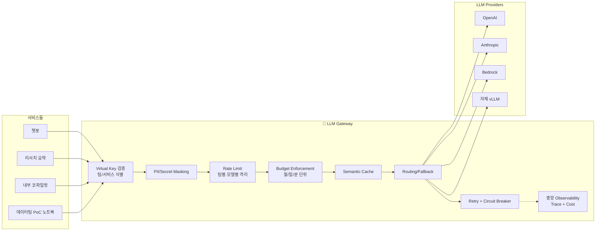

### LLM Gateway 패턴 — "각 서비스가 OpenAI SDK 직접 쓰면 되지"라는 순진함, 그리고 신입이 for-loop에 GPT-4 호출을 넣어 6시간 만에 $47,000이 나가고도 "어느 팀 트래픽인지" 아무도 못 짚은 금요일 저녁

---

#### 0. 사건의 재구성: 2026년 3월, 국내 S 핀테크의 금요일 PM 7:47

- **PM 7:47** — 데이터팀 신입이 "로그 이상 탐지" PoC를 돌림. 로그 라인 하나당 GPT-4o 호출. `for log in logs: openai.chat.completions.create(...)`. 로그 300만 줄.
- **PM 8:12** — 상담 챗봇 팀이 "응답이 느려졌다"고 Slack에 올림. 아무도 상관 안 함. 금요일 저녁이니까.
- **PM 9:30** — OpenAI 조직 전체 TPM(tokens per minute) 한도 소진. 모든 서비스에서 429가 떨어짐. 챗봇도, 리서치 요약도, 내부 코파일럿도.
- **PM 11:04** — 당직자가 "어느 팀이 트래픽을 쏘고 있는지" 추적을 시작. 각 팀이 **자기 서비스에서 각자 발급한 API Key**로 자기 SDK를 쓰는 구조. OpenAI 대시보드는 조직 단위 집계만 보여줌. **"8시대에 트래픽이 치솟았다"까진 알지만, 누구 책임인지 알 수 없음.**
- **AM 1:17** — 각 팀에 "너네 서비스냐"를 일일이 확인. 데이터팀 노트북이 아직 돌고 있음을 발견.
- **AM 2:30** — 셧다운. 청구서 $47,312. 그리고 더 큰 발견: **PoC 코드의 프롬프트에 유저 주민번호 뒤 7자리가 그대로 들어가 OpenAI로 전송됨.** 각 팀이 각자 PII 마스킹을 구현했는데 데이터팀은 안 했기 때문.
- **월요일** — CTO가 "앞으로 LLM 호출은 전부 **한 군데로 모은다**"를 선언. 3주 뒤 Gateway가 올라감.

여기까지 읽고 "그건 걔네가 운영을 못한 거지 Gateway랑 무슨 상관"이라고 생각했다면, 이 글의 독자가 맞다.

---

#### 1. 문제 정의: SDK 직접 호출의 5가지 책임 공백

각 서비스가 OpenAI/Anthropic SDK를 직접 쓸 때 **누구도 책임지지 않는 5가지 공백**이 생긴다. 이게 Gateway의 존재 이유 전부다.

| 책임 영역 | SDK 직접 호출 시 | 결과 |
|---|---|---|
| **1. Attribution (책임 추적)** | 조직 단위 1개 API Key / 또는 팀별 Key지만 중앙 집계 없음 | "누가 썼냐"를 못 가림 |
| **2. Budget Enforcement** | 각 팀이 자기 bill을 자기가 추산 | 월초에 한도 터져도 못 막음 |
| **3. PII/Secret Guard** | 팀마다 마스킹 구현 상이, 신규 팀은 아예 없음 | 민감정보 그대로 외부 전송 |
| **4. Rate Limit Isolation** | 조직 단위 TPM/RPM을 모든 팀이 공유 | 한 팀이 전부 소진 = **cascading failure** |
| **5. Model Portability** | 코드에 `openai.chat.completions.create` 하드코딩 | Claude로 갈아탈 때 N개 서비스 수정 |

**핵심은 2번·4번**이다. 1·3·5는 규율로도 어느 정도 때울 수 있다. 하지만 2·4번은 **런타임에서 강제**해야 한다. 코드 리뷰로 못 막는다. 그래서 "프록시 레이어"가 아키텍처적으로 **반드시** 필요하다.

---

#### 2. 아키텍처: Gateway의 위치



**중요한 설계 원칙 하나**: Gateway는 **OpenAI-호환 API**(`/v1/chat/completions`)를 그대로 노출한다. 그래야 각 팀이 기존 SDK의 `base_url`만 바꿔서 연결할 수 있다. 신규 SDK를 강제하면 아무도 이사 안 온다. 이 지점이 Portkey·LiteLLM·Cloudflare AI Gateway가 공통으로 선택한 설계다.

```python
# Before: 각 서비스에서
import openai
client = openai.OpenAI(api_key=OPENAI_KEY)

# After: base_url만 교체. SDK 코드는 그대로.
client = openai.OpenAI(
    api_key=VIRTUAL_KEY,          # ← 팀별 발급 Virtual Key
    base_url="https://llm-gw.internal/v1"
)
```

---

#### 3. Gateway의 7가지 핵심 책임 — 그리고 각각이 왜 **중앙에서 강제**되어야 하는가

##### ① Virtual Key — 진짜 API Key는 Gateway만 쥔다

- OpenAI/Anthropic Key는 Gateway의 Secret Store에만 존재.
- 각 팀은 **Virtual Key**(gw가 발급)를 받음. `vk_chatbot_prod_a7f3...`
- Virtual Key에 메타데이터가 붙음: `team`, `service`, `env`, `allowed_models`, `monthly_budget_usd`, `rpm_limit`, `tpm_limit`.
- **왜 중앙화?** 신입이 노트북에 Key 하드코딩 → GitHub 푸시 → 크롤러가 10분 안에 긁어감. Virtual Key는 **노출돼도 Gateway에서 즉시 revoke**가 된다. 진짜 Key는 안 터진다.

##### ② Budget Enforcement — "월 $5,000 넘으면 자동 차단"

이게 **1번보다 더 중요한 Gateway의 존재 이유**다.

```yaml
# Virtual Key 설정 예시
- key: vk_chatbot_prod_a7f3
  team: cs-chatbot
  budgets:
    - window: 1m
      limit_usd: 2.00       # 분당 $2 (스파이크 방지)
    - window: 1d
      limit_usd: 300.00     # 일당 $300
    - window: 30d
      limit_usd: 5000.00    # 월 $5,000
  on_exceeded: block        # 또는 degrade (더 싼 모델로 fallback)
```

**0번 사건이 왜 못 터져야 했는가**: 신입이 돌린 PoC Key에 `limit_usd: 10/day`가 걸려 있었다면 PM 8시에 바로 차단되고 Slack 알림이 떴다. $47,000이 아니라 $10에서 끝났다.

**트레이드오프**: Budget을 너무 빡빡하게 걸면 트래픽 급증 시 정상 서비스가 끊긴다. → **soft-limit(알림만)과 hard-limit(차단)을 분리**해서 설정하는 게 관례다.

##### ③ Rate Limit Isolation — Noisy Neighbor 격리

OpenAI 조직 전체 TPM이 1,000,000이라고 치자. 팀이 5개면 각자 "200,000은 내 몫"이라고 생각하지만 **아무도 이걸 강제하지 않는다**. 한 팀이 950,000을 써버리면 나머지 4팀이 429를 맞는다.

Gateway는 Virtual Key별로 TPM/RPM을 **쿼터 할당**한다. Redis 기반 sliding window counter가 산업 표준이다.

```
Team A: TPM 300k  ─┐
Team B: TPM 200k  ─┤
Team C: TPM 200k  ─┼─→ Gateway가 429를 반환 (업스트림 도달 전)
Team D: TPM 200k  ─┤
Team E: TPM 100k  ─┘    총합 1M, 실제 OpenAI 한도 내로 보호
```

##### ④ PII/Secret Masking — 요청에서, 응답에서, 로그에서

- **요청 측**: 주민번호, 전화번호, 카드번호, 이메일을 정규식 + NER로 토큰화 (`[REDACTED_SSN_1]`).
- **응답 측**: LLM이 환각으로 다른 유저 정보를 뱉어내는 경우 차단.
- **로그 측**: 중앙 로그에도 마스킹된 상태로만 저장. (안 그러면 Gateway가 "모든 PII를 쌓아둔 보물창고"가 된다. 보안 최악.)

**실수하는 지점**: 마스킹을 "요청 직전"에만 하고 **cache key 계산은 raw text로 하는 경우**. → Semantic Cache가 PII를 그대로 저장한다. 반드시 마스킹된 텍스트를 cache key로 써야 한다.

##### ⑤ Model Routing & Fallback — 이 글의 주제가 아님, 하지만 Gateway 안에 있다

이미 다룬 주제(Cascade/Semantic/Policy/Load-based Routing)의 **실행 위치가 바로 Gateway**다. 각 서비스에서 Routing 로직을 N번 구현하는 건 안티패턴. Gateway의 Route 모듈이 Virtual Key의 policy를 보고 결정한다.

##### ⑥ Observability — Trace ID가 모든 LLM 호출에 꽂힌다

```
X-Request-ID: req_8f2a...
X-Trace-ID: trc_c91d...      ← 상류 서비스에서 전파됨
X-Virtual-Key: vk_chatbot...
X-Team: cs-chatbot
X-Model-Requested: claude-sonnet-4-6
X-Model-Actually-Used: claude-haiku-4-5    ← fallback 발생
X-Latency-ms: 1247
X-Prompt-Tokens: 892
X-Completion-Tokens: 341
X-Cost-USD: 0.00412
X-Cache-Hit: false
```

이게 전부 중앙 로그로 간다. **"어느 팀이 어느 모델에 얼마 썼냐"를 1분 안에 쿼리할 수 있어야 한다**. 0번 사건의 핵심 재발 방지책이다.

##### ⑦ Retry & Circuit Breaker — 상류 보호

Provider가 흔들릴 때 각 서비스가 각자 재시도를 걸면 **thundering herd**가 된다. Gateway가 중앙에서:
- Exponential backoff with jitter
- Provider-level circuit breaker (OpenAI가 50% 실패 → 30초간 전부 Anthropic으로)
- Timeout 통일 (각 팀이 60s, 120s, 300s 제각각 걸던 걸 Gateway가 통일)

---

#### 4. 트레이드오프 매트릭스

| 축 | SDK 직접 호출 | LLM Gateway |
|---|---|---|
| **p50 Latency** | ~800ms | ~820ms (+20ms) |
| **p99 Latency** | 들쭉날쭉 (팀마다 retry 정책) | 균질 (Gateway가 통제) |
| **운영 복잡도** | 낮음 (처음에만) | 중간 (Gateway 자체를 운영해야 함) |
| **Cost 가시성** | 조직 단위만 | 팀/서비스/엔드포인트 단위 |
| **보안** | 각자 책임 | 중앙 강제 |
| **Model 교체 비용** | O(N) 서비스 수정 | O(1) Gateway 설정 변경 |
| **단일 장애점(SPOF)** | 없음 (각자 독립) | **있음** — Gateway가 터지면 전사 LLM 중단 |

**가장 아픈 트레이드오프는 마지막 줄**이다. Gateway가 SPOF가 된다. 그래서:
- Multi-region active-active 배포
- Gateway 자체는 stateless로 설계, state는 Redis/Postgres로 외부화
- **Gateway bypass 모드**(응급 상황에 특정 Key가 직접 Provider로 가도록) 설계
- Gateway는 "**최대한 단순한**" 로직만. 복잡한 Agent 오케스트레이션은 Gateway 밖에서.

**Latency**: Gateway는 CPU-bound가 아니라 **네트워크 홉 하나**가 추가되는 비용이 전부다. 같은 AZ에 두면 보통 +10~30ms. LLM 응답 자체가 수백~수천 ms라 체감되지 않는다.

---

#### 5. 실제 사례

##### 사례 1: Shopify (2024) — "Platform-first" 선택

Shopify는 LLM Platform 팀을 따로 만들고 **모든 LLM 트래픽을 자체 Gateway로 통일**했다. 내부 명칭 "LLM Gateway" (공개 블로그 기준). 핵심 결정:
- 각 팀이 Virtual Key로 사용, 월간 Budget 자동 알림/차단
- PII 마스킹을 Gateway에서 단일 구현
- "모델 교체는 Platform 팀 결정, 서비스 팀은 영향받지 않는다"는 계약을 세움
- 실제로 2024년 중반에 **GPT-4 → GPT-4o 전환을 서비스 팀 코드 변경 0줄로 완료**

##### 사례 2: Netflix (2024) — "Metaflow 안에 LLM Gateway 녹임"

Netflix는 ML 플랫폼인 Metaflow에 LLM Gateway 기능을 통합. 핵심 통찰:
- "LLM도 결국 ML 모델"이라는 전제로 **기존 ML 거버넌스(비용, 쿼터, 승인)를 그대로 재활용**
- Virtual Key = Metaflow namespace
- 신규 플랫폼 안 만들고 기존 거버넌스 재활용 → 조직적 저항 최소화

##### 사례 3: Portkey / LiteLLM / Cloudflare AI Gateway — 상용 솔루션의 3자 비교

| 솔루션 | 포지션 | 언제 적합한가 |
|---|---|---|
| **LiteLLM Proxy** | OSS, Python 기반, 100+ Provider 통합 | 빠르게 시작, self-host, Python 생태계 중심 |
| **Portkey** | SaaS + OSS, 관측성 강점 | Observability가 1순위 요구사항, 운영 리소스 없음 |
| **Cloudflare AI Gateway** | 엣지 기반 캐싱·Rate Limit | 글로벌 분산, Cloudflare 이미 쓰는 조직 |

**현장 조언**: PoC는 LiteLLM으로 시작하고, 트래픽 월 100억 토큰 넘기 전엔 자체 구현 하지 마라. LiteLLM이 Virtual Key, Budget, Routing, Fallback, Observability 전부 지원한다.

##### 사례 4 (실패): 국내 D 커머스 (2025) — "Gateway를 Agent Orchestrator로 키운 재앙"

플랫폼 팀이 Gateway를 만들고 자신감이 붙자 **"Gateway에서 Agent Planning까지 하자"**로 범위 확장. 결과:
- Gateway 코드베이스가 15,000줄 → 87,000줄로 비대화
- Gateway 배포가 **하루 1회 → 주 1회**로 떨어짐
- 어느 날 Planning 로직 버그가 Gateway 전체를 OOM으로 내림 → 전사 LLM 호출 42분 중단
- 포스트모템 결론: **"Gateway는 Governance Layer다. 비즈니스 로직을 넣지 마라."**

이 사례의 교훈이 Gateway 설계의 **첫 번째 계명**이다: **Gateway는 얇게, 멍청하게.**

##### 사례 5 (실패): 국내 K 보험 (2026) — "서비스별 SDK 직접 호출 유지" 선택

"Gateway는 오버엔지니어링"이라며 각 팀 SDK 직접 사용 유지. 1년 뒤:
- 월 LLM 비용 $62,000 중 **$18,000이 "소속 불명"**
- 금감원 감사에서 "민감정보 외부 전송 추적 체계 없음" 지적 → 과태료
- 모델 교체 요구 발생 시 7개 팀에 PR 요청 → 2개월 소요
- 2026년 Q3에 결국 Gateway 도입 시작. **"1년 전에 할걸"이 포스트모템 결론**

---

#### 6. 언제 쓰고 언제 쓰면 안 되는가

##### ✅ 반드시 도입해야 하는 경우

- **LLM을 호출하는 서비스가 3개 이상**이거나 **곧 3개가 될 로드맵**
- **월 LLM 비용이 $5,000을 넘기 시작**할 때 (팀별 Attribution이 필수가 되는 임계)
- **규제 산업**(금융, 의료, 공공) — PII 중앙 통제가 아니면 감사 통과 불가
- **멀티 Provider**를 쓰거나 **쓸 예정**이면 (OpenAI + Anthropic + Bedrock)
- **온콜 당직자가 "어느 팀이 트래픽 쏘는지 1분 안에 못 찾는다"**는 조건에 해당

##### ⚠️ 신중해야 하는 경우

- **PoC 1~2개짜리 조직** → 오버엔지니어링. SDK 직접 호출 + 일단 월별 비용 알림만.
- **Latency에 극도로 민감한 서비스**(음성 대화형 Agent, 실시간 스트리밍) → Gateway 홉이 쌓이면 체감됨. **Edge에 Gateway를 배치**하거나 특정 서비스는 bypass 허용.
- **단일 Provider만 쓰고 영원히 바꿀 생각 없음** → Model Portability 가치가 0. 그래도 1·2·4번 때문에 결국은 필요해진다.

##### ❌ 쓰면 안 되는 경우

- **Gateway 자체를 운영할 엔지니어가 0명** — Gateway가 터지면 전사 LLM이 멈춘다. 운영 역량 없이 도입하면 사례 4처럼 된다. 이땐 Portkey SaaS에 외주를 주는 게 맞다.
- **"스마트한 Gateway"를 만들고 싶은 유혹** — Agent Orchestration, 복잡한 Prompt Engineering, Business Logic을 Gateway에 넣기 시작하면 **단일 장애점이 된다**. Gateway는 Governance Layer다. 거기까지만.

---

#### 7. 안티패턴

##### ❌ 안티패턴 1. "Gateway에서 프롬프트도 관리하자"

프롬프트 템플릿을 Gateway의 DB에 저장하고 서비스는 `template_id`만 넘기는 설계. 처음엔 깔끔해 보이지만:
- 프롬프트 수정이 **서비스 배포와 분리**되면서 변경 추적이 깨짐
- 버저닝이 꼬임 (서비스 코드 v1.3이 어느 프롬프트 버전과 매칭되는지 불명)
- **프롬프트는 서비스 코드와 함께 Git에 산다**. Gateway는 전달만.

##### ❌ 안티패턴 2. "모든 서비스가 Gateway를 거친다"는 극단

**Embedding API**, **TTS**, **STT** 같이 단순 호출만 하는 서비스까지 Gateway로 밀어넣으면 Latency 비용만 발생. **"Governance가 필요한 호출만"** Gateway로.

##### ❌ 안티패턴 3. Virtual Key를 서비스가 아니라 "사람"에게 발급

개발자별로 Key를 발급하면 **퇴사자 Key 수거**가 지옥이 된다. Key는 **서비스/환경 단위**로. 사람은 IAM에서 "그 서비스 Key를 조회할 권한"을 받는다.

##### ❌ 안티패턴 4. Cache Key에 PII 포함

(위에서 짧게 언급했지만 다시) Semantic Cache를 Gateway에 넣을 때 **마스킹 전 텍스트로 cache key를 만들면** cache 저장소가 PII 창고가 된다. 반드시 마스킹된 텍스트 → 임베딩 → cache key.

##### ❌ 안티패턴 5. "응급 bypass 모드"가 없음

Gateway 자체 장애 시 전사 LLM이 멈춘다. 사전에 **"Virtual Key에 `allow_direct_bypass: true`를 설정하면 특정 서비스는 Provider로 직결"** 옵션을 심어두고, **분기별 1회 DR 훈련**으로 bypass 발동 리허설. 안 그러면 장애 당일 당직자가 bypass 코드를 처음 짠다.

##### ❌ 안티패턴 6. Gateway의 로그를 "그냥 한 테이블"에 저장

하루 1,000만 호출 × 평균 요청/응답 2KB = **20GB/일**. 1년이면 7TB. Postgres 한 테이블에 쌓으면 쿼리가 안 된다. **별도의 OLAP(ClickHouse, BigQuery)** 또는 전용 LLM Observability 플랫폼(LangFuse self-hosted)에 분리.

---

#### 8. 마무리 — Gateway는 "LLM 시대의 API Gateway"다

2015년에 마이크로서비스가 유행하면서 **API Gateway**가 당연해졌다. 이유는 똑같다: 인증, Rate Limit, 관측성, 거버넌스를 **중앙에서 강제**해야 하기 때문. 각 서비스에 분산시키면 반드시 터진다.

LLM Gateway는 그걸 LLM 도메인에 적용한 것뿐이다. 다른 점이 하나 있다면: **비용의 단위가 수십 배 크다**. 잘못된 for-loop 하나가 $47,000짜리 청구서를 만든다. 그래서 더 빨리, 더 강하게 도입해야 한다.

0번 사건의 S 핀테크는 Gateway 도입 후 6개월간:
- 월 LLM 비용 $89k → $34k (semantic cache + routing 효과)
- 신규 모델 테스트 리드타임: 2주 → 2시간
- PII 사고: 0건
- "어느 팀이 트래픽을 쏘고 있는지" 추적 시간: 밤새 → **15초**

> 💡 **왜 중요한가**: LLM Gateway는 "선택적 최적화"가 아니라 **Attribution·Budget·PII를 런타임에서 강제하는 유일한 지점**이며, 이게 없으면 코드 리뷰·규율·"다음부턴 조심하자"로는 절대 못 막는 사고가 반드시 터진다.
