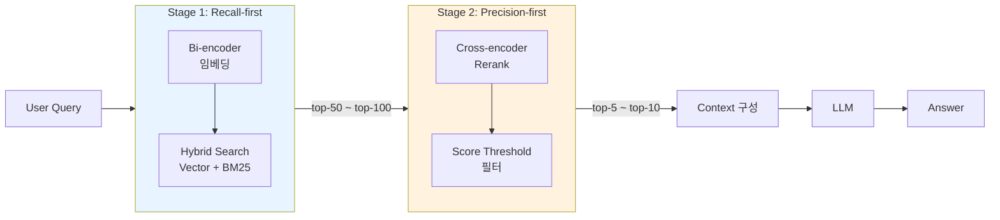

### Reranking (Cross-Encoder 2-stage Retrieval) — "Vector 검색 top-10이면 LLM이 알아서 좋은 걸 고르겠지"라는 순진함, 그리고 2015년 폐지된 보험 특약이 top-7에 묻혀 챗봇이 "현재도 유효한 보장"으로 답변한 뒤 보상 심사팀에 이의신청 1,247건이 쌓인 수요일 새벽

---

#### 사건의 재구성

국내 중견 손해보험사 L사의 설계사용 사내 챗봇. 설계사가 고객 상담 중 실손보험 약관을 빠르게 조회하는 용도로 2026년 1월 런칭했다. 아키텍처는 "교과서적"이었다.

```
약관 PDF 2,340건 → chunking (512 tokens) → OpenAI text-embedding-3-large
→ Pinecone (pod 2개) → top-10 retrieval → GPT-4o → 답변
```

2026년 2월 11일 수요일 새벽, 대구 지점의 베테랑 설계사 K씨가 60대 고객 앞에서 챗봇에 물었다.

> "실손보험 통원치료 보장한도 알려줘"

챗봇이 답했다.

> "통원 1회당 25만원까지 보장되며, 연간 180회까지 청구 가능합니다."

K씨는 그대로 고객에게 설명했고, 고객은 그 자리에서 입원 대신 통원을 선택했다. 3주 뒤 보상 심사 단계에서 거절이 떨어졌다. **해당 조항은 2015년 4세대 실손 개정 때 폐지된 2세대 약관**이었다.

Pinecone 로그를 뽑아보니:

| Rank | chunk 제목 | 코사인 유사도 |
|---|---|---|
| 1 | 2세대 통원치료 특약 (2015 폐지) | **0.8913** |
| 2 | 3세대 통원치료 보장 (2017~2020) | 0.8891 |
| 3 | 2세대 외래진료 추가특약 (폐지) | 0.8847 |
| 4 | 4세대 통원 급여 보장 (현행) | 0.8702 |
| 5 | 4세대 통원 비급여 보장 (현행) | 0.8689 |
| 6 | 통원치료 FAQ 요약 | 0.8651 |
| **7** | **2024년 개정 통원 한도 공지** | **0.8622** |

LLM context에 들어간 건 top-5. **정답(top-7)은 Pinecone이 가져왔지만 LLM 눈앞까지 못 왔다.** 유사도 상위를 "폐지" 조항이 전부 차지한 이유는 간단하다. **Bi-encoder는 "폐지된"과 "현재 유효한"의 뉘앙스를 구분하지 못한다.** 둘 다 "통원치료 보장한도"를 설명하는 동일 토픽이기 때문이다.

CS 민원 1,247건, 금감원 신고 3건, 재발방지 대책 보고서. 사후 회고에서 아키텍트가 한 줄 썼다.

> "우리는 Retrieval을 끝났다고 믿었다. 사실 Retrieval은 두 번 해야 했다."

---

#### 왜 발생하는가 — Bi-encoder의 구조적 한계

Lv5에서 다룬 Vector 검색의 심장인 임베딩 모델은 전부 **Bi-encoder** 구조다.

```
Query  → [Encoder] → vector_q  ┐
                                 ├─→ cosine(q, d)
Doc    → [Encoder] → vector_d  ┘
```

Query와 Document가 **독립적으로** 벡터화된다. 둘은 벡터 공간에서 거리로만 만난다. 이게 장점이자 치명적 한계다.

**장점**: Document 벡터는 사전에 다 만들어 Pinecone에 올려둘 수 있다. Query가 올 때마다 Query만 벡터화하면 되므로 수백만 문서를 수십 ms에 검색 가능.

**한계**: Query–Document 간의 **세밀한 토큰 상호작용**(cross-attention)이 없다. "폐지된 2015년 특약"과 "현행 2024년 특약"은 임베딩 공간에서 거의 같은 좌표에 모인다. 토픽이 같기 때문이다.

이걸 해결하는 모델이 **Cross-encoder**다.

```
[Query, Doc] → [Encoder] → relevance_score (0.0 ~ 1.0)
```

Query와 Document를 **한 쌍으로 묶어** Transformer에 통째로 넣는다. Self-attention이 Query 토큰과 Document 토큰 사이를 전부 훑는다. "폐지된"이라는 단어와 "보장한도 알려줘"라는 Query의 의도 간의 **의미 충돌**을 포착할 수 있다.

| 구분 | Bi-encoder | Cross-encoder |
|---|---|---|
| 입력 | Query, Doc 각각 | (Query, Doc) 쌍 |
| 출력 | 벡터 | 스칼라 점수 |
| 사전 계산 | 가능 (Doc 벡터 저장) | 불가능 (매 쿼리마다 재계산) |
| 속도 | ~5ms / query | ~50-200ms per pair |
| 처리 가능 규모 | 수천만 문서 | 수십~수백 문서 |
| 품질 (NDCG@10) | 0.55~0.65 | 0.75~0.85 |
| 대표 모델 | text-embedding-3-large, BGE-M3 | Cohere Rerank 3, BGE-reranker-v2-m3 |

**어느 하나로는 안 된다**는 게 결론. Bi-encoder 혼자: 재현율(recall)은 높지만 정밀도(precision)가 낮다. Cross-encoder 혼자: 2,340개 chunk × 200ms = 468초. 사용 불가.

그래서 산업 표준은 **2-stage Retrieval**.

---

#### 2-stage Retrieval 아키텍처



핵심 역할 분담은 **한 문장**으로 요약된다.

> **Stage 1은 "정답이 포함된 넓은 그물"을 던지는 책임, Stage 2는 "그물 안에서 진짜만 골라내는" 책임.**

L사의 사고가 이걸 확인시켜준다. Pinecone이 top-10에 정답을 넣어주긴 했다(Stage 1 성공). 그러나 Stage 2가 없었기 때문에 LLM 눈앞에 못 왔다.

**Stage 1 설계 포인트**
- top-K를 넉넉하게 잡는다. 보통 **50~100**. 작게 자르면 Stage 2가 아무리 똑똑해도 못 복원한다.
- Hybrid Search (Vector + BM25) 결과를 그대로 feed. (Lv5에서 다룬 RRF로 융합한 랭킹.)
- 비용·속도가 저렴하므로 "넓게"를 두려워할 필요 없다.

**Stage 2 설계 포인트**
- Cross-encoder는 Query–Doc 쌍 단위로 호출. top-50이면 50번의 inference.
- 결과를 재정렬 + **score threshold**로 하한선 설정 (예: < 0.3이면 drop).
- 최종 top-K는 보통 **3~10**. LLM context window와 비용의 함수.

---

#### Implementation 선택지 — 어떤 Reranker를 쓸 것인가

2026년 10월 현재, 실무에서 쓰이는 선택지는 네 갈래다.

```
┌─────────────────────────────────────────────────────────────┐
│  Managed API                   │  Self-hosted               │
├─────────────────────────────────┼────────────────────────────┤
│  • Cohere Rerank 3             │  • BGE-reranker-v2-m3      │
│  • Jina Reranker v2            │  • BGE-reranker-v2-gemma   │
│  • Voyage Rerank 2             │  • Jina Reranker (OSS)     │
│  • Mixedbread Rerank           │  • Mixedbread (OSS)        │
├─────────────────────────────────┼────────────────────────────┤
│  장점: 운영 0, 품질 안정        │  장점: 비용 통제, 데이터 보안 │
│  단점: 쿼리당 $0.001~0.002     │  단점: GPU 운영, 튜닝 부담  │
└─────────────────────────────────┴────────────────────────────┘
```

| 선택 기준 | 추천 |
|---|---|
| MVP, 하루 1만 쿼리 이하 | **Cohere Rerank 3 API** |
| 하루 10만 쿼리 이상 | **BGE-reranker-v2-m3** self-host (A10 GPU 2대) |
| 데이터 반출 금지 (금융/의료/법무) | **BGE-reranker self-host** 필수 |
| 다국어 (한국어 포함) | **BGE-reranker-v2-m3** 또는 **Cohere Rerank 3** |
| 1초 이내 응답 필수 | **Jina Reranker v2** (경량, ~30ms) |

**실무 팁 하나**: 처음부터 self-host 가지 말 것. Cohere/Jina API로 품질이 정말 올라가는지 **1~2주 A/B 테스트** 먼저. 올라가면 그때 self-host 전환 ROI 계산. 안 올라가면 reranker 문제가 아니라 **chunking 또는 임베딩 모델** 문제다.

---

#### 실제 사례

**사례 1: Perplexity (2024)** — 2-stage의 교과서

Perplexity는 공개 인터뷰에서 자신들의 검색 파이프라인을 이렇게 설명했다.

```
Query → Web Search (top-50 URL)
      → Content Extraction & Chunking
      → Embedding Search (top-30 chunk)
      → Cross-encoder Rerank (top-8)
      → LLM
```

핵심: **Web Search의 BM25 결과도, Embedding Search 결과도 전부 Rerank 단계에서 통합**한다. "검색 소스가 다양할수록 Rerank 중요성이 커진다"는 그들의 원칙. Hybrid Search(Lv5 이전 주제)의 결과물을 그대로 Reranker에 밀어넣는 패턴.

**사례 2: Notion AI (2024)** — Cohere Rerank 도입 전후

Notion은 자사 블로그에서 2024년 Q2 Cohere Rerank 도입 사례를 공개했다. 지표가 압도적이었다.

| 지표 | Before (Bi-encoder only) | After (+ Cohere Rerank 3) |
|---|---|---|
| Answer Quality (사용자 👍/👎) | 71% | **87%** |
| Top-1 정답률 (내부 eval) | 54% | **73%** |
| Latency (p95) | 420ms | 680ms |
| 추가 비용 | - | +18% |

Latency 260ms 증가와 비용 18% 증가를 **품질 16%p 상승**과 맞바꾼 결정. Notion은 "retention과 직결되므로 기꺼이 지불한다"고 평가.

**사례 3: Shopify Semantic Search (2024)** — BGE-reranker self-host

Shopify는 하루 수십억 건의 상품 검색을 처리한다. API 과금은 비현실적. 그래서 **BGE-reranker-v2-m3를 자체 호스팅**했다. GPU 클러스터(A100 수백 대)에 대규모로 배포하고, int8 양자화로 latency를 50ms 수준으로 끌어내렸다. 품질 손실은 1% 미만. 2024년 기준 API 대비 연간 수천만 달러 절감.

**사례 4: 국내 K 법무법인 (2026 상반기)** — 조항 번호 정합성 복구

Lv5에서 다룬 Hybrid Search 사례(민법 조항 번호 미스매치)의 K 법무법인이 다음 분기에 추가한 게 Rerank. BM25 + Vector 상위 50건을 BGE-reranker에 통과시켰더니:

- 조항 번호 정확도: 87% → **96%**
- "제750조"를 물으면 top-1에 반드시 제750조 조문이 올라옴 (BM25 보정에 Rerank 재확인)
- 변호사 서면 작성 시간 평균 23분 단축

**사례 5 (실패): 국내 D 커머스 (2025)** — "Cohere API를 for-loop에 넣다"

의류 커머스 D사. 상품 검색에 Cohere Rerank 3 API를 도입했다. 품질은 좋았다. CTR이 11% 상승. 문제는 **배치 추천 파이프라인**이었다. 야간 배치에서 사용자 100만 명 × 쿼리 평균 3개 × top-30 rerank = **9천만 번의 Cohere API 호출**. 월 청구서가 $18,400. CFO가 "ROI 설명 안 되면 바로 끊어라"라고 통보. 아키텍트가 결정한 재설계는 세 가지였다.

1. 실시간 검색은 Cohere API 유지.
2. 배치 추천은 **BGE-reranker-v2-m3를 A10 GPU 2대에 self-host**. 월 $380.
3. 두 경로 결과물을 **동일한 Rerank score 스키마**로 저장해 다운스트림 분석 코드는 수정 없이 재사용.

사후 회고의 교훈: *"Rerank는 쓸 데를 가려서 써야 한다. 모든 Retrieval 단계에 끼워 넣으면 비용이 Primary LLM보다 커진다."*

**사례 6 (실패): 국내 M 핀테크 (2026 초)** — top-3로 과도하게 잘라 Context Starvation

Rerank를 "엄격한 선별"로 오해한 사례. top-100 → top-3로 자르는 공격적 설정. 품질 평가에서 top-1 정답률은 올라갔지만(74% → 81%) **답변 완성도**는 떨어졌다(사용자 평가 4.2 → 3.6).

원인 분석:
- 금융 상품 설명처럼 **여러 chunk에 흩어진 정보**가 필요한 질문은 top-3로 부족.
- Rerank score가 높아도 **상호 보완적인 정보**가 아니면 LLM이 답변을 완성 못함.

재설계: **top-3 고정 → top-10 + score threshold 0.4** 하이브리드. Rerank는 정렬·필터이지 **context를 자르는 도구가 아니다**.

---

#### 함정과 안티패턴

**함정 1. top-50을 top-3으로 자른다**
Rerank의 역할은 "순서 보정"이지 "context 축소"가 아니다. LLM이 complex query를 답하려면 보완적 정보가 필요하다. **top-5~10 + score threshold** 조합이 안전.

**함정 2. Query마다 매번 Rerank 호출**
Semantic Cache (Lv5에서 다룸)를 Rerank 결과 캐시로도 쓸 수 있다. 유사 Query는 Rerank 결과를 재사용. 비용 20~40% 절감 가능.

**함정 3. Cross-encoder에 긴 chunk를 넣는다**
Cross-encoder는 보통 입력 길이 512 token 제한. chunk가 1,024 token이면 뒷부분이 잘려 Rerank score가 왜곡된다. Rerank 전에 **passage-level로 다시 쪼개는** 전처리 필수.

**함정 4. Rerank score를 "확률"로 믿는다**
BGE-reranker는 0~1 범위지만 Cohere는 0~1 로짓, Jina는 또 다르다. 모델마다 **스코어 분포가 전혀 다름**. threshold를 모델 바꿀 때 동일하게 쓰면 안 된다. 모델 교체 시 **validation set으로 threshold 재튜닝** 필수.

**함정 5. Latency 예산 계산을 빼먹는다**
Reranker top-50 호출 = 50 × 50ms = 2,500ms (단일 모델). 배치 처리나 int8 양자화 없이는 실시간 응답에 부적합. Latency 예산을 **(Retrieval + Rerank + LLM) < SLA**로 역산해 설계.

**함정 6. Rerank만 바꾸고 평가를 안 돌린다**
Lv5 LLM Eval에서 다룬 **Golden Dataset**으로 Rerank 전/후 NDCG@5, Hit@3를 측정. 측정 없이 "품질 좋아진 것 같다"는 금지. Perplexity, Notion 다 숫자로 결정했다.

---

#### 트레이드오프 매트릭스

| 축 | Rerank 미사용 | Rerank 사용 (API) | Rerank 사용 (self-host) |
|---|---|---|---|
| p95 Latency | +0ms | +200~400ms | +50~100ms |
| 비용 (쿼리당) | $0 | $0.001~0.002 | $0 (고정 GPU 비용) |
| 운영 복잡도 | 낮음 | 낮음 | **중~상 (GPU, 모니터링)** |
| 품질 (NDCG@5) | baseline | **+15~25%** | +15~25% |
| 데이터 반출 | 없음 | **있음** | 없음 |
| 월 1만 쿼리 손익분기 | - | 유리 | 불리 (GPU 비용 과잉) |
| 월 100만 쿼리 손익분기 | - | 불리 | **유리** |

---

#### 언제 쓰고, 언제 쓰면 안 되는가

**✅ 반드시 Rerank를 써야 하는 경우**
- 법률·의료·금융·보험처럼 **정답과 유사답 사이 결과가 극명히 갈리는** 도메인. L사 보험 사례가 전형.
- 문서가 매우 길고 **같은 토픽의 다른 버전**(현행/폐지, v1/v2, 지역별)이 공존하는 경우.
- Context window 비용이 큰 모델(GPT-4o, Claude Opus)을 쓰고, context에 들어가는 chunk 수를 줄여야 하는 경우.
- Hybrid Search를 이미 쓰고 있고, Vector/BM25 두 랭킹의 **융합 결과**를 한 번 더 보정하고 싶은 경우.

**⚠️ 신중하게 도입해야 하는 경우**
- 하루 쿼리 수백 건 이하. 품질 향상이 비용·latency 증가를 정당화 못할 수 있다.
- Real-time Voice/Chat처럼 **총 응답 시간 < 500ms** SLA. Rerank 넣으면 터진다.
- Chunking·Embedding부터 문제인데 Rerank로 "덮으려" 하는 경우. 근본 원인부터 고쳐야 한다.

**❌ 쓰지 말아야 하는 경우**
- 문서가 수백 건 수준이라 Retrieval 자체가 top-5 안에 정답이 거의 들어오는 경우. Rerank는 **대규모 corpus에서 효과가 큰** 기술.
- Retrieval 품질 평가를 안 하는 조직. 숫자가 없으면 Rerank가 좋아진 건지 나빠진 건지 영원히 모른다.
- 비용 민감 배치 파이프라인(사용자 세그먼트 전체 재추천 등). 반드시 **self-host + 배치 처리**로 설계해야 하고, 그 설계 역량이 없으면 들어가지 말 것.

---

> 💡 **왜 중요한가**: Retrieval은 한 번이 아니라 두 번 해야 한다 — Bi-encoder로 "넓게" 걸러낸 뒤 Cross-encoder로 "정확히" 재정렬해야 LLM의 Context에 "폐지된 조항"이 아니라 "현행 조항"이 올라간다.
