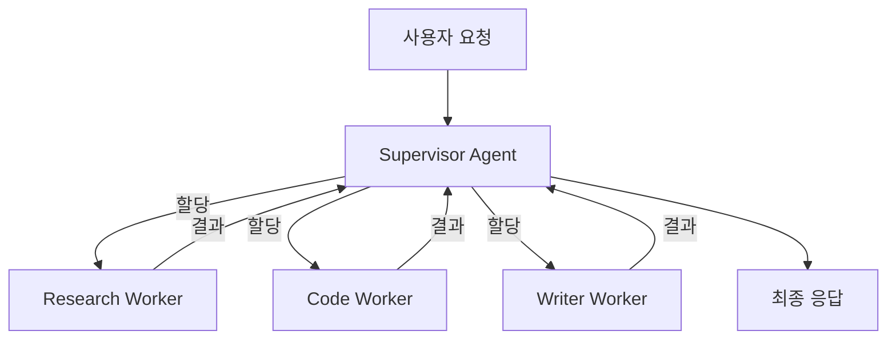
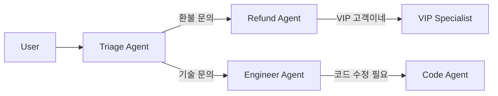

### Multi-Agent Orchestration — "에이전트 10개 띄우면 알아서 협업할 거라는 순진함, 그리고 Planner → Researcher → Writer가 서로 상대 결과물을 '불충분하다'며 되돌려 보내는 핑퐁에 빠져 하나의 보고서 생성에 토큰 $340, 응답 지연 7분 42초가 찍힌 채 데모 당일 CEO 앞에서 멈춰버린 수요일 오후

---

#### 0. 참사 복기 — "에이전트가 많을수록 똑똑하다"는 환상

2026년 2월 중순, 국내 S 전자 B2B 세일즈팀에 "AI 영업 리포트 자동화" 데모가 걸렸다. PoC 팀이 LangGraph로 설계한 구조는 이랬다.

```
Planner Agent → 리포트 목차를 짠다
  ├─ Researcher Agent → 사내 CRM/DW에서 수치 뽑는다
  ├─ Analyst Agent → 숫자를 해석한다
  └─ Writer Agent → 최종 리포트를 쓴다
  → QA Agent → "품질 검증"
```

로컬 테스트에선 2분 안에 리포트가 나왔다. 데모 당일, CEO가 "경쟁사 LG전자 B2B 매출 추세 포함해서 다시 뽑아달라"고 했다. 그 순간 시스템이 멈췄다.

- **Planner**가 "경쟁사 데이터는 외부 소스가 필요하다"며 목차를 수정 → **Researcher**에게 재지시
- **Researcher**가 외부 데이터를 가져왔지만 **Analyst**가 "출처 신뢰도 부족"으로 반려
- **Analyst**가 Researcher에게 되돌려 보냄 → Researcher가 다시 Planner에게 "범위를 좁혀달라"고 요청
- **QA Agent**가 중간 산출물을 보고 "일관성 부족"으로 전체 롤백 지시

**7분 42초, 토큰 비용 $340**. CEO는 "이거 그냥 ChatGPT에 붙여넣는 게 빠르겠다"고 말하고 자리를 떴다. PoC는 다음 주 폐기됐다.

문제의 본질은 "에이전트를 많이 두면 분업으로 똑똑해진다"는 가정이었다. 실제로는 **에이전트 수가 늘수록 조정 비용(coordination cost)이 지수적으로 증가**한다. 이걸 체계적으로 해결하는 게 Multi-Agent Orchestration 패턴이다.

---

#### 1. 왜 Single Agent로는 안 되는가 (Single Agent의 한계)

Lv5 초반에 ReAct를 배웠다. 하나의 Agent가 Tool을 반복 호출하며 문제를 푸는 패턴. 이게 왜 어떤 지점에서 깨지는가?

| 한계 | 증상 |
|---|---|
| **Context 폭발** | Tool call 10번 넘어가면 이전 결과가 context에 쌓여 20K 토큰 돌파 → latency 증가, 정확도 하락 |
| **Role Confusion** | 한 Agent가 "검색"과 "분석"과 "요약"을 다 하면 프롬프트가 뒤엉켜 지시가 섞인다 |
| **Parallelism 불가** | 독립적인 10개 질의를 순차 처리 → 10배 느림 |
| **전문성 부재** | 같은 모델이 모든 Tool을 다루면 각 영역 최적화 불가 (예: 코드 리뷰 vs 금융 수치) |

→ **"작업을 쪼개서 전문화된 Agent에게 맡기자"**가 Multi-Agent의 출발점이다. 문제는 **"어떻게 조정할 것인가"**다.

---

#### 2. 4가지 Orchestration 패턴

##### ① Supervisor 패턴 (중앙 집중형)

중앙 Supervisor가 Worker Agent들에게 작업을 할당하고 결과를 수집한다. **가장 기본, 가장 안전**.



- **장점**: 흐름 추적 쉬움, 디버깅 가능, Worker 간 통신 없음 → 핑퐁 루프 원천 차단
- **단점**: Supervisor가 병목이자 SPOF. Worker 수가 늘면 Supervisor 프롬프트가 비대해짐
- **실제 사례**: **Anthropic Research 시스템 (2025)** — 메인 Agent가 서브 Agent를 병렬 spawn해 각자 다른 각도로 조사한 뒤 메인이 통합. "Supervisor-Worker가 90%의 agentic task에 가장 신뢰성 있는 구조"라고 공식 블로그에서 밝힘.

##### ② Hierarchical 패턴 (계층형)

Supervisor가 또 다른 Supervisor를 둔다. 조직도와 똑같다.

```
         CEO Agent
        /         \
    CTO Agent    CFO Agent
    /     \       /    \
 Dev1    Dev2  Acc1   Acc2
```

- **장점**: 복잡한 도메인을 모듈화 (예: 전사 리서치 플랫폼)
- **단점**: 레벨당 context 전달 손실(whisper down the lane 효과), **지연시간 N배**
- **실제 사례**: **Cognition Devin (2024)** — Planner → Executor → Verifier 3단계 계층. 긴 코딩 태스크엔 효과적이나 간단한 질문엔 과잉

##### ③ Swarm / Handoff 패턴 (분산형)

중앙 조정자 없이, Agent가 "이건 네 담당이야"라며 다른 Agent에게 **대화 자체를 넘긴다**. OpenAI가 2024년 공개한 Swarm이 대표.



- **장점**: context가 다음 Agent로 넘어갈 때 **깔끔하게 전환** — 각 Agent는 자기 역할만 알면 됨
- **단점**: 전체 흐름 통제 어려움. "지금 누가 응답 중인지" 추적용 session state가 필수
- **실제 사례**: **Klarna 고객지원 봇 (2024)** — 결제/배송/환불/기술지원 Agent 간 handoff로 월 230만 건 상담 처리, 상담사 700명 분량 커버. 핵심은 "handoff 조건을 Agent 프롬프트에 명시"하는 것

##### ④ Debate / Critique 패턴 (품질 중시형)

Generator Agent가 답을 만들고, Critic Agent가 공격하고, Judge Agent가 최종 결정. 또는 N명의 Agent가 토론 후 투표.

```
Agent A: "답은 X입니다"
Agent B: "X는 틀렸다. 왜냐하면..."
Agent A: "B의 반박은 Y 지점에서 잘못됐다..."
Judge: "A의 재반박이 더 설득력 있음 → 최종 답 X"
```

- **장점**: hallucination 감소, 중요 결정 품질 향상 (의료/법률)
- **단점**: **토큰 3~5배**, latency 폭증 → 실시간 UX 불가
- **실제 사례**: **MIT Multi-Agent Debate 논문 (2023)** — GPT-3.5 기준 수학 문제 정답률 77% → 85% 상승. 다만 비용/시간이 비선형 증가

---

#### 3. 패턴 선택 매트릭스

| 요구사항 | 추천 패턴 | 이유 |
|---|---|---|
| 사용자 질의 1회에 여러 소스 병렬 조회 | **Supervisor** | 병렬화 + 단순성 |
| 도메인별 완전히 다른 전문 처리 (결제/배송/기술) | **Swarm (Handoff)** | 각 Agent 자율성 보장 |
| 10단계 넘는 복잡한 작업 (코드 리팩토링, 리서치 리포트) | **Hierarchical** | 모듈화 |
| 틀리면 치명적인 결정 (의료 진단, 법률 자문) | **Debate** | 품질 > 비용 |
| 간단한 QA, 요약, 분류 | **Single Agent** | 그냥 쓰지 마라 |

---

#### 4. ❌ Multi-Agent를 쓰면 안 되는 경우 (시니어가 거부해야 할 상황)

1. **"에이전트가 많으면 멋있어 보여서"** — PoC 전시용. 운영에선 비용/지연의 지옥
2. **작업이 선형 파이프라인 (A → B → C)** — 그냥 함수 호출 체인으로 짜라. LangGraph도 과잉
3. **Agent 간 context 공유가 큰 경우** — 공유 state를 매번 복제하면 토큰 폭발. 차라리 Single Agent + 긴 context
4. **응답 지연 요구가 2초 이내** — Multi-Agent는 best case가 5~10초. 사용자가 떠남
5. **에러 복구 전략이 없는 경우** — Worker 하나가 실패하면 전체 플로우가 멈춘다. **Timeout, Retry, Partial Response 설계가 없다면 쓰지 마라**

---

#### 5. 조정 비용(Coordination Cost)을 통제하는 4가지 원칙

Multi-Agent가 깨지는 공통 원인은 "Agent 수 × 통신 횟수"가 선형이 아니라 **O(N²)**로 증가한다는 점이다. 다음 4가지 원칙을 안 지키면 참사가 반복된다.

1. **Max Steps 하드 제한**: 전체 플로우가 N번(보통 15~20) 넘어가면 강제 종료 → 무한 핑퐁 방지
2. **Shared State를 단일 Source로**: Agent들이 각자 메모리를 갖지 말고 공유 state(Redis, DB)에 쓴다 → whisper down the lane 방지
3. **Handoff 조건을 명시적 Enum으로**: "뭔가 복잡해 보이면 다른 Agent에게 넘겨"는 금지. `handoff(target="refund", reason=OrderStatus.CANCELED)`처럼 **구조화된 호출**
4. **Observability는 Day 0에 깔아라**: LangFuse/LangSmith로 **각 Agent의 input/output/latency/cost**를 trace. 안 깔면 "왜 7분 걸렸는지" 영원히 못 찾는다 (앞서 다룬 AI Observability 참조)

---

#### 6. 실제 사례 비교

| 회사/시스템 | 패턴 | 결과 |
|---|---|---|
| **Anthropic Research (2025)** | Supervisor + 병렬 Worker | 복잡 리서치 질의에서 단일 Agent 대비 정답률 +40%, 토큰 15x |
| **Cognition Devin (2024)** | Hierarchical (Plan→Exec→Verify) | SWE-bench에서 당시 SOTA. 단, 간단 태스크엔 30초+ 지연 |
| **Klarna CS Bot (2024)** | Swarm (Handoff) | 상담사 700명 분량 처리, CSAT 유지. 핵심은 handoff 조건의 엄격한 enum화 |
| **Microsoft AutoGen (2023)** | Group Chat (변형 Debate) | 코드 생성 품질↑. 대신 토큰 3~5배 → 운영에선 "high-stake task만" 적용 권고 |
| **국내 S 전자 PoC (2026) ❌** | 설계 미상 (사실상 혼합) | 7분 42초, $340/건, 데모 실패로 폐기 |

---

#### 7. 시니어 백엔드 관점의 결론

Multi-Agent Orchestration은 **"MSA를 처음 도입할 때의 함정"과 똑같은 구조**다. 서비스를 쪼개면 자율성이 생기지만, 서비스 간 통신·일관성·장애 전파 문제가 생긴다. Agent도 똑같다.

- **Monolith (Single Agent)로 시작하라.** 한계가 명확히 드러난 후 쪼개도 늦지 않다
- **쪼갠다면 Supervisor부터.** Swarm/Debate는 매력적이지만 운영 난이도 2배
- **"에이전트가 알아서 협업한다"는 가정 금지.** 명시적 handoff, 명시적 종료 조건, 명시적 timeout
- **비용은 선형이 아니라 지수**. PoC $0.5 → 운영 $50/건은 흔하다. **cost per request를 SLO에 포함**시켜라

Day 113 기준에서, Multi-Agent는 "LLM Routing보다 한 단계 위 추상화"다. Routing이 "어느 모델에 보낼까"였다면, Orchestration은 "어느 역할에 보낼까 + 어떻게 되돌려 받을까"다. 그리고 되돌려 받는 설계가 90%다.

> 💡 **왜 중요한가**: Multi-Agent의 성패는 Agent의 똑똑함이 아니라 조정(Coordination) 설계에 달려 있다 — "에이전트를 늘리면 똑똑해진다"는 가정이 PoC는 통과시키지만 운영에선 비용·지연·일관성 지옥을 만든다.
