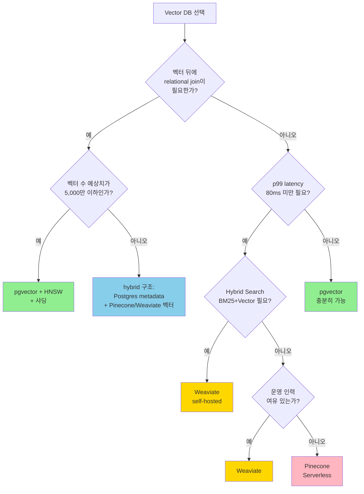

### Vector DB 선택 — "pgvector로 시작하면 되지"라는 순진함, 그리고 임베딩 1,200만 개를 넘긴 밤 IVFFlat 인덱스 재구성이 36시간 걸리는 사이 "스테일 벡터"로 뽑힌 상품 추천 CTR이 1.8% → 0.4%로 추락한 수요일 새벽

---

#### 1. 왜 "Vector DB 선택"이 아키텍처 결정인가

주니어는 "Vector DB? 그냥 코사인 유사도 돌리는 DB잖아요"라고 말한다.
시니어는 "임베딩 1,000만 개 넘기면 **recall, latency, cost, 재인덱싱 시간** 네 축이 서로 밀어낸다"는 걸 안다.

Vector DB는 다른 DB와 달리 **"쓰기(ingest) 지연 ↔ 읽기(recall) 품질 ↔ 비용 ↔ 운영 복잡도"** 가 전부 충돌한다. 선택을 잘못하면 "모델은 멀쩡한데 챗봇 답이 틀린다"가 재현 불가능한 미스터리가 된다. 범인은 LLM이 아니라 **인덱스 파라미터**다.

---

#### 2. 세 가지 선택지 — 한 눈에 비교

```
                 ┌───────────────────────────────────────────────┐
                 │       "지금 몇 개의 벡터를 다루는가?"           │
                 └───────────────────────────────────────────────┘
                        │                │                │
                 < 100만              100만~1,000만        > 1,000만
                        │                │                │
                        ▼                ▼                ▼
                ┌──────────────┐  ┌──────────────┐  ┌──────────────┐
                │  pgvector    │  │  Weaviate    │  │  Pinecone    │
                │  (Postgres)  │  │  (self-host) │  │  (SaaS)      │
                └──────────────┘  └──────────────┘  └──────────────┘
                 운영 단순 ↑        운영 복잡 ↑        운영 0, 비용 ↑
                 비용 ↓             비용 중간          비용 폭발 위험
                 recall 저하        hybrid 내장        최고 latency
                   (스케일시)       (BM25+Vector)      p99 안정
```

| 축 | pgvector (IVFFlat/HNSW) | Weaviate | Pinecone |
|---|---|---|---|
| 1,000만 벡터 ingest | 수시간~수일 | 수십분 | 수분 |
| p99 query latency | 100~500ms | 30~80ms | 20~40ms |
| recall@10 (튜닝 전) | 0.6~0.8 | 0.9+ | 0.95+ |
| Hybrid Search (BM25+Vector) | 수동 조합 | **내장 (BM25F)** | 2024년 지원 |
| 비용 (1,000만 벡터, 1,536차원) | $150/월 (RDS) | $400~800/월 (K8s) | $2,000+/월 |
| 재인덱싱(모델 교체) | **전면 재빌드 필요** | partial update | partial update |
| 트랜잭션 (ACID) | ✅ (Postgres JOIN) | ❌ | ❌ |
| 운영 복잡도 | 낮음 (DBA 재사용) | **중간~높음** | 매우 낮음 |

---

#### 3. 각 선택지의 "숨은 지뢰"

##### 3-1. pgvector — "Postgres 안에 있으니 안전하다"는 함정

pgvector는 두 가지 인덱스를 제공한다.

```
┌─────────────────────────────────────────────────────────────┐
│  IVFFlat                     │  HNSW                         │
├──────────────────────────────┼───────────────────────────────┤
│ - 벡터를 N개 cluster로 묶음  │ - 계층형 그래프 (수평+수직)   │
│ - 쿼리 시 가장 가까운        │ - 쿼리 시 상위 레이어부터     │
│   probes개 cluster만 검색    │   하강하며 탐색               │
│ - ingest 빠름, 재구성 느림   │ - ingest 느림, 재구성 불필요  │
│ - 벡터 증가 시 recall 폭락   │ - 메모리 사용량 2~3배         │
│ - PG 14+ 지원 (2021~)        │ - PG 16+, pgvector 0.5+ 지원  │
└─────────────────────────────────────────────────────────────┘
```

**치명적 함정**: IVFFlat은 cluster를 **ingest 시점의 벡터 분포로 미리 학습**한다. 그 후 벡터가 10배 늘어나면 cluster 분포가 깨져 recall이 급락한다. **해결책은 전면 재인덱싱 밖에 없고**, 1,000만 벡터 기준으로 **24~48시간**이 걸린다.

> "주말에 재인덱싱 걸어두면 되죠"라고 말한 신입이, 월요일 아침에 "lock_timeout 때문에 아직 안 끝났고, 그 사이 신규 임베딩 300만 개가 밀렸습니다"를 들고 왔다.

##### 3-2. Weaviate — Hybrid Search와 운영 복잡도의 거래

Weaviate는 BM25와 Vector를 **한 쿼리로 조합**한다 (`alpha=0.5` 같은 방식). 2024년 기준 Hybrid Search가 가장 성숙한 self-hosted 선택지다.

대신 **K8s에서 돌아간다**. 운영 비용은 "DB 하나 늘어난" 수준이 아니라 "**새로운 분산 시스템을 길들여야 하는**" 수준이다.
- Raft consensus (replica 간 동기화)
- Shard rebalance 중 질의 품질 흔들림
- `vectorIndexConfig.ef` 튜닝이 쿼리마다 다름

##### 3-3. Pinecone — "서버리스니까 걱정 끝"의 비용 폭발

Pinecone은 **운영 복잡도를 비용으로 치환**한 서비스다. 단, 두 가지가 숨어있다.
- **Pod-based pricing**: p1/s1/p2 pod를 미리 사둬야 함 → 트래픽 없어도 과금
- **Serverless (2024~)**: 쿼리당 과금 → 트래픽 폭주 시 OpenAI 토큰보다 Pinecone 쿼리비가 더 나올 수 있음

---

#### 4. 실제 사례

##### 사례 1: Notion AI (2023) — pgvector에서 시작, Pinecone으로 이관

- 초기: PostgreSQL 안에 이미 Notion blocks가 있었기에 pgvector 선택. 조인 한 번으로 "같은 workspace의 유사 block" 가져오기 가능.
- 벡터 수가 수억 단위로 커지자 **IVFFlat recall 저하 + 재인덱싱 시간 폭발**로 Pinecone 이관.
- 교훈: **"초기엔 트랜잭션 보장이 벡터 성능보다 중요하다"**. 멀티테넌시가 복잡한 서비스는 pgvector로 시작하는 게 합리적이다.

##### 사례 2: Shopify Semantic Search (2024) — pgvector 유지의 교과서

- 상품 임베딩이 상품 테이블 옆에 있어야 함 (조인 필요). Pinecone으로 가면 **상품 메타데이터와 벡터가 분리되어 2-step 쿼리** 필요.
- 선택: pgvector + HNSW + 적극적 샤딩 (shop_id 단위).
- 교훈: **"벡터만 검색하는 서비스는 없다"**. 벡터 뒤에 늘 relational 데이터가 따라붙는다면 pgvector의 조인 능력이 이긴다.

##### 사례 3: Perplexity (2024) — Pinecone 그 자체

- 크롤링된 웹 문서 수십억 벡터. relational join 거의 없음. 쿼리당 p99 < 100ms 필수.
- 선택: Pinecone + 자체 ranking.
- 교훈: **"벡터만 검색하는 서비스가 진짜 있다면"** Pinecone이 맞다. 운영 인력을 engineering 쪽에 몰아줄 수 있다.

##### 사례 4 (실패): 국내 K 대형 리테일러 (2025 추정) — pgvector에서 Weaviate로 황급히 이관

- 상품 추천 챗봇에 pgvector + IVFFlat으로 시작. 임베딩 1,200만 개 돌파.
- 주말 재인덱싱 중 **lock_timeout 미설정**으로 신규 ingest가 밀림 → 월요일 아침 신규 상품 300만 개가 벡터 없이 살아있는 상태.
- 추천이 **"지난주의 벡터"로 돌아감** → CTR 1.8% → 0.4% 추락.
- 한 달간 Weaviate로 긴급 이관. 비용은 월 $400 → $2,100으로 증가했지만, "**재인덱싱 전면 중단 없이 incremental update**"가 되기에 수용함.
- 교훈: **"recall이 조용히 떨어진다"**. 모니터링이 없으면 CS 민원으로 알게 된다.

##### 사례 5 (조용한 성공): Instacart (2023) — pgvector + HNSW 유지

- 상품 수백만 개, recall@10 > 0.95 유지. 비결은 **HNSW + 적극적 파티셔닝 + nightly 재랭킹**.
- Pinecone으로 가지 않은 이유: "**장바구니, 결제, 재고가 전부 Postgres에 있다**. 벡터만 분리하면 복잡도가 더 커진다."

---

#### 5. 결정 트리 — 시니어는 이렇게 묻는다



---

#### 6. 언제 쓰고, 언제 쓰면 안 되는가

##### ✅ pgvector가 맞는 경우
- 벡터 뒤에 **tenant_id, user_id, product_id 같은 조인이 늘 따라붙을 때**
- 벡터 수 **1,000만 이하**이고, 연 2배 성장 미만
- 트랜잭션 보장(ACID)이 필요한 경우 (예: "주문과 추천 로그가 같이 저장되어야 함")
- 운영 인력이 **PostgreSQL DBA만 있는** 조직

##### ✅ Weaviate가 맞는 경우
- Hybrid Search (BM25 + Vector)가 **첫날부터 필요**한 경우
- 벡터 수 **1,000만~5,000만**, self-host 가능한 K8s 인프라 있음
- 벤더 lock-in을 피하고 싶은 경우 (오픈소스)

##### ✅ Pinecone이 맞는 경우
- 벡터 수 **5,000만 이상**, 트래픽 패턴이 예측 가능
- relational join 거의 없음 (예: 웹 검색, 공개 문서 RAG)
- 운영 인력을 **벡터 DB에 쓰고 싶지 않은** 조직

##### ❌ 쓰면 안 되는 경우
- "**아직 벡터가 몇 개 될지 모르니 Pinecone부터**" → 트래픽 없으면 돈만 나감
- "**pgvector로 영원히 가면 되죠**" → IVFFlat recall 폭락은 **조용히** 온다. CTR/정답률 모니터링이 없으면 못 알아챈다
- "**Weaviate가 오픈소스니까 공짜**" → K8s + Raft + shard 운영 공수는 $500~2,000/월의 엔지니어 시간을 먹는다

---

#### 7. 운영 체크리스트 (시니어가 반드시 걸어두는 것)

```
[ ] recall@10을 "오프라인 평가셋"으로 매일 자동 측정 (LLM eval 자동화와 연결)
[ ] 벡터 수가 "인덱스 설계 시점 대비 3배" 넘으면 알림
[ ] IVFFlat 사용 시: 재인덱싱 cron (주 1회) + lock_timeout 설정
[ ] HNSW 사용 시: ef_search 파라미터를 환경별로 분리 (dev/stg/prod)
[ ] Pinecone 사용 시: 쿼리당 비용 알림 ($100/일 넘으면 Slack)
[ ] 임베딩 모델 교체 시 "shadow index" 전략 (A/B 가능하게)
[ ] 삭제된 데이터의 벡터도 함께 삭제되는지 검증 (GDPR)
```

---

> 💡 **왜 중요한가**: Vector DB 선택은 "성능 비교표"가 아니라 **"벡터 뒤에 따라붙는 데이터와 조직의 운영 역량을 함께 보는 결정"**이며, 잘못 고르면 모델이 아니라 인덱스가 서비스 품질을 조용히 갉아먹는다.
