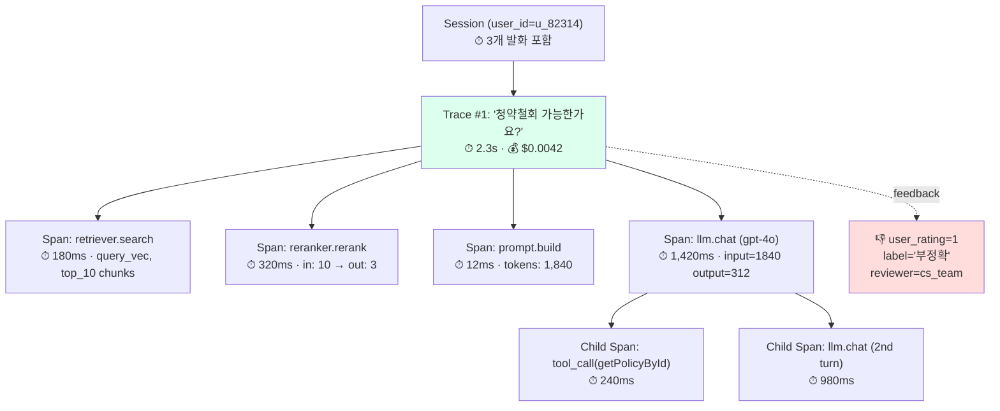

### AI Observability (LangSmith / LangFuse) — "로그 다 찍어뒀는데요?"라는 순진함, 그리고 RAG 체인 9단계 중 어느 노드에서 품질이 깨졌는지 못 짚은 채 "요즘 답변이 좀 이상해요" 한 통의 CS 메일에 엔지니어 3명이 Kibana Discover를 24시간 뒤적인 화요일 새벽

---

#### 📖 사건 재구성 — 2026년 3월, 어느 핀테크의 상담 챗봇

금요일 오후 2시, PM이 Slack에 남긴 한 줄.

> "임베딩 모델을 `text-embedding-3-small` → `3-large`로 바꿔봤어요. 리콜이 더 좋아 보여서요 👍"

배포는 조용히 넘어갔다. CI는 초록불. 평균 latency는 오히려 230ms → 180ms로 줄었다 (3-large가 더 짧은 top-k를 리턴해서 LLM 입력이 줄었기 때문이지만, 아무도 그 인과를 몰랐다).

11일 뒤 화요일 새벽 1시, 당직 엔지니어의 폰이 울렸다.

> "CS팀장입니다. '청약철회' 관련 문의 답변이 2주 전부터 조금씩 틀리기 시작했는데, 오늘 민원 47건이 금감원 접수 직전까지 갔습니다."

엔지니어가 Kibana를 열었다. 로그는 이렇게 생겨 있었다.

```
2026-03-10 14:23:12 INFO  [chat-service] user_id=u_82314 asked question
2026-03-10 14:23:12 INFO  [chat-service] retriever called
2026-03-10 14:23:13 INFO  [chat-service] openai called, tokens=1240
2026-03-10 14:23:14 INFO  [chat-service] response returned, status=200
```

문제의 질문이 어떤 **retrieved chunk**를 받았는지, 그 chunk가 **몇 등에 랭크됐는지**, **reranker가 어떻게 재정렬했는지**, **최종 prompt가 어떻게 생겼는지**, **LLM이 어떤 중간 toolcall을 던졌는지**, **같은 user_id의 지난 세션들과 톤이 어떻게 달라졌는지** — **아무것도 재현할 수 없었다**.

엔지니어 3명이 24시간 Discover를 뒤졌다. 결국 근본 원인은: **임베딩 모델 교체로 '청약철회'가 '해지'가 아니라 '구독취소' 벡터에 더 가깝게 밀렸고, 보험 FAQ 대신 OTT 멤버십 FAQ chunk가 top-3에 섞여 들어왔다.** 로그로는 영원히 짚을 수 없는 사고였다.

---

#### 🧠 왜 기존 APM/로그로는 안 되는가

Datadog, New Relic, ELK로 백엔드를 관측해 온 시니어 입장에서 이 질문이 먼저 떠오른다.

> "span 찍고 trace_id 전파하면 되는 거 아니야? OpenTelemetry 쓰면 되잖아."

**절반만 맞다.** LLM 애플리케이션에는 전통 APM이 못 잡는 4가지 축이 있다.

| 축 | 전통 APM | LLM Observability |
|---|---|---|
| **단위** | HTTP 요청 / DB 쿼리 | 하나의 사용자 발화 → N단계 체인 (retrieve → rerank → prompt build → LLM → tool call → LLM → ...) |
| **입출력** | status code, latency | **프롬프트 전문, 모든 중간 결과물, 토큰 수, 모델 파라미터** |
| **품질** | 2xx / 5xx | **의미적 정확성, 톤, 환각 여부** — 숫자로 안 떨어짐 |
| **피드백 루프** | 에러율 알람 | **사용자 👍/👎, 평가자 라벨, A/B 결과**가 다시 trace에 붙어야 함 |

전통 APM은 "요청이 성공했는가"를 묻는다. LLM Observability는 "**이 답변이 좋았는가, 왜 그랬는가, 어디서 깨졌는가**"를 묻는다. 이건 다른 데이터 모델이다.

---

#### 🏗️ Trace 모델: 하나의 발화 = 하나의 Trace, 그 안의 N개 Span

LangSmith와 LangFuse 둘 다 이 구조를 공유한다.



핵심 포인트:

- **Trace**는 "사용자 발화 하나"에 대응. end-to-end latency, 총 비용, 최종 응답을 담는다.
- **Span**은 체인의 각 단계. retriever, reranker, LLM call, tool call 각각이 하나의 span.
- **Span은 중첩된다.** LLM이 tool을 부르고 다시 LLM을 부르면 child span으로 들어간다.
- **Session**은 Trace의 상위 묶음. 같은 대화 세션의 발화 N개를 묶어 "대화 흐름" 단위로 본다.
- **Feedback**은 Trace에 사후 부착된다. 👍/👎, CS팀 라벨, 자동 평가자(LLM-as-judge) 점수까지 모두 같은 trace_id에 매달린다.

이 모델이 중요한 이유: **배포 한 번 바꾸고 2주 뒤에 "이 변경 전/후로 '청약철회' 질문의 👎 비율이 어떻게 바뀌었나"를 10초 안에 쿼리할 수 있다.** 로그만 있으면 영원히 못 한다.

---

#### 🔧 LangSmith vs LangFuse — 뭐가 다른가

| 항목 | LangSmith | LangFuse |
|---|---|---|
| **라이선스** | SaaS 전용 (LangChain Inc.) | **OSS (MIT) + SaaS 선택** |
| **셀프호스트** | 엔터프라이즈 플랜만 | OSS 바이너리로 자유 (Docker 1장) |
| **프레임워크 결합** | LangChain과 가장 긴밀 (자동 trace) | 프레임워크 중립 — SDK 호출로 trace |
| **데이터 주권** | US/EU 리전 선택, 한국 리전 ❌ | 셀프호스트 시 완전 통제 |
| **가격 모델** | trace 수 기반 과금 | OSS 무료 / SaaS는 이벤트 수 기반 |
| **강점** | LangChain 체인의 자동 분해, Dataset→Eval 통합 UI | PII 통제, 비용 기록, 프롬프트 버전 관리까지 한 UI |
| **약점** | lock-in 리스크, 리전 제한 | UI 성숙도는 LangSmith보다 1~2분기 뒤 |

**현장에서의 선택 기준 (경험칙):**

- **금융/의료/공공** → LangFuse 셀프호스트. 프롬프트에 주민번호·계좌·질병명이 흐르는데 미국 SaaS로 그 데이터를 흘려보낼 수 없다. 한국 금융망분리 환경이면 선택지가 사실상 LangFuse 하나.
- **PoC / 스타트업 / LangChain 기반** → LangSmith. LangChain `@traceable` 데코레이터 하나로 자동 분해되는 UX는 LangFuse보다 명백히 앞서있다.
- **멀티 프레임워크** (LangChain + LlamaIndex + 자체 SDK 혼재) → LangFuse. 프레임워크 중립 설계가 유리.

---

#### 🧪 코드로 보는 최소 예시 — "같은 체인, 두 SDK"

**LangFuse (Python, 프레임워크 중립)**

```python
from langfuse import Langfuse

lf = Langfuse()  # 환경변수로 host/key 주입

def handle_question(user_id: str, question: str) -> str:
    trace = lf.trace(
        name="chat_turn",
        user_id=user_id,
        session_id=current_session_id(),
        input={"question": question},
        tags=["prod", "chat-service", "v2.14.0"],
    )

    # 1. retrieve
    retrieve_span = trace.span(name="retriever.search", input={"q": question})
    chunks = retriever.search(question, top_k=10)
    retrieve_span.end(output={"chunk_ids": [c.id for c in chunks]})

    # 2. rerank
    rerank_span = trace.span(name="reranker.rerank", input={"n_in": 10})
    reranked = reranker.rerank(question, chunks)[:3]
    rerank_span.end(output={"chunk_ids": [c.id for c in reranked]})

    # 3. LLM call — generation span은 비용/토큰까지 자동 기록
    gen = trace.generation(
        name="llm.chat",
        model="gpt-4o",
        input=build_prompt(question, reranked),
        model_parameters={"temperature": 0.2},
    )
    resp = openai_client.chat(...)
    gen.end(
        output=resp.choices[0].message.content,
        usage={"input": resp.usage.prompt_tokens, "output": resp.usage.completion_tokens},
    )

    trace.update(output={"answer": resp.choices[0].message.content})
    return resp.choices[0].message.content
```

**뒤늦게 피드백 붙이기 — "2주 뒤 CS팀장이 👎 라벨 다는 플로우"**

```python
# CS 어드민에서 trace_id로 라벨링
lf.score(
    trace_id="trace_8a4e2f...",
    name="cs_review",
    value=0,  # 0=부정확, 1=정확
    comment="청약철회 조항을 OTT FAQ로 혼동함",
)
```

이 한 줄 덕에, 2주 뒤 "임베딩 모델 교체 전/후 cs_review=0 비율" 쿼리가 가능해진다. **로그로는 영원히 재현 불가능한 질문.**

---

#### ⚖️ 트레이드오프 — 공짜가 아니다

| 비용 축 | 실제로 뭐가 깨지나 |
|---|---|
| **Latency 오버헤드** | async flush를 안 쓰면 trace export가 응답 critical path에 끼어든다. LangFuse SDK는 기본 비동기지만, Lambda처럼 짧은 수명 런타임에선 flush 타이밍을 명시해야 유실된다. |
| **스토리지 폭발** | 하루 100만 trace × 평균 8KB = **8GB/day**. 1년이면 2.9TB. retention 정책 없이 켜면 ClickHouse 노드가 조용히 터진다. |
| **PII 유출** | 프롬프트 전문이 trace에 들어간다. 마스킹 미들웨어(`before_send`) 없이 켜면 사용자의 주민번호, 카드번호가 Observability DB에 전부 적재된다. **보안사고의 90%는 이 경로다.** |
| **벤더 Lock-in** | LangSmith에 1년치 trace가 쌓이면 이전 불가. OTel 표준(GenAI SemConv)이 아직 미성숙해서 "그냥 OTel로 찍어두면 나중에 어디든 가져가지" 전략이 아직 안 통한다. |
| **엔지니어 작업량** | span을 "의미 있게" 쪼개는 건 수작업이다. 자동 트레이싱만 믿으면 chain.invoke 한 줄이 하나의 span으로 뭉개진다 — 그 안에서 뭐가 터졌는지는 다시 아무도 모른다. |

**시니어의 체크리스트:**
1. **마스킹을 먼저 구현한 다음 켠다.** 역순 금지.
2. **retention을 처음부터 설정한다** (hot 7일, warm 30일, cold 90일, 그 뒤 삭제 또는 S3 archive).
3. **sampling 전략을 정한다.** prod 100%는 과하다. 에러·feedback 있는 trace는 100%, 성공 trace는 10% sampling이 합리적.
4. **flush 전략을 async로 두되, graceful shutdown hook에 flush를 건다.** Kubernetes rolling update에서 trace 유실 사고 흔하다.

---

#### 🏢 실제 사례

**사례 1: Elastic (2024) — LangSmith로 Docs AI 품질을 분기별 비교**
Elastic은 Elastic Docs AI (RAG 챗봇)를 LangChain으로 구축했고, **버전별 "질문→답변→👍👎" 데이터셋을 LangSmith Dataset으로 축적**해두고, 매 릴리스마다 같은 데이터셋에서 regression eval을 돌린다. 임베딩 모델이나 reranker를 바꿀 때 "직감"이 아니라 숫자로 결정한다. — [Elastic 엔지니어링 블로그, 2024]

**사례 2: Khan Academy (2024) — "Khanmigo"의 Dataset 기반 Eval 루프**
Khan Academy는 교사가 플래그한 안 좋은 답변을 LangSmith에 Dataset으로 적재하고, 프롬프트 바꿀 때마다 이 Dataset으로 자동 평가한다. "교사 1명이 Slack에 올린 사례 하나로 전체 QA 사이클이 돈다"는 피드백 루프를 만든 것. — Khan Academy 엔지니어링 블로그.

**사례 3: Samsara (물류 IoT, 2024) — LangFuse 셀프호스트로 PII 통제**
운전자 위치·차량 ID가 포함된 LLM 질의를 외부로 보낼 수 없어 LangFuse OSS를 자체 K8s에 띄웠다. ClickHouse + Postgres 조합으로 하루 300만 trace를 처리. 핵심 이유: **"관측성 때문에 데이터 주권을 포기할 수는 없다."** — LangFuse 커뮤니티 콜 발표.

**사례 4 (실패): 국내 N 포털사 추정 사례 (2025) — "안전하게 다 끄고 운영했다"**
PII 유출을 걱정해 입력 프롬프트와 출력 전문을 전부 마스킹한 채 trace만 켜뒀더니, 사고가 나도 "span A가 2초 걸렸다"는 사실만 남고 **그 안의 프롬프트/응답은 전부 `[REDACTED]`**. 디버깅이 불가능해 결국 재현 불가 사고로 종결. 교훈: **마스킹은 전부 끄는 게 아니라 "필드 기반 선별 마스킹"으로 가야 한다** (주민번호 패턴만 마스킹, 나머지 질의문은 보존).

**사례 5 (성공): Replit (2024) — Ghostwriter를 LangSmith + 자체 평가로 운영**
Replit은 LangSmith로 trace를 수집하면서, **LLM-as-judge를 feedback score로 자동 부착**한다. 즉 사용자가 👍/👎를 안 눌러도 모든 응답에 "평가 모델이 매긴 품질 점수"가 붙는다. 프로덕션 트래픽 자체가 지속적 Eval 데이터셋이 되는 설계.

---

#### ✅ 반드시 써야 하는 경우

- **RAG 체인이 3단계 이상** (retrieve + rerank + LLM 최소) → 로그로는 어디서 깨졌는지 영원히 못 짚는다.
- **프롬프트/모델을 분기별로 바꾸는** 조직 → "바꾸기 전/후 품질 비교"가 핵심 의사결정 포인트인데 trace 없이는 비교 불가.
- **Agent 시스템 (ReAct/Tool Use)** → child span 없이는 "LLM이 tool을 7번 재호출한 이유"를 디버깅할 방법이 없다.
- **운영 중 사용자가 품질 이슈를 리포트하는 B2C 서비스** → feedback을 trace에 붙여 "재현 가능한 사고 티켓"을 만들어야 한다.

#### ❌ 쓰면 안 되거나 신중해야 하는 경우

- **PII 마스킹 체계가 아직 없을 때** → 켜는 순간이 사고 날짜. 마스킹 미들웨어가 먼저다.
- **단일 LLM 호출만 있는 단순 요약 API** → 체인이 1단계면 trace가 과하다. Datadog에 input/output 샘플링해 적재하는 정도로 충분.
- **엄격한 금융망분리 환경 + 셀프호스트 인력 없음** → SaaS는 못 쓰고 셀프호스트할 인력도 없는 상태라면, 켜지 말고 먼저 "최소 OTel 기반 자체 적재"부터 시작. 어설프게 LangFuse 띄웠다가 ClickHouse 운영 못 해서 노드 터뜨리는 사고 흔하다.
- **trace 비용이 LLM 호출 비용의 20%를 넘기 시작할 때** → sampling 전략을 다시 짜야 한다. 관측성 비용이 본 비용을 넘기면 조직 설득이 깨진다.

---

#### 🪜 시니어가 설계할 때 머리에 담아야 할 3가지

1. **Observability는 "로그의 상위 호환"이 아니라 "다른 데이터 모델"이다.** span 트리 + feedback이 핵심이고, 이 둘 없이는 전통 로그와 다를 바 없다.
2. **"무엇을 span으로 쪼갤 것인가"는 아키텍처 결정이다.** retriever 안의 쿼리 변환, 임베딩 호출, 벡터 검색을 하나의 span으로 뭉개면 "임베딩이 느린지 벡터 검색이 느린지" 영원히 모른다. span 경계는 **"독립적으로 교체 가능한 단위"**가 기준.
3. **Trace는 Eval Dataset의 원재료다.** 지금 쌓는 trace가 6개월 뒤 모델/프롬프트 교체 결정의 근거가 된다. "일단 켜두고 나중에 쓴다"는 생각이 아니라, **"어떤 쿼리를 분기별로 던질 것인가"를 먼저 설계**하고 그에 맞춰 메타데이터(tags, user_id, model_version)를 심어야 한다.

> 💡 **왜 중요한가**: LLM 애플리케이션은 "성공했는가"가 아니라 "좋았는가"를 물어야 하는 시스템이고, 그 질문에 답할 수 있는 유일한 데이터는 **체인 전 구간의 입출력과 사후 피드백이 trace 하나에 묶여 있을 때**뿐이다 — Observability를 안 깔면 품질 저하는 영원히 "느낌"으로만 남는다.
