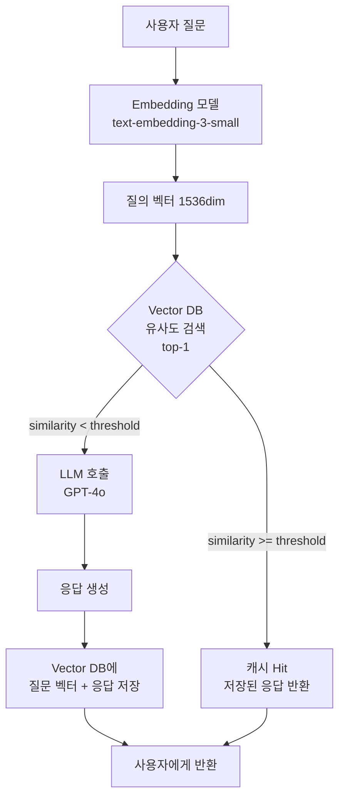
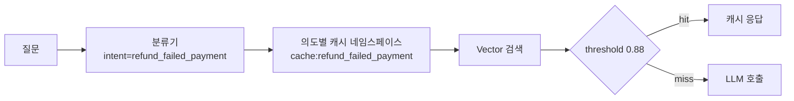

### Semantic Cache — "같은 질문이면 Redis가 먹히겠지"라는 순진함, 그리고 "결제 실패 환불" 질의에 캐시가 "결제 성공 후 환불" 답변을 1,340명에게 2시간 동안 서빙한 뒤 CS 민원 폭주로 QA팀이 임계값 0.85를 0.95로 급히 올렸지만 캐시 Hit Rate가 34% → 2.7%로 떨어지며 월간 LLM 비용이 다시 $81,000으로 복귀한 목요일 밤

---

#### 1. 문제의 출발점 — "GPT-4 비용이 매출의 11%"

Lv5에 들어오면 거의 모든 팀이 똑같은 벽에 부딪힌다.

**"응답 품질은 괜찮다. 그런데 토큰 비용이 매출의 두 자리 퍼센트다."**

그래서 가장 먼저 떠올리는 게 캐시다. 백엔드 엔지니어가 10년 넘게 다뤄온 그 캐시. Redis에 `SET prompt_hash:xxx response`로 넣고, 같은 질문이면 LLM 호출 없이 캐시로 응답. 끝. 간단.

그런데 하루 돌려보면 Hit Rate가 **2%** 가 나온다.

왜? 사용자 질문이 **문자열로는 거의 겹치지 않기 때문**이다.

```
"환불 어떻게 해?"
"환불 신청하려면?"
"환불 받고 싶어요"
"돈 돌려받으려면 어떻게 하나요"
"주문 취소하고 환불받고 싶은데요"
```

의미는 전부 같다. 하지만 SHA-256으로 해시하면 전부 다른 키다. 전통적 캐시는 **"문자열 동일성"** 을 전제로 설계됐는데, 자연어는 **"의미 동일성"** 으로 반복된다. 이 간극이 Semantic Cache가 존재하는 이유다.

---

#### 2. Semantic Cache의 기본 구조

핵심 아이디어는 단순하다. **질문을 임베딩으로 바꿔서, 벡터 유사도로 캐시 조회한다.**



구조 자체는 RAG 리트리버와 거의 똑같다. 다르다면 **"검색 대상이 문서가 아니라 과거 Q&A 쌍"** 이라는 점뿐.

의사코드로 보면 더 명확하다.

```python
def answer(query: str) -> str:
    query_vec = embed(query)
    hit = vector_db.search(query_vec, top_k=1)

    if hit and hit.similarity >= THRESHOLD:
        metrics.incr("cache.hit")
        return hit.cached_response

    metrics.incr("cache.miss")
    response = llm.generate(query)
    vector_db.upsert(query_vec, {"query": query, "response": response})
    return response
```

20줄이면 끝난다. 그래서 다들 쉽게 도입한다. 그리고 그 임계값 `THRESHOLD`가 모든 재앙의 진원지가 된다.

---

#### 3. 핵심 긴장: Threshold라는 외줄타기

Semantic Cache를 운영하는 사람에게 "임계값 몇으로 세팅했어요?"라고 물어보면 그 사람의 운영 성숙도가 바로 드러난다.

| Threshold | 결과 | 리스크 |
|-----------|------|--------|
| **0.75** | Hit Rate 65%, 비용 $11,000/월 | **"잘못된 답변"** 서빙 다수. "결제 실패" → "결제 성공" 답변 매칭 |
| **0.85** | Hit Rate 34%, 비용 $27,000/월 | 일부 Edge case 오매칭. CS팀이 하루 2~5건 민원 접수 |
| **0.92** | Hit Rate 11%, 비용 $63,000/월 | 거의 안전. 그런데 **왜 캐시를 썼는가**가 흐려짐 |
| **0.97** | Hit Rate 1.4%, 비용 $79,000/월 | 사실상 캐시 미도입 상태. 벡터 검색 비용만 추가로 발생 |

이건 **Precision/Recall 트레이드오프를 캐시 비즈니스 지표로 번역한 것** 과 같다. 임계값을 낮추면 Recall(Hit Rate)이 오르는 대신 Precision이 떨어진다. 떨어진 Precision은 **곧바로 틀린 답변**으로 사용자에게 노출된다. CS팀이 그걸 못 거른다.

Lv4에서 다룬 Rate Limit이나 Lv3의 Cache-Aside 패턴이랑 결정적으로 다른 지점이 바로 여기다. **전통적 캐시의 실패 모드는 "stale 데이터"지만, Semantic Cache의 실패 모드는 "완전히 다른 질문에 대한 답변"이다.** stale은 오래된 사실이고, 오매칭은 거짓이다. 품질 영향이 다른 레벨이다.

---

#### 4. "결제 실패 환불" 사건 — 왜 0.85가 터졌는가

도입부에서 언급한 사건의 내부를 뜯어보자.

사용자 질문 1: `"결제 실패했는데 환불받으려면 어떻게 하나요?"`
사용자 질문 2: `"결제 성공한 뒤에 환불받으려면 어떻게 하나요?"`

두 문장을 `text-embedding-3-small`로 임베딩하고 cosine similarity를 재면 — **0.89가 나온다.**

이유는 명확하다. 임베딩 모델은 문장 전체의 **"주제 벡터"** 를 뽑는다. 두 문장 모두 "결제 / 환불 / 어떻게"라는 고농도 토큰 비중이 압도적이다. **"실패"와 "성공"은 1,536차원 중 몇 개 차원에만 반영되는 저농도 신호**다. 그래서 유사도가 0.89로 찍힌다.

임계값이 0.85면? Hit이다. 캐시된 "결제 성공 후 환불" 답변이 "결제 실패 환불" 질문에 그대로 서빙된다. 사용자는 "본인이 결제한 적 없다"는 걸 아는 상태로 "결제가 완료되었다면 마이페이지 → 주문내역 → 환불 신청..." 안내를 받는다. CS 민원이 터진다.

사후 리뷰에서 QA팀이 임계값을 0.95로 올리자, 0.89짜리 쌍은 당연히 미스가 되고 **0.95를 넘는 쌍은 사실상 문자 그대로 똑같은 재질의 FAQ뿐**이다. Hit Rate가 34% → 2.7%로 폭락한다. 비용이 다시 올라간다. 아무도 책임지지 않는다. **임계값 하나로 Precision과 Recall이 모두 무너진 구조적 실패**다.

---

#### 5. 그래서 실무에선 어떻게 푸는가 — 3가지 방어선

성숙한 조직은 임계값 한 개로 승부를 보지 않는다. 적어도 세 겹을 쌓는다.

##### ① 질문 분류기(Classifier) 선행 라우팅

캐시 조회 **전에** 작은 분류기를 돌려서 질문의 **"의도 라벨"** 을 먼저 뽑는다. 같은 라벨끼리만 벡터 검색을 한다.



"결제 실패 환불"과 "결제 성공 환불"은 **분류기에서 다른 라벨로 떨어지므로 벡터 비교 자체가 발생하지 않는다.** 임베딩 모델의 저농도 신호 문제를 분류기의 고농도 결정으로 우회하는 방식이다. GPTCache가 2024년부터 이 패턴을 공식 지원한다.

##### ② Re-ranker로 2차 검증

Vector 유사도로 top-5를 뽑고, Cross-encoder reranker(cohere-rerank-v3, bge-reranker-v2 등)로 **"질문-질문 간 재순위"** 를 매긴다. Vector는 bi-encoder라 저농도 신호를 놓치지만, Cross-encoder는 두 문장을 함께 넣고 attention을 돌리기 때문에 "실패/성공" 같은 단어 하나의 차이에도 민감하다. Hybrid Search에서 이미 다룬 2-stage retrieval을 **캐시에도 그대로 복제**하는 셈이다.

##### ③ LLM-as-a-Judge 샘플링 검증

전체 Hit의 1~5%를 샘플링해 "이 캐시 답변이 지금 질문에 적절한가?"를 작은 모델(Haiku, GPT-4o-mini)로 재판정한다. 부적절 판정이 임계치를 넘으면 **해당 라벨의 캐시 네임스페이스 전체를 자동 무효화**한다. 비용의 1~2%를 품질 보험료로 지불하는 구조다.

---

#### 6. 실제 사례 — 누가 왜 이걸 쓰는가

##### 사례 1: Perplexity (2024) — Semantic Cache로 매일 1,100만 쿼리 처리

Perplexity는 뉴스/시사 검색이라 **"오늘 환율", "어제 경기 결과"** 같은 **동일 질문 반복이 극단적으로 많다.** 공식 블로그에 따르면 Semantic Cache + Query Normalization 조합으로 **GPT-4 호출의 42%를 캐시로 흡수**해 월 수백만 달러 수준의 비용을 절감했다고 공개했다. 임계값은 공개하지 않았지만, 질의 타입별로 다른 네임스페이스를 쓰는 구조가 특허(US 2024/0338441)에 암시돼 있다.

##### 사례 2: GPTCache + Milvus — Zilliz의 오픈소스 레퍼런스

Zilliz가 만든 GPTCache는 LangChain, LlamaIndex 공식 통합이 가장 먼저 들어간 라이브러리다. 내부적으로 **"임베딩 → 벡터 검색 → similarity threshold → optional LLM judge"** 파이프라인을 그대로 구현한다. GitHub 7,000+ star. 국내 핀테크의 챗봇 PoC 상당수가 이걸 Fork해서 쓴다. 결정적 장점은 **백엔드를 Faiss/Milvus/Redis-Vector/pgvector 중 바꿔 끼울 수 있다는 것** — Vector DB 선택을 캐시 레이어에 가둬둘 수 있다.

##### 사례 3: Portkey AI Gateway (2024) — Gateway + Semantic Cache 결합

이미 다룬 LLM Gateway 패턴 위에 Semantic Cache를 **Gateway 레벨 미들웨어**로 얹은 구조다. 애플리케이션 코드는 캐시의 존재를 몰라도 된다. Gateway가 요청을 받으면 임베딩 → 캐시 조회 → 미스면 LLM 벤더 호출 → 응답을 캐시에 적재. **"캐시는 애플리케이션 관심사가 아니라 플랫폼 관심사"** 로 재정의한 접근이다. 멀티테넌트 서비스에선 이 분리가 거의 필수다.

##### 사례 4 (실패): 국내 K 카드사 추정 사례 (2025) — "FAQ 외에는 쓰지 말아야 했다"

K사는 상담 챗봇에 Semantic Cache를 전면 도입했다가 **개인화 질의 — "내 이번 달 결제액 알려줘"** 같은 질문이 **다른 고객의 과거 질문에 걸려 매칭되는 사고**를 냈다. 질문 문자열에 고객 ID나 PII가 들어있지 않다 보니 임베딩이 **"이번 달 결제액 조회"** 라는 의도 벡터로만 수렴했고, 캐시는 **"가장 유사한 과거 질문의 응답"** 을 돌려줬다. 다행히 응답에 민감정보 자체는 없었지만(수치는 LLM이 그 자리에서 생성한 플레이스홀더), **"다른 사람 답변일 수 있다"는 공포가 확산되면서 서비스 전면 롤백**됐다. 교훈은 간단하다 — **사용자 컨텍스트가 응답을 결정하는 질의는 Semantic Cache에 넣으면 안 된다.**

---

#### 7. 트레이드오프 — 진짜 저장하는 비용

| 축 | 캐시 미도입 | Semantic Cache 도입 |
|---|---|---|
| **LLM 토큰 비용** | 100% | 30~60% (Hit Rate 의존) |
| **임베딩 비용** | 0 | 모든 요청에 대해 추가 발생 (text-embedding-3-small 기준 쿼리당 $0.00002) |
| **Vector DB 운영** | 불필요 | 전용 인덱스 운영 + 메모리 비용 |
| **지연 시간** | LLM 호출 1회 | 임베딩 + Vector 검색 + (Miss 시) LLM 호출 |
| **품질 리스크** | 없음 | 오매칭 시 **완전히 다른 답변** 서빙 |
| **인시던트 디버깅** | 로그 추적 | **"이 답변은 어떤 과거 질문에서 왔는가"** 추적 설계 필수 |

핵심은 **임베딩 비용과 Vector 검색 레이턴시는 "Miss일 때도" 발생한다는 점**이다. Hit Rate가 극단적으로 낮으면 — 10% 미만 — Semantic Cache는 **"비용을 늘리면서 품질 리스크만 추가로 얻는 구조"** 로 전락한다. 도입 전 **최소 Hit Rate 추정이 반드시 선행**돼야 한다.

---

#### 8. 언제 쓰고, 언제 쓰면 안 되는가

##### ✅ 반드시 써야 하는 경우

- **FAQ 성격의 질문이 전체의 30% 이상**: 쇼핑몰 CS, 금융사 상담 챗봇, 공공 민원 봇
- **질문의 사용자 컨텍스트 의존도가 낮음**: "환불 정책이 뭐야?" vs "내 환불 내역 보여줘" — 전자만 캐시
- **동일 토픽 반복이 극단적**: 뉴스 검색, 시세 조회, 날씨 — 하루 수만 명이 똑같은 걸 물어본다
- **Latency 요구가 느슨**: 임베딩 + 벡터 검색이 50~150ms 추가되는 걸 감당할 수 있어야 함

##### ❌ 쓰면 안 되는 경우

- **개인화 응답**: "내 주문", "내 잔액", "내 포인트" — 사용자 ID가 임베딩에 녹지 않으면 반드시 오매칭한다
- **실시간 데이터 기반 응답**: 재고/시세/날씨 — 캐시 TTL 설계가 지옥이고, Semantic Cache는 TTL 전략이 특히 모호하다
- **Precision이 critical한 도메인**: 의료 처방, 법률 해석, 금융 상품 적합성 — 0.01% 오매칭도 사고
- **고도로 긴 멀티턴 대화**: 대화 히스토리가 임베딩에 전부 녹지 않는다. 턴 하나만 바뀌어도 의미가 뒤집히는데 캐시는 이걸 못 잡는다

##### 🟡 신중해야 하는 경우

- **A/B 테스트 중인 프롬프트**: 캐시가 이전 버전 응답을 계속 서빙하면 실험 결과 자체가 오염된다. 프롬프트 버전을 네임스페이스에 포함시켜야 하는데 Hit Rate가 급격히 떨어진다
- **다국어 서비스**: 언어별 임베딩 품질 편차가 커서 임계값 하나로 전역 운영이 어렵다. 언어별 네임스페이스 필수

---

#### 9. 운영 체크리스트 — Lv5 엔지니어가 배포 전에 확인할 것

- [ ] 임계값은 **네임스페이스별로 다르게** 설정 가능한가 (전역 상수 금지)
- [ ] 캐시 Hit에 **"매칭된 과거 질문 ID + similarity 점수"** 가 응답 메타데이터로 남는가 (사후 추적 가능 여부)
- [ ] **PII 감지기**가 캐시 적재 단계에서 돌고 있는가 (실수로 들어간 개인정보가 다른 사용자에게 서빙되지 않도록)
- [ ] **문서 업데이트 시 캐시 무효화 전략**이 있는가 (RAG 소스가 바뀌면 캐시된 답변도 stale)
- [ ] **Hit Rate / 오매칭률 / 비용 절감액**이 분리된 대시보드로 보이는가 (하나의 지표만 보면 재앙)
- [ ] A/B 테스트/프롬프트 버저닝과의 **네임스페이스 연동**이 설계됐는가 (이미 다룬 Prompt Registry와 반드시 결합)

---

> 💡 **왜 중요한가**: Semantic Cache는 비용을 반으로 깎을 수 있는 Lv5의 유일한 지렛대이지만, 임계값 하나로 "비용 절감 시스템"에서 "틀린 답변 생성 시스템"으로 뒤집히는 대칭적 리스크를 가진 유일한 캐시 레이어다.
