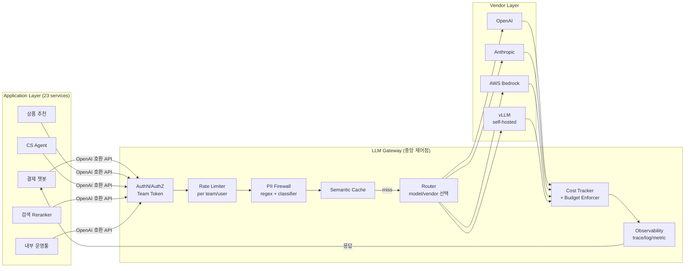

### LLM Gateway 패턴 — "SDK 직접 호출하면 되지"라는 순진함, 그리고 23개 마이크로서비스에 흩뿌려진 `OPENAI_API_KEY` 중 하나가 Public Fork된 PoC 레포에 그대로 커밋돼 밤새 $47,200이 찍히고 보안팀이 긴급 전사 키 로테이션을 돌렸지만 "어느 서비스가 어느 키를 쓰는지"를 추적하는 데만 Confluence 다이어그램 11장과 Slack DM 47개를 뒤진 수요일 새벽

---

#### 1. 그 수요일에 실제로 벌어진 일

> 2025-08-13, 03:12 KST. 결제·추천·CS 챗봇·검색·내부 운영툴까지 LLM을 쓰기 시작한 지 11개월째인 국내 커머스 플랫폼 N사. 백엔드 챕터는 "각 팀이 알아서 OpenAI SDK import해서 쓰면 된다"는 원칙으로 시작했다. 처음엔 깔끔해 보였다.
>
> 11개월 뒤의 현실:
> - **23개 서비스**가 각자 `openai`, `anthropic`, `cohere` SDK를 직접 import
> - **API Key는 각 팀 Vault**에 분산 — 보안팀도 몇 개가 유통되는지 모름
> - **비용 리포트는 OpenAI 콘솔의 월 청구서 1장** — "결제 챗봇이 얼마 썼냐"는 CFO 질문에 답을 못 함
> - **Rate Limit**은 벤더가 걸어주는 조직 전체 TPM 한도뿐. 어떤 팀이 폭주하면 다른 팀이 전부 429
>
> 그날 밤 터진 건, PoC하던 신입 개발자가 레포를 `public`으로 fork하면서 `.env`가 함께 올라간 사소한 실수였다. 봇이 15분 만에 키를 긁어갔고, `gpt-4-turbo`로 토큰을 미친 듯이 때려 **08시간 동안 $47,200**. 보안팀이 OpenAI 조직 콘솔에서 긴급 revoke했는데, 그 키 하나가 revoke되는 순간 **서비스 7개가 동시에 500**을 뿜었다. 어느 서비스가 어느 키를 쓰는지 중앙 레지스트리가 없었기 때문이다.
>
> 포스트모템 액션 아이템 1번: **"LLM 호출은 전부 Gateway를 통과시킨다."**

---

#### 2. LLM Gateway란 무엇인가

> 한 줄 정의: **"모든 LLM 호출을 통과시키는 중앙 Reverse Proxy. 벤더 SDK와 애플리케이션 사이에 끼워 넣는 L7 미들웨어."**

API Gateway(Kong, AWS API Gateway)가 "들어오는 트래픽"을 통제했다면, LLM Gateway는 **"나가는 LLM 트래픽"을 통제**한다. 책임 영역이 겹치는 7가지:

| 책임 | 왜 Gateway여야 하나 |
|---|---|
| **① API Key 중앙화 & 로테이션** | 23개 서비스 코드 안 건드리고 키 한 번만 교체 |
| **② Rate Limiting (per-team/user/key)** | 벤더가 주는 조직 전체 TPM을 팀별로 쪼개 격리 |
| **③ Cost Attribution** | 호출마다 team/feature/user 태그 → 리포트/챠지백 |
| **④ Routing & Fallback** | OpenAI 장애 시 Anthropic으로 (앞서 다룬 패턴을 Gateway 레이어로 끌어올림) |
| **⑤ Semantic Cache** | 중복 호출을 애플리케이션 밖에서 흡수 |
| **⑥ Observability (trace/log/metric)** | 벤더별 응답 포맷을 한 포맷으로 정규화 |
| **⑦ PII Masking / Prompt Firewall** | 주민번호·카드번호가 벤더 서버로 나가기 전 차단 |

이 중 **①②③만으로도 Gateway는 정당화된다.** 나머지는 보너스다.

---

#### 3. 아키텍처 다이어그램



핵심은 **"애플리케이션은 벤더 SDK가 아니라 Gateway의 OpenAI 호환 API를 호출"**한다는 것. 이 한 가지 결정이 23개 서비스를 벤더 중립으로 만든다.

---

#### 4. 중앙화의 실체 — 애플리케이션 코드가 어떻게 바뀌는가

**Before (벤더 SDK 직접 호출):**
```java
// 결제 챗봇 서비스
OpenAiClient client = new OpenAiClient(System.getenv("OPENAI_API_KEY"));
var resp = client.chat()
    .model("gpt-4-turbo")
    .messages(messages)
    .create();
```
→ 키·모델·벤더가 코드에 하드코딩. 바꾸려면 23번 배포.

**After (Gateway 경유):**
```java
// 결제 챗봇 서비스
OpenAiClient client = new OpenAiClient(
    "sk-gw-payment-chatbot-xxx",          // Gateway가 발급한 virtual key
    "https://llm-gw.internal/v1"          // Gateway endpoint
);
var resp = client.chat()
    .model("payment-chat-model")          // 논리적 모델명 (Gateway에서 매핑)
    .messages(messages)
    .metadata(Map.of("feature", "refund-flow", "user_id", userId))
    .create();
```

바뀐 포인트:
- `sk-gw-...` **virtual key**: Gateway가 발급·관리. 벤더 real key는 Gateway만 알고 있음
- `payment-chat-model` **논리적 모델명**: Gateway의 config에서 `gpt-4-turbo` → `claude-sonnet-4` 교체는 **코드 변경 0줄**
- `metadata`: Cost Attribution과 Observability의 축

**이 패턴 하나로 N사의 그 수요일은 아예 발생하지 않는다.** Virtual key만 revoke하면 되고, 실제 벤더 키는 Gateway 안에서만 돌면 됐을 테니.

---

#### 5. Build vs Buy — 2026년 시점의 선택지

| 솔루션 | 포지셔닝 | 장점 | 단점 |
|---|---|---|---|
| **LiteLLM** (OSS Python Proxy) | 가볍고 self-host. 100+ 벤더 통합 | 사실상 업계 표준, Docker 1발, 커뮤니티 풍부 | Python GIL 기반 → 극한 처리량에서 노드 수 증가 필요 |
| **Portkey** (SaaS/Self-host 하이브리드) | Observability·Governance 강점 | AI Gateway + Observability + Guardrails 통합 | 유료 플랜의 호출당 비용, 데이터가 벤더 거침 (self-host로 완화 가능) |
| **Kong AI Gateway** (Enterprise) | Kong 기반 L7 플러그인 | 기존 API Gateway와 통합, 엔터프라이즈 지원 | Kong 운영 경험 필수, 과한 중량 |
| **Helicone** (OSS/SaaS) | Observability 특화 → Gateway로 확장 | 로깅·대시보드 품질 압도적 | Routing/Guardrail은 상대적으로 얕음 |
| **OpenRouter** (Public SaaS) | 멀티 벤더 마켓플레이스 | 벤더 즉시 스왑, 단일 결제 | 데이터 egress, SLA 통제 어려움, 엔터프라이즈 거버넌스 부족 |
| **자체 구축** (Spring Cloud Gateway + 커스텀 필터) | 100% 통제 | 사내 규제·감사 요건 완벽 fit | 구축 2~4개월, 유지보수 상시 비용 |

**실무 판단 기준 (시니어 관점):**
- **PoC~Series A 스타트업**: LiteLLM self-host. 운영 비용 거의 0에 가까움
- **중견 커머스/핀테크**: LiteLLM + Helicone 조합, 또는 Portkey self-host
- **금융/의료/공공**: 자체 구축 또는 Kong AI Gateway. 외부 SaaS로 프롬프트가 못 나감
- **AI가 핵심 상품 (Perplexity, Cursor류)**: 자체 구축 불가피. Routing 알고리즘 자체가 경쟁력

---

#### 6. 트레이드오프 — 공짜가 아니다

**① 추가 홉 = 지연 (p50 +15~40ms)**
- 같은 리전·같은 VPC에 두면 p50 15ms 선. 리전 넘어가면 100ms+
- LLM 응답이 어차피 수초 단위라 체감은 작지만, **스트리밍 TTFT(Time To First Token)**는 가차없이 늘어남

**② SPOF (단일 장애점)**
- Gateway가 죽으면 **23개 서비스가 전부 LLM을 못 씀**
- 대책: HA 다중 노드, Health check, 그리고 **Gateway 자체의 Circuit Breaker 설계**가 필요. "Gateway가 느려지면 애플리케이션은 직접 벤더 SDK로 fallback" 옵션을 두는 팀도 있음 (단, 이러면 중앙화의 이점이 깨짐 → 보통 안 함)

**③ 벤더 신기능 지연**
- OpenAI가 어제 발표한 신기능(예: Structured Outputs의 신 파라미터)이 LiteLLM에 반영될 때까지 1~3주
- 이 때문에 Research팀은 Gateway 우회를 요구하는 경우가 많음 → **"Prod는 Gateway 필수, 실험은 우회 허용"** 룰을 명시해야 함

**④ 보안 책임이 Gateway에 집중**
- 모든 real API Key가 Gateway 안에 있음 → Gateway가 뚫리면 **전사 LLM 키 전부 유출**
- HSM/KMS 통합, 감사 로그, Zero Trust 접근 통제가 Gateway 레벨에서 설계되어야 함

> 핵심 원칙: **"Gateway는 공짜 추상화가 아니라, '중앙화된 통제 vs 분산된 민첩성' 간의 트레이드오프."** 11개월째 23개 서비스가 되기 전에 깔면 저렴하고, 그 이후에 깔면 마이그레이션 비용이 크다.

---

#### 7. 실제 사례

**사례 1 — Shopify (2024~, Portkey self-host)**
- Shopify Magic/Sidekick 등 100+ 내부 AI 피처
- 선택 이유: 피처 팀마다 모델 선호도 상이, 비용 챠지백 필수, PII 통제 요구 (판매자 데이터)
- 성과: 벤더 추가/교체 시 **각 피처 팀 코드 변경 없이** Gateway config만 수정. 2024년 OpenAI 응답 지연 급증 시 일부 피처를 Bedrock Claude로 자동 라우팅

**사례 2 — Zapier (2023, LiteLLM 조기 도입)**
- "AI by Zapier" 액션에 50+ 모델 노출 → LiteLLM이 100+ 벤더를 OpenAI 포맷으로 통일해주는 게 결정적
- 운영 팁 공개: **LiteLLM Proxy를 K8s에 HPA로 띄우고, Redis로 Rate Limit과 Semantic Cache 공유**

**사례 3 — 국내 N 커머스 (서두의 그 회사, 2025 포스트모템 이후)**
- LiteLLM self-host + 자체 Spring Boot 어드민 UI로 virtual key 발급·감사
- 도입 3개월 후: LLM 비용 **-28%** (중복 호출 캐시로 흡수), 벤더 키 유출 incident **0건**, "결제 챗봇이 이번 달 얼마 썼냐"는 CFO 질문에 **5초 안에 답변**

**사례 4 (실패) — 국내 F 핀테크 (2024)**
- Gateway를 사내 자체 구축했는데, **스트리밍 응답을 버퍼링해서 통째로 반환**하도록 짬 → TTFT가 벤더 직호출 대비 4.3배 느려짐 → 챗봇 UX 민원 폭주
- 교훈: **스트리밍(SSE/HTTP chunked)을 처음부터 1급 요구사항으로 설계해야 한다.** 벤치마크 시 p50 지연보다 TTFT를 먼저 봐야 한다

**사례 5 — Notion AI (2024)**
- 수년간 자체 Gateway 운영. Routing 알고리즘(짧은 요약 → Haiku, 장문 생성 → Opus)이 **상품의 마진 그 자체**
- 이 수준에서는 Buy가 아니라 Build. "Gateway의 지능이 회사의 경쟁력"인 영역

---

#### 8. 언제 쓰고 언제 쓰면 안 되는가 (시니어 판단 기준)

**✅ 반드시 Gateway를 깔아야 할 때**
- LLM을 쓰는 서비스가 **3개 이상**이거나, 곧 그렇게 될 로드맵이 있을 때
- 비용 챠지백이 조직 정치의 이슈가 될 조짐 (CFO가 월 청구서 보고 "누구 거야?"를 묻기 시작할 때)
- 멀티 벤더가 이미 결정됐을 때 (앞서 다룬 Routing/Fallback을 쓰려면 Gateway는 사실상 전제)
- 금융·의료·공공 등 **감사 로그가 법적 의무**인 산업
- PII/민감정보가 프롬프트에 섞여 나갈 가능성이 있을 때

**❌ 쓰면 안 되거나, 신중해야 할 때**
- **PoC 1개짜리 사이드 프로젝트**: 벤더 SDK 직호출이 제일 빠르고 저렴. Gateway는 과잉 설계
- **극한 저지연이 요구될 때**: 스트리밍 TTFT가 상품 품질을 좌우하는 경우(음성 비서 등)엔 Gateway 홉이 치명적일 수 있음 → 벤치마크 필수
- **벤더 신기능을 즉시 쓰고 싶은 R&D 트랙**: Gateway가 지원할 때까지 기다릴 수 없는 실험은 우회 허용 룰을 명문화할 것
- **운영 인력 1~2명짜리 팀**: Gateway는 HA·보안·업그레이드 비용이 상시 발생. 사람 없으면 Portkey SaaS 같은 Buy가 정답

---

#### 9. 요약 — 시니어 백엔드 관점의 한 줄

> LLM Gateway는 "**새로운 추상화를 하나 더 끼워 넣자**"는 유혹이 아니라, **"벤더 SDK가 애플리케이션 코드로 번져 나가는 걸 막는 방어선"**이다. 이 방어선을 늦게 치는 조직일수록, 그 수요일 새벽 Confluence 다이어그램 11장을 뒤적이는 밤이 반드시 한 번은 온다.

> 💡 **왜 중요한가**: Routing/Fallback·Semantic Cache·Observability·Cost Attribution·PII Firewall은 전부 "어디에 끼워 넣을 것인가"라는 공통 질문을 품고 있고, 그 답이 바로 LLM Gateway다 — 즉 Lv5에서 지금까지 쌓은 모든 패턴을 **배포 가능한 하나의 아티팩트로 묶는 통합 레이어**다.
