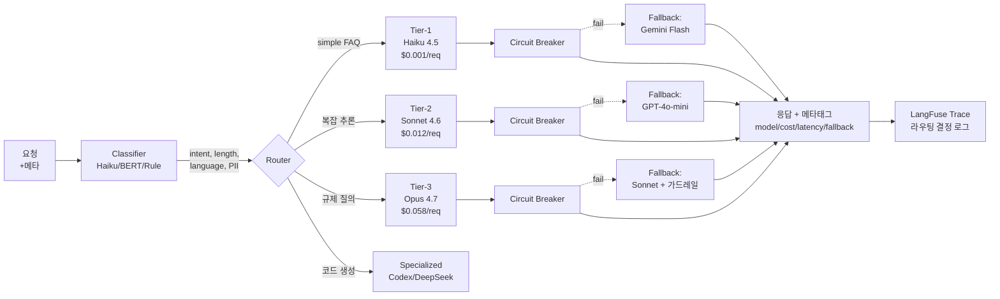

### LLM Routing & Fallback — "GPT-4o 하나로 통일하면 되지"라는 순진함, 그리고 결제 FAQ 하나당 $0.023을 삼키던 챗봇이 OpenAI us-east-1 Partial Outage로 2시간 침묵한 뒤 Haiku 폴백을 급조했지만 환불 안내의 호칭이 "고객님"에서 "사용자"로 바뀌어 CS 민원이 다시 터진 금요일 새벽

#### 1. 사건의 재구성

```
[D-30] 챗봇 PoC 론칭. 모델은 GPT-4o 하나.
       비용? "트래픽 작으니 괜찮아요."
       품질? "제일 똑똑한 거 썼으니 괜찮아요."
       장애? "OpenAI 안 죽으니 괜찮아요."

[D-14] 월간 LLM 청구서 $142,000.
       재무팀: "FAQ 답변 하나에 왜 $0.023이 들어가요?"
       분석해 보니 전체 질의의 71%가 "운영시간 알려주세요" 수준.
       → Haiku로도 충분한 걸 Opus급으로 때리고 있었음.

[D-07] 금요일 02:14 KST, OpenAI us-east-1 Partial Outage.
       Rate Limit도 아니고 5xx도 아니고,
       응답은 오는데 평균 레이턴시가 1.4s → 38s.
       헬스체크는 200. 서킷 브레이커는 안 열림.
       챗봇 상담창 "입력 중..." 2시간 지속.

[D-06] 긴급 대응: Anthropic Haiku로 트래픽 전환.
       코드 2줄 수정 → `model="claude-haiku-4-5"`.
       배포 완료, 응답 돌아옴. "해결됐습니다 ✓"

[D+00] 금요일 11:30, CS팀장:
       "환불 안내 답변이 '사용자님'이라고 나와요.
        우리 10년간 '고객님'으로 통일했는데요?"
       톤·호칭·금칙어 규칙이 프롬프트가 아니라
       GPT-4o의 '암묵적 학습'에 묶여 있었다는 사실 발견.
```

문제의 본질은 **"하나의 모델을 모든 요청에, 하나의 프로바이더를 모든 트래픽에"** 라는 디폴트 선택이다. 라우팅은 비용 최적화 테크닉이 아니라 **가용성·품질·비용 세 축의 분리 가능성** 그 자체다.

#### 2. 두 개의 다른 문제: Routing vs Fallback

둘은 자주 섞여 쓰이지만 **트리거와 목적이 다르다.**

| 축 | Routing (라우팅) | Fallback (폴백) |
|---|---|---|
| **언제 결정하나** | 요청이 들어오는 **순간** | 1차 호출이 **실패/열화한 뒤** |
| **왜 하나** | 요청 특성에 맞는 모델 선택 (비용/품질/지연) | 가용성·SLA 유지 |
| **트리거** | 분류기, 룰, 메타데이터 | 5xx, 타임아웃, Rate Limit, 품질 저하 신호 |
| **실패 모드** | 분류 오류 → 품질 저하 | 폴백 모델 품질/톤 불일치 → 사일런트 리그레션 |
| **코드 위치** | 요청 전처리 (Gateway/Router) | 호출 래퍼 (Circuit Breaker + Retry) |

**둘 다 필요하고, 둘 다 LLM Gateway 위에 얹어야 한다.** Gateway 없이 서비스에 직접 꽂으면 라우팅 룰이 23개 서비스에 복붙된다 (이전에 다룬 LLM Gateway 사건의 변주).

#### 3. 전체 구조도



핵심은 **라우터와 폴백이 독립 레이어**라는 점이다. 라우터가 "이 요청은 Tier-1 Haiku"로 결정했어도, Haiku가 죽으면 Fallback이 "Gemini Flash"로 교체한다. 라우팅 결정과 실제 서빙 모델은 응답 메타데이터에 **반드시** 함께 찍혀야 한다. 안 그러면 품질 리그레션의 원인을 추적할 수 없다.

#### 4. 라우팅 전략 4단계 — 어디까지 가야 하나

**(a) Static Rule-based**: `token_count < 500 && intent in [FAQ, greeting] → Haiku`
- 구현 1일. 커버리지 60~70%. 분류 실패 시 비용 폭탄.
- **적정 지점**: PoC~Pre-GA. 월 트래픽 100만 미만.

**(b) Classifier-based (Semantic)**: 작은 분류기(DistilBERT, Haiku 자체)가 intent/complexity를 라벨링 → 룰 테이블 매핑.
- 분류기 자체도 레이턴시 50~200ms 추가, 오분류율 3~8%.
- **적정 지점**: 월 트래픽 1,000만. 명확한 intent 카테고리 존재.

**(c) Learned Router (RouterLLM, Not Diamond)**: 쿼리 → 최적 모델을 **학습**된 라우터가 예측. 과거 요청·모델·품질 쌍으로 학습.
- Martian·Not Diamond 상용 솔루션 존재. 자체 구현은 데이터 수집·라벨링·재학습 파이프라인 필요.
- **적정 지점**: 월 LLM 비용 $50K+. 품질/비용 Pareto 곡선을 실제로 최적화해야 할 때.

**(d) Cost-aware Budget Router**: 월 예산 상한을 유저/테넌트별로 설정, 소진 시 자동 하위 티어로 강등.
- B2B SaaS에서 필수 (Free/Pro/Enterprise plan별 모델 티어).
- **구현 포인트**: 토큰 소비는 **응답 후**에만 정확히 알 수 있음 → 사전 추정 + 사후 보정 이중 계산.

```python
# (b) Classifier-based 라우터의 핵심 결정 로직 — 실제 서비스 예
def route(request: LLMRequest) -> ModelConfig:
    # 1차: 하드 룰 (레이턴시 ~0)
    if request.user_tier == "enterprise" and request.intent == "legal":
        return TIER_3_OPUS   # 규제 질의는 무조건 최상위

    if request.contains_pii:
        return SELF_HOSTED_LLAMA  # 외부 모델 금지

    # 2차: 분류기 (레이턴시 +80ms)
    label = classifier.predict(request.prompt)  # Haiku-based
    complexity = label.complexity  # 1~5

    # 3차: 예산 체크
    if tenant_budget_used_ratio(request.tenant_id) > 0.9:
        complexity = max(1, complexity - 1)  # 티어 강등

    return COMPLEXITY_TO_MODEL[complexity]
```

#### 5. Fallback 전략 — "열화"를 어떻게 감지하나

**폴백의 함정은 "5xx만 보는 것"이다.** 실제 LLM 장애의 70%는 2xx를 유지한 채 다음과 같이 열화한다:

- **Soft failure 1**: 레이턴시 p99 2s → 25s (여전히 200 OK).
- **Soft failure 2**: Rate Limit 안에 들어가지만 TPM이 깎여 토큰 생성 속도 감소.
- **Soft failure 3**: 응답은 오는데 토큰 중간에 잘리거나 반복(`"죄송합니다 죄송합니다 죄송합니다..."`).
- **Soft failure 4**: 지역/언어별 품질 저하 (한국어 톤이 번역체로 바뀜).

따라서 Circuit Breaker는 **상태코드가 아니라 SLO 지표 기반**이어야 한다:

```
Trigger 조건 (OR):
- HTTP 5xx 비율 > 2% (최근 1분)
- p99 레이턴시 > SLO × 2
- 응답 토큰/초 < 베이스라인의 40%
- 반복 패턴 감지 (same n-gram 3회 이상)
- JSON 파싱 실패율 > 5% (structured output 요구 시)
```

**폴백 품질 보증의 핵심**: 폴백 모델에도 **같은 시스템 프롬프트·같은 가드레일·같은 톤 가이드**가 적용되는지 사전 검증해야 한다. 사건 재구성에서 "고객님 → 사용자님"으로 바뀐 이유가 바로 이것. GPT-4o는 암묵적으로 "고객님"을 썼지만, Haiku는 명시적 지시가 없으면 "사용자"를 쓴다. **폴백은 코드 2줄이 아니라, 폴백 모델별 Golden Set 평가 통과가 전제조건이다.**

#### 6. 실제 사례

| 회사/시스템 | 어떻게 쓰고 있나 | 왜 그 선택을 했나 |
|---|---|---|
| **Shopify Sidekick** | GPT-4 primary, Claude Sonnet fallback. 머천트별 쿼리 복잡도에 따라 Haiku로도 라우팅. | 2024년 OpenAI 장애 몇 차례 겪은 뒤 멀티 프로바이더 강제. 단일 벤더 락인 리스크 제거가 비용보다 우선. |
| **DoorDash 메뉴 분류** | Haiku로 1차 intent 분류 → Sonnet으로 실제 생성. 전체 쿼리의 85%가 Haiku 선에서 끝남. | 월 수백만 건 메뉴 아이템 분류. Opus/GPT-4o 풀가격은 ROI 안 나옴. 분류-생성 분리로 비용 ~70% 절감. |
| **Lyft 내부 LLM Platform** | 자사 LLM Gateway에 cost-aware 라우터 내장. 엔지니어가 모델을 지정하지 않아도 됨. | 100+ 내부 서비스가 LLM을 쓰면서 "어느 팀이 어느 모델을 왜 쓰는지" 추적 불가. 중앙화 필수. |
| **Not Diamond** | Learned Router를 서비스로 판매. 쿼리당 최적 모델을 라우팅. | 한 프로바이더가 모든 쿼리에서 최고가 아니라는 벤치마크 축적 → "모델별 Pareto frontier" 자체를 상품화. |
| **Perplexity** | 질의 유형별로 Sonnet / GPT / 자체 Sonar 모델 분기. 유저가 선택 가능 + 자동 라우팅. | 검색 품질 ≠ 추론 품질 ≠ 코드 품질. 하나로 다 못 함. 선택권 자체가 UX. |
| **OpenRouter** | 400+ 모델을 단일 API로 통합. 가격·레이턴시·가용성 기반 자동 라우팅. | 멀티 프로바이더 통합 자체가 상품. "ChatGPT 하나로 다 되는 세상"은 이미 끝났다는 베팅. |

#### 7. 트레이드오프

| 선택 | 얻는 것 | 잃는 것 / 숨은 비용 |
|---|---|---|
| **단일 모델 (라우팅 없음)** | 디버깅·톤 일관성·코드 단순성 | 비용 3~10배, 벤더 락인, 장애 전파 |
| **Static Rule 라우팅** | 2일 구현, 투명한 결정 | 룰 개수 선형 증가, 엣지 케이스 미스 |
| **Learned Router** | 비용 최대 70% 절감, 자동 최적화 | 데이터 수집·라벨링 파이프라인, 블랙박스 결정, 라우터 자체 장애 리스크 |
| **멀티 프로바이더 Fallback** | 가용성 99.9% → 99.99%, 벤더 레버리지 | 프롬프트 N벌 유지·평가, 톤 리그레션, 복잡한 Golden Set |
| **자체 호스팅 + API 하이브리드** | PII 안전, 비용 상한 | GPU 운영 비용, 모델 품질 격차, 운영 인력 |

#### 8. 시니어 백엔드 관점 — 언제 쓰고 언제 쓰면 안 되는가

**써야 하는 신호**
- 월 LLM 비용 $10K 돌파. 쿼리 복잡도 분포가 **비대칭** (대부분 단순, 일부만 복잡).
- 단일 프로바이더 장애가 **매출/SLA/계약**에 직결되는 B2B 제품.
- 멀티 테넌트 SaaS에서 **plan별 품질 차등**을 둬야 할 때.
- 규제·PII로 **특정 요청은 외부 모델 금지**가 걸릴 때.
- 응답 레이턴시 SLO가 **p95 < 2s** 수준이라 대형 모델만으로는 못 지킬 때.

**쓰면 안 되는/미루는 신호**
- **PoC·Pre-GA 단계.** 트래픽이 월 100만 미만이면 라우팅 복잡도가 ROI를 못 넘긴다. 하나로 고정하고 LangFuse로 비용 분해만 해도 충분.
- **품질 평가 체계가 없을 때.** 폴백·라우팅은 Golden Set과 LLM-as-Judge가 **먼저 있어야** 한다. 평가 없이 라우터부터 넣으면 "뭐가 더 나빠졌는지도 모르는 채" 돌아간다 (앞서 다룬 LLM Evaluation 사건의 연장선).
- **단일 intent만 처리하는 좁은 서비스.** 코드 리뷰 봇, SQL 생성기처럼 쿼리 분포가 단조로우면 라우팅 이득이 거의 없다.
- **프롬프트가 아직 자주 바뀌는 단계.** 라우팅 대상이 N개면 프롬프트·평가·버전 관리 비용도 N배. 프롬프트가 안정화된 뒤에 라우팅을 얹는다.

**실패하는 전형적인 패턴 3가지**
1. **"그냥 cheaper 모델로 폴백하면 되지"** → 폴백 모델의 톤·호칭·금칙어 평가 생략 → 사일런트 리그레션. 폴백 모델별 Golden Set은 라우팅 코드보다 먼저 만들어야 한다.
2. **"5xx 보고 폴백"** → 소프트 열화 (레이턴시·토큰 반복)에는 반응 못 함. SLO 지표 기반 Circuit Breaker 필요.
3. **"응답 메타데이터 기록 안 함"** → "요즘 품질이 좀 떨어졌다"는 신고에 "어느 모델이 응답했는지"조차 모름. `model_served`·`fallback_triggered`·`routing_decision`은 로그·DB·응답 헤더 **삼중**으로 찍어야 한다.

> 💡 **왜 중요한가**: 단일 모델·단일 프로바이더 선택은 "일단 간단하게 가자"가 아니라 **가용성·품질·비용 세 축을 한 덩어리로 묶어버리는** 아키텍처 결정이고, 라우팅과 폴백은 그 세 축을 다시 떼어내 각각 독립적으로 조정 가능한 레버로 만드는 유일한 방법이다.
