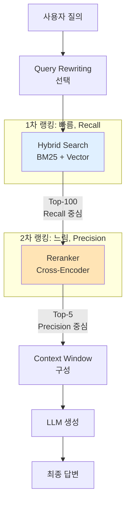

### Reranking — "Top-10 뽑았으면 됐지"라는 순진함, 그리고 Hybrid Search가 7위에 꽂은 정답 문서를 LLM이 2위 문서만 보고 "해당 정보가 없습니다"라고 답한 뒤 CS팀이 "답변 품질 저하 리포트"를 올린 월요일 오후

---

#### 그 월요일 오후, 무슨 일이 있었나

Hybrid Search를 성공적으로 깔았다. BM25로 "주문번호 ORD-20260314-7812"도 잡아내고, 벡터 검색으로 "환불이 느려요"의 함의도 집어내게 됐다. CS 챗봇 상담사들은 "이제 좀 쓸 만하다"고 했다.

그런데 월요일 아침, 품질 QA팀이 샘플 추출한 100건 중 **17건**에서 이상한 패턴을 발견했다.

> **질의**: "구독 자동결제 중단하면 남은 기간은 쓸 수 있나요?"
> **Retriever Top-10에 정답 문서 존재**: ✅ (7위, "구독 해지 후 잔여 기간 이용 정책")
> **LLM 답변**: "해당 정보를 찾을 수 없습니다. 고객센터로 문의 바랍니다."

Retriever는 정답을 **가져왔다**. 그런데 LLM이 **못 봤다**. 왜?

LLM 컨텍스트에는 Top-10을 다 넣었는데, 1위~3위에 꽂힌 문서가 "구독 상품 안내", "자동결제 결제수단 변경", "결제 실패 시 재시도" 같은 **키워드는 겹치지만 질문의 의도와 어긋나는** 문서들이었다. GPT-4o의 "Lost in the Middle" 현상(2024, Liu et al.)이 겹치면서, 7위에 있던 정답은 사실상 **읽히지 않았다**.

Hybrid Search가 "정답을 Top-K 안에 넣는 것"까지는 했지만, "정답을 Top-1~3 안에 넣는 것"은 못한 거다. 그리고 **Retrieval의 1차 랭킹은 원래 그런 걸 하라고 만든 게 아니다**.

여기서 Reranker가 등장한다.

---

#### Reranker가 뭘 하는가 — Bi-Encoder vs Cross-Encoder

Retrieval 단계에서 쓴 임베딩 모델(OpenAI `text-embedding-3-large`, BGE-M3 등)은 **Bi-Encoder**다. 질의와 문서를 **각각 따로** 인코딩해서 벡터 공간에서 코사인 유사도로 비교한다.

```
[Bi-Encoder: Retrieval용]
질의 ──► Encoder ──► 벡터_q
문서 ──► Encoder ──► 벡터_d    => cosine(벡터_q, 벡터_d)

장점: 문서를 미리 임베딩해둘 수 있다. 1,200만 건을 100ms 안에 Top-K 뽑는다.
단점: 질의와 문서가 "만나지" 않는다. 각자 요약된 벡터로만 비교한다.
```

Cross-Encoder는 다르다. **질의와 문서를 한 쌍으로 묶어서** Transformer에 통째로 넣는다.

```
[Cross-Encoder: Reranking용]
[CLS] 질의 토큰 ... [SEP] 문서 토큰 ... [SEP] ──► Transformer ──► relevance score

장점: Self-Attention이 질의 단어 하나하나와 문서 단어 하나하나를 교차 참조한다.
     "자동결제 중단 → 잔여 기간" 같은 의미 결합을 잡아낸다.
단점: 질의가 오면 그제서야 N개 문서랑 N번 forward pass. 100ms × N 소요.
```

**바로 이 트레이드오프가 Reranker 아키텍처의 전부다.** Bi-Encoder로 1,200만 건에서 Top-100 빠르게 뽑고, Cross-Encoder로 그 100건만 정밀 재채점해서 Top-5로 압축한다.

---

#### 전체 파이프라인에서의 위치



핵심은 역할 분리다.

| 단계 | 목표 지표 | 처리량 | 지연 |
|------|----------|--------|------|
| Hybrid Search | **Recall@100** (정답이 Top-100에 들어 있는가) | 1,200만 건 → 100개 | ~80ms |
| Reranker | **nDCG@5 / MRR** (정답이 Top-1~5에 있는가, 몇 위인가) | 100 → 5개 | ~200~500ms |
| LLM 생성 | **답변 품질** | 5개 문서 사용 | ~1,500ms |

Retriever한테 "Precision도 책임져"라고 떠넘기면 Recall이 깎인다. Reranker한테 "1,200만 건 다 재채점해"라고 하면 지연이 분 단위로 간다. **각자 잘하는 걸 시키는 패턴**이다.

---

#### 선택지 — 2026년 현재 실무 옵션

| Reranker | 유형 | 지연(100문서) | 비용 | 비고 |
|---------|-----|--------------|-----|------|
| **Cohere Rerank v3** | API | ~250ms | $2 / 1K 검색 | 다국어 강력, SaaS 표준 |
| **Voyage rerank-2** | API | ~180ms | $0.05 / 1M 토큰 | 긴 컨텍스트(16K) 지원 |
| **BGE Reranker v2-m3** | 오픈소스 | ~400ms (A100) | 자체 호스팅 | 한국어 포함 다국어, 상용 가능 |
| **Jina Reranker v2** | API/오픈소스 | ~200ms | API $18 / 1M | Function Calling 특화 |
| **MixedBread mxbai-rerank** | 오픈소스 | ~350ms (A100) | 자체 호스팅 | Apache 2.0 |

실무 체크리스트:

- **다국어/한국어 필수?** → Cohere Rerank v3 또는 BGE Reranker v2-m3
- **긴 문서(5K+ 토큰)?** → Voyage rerank-2 (16K 지원)
- **데이터가 사내에서 못 나가?** → BGE / mxbai 자체 호스팅
- **빠른 PoC?** → Cohere API 한 줄로 끝. 나중에 자체 호스팅으로 이전

---

#### 트레이드오프 — 왜 안 쓰는 팀도 있는가

Reranking은 공짜가 아니다. 결정 전에 재야 할 것들.

**1) 지연의 벽**

Top-100을 재채점하면 Cross-Encoder가 100번 돈다. Cohere Rerank v3가 100문서 기준 ~250ms. 사용자 입장에서 **총 응답 시간이 1.3초 → 1.6초**가 된다. 사내 챗봇은 괜찮다. 실시간 자동완성은 못 쓴다.

→ 대안: Top-K를 50 또는 25로 줄이거나, 임계값 기반 조기 종료.

**2) 비용의 중첩**

Hybrid Search에 이미 벡터 DB 비용이 있다. 거기에 Rerank API 비용이 더해진다. Cohere Rerank 기준으로 질의 100만 건/월이면 **월 $2,000**. LLM 호출 비용에 비하면 작아 보이지만, 의외로 "RAG 전체 비용의 15~20%"를 차지하는 경우가 흔하다.

→ 대안: Rerank는 Top-3 이상 점수 차이가 작을 때만 호출하는 **조건부 리랭킹**.

**3) 복잡도의 증가**

파이프라인에 **노드가 하나 더 늘어난다**. 장애 지점이 늘고, 평가 대상도 늘고, 모니터링 대상도 늘고, 캐시 전략도 복잡해진다. [[ai-observability-langsmith-langfuse]]를 안 깐 상태에서 Reranker를 추가하면, 답변이 이상해졌을 때 "Retriever가 못 가져온 건지, Reranker가 잘못 재정렬한 건지, LLM이 못 읽은 건지"를 구분 못 한다.

**4) Reranker 자체의 품질이 데이터에 맞지 않을 수도**

Cohere Rerank는 범용 모델이다. **당신의 도메인(금융 약관, 의료 가이드라인, 사내 ERP 매뉴얼)에 특화되지 않았다**. 가끔 Hybrid Search 결과가 더 나은 경우도 생긴다.

→ 대안: 자체 데이터로 BGE Reranker **Fine-tuning**. 쿼리-문서 쌍 2,000~5,000개면 눈에 띄는 개선.

---

#### 실제 사례

**Perplexity AI** — 검색 결과 재정렬에 자체 파인튜닝한 Reranker를 쓴다. 공개된 블로그(2024)에 따르면 "웹 검색 10~20개 결과를 Reranker로 압축한 뒤 LLM에 넘기는 구조"가 Perplexity 품질의 핵심이라고 명시. 범용 Rerank가 아니라 **"답변 가능한 소스를 상위로 올리도록"** 학습시킨 커스텀 모델.

**Vespa (Yahoo)** — 2단계 랭킹을 공식 아키텍처로 둠. **Phase 1**: BM25 + ANN으로 Top-1000. **Phase 2**: Cross-Encoder 또는 Learning-to-Rank로 Top-10. 야후 검색, 광고 랭킹, 쇼핑 추천 모두 이 패턴.

**Elastic 8.11+** — ELSER(Elastic의 자체 Sparse 모델)로 1차 검색 후, Cohere/HuggingFace Reranker 노드를 **인덱스 파이프라인에 직접 꽂을 수 있는** `rerank` processor를 제공. "RAG를 ES 위에서 쪽박 안 깨고 쓰고 싶은" 팀들의 디폴트가 됨.

**LangChain / LlamaIndex 생태계** — 2024년 하반기부터 거의 모든 레퍼런스 아키텍처가 Retriever 뒤에 Reranker 노드를 포함. "RAG 품질 안 나와요"의 90%가 Reranker 미도입으로 분류됨.

---

#### 언제 쓰고, 언제 쓰면 안 되는가

**써야 할 때**
- Retriever(Hybrid Search 포함)의 **Top-5 Precision이 명백히 부족한 경우** — "Top-10에는 정답이 있는데 Top-3에는 없다"가 반복 관측.
- 질의와 문서 모두 **자연어 문장**인 경우 — FAQ, 매뉴얼, 지식베이스 Q&A.
- **답변 품질이 비용/지연보다 중요한 도메인** — 법률, 의료, 금융 상담, 내부 지식베이스.
- 컨텍스트 윈도우가 작은 모델(Claude Haiku, Llama 3 8B)로 LLM 호출을 압축하고 싶을 때 — Top-100을 전부 넣을 수가 없으니 Top-5로 추려야 함.

**쓰지 말아야 할 때**
- **지연이 생명인 경우** — 자동완성, 실시간 추천 피드. Rerank 250ms가 사용자 이탈로 직결.
- **정확한 식별자 매칭이 핵심인 경우** — 주문번호, 사번, SKU 검색은 BM25로 이미 끝남. Reranker는 오히려 **키워드 매칭을 "유사한 다른 의미"로 밀어낼 수 있음**.
- **Retriever 품질이 아예 바닥인 경우** — Recall@100이 60%도 안 되는 상태. 재채점으로 올릴 수 없는 걸 올리려 하는 셈. Chunking 전략과 임베딩 모델부터 손봐야 함.
- **쿼리 볼륨이 극단적으로 많은데 지불 능력이 적을 때** — 월 수억 건 레거시 검색을 바꾸는 상황이면 자체 호스팅 Reranker + GPU 투자를 계산해야 함.
- **평가 체계가 없는 경우** — Reranker 도입 전/후 nDCG@5, MRR 변화를 측정 못 하면 "체감상 좋아진 것 같은" 결론만 남고, 비용은 영원히 깔림.

---

#### 시니어 체크리스트

1. **Retrieval 분리 측정부터**: Recall@100(정답이 Top-100에 들어있는가)과 Precision@5(Top-5에 몇 개가 관련 있는가)를 **따로** 측정. 전자가 낮으면 Reranker가 아니라 Hybrid Search / Chunking 문제.
2. **Rerank 임계값**: Top-1~Top-3 relevance score 차이가 **0.1 미만**인 경우만 Rerank를 돌리는 조건부 전략 검토.
3. **캐시 전략**: Reranker 결과도 질의 정규화 후 캐시 가능. 다만 [[semantic-cache]]에서 봤듯이 임계값 설계가 전부.
4. **Fallback 설계**: Reranker API가 죽으면 Retriever Top-5를 그대로 넘기는 **Graceful Degradation**. 품질은 떨어지지만 서비스는 산다.
5. **평가 자동화**: Reranker 교체/파인튜닝은 **nDCG@5가 기준치 이상일 때만** 롤아웃. [[llm-evaluation]]과 동일한 원칙 — "휴먼 QA 샘플 100건"으로 결정하지 말 것.

---

> 💡 **왜 중요한가**: Retriever의 Recall과 LLM의 Precision 사이에는 "뽑긴 했지만 못 읽히는 문서"라는 실무 함정이 존재하고, Reranker는 이 간극을 메우는 전용 레이어다 — 안 깔면 "Top-K엔 있었지만 답변엔 안 나온" 품질 저하가 영원히 반복된다.
