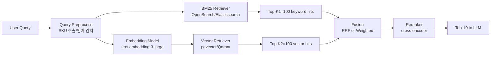

### Hybrid Search (Vector + Keyword) — "임베딩이 다 해줄 거야"라는 순진함, 그리고 "LG OLED C3 55"를 검색한 고객에게 "삼성 QLED 55 라이프스타일"을 1위로 꽂아 넣고 전환율이 3일간 2.1%p 깎인 뒤에야 "벡터 검색이 모델번호를 못 읽는다"는 걸 백오피스 시니어 PM이 Slack에 한 줄로 올려 발견한 금요일 오후

#### 사건 재구성

- 금요일 09:42, 가전 커머스 검색팀이 "구형 Elasticsearch BM25에서 pgvector 임베딩 검색으로 교체" 배포 완료. QA 샘플 100건에서 NDCG@10이 0.61 → 0.78로 올라감.
- 월요일 14:00, 모델번호 검색 전환율만 선택적으로 3일간 2.1%p 하락. 전체 지표는 평평하게 보여서 모니터링 알람은 안 울림.
- 원인: `"LG OLED C3 55"` 질의 임베딩이 `"프리미엄 55인치 거실용 TV"`와 코사인 0.89로 묶이고, 정작 모델번호 `OLED55C3KNA`가 들어간 상품 페이지는 1위에서 7위, 15위로 밀려남. 사용자는 1페이지에서 "이게 아닌데"하고 이탈.
- 벡터는 **의미**는 알지만 **문자열의 정확성**은 모른다. BM25는 반대다.

#### 왜 둘 중 하나만으론 안 되는가

| 질의 유형 | BM25 (Keyword) | Dense Vector |
|---|---|---|
| `"OLED55C3KNA"` (모델번호) | 정확히 매칭 → 1위 | 토큰이 OOV, 0.3대 유사도 → 20위권 |
| `"거실에서 영화 보기 좋은 TV"` | 거의 매칭 안 됨 | 의미 포착 → 상위권 |
| `"환불 어떻게 해요"` | "환불" 포함 FAQ 다수 | 문맥 유사 FAQ 포착 |
| `"iPhone 15 Pro Max 256GB"` | 완벽 매칭 | 색상 변형들과 섞임 |

**본질**: BM25는 lexical (철자/토큰 매칭), Dense는 semantic (의미 분포). 운영 환경 질의는 두 종류가 섞여 들어온다. 어느 한쪽을 끄면 반드시 어느 한쪽의 질의가 깨진다.

#### 아키텍처: 2채널 조회 후 융합



핵심은 **두 검색을 병렬로 돌리고 Top-K를 넉넉히 뽑은 뒤 융합**한다는 점. 융합 전략은 세 종류다.

#### 융합 전략 3가지

**1) RRF (Reciprocal Rank Fusion)** — 점수가 아니라 **순위**만 쓴다.

```
score(d) = Σ 1 / (k + rank_i(d))     # k=60 관례
```

- 장점: BM25 점수 스케일(0~수십)과 벡터 코사인(0~1)을 **정규화할 필요가 없다**. 서로 다른 분포의 스코어를 섞을 때 가장 안전함.
- 단점: 점수 차이의 "정도"가 사라짐. 1위 BM25 점수가 압도적으로 높아도 7위 벡터와 동급 취급.
- **Elasticsearch 8.9+, OpenSearch, Weaviate hybrid search**의 기본값.

**2) Weighted Linear Combination** — 점수를 정규화한 뒤 가중합.

```
score(d) = α · norm(bm25) + (1-α) · norm(cosine)
```

- 장점: α로 트래픽별 튜닝 가능 (모델번호 트래픽이 많은 가전 쇼핑몰은 α=0.6, 자유 질의가 많은 FAQ는 α=0.3).
- 단점: 정규화 방식(min-max, z-score, sigmoid)에 따라 결과가 흔들림. BM25 분포가 쿼리마다 달라 **쿼리별로 안정적이지 않다**.

**3) CC (Convex Combination with per-query normalization)** — 쿼리마다 각 채널의 Top-K 분포로 재정규화.

- 장점: 쿼리 간 분포 흔들림이 적음.
- 단점: 구현 복잡. 라이브러리 지원 적음.

**실무 판단**: **처음은 RRF**로 시작. 지표가 안 오를 때만 Weighted로 넘어가서 트래픽 세그먼트별로 α를 다르게 쥔다.

#### 실제 사례

- **Vespa (Yahoo)** — Hybrid를 그냥 쓰는 수준이 아니라 **네이티브로 두 Retriever를 하나의 ranking profile에서 동시에 다룬다**. BM25와 nearestNeighbor를 하나의 쿼리 트리에 합쳐서 single-pass로 평가. 전자상거래/뉴스 검색에서 지배적인 이유.
- **Elasticsearch 8.9+** — `_search`에 `retriever: { rrf: {...} }` 공식 지원. 2024년 이전엔 애플리케이션 레이어에서 두 쿼리 돌려서 병합해야 했음. 직접 RRF 구현한 조직은 지금도 레거시로 돌아가고 있음.
- **Weaviate** — `hybrid` 쿼리에 `alpha` 파라미터 하나로 BM25:Vector 비율 조절. 0.5가 기본. UI/운영 측면에서 가장 심플함.
- **Shopify 상품 검색** — 2024년 공개 테크블로그에서 "모델번호/SKU는 BM25, 자연어 질의는 Dense, 둘 다 돌리고 RRF" 패턴을 명시. 전체 전환율이 한 자릿수 % 단위로 상승.
- **Perplexity, You.com** — 웹검색 Agent는 거의 전원 Hybrid. 고유명사/최신 뉴스 토큰이 임베딩 학습에 없기 때문에 Dense만으론 recall이 깨짐.

#### 트레이드오프

| 선택 | 얻는 것 | 잃는 것 |
|---|---|---|
| **벡터만** | 의미 검색, 다국어 자연스러움 | SKU/고유명사/최신 토큰 recall 깨짐 |
| **BM25만** | 정확한 매칭, 설명 가능성, 비용 거의 0 | 동의어/의역/다국어 recall 깨짐 |
| **Hybrid (RRF)** | 두 유형 질의 모두 커버 | Latency 1.5~2배, 인프라 2채널 운영, Top-K가 커지면 Reranker 부하 ↑ |
| **Hybrid + Rerank** | 품질 상한 돌파 | p95 Latency 300ms+ 추가, GPU 비용, 캐시 적중률 하락 |

**눈에 안 띄는 함정**:
- **BM25 index 신선도 ≠ Vector index 신선도.** BM25는 수 초 내 반영, 벡터는 임베딩 재계산 + ANN 재빌드로 수 분~수 시간. 두 채널이 "서로 다른 세계"의 상품을 보고 있으면 품질이 되려 떨어진다. 두 index의 lag를 모니터링해야 함.
- **다국어 혼재 트래픽.** 한글 질의가 BM25에서 분석기(nori) 설정 틀어지면 recall이 통째로 0. Hybrid라서 Vector가 가려주지만, "왜 BM25 측 신호가 다 사라졌는지" 알림이 안 오면 서서히 품질이 썩는다.
- **임베딩 모델 교체 시 α 재튜닝 필요.** `text-embedding-ada-002` → `text-embedding-3-large` 교체 후 α가 그대로면 벡터 쪽이 과대평가되거나 과소평가됨.

#### 언제 쓰고, 언제 쓰면 안 되나

**써야 할 때**
- 질의에 **고유명사·모델번호·버전**이 자주 섞인다 (전자상거래, SaaS 문서, 티켓링 시스템, 코드 검색).
- 다국어 트래픽이 섞이고 임베딩 모델이 모든 언어에 균질하지 않다.
- 사용자가 "정확히 이 단어가 들어간 결과"를 기대하는 UX다 (법률, 의료, 규제 문서).

**쓰지 말아야 할 때**
- **질의가 다 자연어 자유 질문**이고 고유명사가 거의 없다 (고객 상담 FAQ, 심리상담 챗봇). → Dense만으로 충분. BM25 채널 유지 비용이 아깝다.
- **인덱스 운영팀이 1명**이고 BM25 analyzer와 Vector pipeline을 둘 다 깊이 못 본다. → 하나로 시작, 지표가 깨지는 세그먼트가 명확해지면 그때 도입.
- **p95 Latency 100ms 미만을 반드시 지켜야** 하고 Reranker까지 넣을 여유가 없다. → 둘 중 승률 높은 쪽만. (대개 Dense.)
- **문서 1만 건 이하**. → 어차피 둘 다 recall이 거의 100%라 융합의 의미가 없다. 운영 복잡도만 추가됨.

#### 체크리스트 (도입 전)

- [ ] 트래픽 샘플 1,000건을 **"키워드 중심 / 자연어 중심 / 혼합"** 셋으로 라벨링했는가?
- [ ] 세그먼트별로 BM25-only, Vector-only, Hybrid의 NDCG@10을 각각 측정했는가?
- [ ] 두 index의 **신선도 lag를 모니터링**할 메트릭이 있는가?
- [ ] α(또는 RRF k)를 **쿼리 세그먼트별로 다르게** 적용할 수 있도록 라우팅 레이어가 있는가?
- [ ] Hybrid가 BM25-only보다 **"어떤 세그먼트"에서 지는지** 아는가? (지는 세그먼트는 반드시 생긴다.)

> 💡 **왜 중요한가**: 벡터 검색은 "의미는 알지만 글자는 모른다" — 운영 트래픽의 1/3을 차지하는 고유명사·모델번호·버전 질의를 통째로 흘려버리고, 전체 지표는 평평해 보여서 발견이 늦다.
