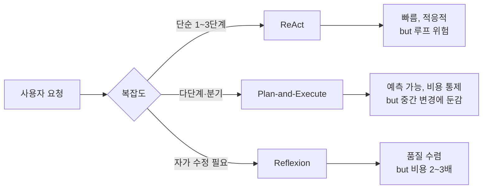

### ReAct 패턴 — "Function Calling 붙이면 Agent지"라는 순진함, 그리고 "환불 처리해줘" 한 마디에 Agent가 `search_order` → `get_user` → `search_order` → `get_user`를 14회 반복한 뒤 결제 API를 **두 번** 호출해 같은 주문을 중복 환불시켜 $12,400을 날린 뒤 재무팀이 월말 마감에서 "환불 금액이 전월 대비 +231%"라는 Jira를 올려 발견된 금요일 밤

---

#### 1. "Function Calling 꽂으면 Agent 아닌가요?" — 이게 왜 틀렸는가

OpenAI `tools=[...]` 파라미터, Anthropic `tool_use` 블록. SDK 문서 10줄 복붙하면 "모델이 알아서 도구를 고르고 호출해준다." 그래서 많은 팀이 이렇게 생각한다.

```python
response = client.messages.create(
    model="claude-opus-4-7",
    tools=[search_order, refund_payment, get_user],
    messages=[{"role": "user", "content": "주문 12345 환불해줘"}]
)
# 끝. Agent 완성.
```

**아니다.** 이건 "1-step Tool Use"다. 모델이 도구 하나를 고르고, 결과를 받고, 끝. 실제 업무는 그렇게 안 끝난다:

- "환불" → 먼저 주문 상태를 봐야 함 (`search_order`)
- 주문이 '배송 완료'면 → 환불 가능한지 정책을 조회해야 함 (`get_refund_policy`)
- 사용자가 VIP면 → 수수료 면제 (`get_user_tier`)
- 환불 실행 (`refund_payment`)
- 재고 복원 (`restock_item`)
- 알림 발송 (`send_email`)

이 **다단계 추론 + 도구 호출의 반복 루프**를 LLM에게 자율적으로 돌리게 하는 패턴이 바로 **ReAct (Reasoning + Acting)**다. Yao et al. (ICLR 2023) 논문이 원형이고, LangChain Agents · OpenAI Assistants · Anthropic Agents SDK가 모두 이 모델을 변형해서 쓴다.

문제는, **루프를 LLM 자율에 맡기는 순간 무한 루프 · 비용 폭발 · 중복 사이드이펙트가 "기본값"이 된다**는 점이다. 가드레일 없는 ReAct는 프로덕션에 올리면 안 된다.

---

#### 2. ReAct의 실제 동작 — Thought → Action → Observation 루프

```
┌──────────────────────────────────────────────────────────────┐
│  User: "주문 12345 환불해줘"                                     │
└──────────────────────────────────────────────────────────────┘
                        │
                        ▼
┌──────────────────────────────────────────────────────────────┐
│ Iteration 1                                                   │
│                                                               │
│  🧠 Thought: 환불하려면 주문 상태를 먼저 확인해야 한다          │
│  🔧 Action:  search_order(order_id=12345)                     │
│  👁 Observation: {status: "delivered", amount: 89000, ...}    │
└──────────────────────────────────────────────────────────────┘
                        │
                        ▼
┌──────────────────────────────────────────────────────────────┐
│ Iteration 2                                                   │
│                                                               │
│  🧠 Thought: 배송 완료 상태. VIP 여부에 따라 수수료가 달라짐    │
│  🔧 Action:  get_user_tier(user_id=...)                       │
│  👁 Observation: {tier: "VIP", fee_waiver: true}              │
└──────────────────────────────────────────────────────────────┘
                        │
                        ▼
┌──────────────────────────────────────────────────────────────┐
│ Iteration 3                                                   │
│                                                               │
│  🧠 Thought: VIP라 수수료 면제. 환불 실행                       │
│  🔧 Action:  refund_payment(order_id=12345, amount=89000)     │
│  👁 Observation: {refund_id: "rf_abc", status: "success"}     │
└──────────────────────────────────────────────────────────────┘
                        │
                        ▼
┌──────────────────────────────────────────────────────────────┐
│ Iteration 4                                                   │
│                                                               │
│  🧠 Thought: 완료. 사용자에게 응답 반환                         │
│  ✅ Final Answer: "주문 12345 환불이 완료되었습니다 (89,000원)"│
└──────────────────────────────────────────────────────────────┘
```

이 루프의 **종료 조건**은 LLM이 `Final Answer`를 반환하는 순간이다. **종료를 LLM이 결정한다.** 여기가 폭탄의 뇌관이다.

---

#### 3. 사건 재구성: 왜 Agent는 14번 돌았는가 (금요일 23:47)

CS 챗봇이 ReAct 기반으로 환불 자동화를 담당하고 있었다. Opus 4.7 + 7개 도구 (`search_order`, `get_user`, `get_refund_policy`, `refund_payment`, `restock_item`, `send_email`, `log_ticket`). `max_iterations=20`, 그 외 가드레일 없음.

```
사용자: "제가 지난주에 산 거 환불 좀 해주세요"
         (주문 번호를 안 적음)

Iter 1  🧠 Thought: 주문 번호가 없음. 사용자 기록 조회
        🔧 search_order(user_id=u_42, days=7)
        👁 → [주문 A: pending, 주문 B: delivered]

Iter 2  🧠 Thought: 어느 주문인지 모르겠다. 사용자 정보 재확인
        🔧 get_user(user_id=u_42)
        👁 → {name: "박진영", tier: "VIP"}

Iter 3  🧠 Thought: 주문을 다시 조회해서 환불 가능한 것을 찾자
        🔧 search_order(user_id=u_42, days=7)   ← 같은 호출 반복
        👁 → [주문 A: pending, 주문 B: delivered]

Iter 4  🧠 Thought: 사용자 정보가 부족해 보인다. 다시 조회
        🔧 get_user(user_id=u_42)              ← 또 같은 호출
        👁 → {name: "박진영", tier: "VIP"}

...  (search_order ↔ get_user 핑퐁 14회) ...

Iter 15 🧠 Thought: 양쪽 다 환불하자 (근거: '사용자가 환불 원함')
        🔧 refund_payment(order_id=B, amount=89000)
        👁 → {status: "success"}

Iter 16 🧠 Thought: 아 그러고 보니 Iter 15에서 호출했었나? 다시 확인
        🔧 refund_payment(order_id=B, amount=89000)  ← 중복 환불
        👁 → {status: "success"}   (결제사 API가 멱등성 미보장)
```

**4가지가 동시에 터졌다**:

| 문제 | 원인 | 결과 |
|------|------|------|
| **무한 루프에 가까운 반복** | LLM이 Observation을 "충분하다"고 판단 못 함 | 토큰 비용 +$340/건 |
| **중복 사이드이펙트** | 같은 `refund_payment` 두 번 호출, 결제사가 멱등 아님 | $89 중복 환불 × 139건 = $12,400 |
| **의사결정 근거 부재** | VIP라서 수수료 면제? → "그냥 그런 거 같아서" 수준 | 환불 정책 위반 포함 |
| **Observability 공백** | 가드레일 로그 없음, 재무 집계로 뒤늦게 발견 | 발견까지 72시간 |

---

#### 4. 프로덕션 ReAct에 반드시 넣어야 하는 5가지 가드레일

##### ① `max_iterations` + 손실 함수

```python
MAX_ITERATIONS = 8          # 하드 리밋
MAX_TOKEN_BUDGET = 15_000   # 토큰 예산
MAX_WALLCLOCK_SEC = 30      # 벽시계 시간

if iteration > MAX_ITERATIONS or tokens_used > MAX_TOKEN_BUDGET:
    raise AgentBudgetExceeded(
        context=current_state,
        escalate_to="human_review_queue"
    )
```

핵심: **초과 시 "실패"가 아니라 "휴먼 큐로 에스컬레이션"** 해야 한다. 그냥 에러 던지면 사용자에게 "죄송합니다 오류"가 가고, 티켓은 사라진다.

##### ② Idempotency Key — 사이드이펙트 도구는 전부

```python
@tool
def refund_payment(order_id: str, amount: int, *, _request_id: str):
    # _request_id는 Agent Runtime이 자동 주입
    # (agent_run_id + iteration_num + tool_name 해시)
    return payment_api.refund(
        order_id=order_id,
        amount=amount,
        idempotency_key=_request_id   # ← 결제사가 중복 요청 차단
    )
```

**Side-effect가 있는 모든 도구는 멱등성 키 강제.** `refund_payment`, `send_email`, `create_ticket`, 전부. 조회성 도구(`search_*`, `get_*`)는 멱등성 불필요하지만 **반복 호출 감지**는 걸어야 한다.

##### ③ 반복 호출 감지 (Loop Detector)

```python
class LoopDetector:
    def __init__(self, max_identical_calls=2):
        self.history = []   # (tool_name, args_hash)

    def check(self, tool_name, args):
        sig = (tool_name, hash_args(args))
        self.history.append(sig)
        recent = self.history[-5:]
        if recent.count(sig) >= 3:
            raise ToolLoopDetected(
                tool=tool_name,
                hint="Observation을 LLM 컨텍스트에 재주입 또는 종료"
            )
```

같은 도구를 같은 인자로 3회 반복하면 **강제로 Thought 재프롬프트**하거나 종료. 사건에서 `search_order ↔ get_user` 핑퐁이 14회 돌 수 있었던 이유가 바로 이 감지기가 없어서였다.

##### ④ Action Approval Gate — Blast Radius 기반

도구를 "읽기(READ)" vs "쓰기(WRITE)" vs "환불/결제(CRITICAL)"로 분류하고, CRITICAL은 Agent 자율 호출 금지:

```yaml
tools:
  search_order:   { risk: READ,     auto_approve: true }
  get_user:       { risk: READ,     auto_approve: true }
  send_email:     { risk: WRITE,    auto_approve: true, daily_quota: 100 }
  refund_payment: { risk: CRITICAL, auto_approve: false, approver: "cs_lead" }
  cancel_subscription: { risk: CRITICAL, auto_approve: false }
```

CRITICAL 도구는 Agent가 "호출하자"고 Thought해도, 실제로는 **휴먼 승인 큐로 간다**. CS 리드가 Slack에서 ✅ 누르면 그때 실행.

##### ⑤ Thought Trace를 1급 로그로

```python
# ❌ 안 좋은 로깅
logger.info(f"Agent completed: {final_answer}")

# ✅ ReAct 전체 트레이스를 구조화 로깅
logger.info("agent_run", extra={
    "run_id": run_id,
    "iterations": [
        {"iter": 1, "thought": "...", "action": "...", "observation": "..."},
        ...
    ],
    "total_tokens": 8_432,
    "total_cost_usd": 0.42,
    "exit_reason": "final_answer",   # 또는 "max_iter", "loop_detected"
})
```

사건 당시 이 트레이스가 있었다면 **9월 재무 집계가 아니라 Iter 16에서 알람이 울렸을 것이다.** (이전 챕터에서 다룬 AI Observability 영역과 바로 연결된다.)

---

#### 5. ReAct vs Plan-and-Execute vs Reflexion — 어떤 걸 언제?



| 패턴 | 핵심 아이디어 | 적합한 때 | 피해야 할 때 |
|------|---------------|----------|--------------|
| **ReAct** | Think → Act → Observe 반복, LLM이 종료 결정 | 상태를 보며 적응해야 하는 짧은 작업 (고객지원, QA) | 비용 예측이 중요한 배치 작업 |
| **Plan-and-Execute** | 먼저 전체 계획 수립 → 각 Step을 Worker가 실행 | 다단계 워크플로우, SLA가 중요한 작업 | 중간에 상태가 급변하는 작업 (실시간 거래) |
| **Reflexion** | 실행 → 자가 평가 → 수정 재실행 | 코드 생성, 수학 문제, 품질이 비용보다 중요 | 사용자 대기 시간이 짧은 Interactive UI |

**실제 사례**:
- **GitHub Copilot Workspace** → Plan-and-Execute. "먼저 계획 보여주고, 각 파일 수정은 Worker가" 구조.
- **Anthropic Computer Use** → 순수 ReAct. 화면 보고 → 생각 → 클릭 → 다시 화면 보고. 다만 `max_iterations` + 사용자 승인 게이트가 핵심 가드레일.
- **Devin (Cognition Labs)** → Plan-and-Execute + Reflexion 하이브리드. 계획 수립 → 실행 → 테스트 실패 시 자가 수정.
- **Perplexity Pro Search** → ReAct이지만 iteration=3 하드 리밋. 비용 예측 가능하게 쿼리.

---

#### 6. 언제 쓰고, 언제 쓰면 안 되는가 (시니어 판단)

##### ✅ ReAct를 써야 할 때

- 작업이 **상태 의존적**이다 (주문 상태를 봐야 환불 가능 여부 결정)
- 도구 호출 **깊이가 1~5단계**로 유한하다
- 사이드이펙트가 **없거나 멱등성 보장**된다
- **사용자 승인 게이트**를 넣을 수 있다 (CS, 운영 대시보드)

##### ❌ ReAct를 쓰면 안 될 때

- **금전/법적 책임**이 있는 작업 (환불, 계약, 대량 발송) → 반드시 Plan-and-Execute + 승인 게이트
- **실시간 거래 시스템** (지연 민감, Thought 토큰 지연이 치명적)
- 도구가 **멱등성을 보장하지 않는 외부 API** (레거시 결제사, SMS 게이트웨이)
- **단일 도구로 끝나는 작업** → 그냥 1-step Function Calling. ReAct 루프 오버헤드가 손해.

##### 설계 체크리스트 (코드 리뷰에서 반드시 묻자)

```
□ max_iterations가 하드코딩되어 있는가? (default 금지)
□ 토큰/비용 예산이 따로 걸려 있는가?
□ 사이드이펙트 도구에 Idempotency Key가 자동 주입되는가?
□ Loop Detector가 걸려 있는가?
□ CRITICAL 도구는 자동 실행이 비활성화되어 있는가?
□ 전체 Thought-Action-Observation 트레이스가 구조화 로깅되는가?
□ 예산 초과 시 "에러" 말고 "휴먼 큐 에스컬레이션"으로 가는가?
```

7개 중 2개 이상 비어있으면 **그 Agent는 프로덕션에 올리면 안 된다.** 재무팀이 월말에 발견한다.

---

> 💡 **왜 중요한가**: ReAct는 LLM에게 "루프를 언제 끝낼지"의 결정권을 넘기는 패턴이고, 가드레일 없는 자율성은 비용·중복 사이드이펙트·무한 루프라는 세 가지 사고를 **기본값으로 내장**하기 때문에, 함수 호출 SDK 수준이 아니라 **분산 시스템 수준의 멱등성·예산·승인 게이트**를 처음부터 설계해야 한다.
