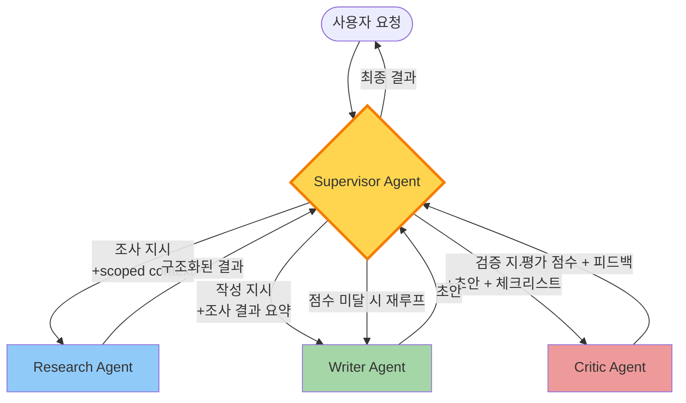

### Multi-Agent Orchestration — "전문가 Agent 5개 모아놓으면 알아서 협업하겠지"라는 순진함, 그리고 Research Agent가 Writing Agent에게 넘긴 context가 3홉 돌며 72KB → 384KB로 부풀어 리포트 1건당 토큰 비용이 $0.08 → $11.40으로 143배 폭증한 뒤 재무팀이 "LLM 비용 전주 대비 +4,100%"라는 Slack을 올려 발견한 수요일 새벽 04:12

---

#### 1. 왜 멀쩡한 Single-Agent를 두고 Multi-Agent로 가는가

RAG가 "검색 → 생성" 2단계라면, 복합 업무는 **"조사 → 분석 → 작성 → 검증 → 수정"** 5단계가 넘어간다. 이걸 한 LLM에게 통째로 던지면:

- 프롬프트가 4,000 토큰을 넘어가고
- 시스템 지시사항 간에 **지시 충돌**(instruction collision)이 생기고
- "이번 턴에는 작성 단계만 해줘"를 모델이 자꾸 어기고 전체를 다시 쓰고
- 체크리스트 중 3번째 항목에서 환각이 섞이면 뒷 단계가 다 오염된다

그래서 **역할을 쪼개고, 각 Agent에 좁은 책임만 준다**는 것이 Multi-Agent의 출발점이다. 여기까지는 상식이다. 문제는 **이 Agent들을 누가, 어떻게 지휘하느냐**다.

---

#### 2. 네 가지 오케스트레이션 패턴

| 패턴 | 지휘 구조 | 통신 방식 | 쓰이는 곳 |
|---|---|---|---|
| **Supervisor (Hierarchical)** | 상위 Orchestrator가 하위 Worker에게 분배 | 중앙집중 | LangGraph, Anthropic Research |
| **Sequential Pipeline** | A → B → C 고정 순서 | 단방향 | CrewAI 기본 모드 |
| **Group Chat / Debate** | 모든 Agent가 서로 말함 | 브로드캐스트 | AutoGen (MS) |
| **Blackboard** | 공유 메모리에 쓰고 읽음 | 간접 통신 | 복잡한 Planning 시스템 |

실무 95%는 **Supervisor + Sequential 조합**이 정답이다. Group Chat은 데모에서 멋있지만 프로덕션에서는 비용 폭탄이고, Blackboard는 상태 관리가 터진다.

---

#### 3. Supervisor 패턴 다이어그램



**핵심은 Supervisor가 "번역기" 역할을 한다는 것이다.**
Research Agent의 결과물 72KB를 Writer Agent에게 그대로 넘기지 않는다. Supervisor가 **압축·요약·필터링**해서 Writer가 필요한 만큼만 넘긴다. 이걸 하지 않으면 다음 섹션의 참사가 생긴다.

---

#### 4. 순진한 구현이 파산시키는 세 가지 방식

##### (1) Context Explosion — "그냥 모든 결과를 다음 Agent에게 넘기면"

```
턴 1: Supervisor → Research → (조사 결과 72KB)
턴 2: Supervisor → Writer   (프롬프트에 72KB 통째 삽입 → 초안 48KB 생성)
턴 3: Supervisor → Critic   (프롬프트에 72KB + 48KB + 지시 → 120KB 입력)
턴 4: Supervisor → Writer   (수정 요청, 이번엔 72KB + 48KB + 피드백 24KB = 144KB)
...
```

입력 토큰이 **턴마다 선형이 아니라 삼각수(triangular)로** 증가한다. Claude Sonnet 4.6 기준 입력 토큰 $3/1M인데, 5홉이 끝날 즈음엔 리포트 1건당 $11을 찍는다.

##### (2) Infinite Delegation Loop

Supervisor가 Critic의 "품질 미달"을 받으면 → Writer로 재루프 → Writer가 "조사 부족"을 반환 → Research로 재루프 → Research가 "질문 애매"를 반환 → Supervisor가 "다시 조사"... **종료 조건이 모델 판단에만 맡겨져 있으면 반드시 루프가 생긴다.**

##### (3) Responsibility Diffusion — 책임 분산

문제가 생겼을 때 "어느 Agent가 틀렸는가"를 추적할 수 없다. Writer가 환각을 만들어낸 건지, Research가 틀린 사실을 넘긴 건지, Supervisor가 요약하다 왜곡한 건지 — 세 LLM 호출 로그를 다 열어봐야 안다. 디버깅 비용이 Single-Agent 대비 **5~10배**로 뛴다.

---

#### 5. 프로덕션에서 반드시 지켜야 하는 네 가지 가드레일

| 가드레일 | 구현 방법 | 왜 |
|---|---|---|
| **홉 제한 (max_hops)** | Supervisor 상태에 `hop_count` 보관, 임계치(보통 8) 넘으면 강제 종료 | 무한 루프 비용 폭탄 방지 |
| **Context 압축** | Agent 간 넘길 때 Supervisor가 300~500 토큰 요약으로 재작성 | Triangular token growth 차단 |
| **구조화된 메시지** | 자유 텍스트 금지, Pydantic/JSON schema 강제 | 파싱 실패/할루 전파 차단 |
| **상태 기반 종료 조건** | "Critic 점수 ≥ 8.5" 같은 정량 조건으로 종료 판정 | LLM이 "충분합니다"라고 자체 판단하는 걸 막음 |

---

#### 6. 실제 사례 — 누가 왜 이 패턴을 택했는가

**Anthropic의 Multi-Agent Research System (2025)**
단일 Agent로 리서치 태스크를 돌리는 것 대비 **90.2% 성능 향상**을 보고했지만, **토큰 소비가 4배**였다. Anthropic이 공식 블로그에서 명시적으로 쓴 문장이 있다: *"Multi-agent systems are worth the cost only for tasks where quality improvement justifies 4x token spend."* 즉 **$200짜리 리서치가 $800이 돼도 가치 있을 때만** 쓰라는 뜻이다. 챗봇 FAQ에 쓰면 파산한다.

**Cursor의 Composer (코드 생성)**
Planner → Executor → Verifier 3-Agent 구조. Planner가 변경 계획을 세우고, Executor가 파일별로 패치를 생성하며, Verifier가 lint/type 체크 결과를 보고 반려한다. **Supervisor는 "코드 변경 계획"이라는 명확한 중간 산출물**을 가지고 있어 context 압축 지점이 명확하다.

**GitHub Copilot Workspace**
Specification → Plan → Implementation → Validation 4-Agent 체인. 각 단계가 **사용자 승인을 거치는 Human-in-the-Loop**로 설계돼 있다. 자동 루프를 아예 끊고 사람이 끼어 들어오게 만든 것이다. 비용과 책임 두 문제를 동시에 해결한 설계다.

**실패 사례 — AutoGPT (2023)**
Group Chat 패턴으로 Agent들이 자유롭게 토론하게 뒀더니, "다음 할 일을 결정하자"는 메타 토론만 20턴 돌다가 종료되는 사례가 속출했다. **종료 조건과 책임 분배가 없는 자유 토론은 production이 아니라 데모 영상에서만 작동한다.**

---

#### 7. 시니어 백엔드 관점의 판단 기준

**써도 되는 경우**
- 리서치/감사/법률 분석처럼 **품질 한 단위 상승이 비용 4배를 정당화**하는 도메인
- 각 역할의 **외부 툴 권한이 명확히 분리**되는 경우 (조사 Agent는 검색만, 작성 Agent는 DB 쓰기만)
- **긴 Planning**이 필요하고 중간 산출물이 명확한 태스크 (코드 생성, 리포트 작성)
- Human-in-the-Loop로 **최소 1회 사용자 승인**을 끼울 수 있는 UX

**쓰면 안 되는 경우**
- Chatbot FAQ, 간단한 요약, 번역 등 **Single-Agent + 좋은 프롬프트로 커버되는** 태스크
- **p95 latency < 2s**를 요구하는 실시간 API — Multi-Agent는 기본 3~5배 느리다
- **비용 민감한 B2C** 서비스 — 리포트 1건 $11은 유료 플랜만 감당 가능
- 팀에 **LLM Observability(LangSmith/LangFuse) 투자가 없는** 조직 — 디버깅이 불가능해진다

> 💡 **왜 중요한가**: Multi-Agent는 "똑똑한 Agent 여럿을 모으면 더 똑똑해진다"가 아니라 "**비용 4배, 지연 5배, 디버깅 10배를 지불하고 품질 2배를 사는 거래**"다 — 이 가격표를 보지 않고 도입하면, 당신의 LLM 청구서는 수요일 새벽 재무팀의 Slack 알림이 된다.
