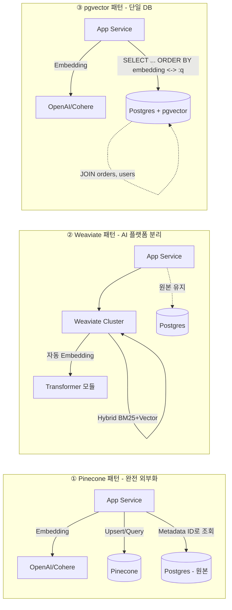

### Vector DB 선택 — "Pinecone이 제일 유명하니까요"라는 순진함, 그리고 월 $2,400 청구서에 놀란 CTO가 "pgvector로 옮기면 안 되나요?"를 묻자 벡터 420만 개 마이그레이션에 2주를 날린 뒤 쿼리 p99가 180ms → 1,420ms로 7.9배 느려져 금요일 밤 전면 롤백하고 월요일 아침 Pinecone 결제카드를 다시 등록한 수요일 새벽 03:40

RAG가 "임베딩 넣고 유사도 검색"이라는 한 줄로 요약되는 순간, 모든 함정은 **Vector DB를 어떻게 고르느냐**에 숨는다. 데이터 크기, QPS, 메타데이터 필터링 복잡도, 운영 인력, 그리고 "이미 Postgres가 돌고 있다"는 조직적 현실 — 이 다섯 축이 꼬여서 "그냥 유명한 거 쓰자"는 결정이 1년 뒤 청구서 또는 지연시간으로 돌아온다.

---

#### 세 가지 축: Managed / Specialized OSS / Postgres 확장

```
                        ┌─────────────────────────────────────────┐
                        │  "벡터 검색을 어디서 돌릴 것인가?"       │
                        └────────────────┬────────────────────────┘
                                         │
          ┌──────────────────────────────┼──────────────────────────────┐
          ▼                              ▼                              ▼
  ┌───────────────┐             ┌───────────────┐             ┌───────────────┐
  │   Pinecone    │             │   Weaviate    │             │   pgvector    │
  │  (Managed)    │             │  (OSS+Cloud)  │             │  (Postgres)   │
  └───────┬───────┘             └───────┬───────┘             └───────┬───────┘
          │                             │                             │
   운영 Zero                     Self-host 가능              기존 DB 재활용
   스케일 자동                    하이브리드 내장             트랜잭션 보장
   가격 $$$$                     운영 $$ + 인프라            가격 $ (사실상)
   p99 안정적                    튜닝 여지 많음              5백만↑ 성능 급락
          │                             │                             │
          ▼                             ▼                             ▼
   "일단 돈으로               "AI 플랫폼팀이              "DB팀 1명이 다 보고,
    해결하고 싶다"              따로 있다"                  벡터는 보조 지표다"
```

핵심은 **"벡터 검색이 비즈니스 코어냐, 부가 기능이냐"**이다. 챗봇/검색이 매출의 70%면 Pinecone이 싸고, 백오피스 FAQ 보조면 pgvector가 비싸다. 유명세는 판단 기준이 아니다.

---

#### 축별 트레이드오프 — 숫자로 보면 선택이 쉬워진다

| 축 | Pinecone (Serverless) | Weaviate (Self-hosted) | pgvector (Postgres 15+) |
|---|---|---|---|
| **운영 인력** | 0명 | 0.5~1명 (DevOps) | 0명 (기존 DBA) |
| **1천만 벡터 월 비용** | ~$3,500 | ~$900 (EC2 r6i.2xlarge x2) | ~$300 (RDS db.r6g.xlarge) |
| **p99 Latency (Top-10)** | 25~60ms | 40~120ms | 200~1,500ms (크기 의존) |
| **메타데이터 필터링** | 지원 (Index 분리) | 지원 (강력) | 지원 (SQL WHERE 그대로) |
| **Hybrid Search 내장** | ❌ (별도 구성) | ✅ (BM25 + Vector) | ⚠️ (`tsvector` 조합 수동) |
| **트랜잭션** | ❌ | ❌ | ✅ (주문/결제와 ACID 보장) |
| **스케일 한계** | 사실상 무제한 | 수평 확장 가능 | 단일 노드 ~5백만~2천만 벡터 |
| **인덱스 재구축 시간** | 자동 (무감지) | 분~시간 | **시간~일 (`CREATE INDEX` LOCK)** |

> pgvector의 가장 큰 함정은 비용이 아니라 **인덱스 재구축**이다. HNSW 인덱스를 1천만 벡터에 CONCURRENTLY 없이 걸면 테이블이 몇 시간 잠긴다. 운영 중인 Postgres에 벡터를 얹을 땐 반드시 `CREATE INDEX CONCURRENTLY`.

---

#### 아키텍처 비교 — 데이터 흐름이 다르다



**①의 함정**: 원본과 벡터가 다른 저장소에 있으면 **데이터 동기화**가 또 하나의 서비스가 된다. "Postgres에 문서 삭제했는데 Pinecone에 남아있어서 AI가 삭제된 사내 문서 답변함" 사고가 정확히 이 경계에서 터진다.

**③의 매력**: `WHERE user_id = ? AND deleted_at IS NULL ORDER BY embedding <-> :q LIMIT 10` 이 한 줄로 끝난다. 삭제 동기화 사고가 구조적으로 불가능.

**③의 벽**: 벡터가 500만 개 넘어가면 HNSW 메모리가 폭발하고, 멀티 테넌트 격리를 WHERE로만 하면 필터링 후 Top-K 재계산이 느려진다 (post-filtering 문제).

---

#### 실제 사례 — 왜 그 회사는 그걸 골랐나

**Notion AI** (Pinecone): 수억 블록을 임베딩. 자체 인프라 팀을 벡터 튜닝에 쓸 바엔 Pinecone에 비용 지불하고 제품에 집중. 전형적 "AI가 코어 매출인 조직" 패턴.

**Weaviate 선택 조직 (예: Stack Overflow for Teams)**: Hybrid Search가 내장돼 있고(BM25 + Vector), 코드/문서처럼 **정확 매칭이 중요한 도메인**이라 Weaviate의 BM25 가중치 튜닝이 직접적인 품질 지표가 됐다. 그리고 OSS라 enterprise 고객의 on-prem 요구를 수용 가능.

**pgvector 선택 조직 (예: Supabase 생태계, 많은 B2B SaaS)**: 이미 Postgres로 멀티테넌트 격리를 RLS(Row Level Security)로 하고 있다면, 벡터만 다른 DB로 빼는 순간 **테넌트 격리 로직을 두 벌 유지**해야 한다. "고객 A의 벡터가 고객 B에게 노출됨" 사고를 막는 가장 안전한 방법은 **같은 테이블의 같은 RLS 정책 아래 두는 것**이다.

**Instacart가 2024년에 pgvector → Pinecone으로 옮긴 이유**: 레시피 임베딩이 8천만 개를 넘어가면서 pgvector의 p99가 850ms를 쳤다. 비용이 아니라 **지연시간이 UX를 깼기 때문**에 옮겼다. 반대 방향 마이그레이션도 흔하다는 점을 기억해야 한다.

---

#### 선택 체크리스트 (시니어가 CTO에게 요약할 때)

```
벡터 개수가 500만 미만이고, 이미 Postgres가 돌고 있다
    → pgvector. 다른 선택은 과설계다.

벡터 개수가 1억을 넘고, QPS가 100 이상이며, AI팀이 2명 이하다
    → Pinecone. 비용은 비싸지만 운영 인력이 더 비싸다.

Hybrid Search(BM25+Vector)가 품질에 결정적이고, on-prem 요구가 있다
    → Weaviate. 내장 하이브리드가 통합 가성비 최고.

멀티테넌트 B2B SaaS이고, 테넌트별 데이터 격리가 법적 요구사항이다
    → pgvector 유지. RLS 한 벌로 끝난다.

데이터 삭제/업데이트가 잦고, "AI가 삭제된 문서 답변" 리스크가 치명적이다
    → pgvector. 트랜잭션으로 원본과 벡터를 함께 삭제.
```

---

#### 안티패턴 — 이렇게는 쓰지 마라

1. **"Pinecone이 유명하니까 PoC도 Pinecone으로"** — PoC는 pgvector로 하루 만에 돌리고, 트래픽이 증명되면 Pinecone으로 올려라. 반대 방향(Pinecone → pgvector) 마이그레이션이 훨씬 비싸다.
2. **"벡터만 다른 DB, 원본은 Postgres"를 **동기화 서비스 없이** 운영** — CDC(Debezium) 또는 outbox 패턴 없이는 반드시 데이터 drift가 생긴다.
3. **pgvector에 `CREATE INDEX` 를 CONCURRENTLY 없이 운영 중 실행** — 테이블 LOCK으로 서비스 전면 장애. 반드시 `CREATE INDEX CONCURRENTLY ... USING hnsw`.
4. **메타데이터 필터링을 Vector DB의 WHERE에 의존해서 설계** — Pinecone/Weaviate의 필터는 Postgres SQL만큼 유연하지 않다. 필터 조건이 복잡해지면 "먼저 Postgres로 ID 목록 뽑고, 그 ID로 Vector DB 쿼리"하는 2단계가 결국 필요해진다. (pgvector는 이 문제가 없다.)
5. **"벡터 차원수(dimension)를 모델 바꿀 때마다 늘릴 수 있다"고 가정** — 차원이 바뀌면 **인덱스 전면 재구축**이다. 1,536차원(OpenAI)과 3,072차원(OpenAI large)을 바꾸는 결정은 "SQL 한 줄 고치는 일"이 아니라 **데이터 마이그레이션 프로젝트**다.

---

#### 쓰면 안 되는 경우

- **벡터 수 1만 이하**: 인메모리 FAISS나 sqlite-vss로 충분. Pinecone/Weaviate는 월 최저 요금만 날린다.
- **쿼리당 지연 허용치가 2초 이상이고 비용이 중요한 배치 작업**: Vector DB 없이 Numpy로 코사인 유사도 직접 계산이 더 싸다.
- **벡터 데이터가 하루에 10% 이상 바뀌는 실시간 추천**: 어떤 Vector DB도 HNSW 재구축 비용이 크다. 대안은 **Approximate Nearest Neighbor를 포기하고 Exact Search** (pgvector의 `ivfflat` 대신 그냥 테이블 스캔) + 데이터셋 제약.

> 💡 **왜 중요한가**: Vector DB 선택은 "어느 제품이 좋냐"가 아니라 **"데이터 소유권, 운영 인력, 트랜잭션 경계, 멀티테넌트 격리"라는 네 가지 아키텍처 제약을 어디에 둘 것인가**의 결정이고, 이걸 잘못 고르면 비용이 아니라 데이터 정합성과 지연시간이 1년 뒤에 청구서로 돌아온다.
