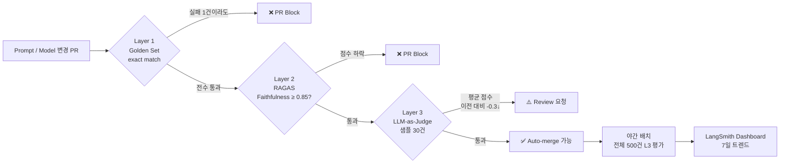

### LLM 평가 자동화 — "QA팀이 수동으로 100개씩 돌려봤는데요?" 그리고 프롬프트 한 줄 바꿨더니 어디가 깨졌는지 아무도 모르는 금요일 밤의 공포

> 결제 상담 챗봇의 "환불 안내" 프롬프트에서 `"친절하게 안내해주세요"`를 `"공손하고 간결하게 안내해주세요"`로 바꾼 PR이 금요일 오후 5시 23분에 머지됐다. QA팀 3명이 돌아가며 수동 검수했던 샘플 50건은 모두 통과. 월요일 아침, CS팀 Slack이 터졌다. "환불 가능 기간이 7일인데 챗봇이 14일이라고 안내해요." Prompt diff를 보니 아무도 건드리지 않은 FAQ RAG 검색 결과 섹션의 **few-shot 예시 순서**가 바뀌면서, 모델이 참고하는 anchor 문서가 "일반 상품"에서 "구독 상품"으로 밀렸던 것. 수동 QA 50건에는 구독 상품 질문이 2건밖에 없었다. 손해 추정액 1,840만 원.

---

#### 왜 전통적 테스트가 LLM에선 그냥 깨지는가

| 전통 백엔드 테스트 | LLM 시스템 |
|---|---|
| `assertEquals(expected, actual)` | 같은 입력에 매번 다른 출력 (temperature>0) |
| 입력 10개면 커버리지 10개 | 입력 10개로 커버리지 측정 자체가 의미 없음 |
| 실패 = 코드 버그 | 실패 = 프롬프트? 모델? 리트리버? Reranker? Chunking? |
| CI에서 30초 | 평가 1회에 Golden Set 300건 × $0.03 = $9, 5분 |

**"유닛 테스트 커버리지 90%"로 LLM 품질을 보장할 수 없다.** 당신이 테스트하는 건 "코드가 LLM을 호출했는가"지, "LLM이 **옳은 답**을 했는가"가 아니다.

---

#### 평가 체계는 3층으로 쌓는다

```
┌────────────────────────────────────────────────────────────────┐
│  Layer 3: LLM-as-a-Judge (주관적 품질)                        │
│  - Faithfulness, Helpfulness, Tone                           │
│  - GPT-4o가 응답을 0~5점으로 채점                              │
│  - 비용 ↑, 느림, 하지만 "말투" 같은 걸 유일하게 잡음          │
├────────────────────────────────────────────────────────────────┤
│  Layer 2: Automated Metrics (RAGAS/DeepEval)                 │
│  - Context Precision, Context Recall, Answer Relevance       │
│  - 임베딩 유사도·규칙 기반, 결정적(deterministic)              │
│  - 빠름, 싸고, 재현 가능                                       │
├────────────────────────────────────────────────────────────────┤
│  Layer 1: Golden Set (Regression Test의 LLM 버전)             │
│  - 100~500건의 (질문, 정답, 참조문서) 튜플                     │
│  - 정규식·키워드 매칭, exact match (반드시 들어가야 할 숫자)   │
│  - 금요일 5시 PR이 "환불 기간 7일"을 안 뱉으면 → 즉시 block   │
└────────────────────────────────────────────────────────────────┘
```

핵심은 **"위로 갈수록 느리고 비싸고 주관적, 아래로 갈수록 빠르고 싸고 객관적"**이라는 것. CI에선 L1 전부 + L2 샘플링, 야간 배치에선 L3 전수.

---

#### CI에 꽂는 평가 파이프라인



---

#### Golden Set은 어떻게 만드나 — 가장 어려운 부분

**"프롬프트 엔지니어가 ChatGPT로 100개 생성"**은 함정이다. GPT가 만든 질문엔 GPT가 쉽게 답한다. Golden Set의 가치는 **"실제 유저가 어떻게 비틀어서 묻는가"**다.

| 소스 | 비중 | 이유 |
|---|---|---|
| 실제 CS 티켓/채팅 로그 | 60% | 유저가 실제로 던지는 질문. 오탈자, 반말, 생략 포함 |
| Adversarial (일부러 꼬아낸 질문) | 20% | "환불 안 되는 걸 환불해줘" 같은 edge case |
| Happy path | 15% | FAQ 그대로. 이게 깨지면 심각 |
| 신규 피처 | 5% | 최근 2주 내 추가된 기능 |

**각 샘플은 최소 이것을 가져야 한다:**
```yaml
- id: refund-period-standard-001
  query: "어제 산 건데 환불 되나요?"
  must_contain: ["7일", "결제일"]        # Layer 1
  must_not_contain: ["14일", "30일"]     # Layer 1 (오답 방지)
  reference_docs: ["refund-policy-v3.md#section-2"]  # Layer 2 context recall
  judge_criteria: "정확한 환불 기간을 공손한 어조로 안내" # Layer 3
  tags: [refund, high-traffic, pii-safe]
```

---

#### LLM-as-a-Judge의 함정 3개

1. **Positional bias**: Judge LLM은 "먼저 보여준 답변"을 더 좋게 평가한다. A/B 비교 시 **순서를 뒤섞어 2회 평가하고 평균** 내야 한다.
2. **자기 모델 편애**: GPT-4로 평가하면 GPT-4 생성 답변을 Claude 답변보다 평균 7% 더 높게 준다. **Judge는 평가 대상과 다른 벤더 모델**로.
3. **"5점 만점"의 함정**: 5단계 척도는 항상 3~4에 몰린다. **Pairwise comparison (A vs B 중 어느 게 나은가)** 이 통계적으로 훨씬 신뢰도 높다.

---

#### 트레이드오프

| 축 | 가볍게 | 무겁게 |
|---|---|---|
| **커버리지** | Golden Set 50건 | 2,000건 (수동 라벨링 3주) |
| **빈도** | PR마다 L1만, 주 1회 L3 | 모든 PR에서 L1+L2+L3 |
| **비용** | 월 $200 (샘플링) | 월 $8,000 (전수 LLM-judge) |
| **민감도** | 큰 regression만 잡음 | 미세한 어조 변화도 감지 |
| **FP(오탐)** | 거의 없음 | Judge 변덕으로 가짜 알람 多 |

**스타트업 (사용자 1만 미만)**: Layer 1 200건 + Layer 2 샘플링 50건. 월 비용 $150, PR 블로커로 충분.
**중견 (사용자 10만)**: Layer 1 500건 + Layer 2 전수 + Layer 3 샘플 100건. CI 3분 추가.
**대형 (금융/의료)**: Layer 1 2,000건 + Layer 2/3 전수, Human-in-the-loop 월 1회. 월 $20,000+.

---

#### 실제 사례

- **GitHub Copilot**: 자체 Golden Set으로 "code completion acceptance rate"를 핵심 지표로. 모델 업그레이드 전 **A/B 섀도우 배포**로 48시간 평가 후 롤아웃. ([2023 Copilot Eval Blog])
- **Notion AI**: LangSmith로 Faithfulness 추적. "요약 품질 저하" 이슈를 유저 CS보다 평균 **3일 먼저** 평가 대시보드에서 감지.
- **Perplexity**: RAGAS Context Precision이 0.75 이하로 떨어진 쿼리 패턴을 자동 클러스터링해 **"리트리버 품질 저하 알람"**으로 PagerDuty 연동.
- **Klarna (금융 챗봇)**: 금액·날짜·이자율은 Layer 1에서 **exact match 필수**. 숫자 하나 틀리면 소송 리스크라 LLM-judge 신뢰 안 함.

---

#### 언제 쓰고 언제 쓰면 안 되는가 — 시니어 관점

**써야 할 때**
- 프롬프트/모델/리트리버가 **일주일에 2회 이상** 바뀌는 프로덕트 (수동 QA 못 따라감)
- **금액·법률·의료 등 "틀리면 돈 나가는" 응답**이 섞인 경우 (Layer 1 exact match 필수)
- 모델 벤더 업그레이드가 있는 경우 (`gpt-4o-2024-08-06` → `gpt-4o-2024-11-20` 같은 silent regression)

**쓰면 안 될 때 (혹은 과도한 투자인 경우)**
- 응답이 "자유 창작" 용도 (카피라이팅, 아이디어 브레인스토밍) — 정답이 없는데 평가는 불가능
- **MVP 단계, 유저 100명 미만** — Golden Set 만들 시간에 유저에게 직접 물어보는 게 10배 빠름
- 응답이 하루 10건 미만 — 그냥 전수 수동 검수가 싸다
- **Judge LLM 비용이 서비스 LLM 비용의 20% 넘을 때** — 평가가 본체보다 비싸지는 역전 현상 (샘플링으로 전환)

---

#### 안티패턴: "평가 점수가 올랐으니 좋아진 거죠?"

Faithfulness 0.82 → 0.89로 올랐다고 모델이 좋아진 게 아니다. **Golden Set이 모델의 약점을 안 담고 있으면 점수는 거짓말을 한다.** 반드시 **CS 티켓 신규 유입을 Golden Set에 월 1회 흘려넣는 피드백 루프**가 있어야 한다. 평가 체계도 **살아있는 데이터셋**이지, 한 번 만들고 고정하는 게 아니다.

> 💡 **왜 중요한가**: LLM 시스템에서 "품질 저하"는 코드 리뷰로 못 잡히고, 유저 CS로만 뒤늦게 발견된다 — 자동 평가 파이프라인은 "금요일 밤 PR이 월요일 아침 CS 폭주로 돌아오는 것"을 막는 유일한 안전망이다.
