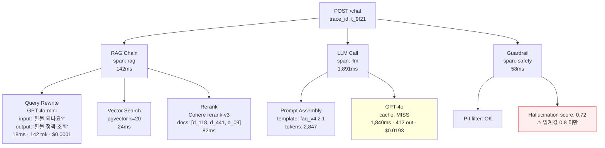

### AI Observability (LangSmith/LangFuse) — "Datadog에 띄우면 되지"라는 순진함, 그리고 VIP 고객이 "답변이 틀렸다"고 올린 티켓을 열흘째 재현 못 해 "모델 환각 추정"으로 종결시킨 뒤 같은 패턴이 3건 더 터져 MRR $14,800을 날린 화요일 오후

B2B SaaS 고객지원 챗봇. 화요일 오후 3시 42분, 연 계약 $142K짜리 VIP 고객이 "환불 정책을 완전히 틀리게 안내받았다. 스크린샷 첨부한다"며 CS팀에 티켓을 올린다. CS 리드가 플랫폼팀에 "그 시각 그 유저에게 뭘 서빙했는지 재현해달라"고 Slack. 플랫폼팀이 Datadog APM을 켠다.

```
POST /v1/chat/completions   2,147ms   200 OK
  └─ llm.openai.call        2,089ms   200 OK
```

끝. 2.1초가 어디서 왔는지, 어떤 프롬프트 버전이었는지, RAG가 어떤 문서 5개를 꺼냈는지, Semantic Cache를 때렸는지 miss였는지, 어떤 모델로 라우팅됐는지(GPT-4o? Haiku 폴백?) — **어느 것도 로그에 없다**. `application.log`를 뒤지니 `user_id=u_8821 response="환불은 결제일로부터 7일 이내..."`만 찍혀 있다. 입력은 없다. "비슷한 질문"으로 재시도해봤더니 이번엔 "30일 이내"로 답한다. 재현 실패. 티켓은 "모델 환각 추정, 가이드레일 보강 예정"으로 종결. 2주 뒤 동일 패턴 3건 추가. VIP가 "품질 관리 안 되는 벤더"라며 갱신 거부. MRR −$14,800.

문제의 본질: **LLM 앱의 trace는 HTTP trace가 아니라 "결정 트리"다.** 하나의 사용자 질의가 Query Rewrite → Embed → Vector Search → Rerank → Prompt Assembly → LLM Call → Tool Call → LLM Call(재진입) → Guardrail Check로 **중첩된 span tree**를 그리는데, Datadog/New Relic은 이걸 flat한 HTTP 호출로밖에 못 본다. 그래서 LangSmith(LangChain 사내 SaaS), LangFuse(OSS, MIT), Arize Phoenix(OTel 기반) 같은 **LLM 전용 Observability 레이어**가 따로 존재한다.

핵심은 다섯 기둥: **Trace**(중첩 span + input/output 전문), **Prompt Registry**(버전·변수 바인딩), **Dataset**(실패 케이스를 테스트셋으로 승격), **Eval**(LLM-as-Judge로 자동 채점), **Cost/Token**(span별 토큰·단가 합산).



VIP 티켓이 다시 떴다면? LangFuse UI에서 `user_id=u_8821, 2026-11-03 15:42` 필터로 trace를 열면 **그 순간의 Rerank 결과·실제 들어간 context 2,847토큰 전문·사용된 프롬프트 템플릿의 버전 커밋 해시·토큰별 비용**이 전부 그대로 박제돼 있다. 재현이 아니라 **그 트레이스를 그대로 Dataset으로 승격 → Eval 돌려서** "이 입력에선 d_441(최신 정책)이 아니라 d_09(2년 전 폐기된 정책)가 1위로 뽑혔다"가 20분 안에 확인된다. 그 뒤 Rerank 임계값을 올리고 d_09를 metadata에 `deprecated=true`로 플래그. 재발 방지 PR이 그날 저녁에 머지된다.

**트레이드오프.**

| | **LangSmith** | **LangFuse** | **Arize Phoenix** |
|---|---|---|---|
| 라이선스 | Closed SaaS (self-host는 Enterprise) | **MIT, self-host 자유** | ELv2 (OSS), 유료 SaaS |
| 통합 | LangChain/LangGraph 최상 | SDK 범용 (OpenAI/Anthropic/Vercel AI/LlamaIndex) | **OpenTelemetry 네이티브** |
| 데이터 거주 | 미국 (금융/의료는 블로커) | 자가 호스팅으로 EU/KR 가능 | 자가 호스팅 가능 |
| DX | 가장 매끈 | UI 투박하지만 급속 추격 중 | 분석 중심, UI는 Jupyter 결 |
| 가격 | $39/user + 사용량 | **OSS 무료** / Cloud $59~ | OSS 무료 / Enterprise 별도 |

Notion AI와 Shopify Sidekick은 LangSmith를 쓴다 — 둘 다 LangChain 채택 기업이고 전사 결정이 "SaaS 통일". Zalando와 Khan Academy는 LangFuse 자가호스팅 — GDPR·학생 데이터 거주 요건이 SaaS를 막는다. Uber는 Phoenix 위에 자체 OTel 파이프라인 — 이미 Jaeger가 있고 OTel span을 그대로 재사용하는 게 ROI가 가장 컸기 때문.

**언제 쓰고 언제 쓰면 안 되는가.**

도입해야 할 때는 (1) 프로덕션 LLM 트래픽이 하루 1,000건 이상, (2) 프롬프트를 주 1회 이상 변경, (3) 품질 리포트가 CS를 통해 들어오는 구조, (4) RAG·Agent 같은 **멀티 스텝 체인**이 하나라도 있을 때 — Day 1부터 깐다. 반대로 안 써도 되는 경우는 LLM 호출이 "유저 입력 → 모델 → 응답" 1:1 Proxy이고 프롬프트가 월 1회 미만 변경되는 **얇은 Wrapper 서비스** — 이땐 Datadog span에 `input_tokens`, `output_tokens`, `prompt_hash` 세 개 태그만 추가해도 90%는 커버된다. Observability 레이어를 하나 더 얹는 운영 부담이 트레이스에서 얻는 가치를 못 넘긴다.

**함정 하나만.** input/output 전문을 저장하면 **PII가 통째로 Observability DB에 적재된다**. LangFuse든 LangSmith든 SDK 레벨에서 **masking hook**(`maskUser`, `maskInput` 콜백)으로 주민번호·카드번호·이메일을 서버 전송 전에 치환해야 한다. "일단 다 저장하고 나중에 지우자"는 GDPR 72시간 통지 의무로 돌아온다.

> 💡 **왜 중요한가**: LLM 앱의 버그는 "재현"이 아니라 "그 순간의 trace를 박제했느냐"로 잡힌다 — 박제가 없으면 그건 버그가 아니라 괴담이 된다.
