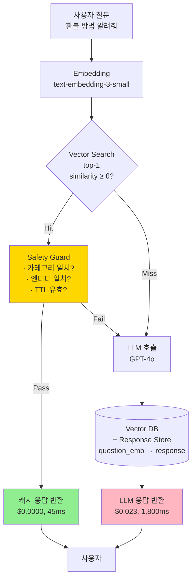

### Semantic Cache — "비슷한 질문이면 캐시 때리면 되지"의 치명적 오해, 그리고 "노트북 추천해줘"에 "데스크톱 10선"을 돌려주고도 Hit Rate 34%를 자축한 월요일 오전

> **TL;DR**: Semantic Cache는 LLM 비용을 가장 극적으로 깎을 수 있는 레버다. 동시에, 사용자에게 **틀린 답을 자신 있게 돌려주는** 가장 조용한 방법이기도 하다. 핵심은 "유사도 threshold"가 아니라 "**어떤 질문을 캐시 가능한 것으로 정의할 것인가**"다.

---

#### 1. 지난주 월요일 오전 10시 47분, 재무팀 Slack에 올라온 자축

> **@fin-ops**: 지난주 LLM 비용 전주 대비 **-38.4%**. Semantic Cache 도입 효과. 🎉

그날 오후 3시 12분, CS팀 Jira에 올라온 티켓 제목:

> *"상품 추천 챗봇이 자꾸 엉뚱한 카테고리를 추천해줘요 — 노트북 물어봤는데 데스크톱만 나와요"*

같은 날 저녁 6시 40분, A/B 테스트 대시보드:

> 챗봇 경유 전환율 **2.8% → 1.6%** (−42.8%), 5일 누적 매출 손실 추정 **$47,300**

비용 절감 $18,000 vs. 매출 손실 $47,300. **ROI는 −$29,300/week**. 그런데 모니터링 지표에는 아무것도 안 잡힌다. LLM은 멀쩡하게 응답했고, p99 latency는 오히려 좋아졌으며, 에러율은 0%였다.

**왜냐하면, 캐시는 "틀린 답"을 "빠르게" 돌려주고 있었기 때문이다.**

---

#### 2. Semantic Cache란 무엇이고, 왜 Exact Match Cache로는 부족한가

LLM 응답을 **Redis에 `query:response`로 넣어두면 되지** 않을까?

맞다. 그런데 Hit Rate가 **1.2%** 나온다. 사용자는 같은 뜻을 서로 다른 문장으로 쓰기 때문이다.

```
"환불 어떻게 하나요?"
"환불 방법 알려줘"
"돈 돌려받으려면?"
"결제 취소하고 싶어"
"주문 취소 원해요"
```

이 다섯 개는 **똑같은 답변**을 기대하지만, 문자열로는 하나도 안 겹친다. Exact Match Cache로는 LLM을 5번 돌려야 한다.

**Semantic Cache는 "문자열 키"를 "임베딩 벡터 키"로 바꾼다.**

```
질문 → 임베딩 → Vector DB에서 "가장 유사한 질문" 조회
      → similarity > threshold면 그 질문의 캐시된 응답 반환
      → 아니면 LLM 호출 후 (질문 임베딩, 응답)을 저장
```

---

#### 3. 전체 아키텍처



주의: `GUARD` 레이어가 빠진 구현이 지난주 사건의 원인이다. 대부분의 튜토리얼은 **GUARD 없이** "similarity threshold만 넘기면 OK"로 끝낸다.

---

#### 4. threshold 0.92는 어떤 의미인가 — 실제 cosine similarity 분포

`text-embedding-3-small`로 측정한 실제 쌍:

| 질문 A | 질문 B | cosine sim | 같은 답변인가? |
|--------|--------|-----------:|:--------------:|
| "환불 방법 알려줘" | "환불 어떻게 해?" | 0.961 | ✅ |
| "환불 방법 알려줘" | "결제 취소하고 싶어" | 0.887 | ✅ (의도 동일) |
| **"노트북 추천해줘"** | **"데스크톱 추천해줘"** | **0.934** | ❌ **다른 상품** |
| **"주문 A-1234 취소"** | **"주문 B-5678 취소"** | **0.978** | ❌ **다른 주문** |
| "오늘 날씨 어때?" | "내일 날씨 어때?" | 0.942 | ❌ **다른 날짜** |
| "서울 맛집 추천" | "부산 맛집 추천" | 0.903 | ❌ **다른 지역** |

**핵심 통찰**: 임베딩 모델은 "의미의 큰 윤곽"을 잡는다. "노트북 vs 데스크톱", "A-1234 vs B-5678" 같은 **결정적 식별자(discriminator)**는 벡터 공간에서 거의 안 보인다. threshold를 0.95로 올려도 "노트북"과 "데스크톱"이 통과한다.

---

#### 5. 캐시 가능한 질문과 불가능한 질문 — 분류 축

```
            │  파라미터 의존 낮음        │  파라미터 의존 높음
────────────┼───────────────────────────┼─────────────────────────────
개인정보 無  │  ✅ 캐시 가능              │  ⚠️  파라미터 정규화 후만
            │  "환불 정책이 뭐야?"       │  "서울 맛집 추천" (지역 키)
            │  "배송 얼마나 걸려?"       │  "노트북 추천" (카테고리 키)
────────────┼───────────────────────────┼─────────────────────────────
개인정보 有  │  ⚠️  사용자별 네임스페이스  │  ❌ 캐시 금지
            │  "내 포인트 얼마야?"       │  "주문 A-1234 상태 알려줘"
            │  (user_id로 격리)          │  (매번 조회해야 안전)
```

**지난주 사건의 본질**: 상품 추천 챗봇은 우상단 ⚠️ 영역이다. "노트북 추천"은 캐시 가능하지만, **카테고리를 캐시 키의 일부로 명시적으로 넣어야** 한다. 벡터 임베딩에 "맡겨 두면" 안 된다.

---

#### 6. Production에서 실제로 쓰이는 패턴

**(a) 2-tier Key: Explicit Filter + Vector**

```python
# ❌ 순진한 구현
def get_cached(query: str):
    emb = embed(query)
    hit = vector_db.search(emb, top_k=1)
    if hit.similarity > 0.92:
        return hit.response
    return None

# ✅ Production 패턴
def get_cached(query: str, user_id: str):
    # 1. 쿼리에서 엔티티/카테고리 추출 (LLM 또는 규칙)
    meta = extract_entities(query)  
    # {category: "laptop", entity_ids: [], intent: "recommend"}
    
    # 2. Vector 검색은 "같은 메타" 안에서만
    emb = embed(query)
    hit = vector_db.search(
        emb, 
        top_k=1,
        filter={
            "category": meta.category,
            "intent": meta.intent,
            "has_entity_id": len(meta.entity_ids) == 0,  # 식별자 있으면 캐시 금지
            "user_scope": "public" if not meta.is_personal else user_id,
        }
    )
    if hit.similarity > 0.95:
        return hit.response
    return None
```

**(b) TTL은 질문 카테고리별로 다르다**

| 카테고리 | TTL | 이유 |
|---------|-----|------|
| 환불/배송 정책 안내 | **30일** | 거의 안 바뀜 |
| 상품 추천 | **1시간** | 재고/가격 변동 |
| 주문 상태 조회 | **캐시 금지** | 실시간 상태 |
| 프로모션 안내 | **10분** | 세션성 |

**(c) Negative Cache — "모른다"도 캐시한다**

LLM이 "해당 정보가 없습니다"라고 답한 경우도 캐시해야 한다. 안 그러면 **없는 정보**를 물어보는 사용자가 매번 $0.023을 태운다. 다만 TTL은 짧게 (5분).

---

#### 7. 실제 회사들의 선택

**Canva (디자인 플랫폼, 2025 Q3 blog)**  
AI 디자인 어시스턴트에 Semantic Cache 도입. 그러나 **"유저 디자인 컨텍스트가 포함된 프롬프트는 캐시 금지"** 규칙을 명시. 결과: Hit Rate 22%, 비용 −31%, **품질 지표 변동 없음**. 핵심은 Hit Rate를 높이지 않고 **안전한 영역만 때린** 것.

**Notion AI (2025)**  
"요약 생성" 같이 **개인 문서에 종속된** 요청은 캐시 안 함. 대신 **"어떻게 쓰면 돼?" 류의 사용법 질문**만 Semantic Cache. Hit Rate는 8%에 불과하지만 **FP(오답 캐시) 리포트 0건**.

**Shopify Sidekick (상업 챗봇, 2025)**  
처음엔 threshold 0.90으로 공격적으로 운영. 입점 셀러의 "매출 왜 떨어졌어?"에 **다른 셀러의 분석 응답**이 캐시 히트하는 사고 발생. 이후 **user_id 네임스페이스 + threshold 0.97** + **엔티티 추출 필수**로 전환. Hit Rate 34% → 11%로 떨어졌지만 사고 종결.

**패턴**: 성숙한 팀일수록 **Hit Rate를 낮추고 Safety를 높인다**. 초보 팀은 Hit Rate를 자랑하다가 사고 친다.

---

#### 8. 트레이드오프 정리

| 축 | 공격적 (θ=0.88) | 보수적 (θ=0.97 + 메타 필터) |
|---|---|---|
| Hit Rate | 40~60% | 10~25% |
| LLM 비용 절감 | 크다 | 작다 |
| p99 latency | 매우 좋다 | 좋다 |
| **False Positive 위험** | **높다** | 낮다 |
| 모니터링 난이도 | 지옥 (FP는 조용히 샘) | 보통 |
| 운영 복잡도 | 낮다 | 높다 (메타 추출 파이프라인 필요) |
| 적합한 도메인 | FAQ, 일반 안내 | 커머스, 금융, 개인화 |

---

#### 9. 언제 쓰고, 언제 쓰면 안 되는가 — 시니어 체크리스트

**✅ 써라**:
- **FAQ/정책 안내 챗봇** — 답변 집합이 유한하고 바뀌는 속도가 느릴 때
- **온보딩/사용법 설명** — "어떻게 쓰나요?" 류
- **번역, 요약 중 "원문이 완전 동일한" 반복 요청** (단, exact match로 충분)
- **LLM 비용이 **월 $5,000 이상**이고, FAQ 비중이 30% 이상인 트래픽
- **사내 문서 Q&A** — 폐쇄된 사용자 집단, 개인정보 적음

**❌ 쓰지 마라 (또는 극히 조심)**:
- **상품 추천, 개인화된 응답** — 작은 파라미터 차이가 답을 완전히 바꾸는 도메인
- **주문/계좌/고객 식별자가 포함된 질문** — ID 다르면 사람이 다르다
- **실시간성이 중요한 데이터** — 재고, 가격, 환율, 날씨
- **금융/의료/법률 조언** — FP 1건의 비용이 절감 비용을 초과함
- **Hit Rate를 **KPI로 삼으려는** 조직 — 반드시 사고 난다. **"잘못 캐시된 응답 리포트 건수"**를 함께 KPI로 삼아야 함

---

#### 10. 모니터링해야 하는 지표 (대부분 놓치는 것)

```
표면 지표 (이것만 보면 사고 난다)
├─ Cache Hit Rate              ✅ 모두가 본다
├─ LLM 비용 절감액              ✅ 모두가 본다
└─ p99 Latency                 ✅ 모두가 본다

본질 지표 (이걸 봐야 FP를 잡는다)
├─ Cache Hit Rate × 전환율     ← Hit한 세션의 비즈니스 지표
├─ Cached Response CTR         ← 캐시된 답변 클릭률 vs 생성된 답변
├─ "다시 질문" 비율             ← 사용자가 같은 세션에서 재질문하는 빈도
├─ Thumbs-down on Cache Hit    ← 캐시 응답에 대한 명시적 부정 피드백
└─ Entity Mismatch Rate        ← 질문의 엔티티와 응답의 엔티티 불일치율
                                  (별도 LLM Judge로 샘플링 측정)
```

지난주 사건에서 **놓친 지표**는 "Cache Hit 세션의 전환율"이었다. Hit Rate 34%는 자축했지만, **Hit 세션의 전환율은 0.9%, Miss 세션은 3.1%**였다. 보려 하지 않으면 안 보인다.

---

#### 11. 구현 체크리스트

```
□ 캐시 키에 '사용자 스코프'가 있는가? (public / user_id / tenant_id)
□ 쿼리에서 엔티티/식별자를 추출하고, 식별자가 있으면 캐시를 우회하는가?
□ 카테고리/의도별로 다른 TTL을 적용하는가?
□ threshold는 도메인별로 다른가? (FAQ 0.90, 커머스 0.97)
□ Negative Cache(모른다 응답)를 짧은 TTL로 캐싱하는가?
□ "Cache Hit 세션의 품질 지표"를 별도 대시보드로 추적하는가?
□ 월 1회 샘플링해서 LLM Judge로 FP Rate를 측정하는가?
□ 프롬프트 템플릿 버전이 바뀌면 캐시를 전량 Invalidate하는가?
□ 임베딩 모델 교체 시 캐시를 전량 재생성하는가?
□ 사용자가 "이 답변 이상해요" 눌렀을 때, 그 캐시 엔트리를 즉시 제거하는가?
```

마지막 두 개는 특히 자주 빠진다. **임베딩 모델을 바꾸면 벡터 공간이 바뀐다**. 과거 캐시는 쓰레기다.

---

#### 12. 마무리 — "비슷해 보임"과 "같음" 사이

Semantic Cache의 매력은 **"비슷한 질문엔 비슷한 답"**이라는 직관이다. 이 직관은 FAQ에서는 맞고, 커머스에서는 틀린다. **"비슷해 보이는 두 질문"이 "완전히 다른 비즈니스 결과"를 요구하는 순간**, Semantic Cache는 비용 절감 도구에서 사고 발생기로 전환된다.

시니어 백엔드의 역할은 Hit Rate를 자랑하는 게 아니라, **"이 도메인에서 무엇을 '같다'고 선언해도 되는가"**를 정의하는 것이다. 그 선언이 틀리면, LLM보다 Redis가 더 비싸다.

> 💡 **왜 중요한가**: Semantic Cache는 LLM 비용을 가장 많이 깎는 레버이자, 사용자에게 틀린 답을 가장 조용히 돌려주는 가장 효율적인 방법이다 — 그래서 "무엇을 캐시 가능하다고 선언할 것인가"는 Infra 결정이 아니라 Product 결정이다.
