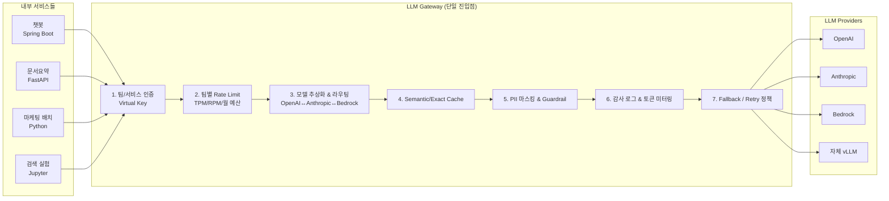

### LLM Gateway 패턴 — "각 팀이 OpenAI 키 들고 알아서 쓰면 되지"라는 순진함, 그리고 마케팅팀 Python 스크립트가 지수 백오프 없는 while 루프에서 분당 2,100 req를 OpenAI로 쏘다가 월말 청구서 $47,300을 찍은 뒤 재무팀이 "AI 비용 전월 대비 +890%" Slack을 올려서야 발견된 10월 1일 오전 09:47

> 시니어가 처음 이 패턴을 접할 때 가장 흔히 하는 반응:
> *"그거 그냥 API Gateway를 LLM으로 바꾼 거 아냐? Kong 앞에 세우면 되는 거 아냐?"*
>
> 맞다. **구조**는 그렇다. 그런데 **흐르는 트래픽의 성질**이 전혀 다르다.
> 기존 API 호출 1건 = 수십 bytes, 1~50ms, 과금 모델 거의 없음.
> LLM 호출 1건 = **수 KB~수십 KB**, **2~90초**, **토큰당 과금**, **스트리밍 응답**, **모델별 포맷 다름**, **버전 깨지면 전체 서비스 터짐**.
>
> 그래서 LLM Gateway는 "API Gateway + 과금 미터링 + 모델 추상화 + 스트리밍 프록시 + Fallback + 감사 로그"가 **한 프로세스에 몰려 있는** 특수한 BFF다.

---

#### 1. 왜 "그냥 각 서비스가 OpenAI SDK 깔고 쓰면 되지"가 지옥을 부르는가

```
┌─────────────────────────────────────────────────────────────┐
│          Naive Architecture — "각자 알아서"                 │
└─────────────────────────────────────────────────────────────┘

  [챗봇 서비스]  ──► OPENAI_API_KEY_A ──┐
  [문서요약 배치] ──► OPENAI_API_KEY_B ──┼──► api.openai.com
  [마케팅 스크립트] ──► OPENAI_API_KEY_C ──┤
  [검색팀 실험 코드] ──► OPENAI_API_KEY_D ──┘

  문제 발생 시:
   ① 누가 얼마 썼는지 → 월말 청구서 PDF를 눈으로 세야 함
   ② 한 팀이 폭주해도 → 다른 팀이 429를 맞음 (조직 전체 TPM/RPM 공유)
   ③ 모델 Deprecation → 4개 서비스 코드를 다 뜯어야 함
   ④ GPT-4o → Claude로 교체 → 요청/응답 포맷 다 다름
   ⑤ 응답 로그 저장 정책 → 팀마다 제각각 (GDPR 감사 걸리면 끝)
   ⑥ API 키 유출 → 어느 레포인지 추적 불가 (키 1개를 공유했으면 더 끝)
```

마케팅팀 스크립트가 월초에 폭주했을 때 문제는 **$47,300이 아니었다**. 문제는 그 동안 챗봇 서비스가 **429를 계속 맞아서** 고객 대화의 7.2%가 "잠시 후 다시 시도해주세요"로 끊긴 것을, 재무팀이 Slack 올릴 때까지 **아무도 두 사건을 연결 짓지 못했다는 점**이다.

OpenAI의 TPM/RPM 한도는 **조직 단위**다. 여러 팀이 하나의 조직 키를 공유하는 한, 한 팀의 사고는 자동으로 전사 장애가 된다.

---

#### 2. LLM Gateway가 하는 일 — 7가지 책임



| # | 책임 | 왜 Gateway에 있어야 하나 |
|---|------|----------------------|
| 1 | **Virtual Key (팀별 가짜 키)** | 각 팀은 `sk-team-chatbot-xxx`를 받고, 실제 OpenAI 키는 Gateway만 안다. 유출되면 그 가짜 키 하나만 로테이트 |
| 2 | **팀 단위 Rate Limit & 월 예산** | "챗봇팀 월 $8,000 / TPM 200K", 넘으면 429. **마케팅 스크립트의 사고가 챗봇을 죽이지 않는다** |
| 3 | **모델 추상화** | 호출부는 `model: "default-chat"`이라고 쓴다. Gateway가 GPT-4o나 Claude 3.5 Sonnet으로 매핑 |
| 4 | **Semantic/Exact Cache** | 같은 질문이 반복되는 FAQ는 **네트워크를 떠나기 전에** 잘라낸다 (단, [[semantic-cache-trap]] 함정 참고) |
| 5 | **PII 마스킹** | `email`, `카드번호`, `주민번호` 정규식/NER을 Gateway에서 한 번에 지운다. 각 팀 코드가 지우기를 기대하지 않는다 |
| 6 | **토큰 미터링** | `input_tokens`, `output_tokens`, `cost_usd`를 요청 단위로 ClickHouse/Postgres에 쓴다. 월말 청구서가 아니라 **실시간 대시보드**로 안다 |
| 7 | **Fallback & Retry** | 429/5xx/타임아웃 시 지수 백오프, 다른 Provider로 폴백. 이 로직을 **클라이언트에 분산시키지 않는다** |

**핵심 설계 원칙**: *클라이언트 SDK는 OpenAI SDK와 동일한 인터페이스를 유지하되, `base_url`만 Gateway로 바꿔 끼운다.* 그래서 기존 코드는 1줄 바꾸면 끝난다.

```python
# 바꾸기 전
client = OpenAI(api_key=os.environ["OPENAI_API_KEY"])

# 바꾼 후 — 이게 전부다
client = OpenAI(
    api_key=os.environ["LLM_GATEWAY_VKEY"],   # 가짜 키
    base_url="https://llm-gw.internal/v1",     # Gateway 주소
)
```

---

#### 3. 실제 사례 — 이 패턴을 누가, 왜 택했나

| 회사/제품 | 선택 | 이유 |
|-----------|------|------|
| **Shopify** | 자체 LLM Gateway (Sidekick) | 수백 개 내부 팀이 LLM을 쓰는데, 팀별 비용 추적과 PII 마스킹 일원화가 compliance 요구 |
| **Cloudflare** | AI Gateway 제품화 | "엣지에서 LLM 호출을 캐싱/로깅/라우팅하자"는 아이디어를 외부에 판매 |
| **Netflix** | Metaflow + 자체 LLM Proxy | ML팀과 제품팀의 LLM 호출을 한 pipeline에서 관측하려고 |
| **Klarna** | LiteLLM + Portkey 조합 | 상담 챗봇이 OpenAI us-east-1 장애 났을 때 Claude로 10초 내 폴백 필요 |
| **Uber** | Michelangelo에 LLM Gateway 레이어 추가 | 기존 ML Platform에 LLM 게이트를 끼워 "모델 거버넌스"를 통일 |

#### 오픈소스/상용 옵션 비교

| 도구 | 성격 | 강점 | 약점 |
|------|------|------|------|
| **LiteLLM** | OSS Python Proxy | 100+ 모델 통합, 가장 빠르게 띄울 수 있음 | 고부하(수만 TPS)에서 Python GIL 한계 |
| **Portkey** | SaaS + OSS | Observability + Fallback 완성도 높음 | 데이터가 외부로 나감 (보안팀 반대 가능) |
| **Helicone** | SaaS/셀프호스트 | 로깅·캐싱 특화, Postgres 기반 | Router/Guardrail 약함 |
| **Kong AI Gateway** | Kong 플러그인 | 기존 Kong API Gateway와 통합 | LLM 특화 기능은 상대적으로 얕음 |
| **Cloudflare AI Gateway** | 엣지 서비스 | 전 세계 엣지 캐싱, 세팅 5분 | Cloudflare 생태계에 락인 |
| **자체 구축 (Go/Rust)** | — | 완전 통제, 레이턴시 최소 | 6~12인월. 유지보수 비용이 영원히 남음 |

---

#### 4. 시니어가 꼭 봐야 하는 트레이드오프

##### ① 레이턴시 추가 분
Gateway 1홉 = **일반적으로 +5~30ms**. LLM 호출 자체가 2~90초임을 감안하면 사실상 무시 가능하다. **단, 스트리밍 응답**을 proxy할 때는 버퍼링 안 하고 바로 flush해야 한다. Portkey 초기 버전이 이걸 한 번에 모아서 내보내는 버그가 있어 TTFT(Time To First Token)가 2초 → 11초로 늘어난 유명한 incident가 있다.

##### ② Gateway 자체의 SPOF
Gateway가 죽으면 전사 LLM이 죽는다. 그래서:
- 최소 **다중 AZ 배포**
- Rate Limit 상태는 **Redis Cluster** (단일 Redis는 Gateway와 함께 죽는다)
- **Admission Control**: Gateway 자신의 CPU/메모리가 80% 넘으면 신규 요청을 조기 429로 거절 (죽는 것보다 낫다)
- Gateway 장애 시 **클라이언트 SDK가 직접 Provider를 때릴 수 있는 bypass 키**를 챗봇·결제 같은 Tier-0 서비스에만 발급. 단, bypass 키는 **Vault**에 두고 Gateway가 살아 있을 땐 못 꺼내게 한다

##### ③ 데이터 주권 / Compliance
금융·의료 쪽은 "LLM 요청/응답 전체가 Postgres에 영구 저장되는가"에 매우 민감하다. 기본 전략:
- 요청 본문은 **해시만** 저장
- 전체 본문은 **7일 TTL S3**, 감사 트리거 시에만 조회
- **PII 마스킹은 Gateway 입구에서** 수행 → 마스킹된 본문만 Provider로 나간다 (이게 핵심)

##### ④ 캐시의 함정
Semantic Cache를 Gateway 레이어에 넣으면 전사 서비스가 혜택을 본다. 하지만 **팀 간 캐시 공유는 위험**하다. A팀이 "VIP 고객 할인가 알려줘"에 대한 응답을 캐시하면 B팀이 그걸 그대로 받을 수 있다. **캐시 키에 `team_id` + `user_role` + `tenant_id`를 반드시 섞어야 한다.** (이 함정은 [[semantic-cache-trap]]에서 다뤘다.)

##### ⑤ 멀티 모델 Observability의 경계
Gateway에서 로그를 다 쌓는다고 AI Observability가 공짜로 되는 건 아니다. Gateway는 **요청/응답/비용**을 안다. 그런데 **"이 답변이 품질이 좋았는가"**는 모른다. 그건 [[ai-observability-langfuse]]가 하는 일이다. 역할 혼동 금지.

---

#### 5. 언제 쓰고, 언제 쓰면 안 되는가

**써야 한다**:
- LLM을 쓰는 **팀이 3개 이상**이고, 월 호출이 **100만 건 이상**
- 팀별 **비용 가시화**가 재무/경영진 요구사항
- **GDPR/PCI/HIPAA** 등 PII 마스킹이 compliance 조건
- **Fallback이 비즈니스 요구**인 Tier-0 서비스 (결제, 고객 응대)
- 여러 Provider를 혼용 (OpenAI + Anthropic + 자체 vLLM)

**쓰면 안 된다 (과잉 설계)**:
- 팀 1개, 호출 1일 1,000건 수준의 **POC/스타트업 초기**
- 레이턴시가 **5ms도 아까운** 초저지연 (금융 HFT, 실시간 추천 inline — 애초에 LLM을 넣을 자리가 아니다)
- **사내에 Gateway 운영 인력이 없고** 상용 SaaS는 데이터 주권 때문에 못 쓰는 경우 → 이 조합이면 Gateway 도입 전에 **먼저 조직 문제를 풀어야 한다**. 운영 주체 없는 Gateway는 그 자체가 또 다른 SPOF가 된다

---

#### 6. 도입 로드맵 (현실적인 순서)

```
Week 1-2:  LiteLLM 하나 띄우고 챗봇팀 1곳만 뒤로 보낸다.
           (가장 호출 많은 팀 1곳 → 효과·문제 즉시 가시화)
Week 3-4:  Virtual Key 발급, 팀별 월 예산 알림 Slack 연동.
           기존 각 팀의 OPENAI_KEY는 Vault에 재보관 (유출 사고 대비)
Week 5-6:  Fallback 정책 (OpenAI 429/5xx → Anthropic) 연결.
           이 시점에 Tier-0 서비스를 뒤로 보낸다.
Week 7-8:  PII 마스킹 + 감사 로그 S3로 영구 저장 (7일 hot / S3 cold).
Week 9+:   Semantic Cache는 가장 마지막. 틀린 히트 1건의 비용이
           비용 절감분보다 훨씬 크다. 반드시 품질 평가 함께.
```

**순서가 뒤집히면** Gateway는 "그냥 비용만 추가되는 중간 홉"이 된다. 가치는 **거버넌스·비용 가시화 → Fallback → Guardrail → Cache** 순서로 쌓여야 한다.

---

> 💡 **왜 중요한가**: 마케팅팀 스크립트의 $47,300은 돈 문제가 아니라 거버넌스 문제고, LLM Gateway는 그 거버넌스를 "각 팀 코드가 알아서 하길 바라는 기도"에서 "한 곳에서 강제되는 인프라"로 바꾸는 **단일 지점**이다.
