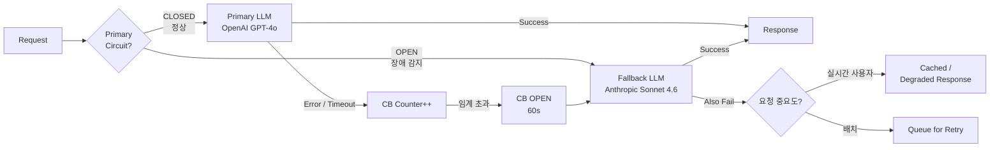

### LLM Routing & Fallback — "GPT-4o 하나로 다 처리하면 되지"의 순진함, 그리고 OpenAI 47분 장애에 SaaS 전체가 blank screen을 띄운 수요일 저녁 19:23, 그리고 월말 청구서 $38,900 중 72%가 "오늘 날씨 어때?" 같은 질문에 쓰였다는 걸 발견한 11월 1일 오전

---

#### 1. 그 수요일 저녁의 복기

**19:23** — OpenAI `status.openai.com` 노랑 배너: "Elevated errors on `chat/completions`."
**19:24** — 우리 SaaS Dashboard `/ai/chat` p99 → 45초 (타임아웃 벽에 박음).
**19:26** — Slack #incident 채널에 CS팀 첫 신고: "고객사 3곳에서 'AI 답변 안 와요' 티켓."
**19:31** — PagerDuty, CTO에게 발신.
**19:47** — Jira 긴급 티켓: "Primary LLM 벤더 장애. Fallback 없음. 복구 대기."
**20:10** — OpenAI 복구. 그 사이 B2B 계약 SLA 99.9% → 월 허용 다운타임 43분을 **47분 장애 1건으로 모두 소진**. 다음 달 SLA Credit $8,400 청구 예정.

그 다음 주 월요일, 재무팀이 LLM 월 청구서를 가져왔다:
- 총 비용 **$38,900**
- 전체 요청 중 **GPT-4o-mini로도 충분한 단순 질의 비중: 72%**
- 그 72%를 **GPT-4o**로 처리하면서 날린 돈: **$28,000**
- 반대로 "복잡한 추론" 질의(법률/코드 분석) 중 GPT-4o-mini로 처리되어 품질이 떨어진 비율: **9%**

> 하나의 모델로 모든 요청을 처리한 결과:
> - **가용성**: 벤더가 흔들리면 서비스가 통째로 흔들린다 (SPOF).
> - **비용**: 쉬운 질문에 비싼 모델이 꽂힌다.
> - **레이턴시**: "요약 한 줄"에 Reasoning 모델 2.8초가 붙는다.

이걸 구조적으로 푸는 패턴이 **LLM Routing & Fallback**이다.

---

#### 2. Routing vs Gateway — 뭐가 다른데?

이전 단계에서 다룬 **LLM Gateway**가 "모든 팀의 LLM 트래픽을 한 곳으로 모아 Rate Limit·Billing·Key 관리"를 하는 **인프라 레이어**였다면, **Routing**은 Gateway 안쪽에서 돌아가는 **의사결정 레이어**다.

```
┌─────────────────────────────────────────────────────────┐
│                     Application                         │
│  "이 회계 규정에 따라 2026년 영업세 신고 흐름 요약해줘"  │
└───────────────────────────┬─────────────────────────────┘
                            ▼
┌─────────────────────────────────────────────────────────┐
│   LLM Gateway  (키·쿼터·로깅·캐시 — '어떻게 보낼까')     │
└───────────────────────────┬─────────────────────────────┘
                            ▼
┌─────────────────────────────────────────────────────────┐
│   LLM Router   (어떤 모델에 보낼까 — '누구한테 보낼까') │
│  ┌──────────────┬─────────────┬──────────────────────┐  │
│  │ Classifier   │ Cost Policy │ Latency / SLA Policy │  │
│  └──────────────┴─────────────┴──────────────────────┘  │
└────────┬──────────────┬─────────────────┬───────────────┘
         ▼              ▼                 ▼
    ┌─────────┐   ┌───────────┐    ┌────────────┐
    │ Haiku   │   │ Sonnet    │    │ Opus /     │
    │ 4.5     │   │ 4.6       │    │ GPT-4o /   │
    │ (빠름)  │   │ (주력)    │    │ Gemini Pro │
    │ 저가    │   │ 중가      │    │ (추론·고가)│
    └─────────┘   └───────────┘    └────────────┘
```

Gateway는 "트래픽 관문", Router는 "트래픽 분류반장". 둘은 섞어 쓰면 안 된다 — 관문이 분류까지 하면 Gateway가 모델 벤더별 SDK·토큰 정책·프롬프트 템플릿까지 알게 되고, **공용 인프라가 비즈니스 로직을 삼키기 시작한다.**

---

#### 3. Router의 세 축

실무에서 Router 설계는 아래 세 축의 조합으로 결정된다.

| 축 | 질문 | 대표 신호 | 구현 난이도 |
|---|---|---|---|
| **Quality Router** | "이 질의가 어려운가?" | 질의 길이, 코드 포함 여부, Reasoning 요구, 도메인 분류기 | 중~상 |
| **Cost Router** | "이 고객·이 기능에 얼마까지 쓸 수 있나?" | Plan(Free/Pro/Enterprise), Feature Flag, 월 예산 | 하 |
| **Latency Router** | "이 호출이 동기(사용자 대기)인가 비동기인가?" | Streaming 여부, p95 SLA, 사용자 대기 UI | 하 |

실전 라우팅은 **3축의 AND 조건**이다. 예를 들어 "유료 고객의 실시간 Chat UI에서 들어온 500자 이상의 코드 리뷰 요청" → `Opus 4.7` / "Free 고객의 20자 캐주얼 질문" → `Haiku 4.5` / "비동기 백오피스 배치 집계" → `Sonnet 4.6`.

**중요한 함정 하나** — Quality Router를 LLM으로 돌리고 싶어진다. ("Mini-LLM이 질의 분류하고 Big-LLM이 답한다" 2단 구조.) 이 유혹에 넘어가면, 모든 요청이 **최소 2회 LLM 호출**이 되어 Classifier 비용만으로 월 $3,000이 추가로 찍힌다. 대부분의 경우 **휴리스틱(토큰 수 + 키워드 + 유저 플랜) + 작은 오픈소스 Classifier(DistilBERT)** 로도 F1 0.88이 나온다. LLM Classifier는 "휴리스틱으로 못 거른 애매한 10%"에만 붙이는 게 맞다.

---

#### 4. Fallback 계층 설계 — 핵심은 "시간이 아니라 상태"

가장 흔한 실수: `try { openai.call() } catch { anthropic.call() }` 를 **동일 요청에 바로 붙이는** 것.

이게 왜 깨지는가?
- OpenAI가 **429(Rate Limit)** 를 1건 뱉었다고 즉시 Anthropic으로 넘기면, 다음 요청·그 다음 요청도 Anthropic으로 쏠린다. Anthropic은 **평소 트래픽 10배를 갑자기 받아** 거기서도 429를 뱉기 시작한다. **Fallback이 Cascade 장애를 만든다.**
- OpenAI가 **5초간 느려졌다**고 Fallback을 돌리면, Fallback 왕복 포함 **9초짜리 응답**을 사용자에게 돌려주게 된다. 차라리 Primary 재시도가 빠르다.

올바른 Fallback은 **Circuit Breaker + 요청 분류** 조합이다.



**설계 포인트 4가지**
1. **Circuit은 벤더별·모델별로 따로** — OpenAI `gpt-4o`가 깨졌다고 `gpt-4o-mini`까지 차단하면 과잉 차단.
2. **Half-Open 복귀** — 60초 뒤 10%만 Primary로 흘려 복구 확인. 한 번에 100% 복귀하면 복구된 벤더를 다시 깨뜨린다.
3. **Fallback은 "다른 벤더"여야 한다** — OpenAI 장애에 OpenAI `gpt-4-turbo`를 Fallback으로 두는 건 Fallback이 아니다 (같은 리전·같은 Control Plane).
4. **Degraded Response를 설계해 두어라** — 두 벤더 다 깨진 상태의 UX. "지금 AI 응답이 지연됩니다. 캐시된 FAQ: ..." 라도 Blank Screen보다 낫다.

---

#### 5. 실제 사례

- **GitHub Copilot (2024)**: `Copilot Chat`은 질의 유형에 따라 `gpt-4o`·`claude-3.5-sonnet`·`o1-mini` 중 선택하는 **명시적 Model Picker + 암묵적 Router** 2단 구조를 노출했다. 사용자가 선택 안 하면 서버 Router가 "코드 변경 범위·커서 맥락 길이"로 Sonnet/4o를 분기.
- **Notion AI**: 2024년 상반기까지 OpenAI Only였다가, 2024 하반기부터 Anthropic Claude를 Fallback·일부 기능 Primary로 분산. 이유는 공식적으로 "성능 다각화"였지만 업계는 2024년 6월 OpenAI 4시간 장애 직후의 결정으로 해석.
- **Not Diamond / Martian / OpenRouter**: Routing-as-a-Service. "너의 트래픽을 우리 Router에 던지면 품질 유지하면서 비용 35% 깎아준다"가 마케팅. 내부적으로는 Classifier(BERT 계열) + 벤더 가격표를 결합. **Enterprise는 거의 안 쓴다** — 자기 트래픽 패턴·PII를 외부에 흘리기 싫어서. Growth 스타트업이 쓴다.
- **Anthropic SDK v0.40+ / OpenAI SDK**: 공식 SDK에 `max_retries`·`timeout` 외에 **Multi-Provider Fallback은 아직 1급 시민이 아니다.** 때문에 LangChain `with_fallbacks()`, LiteLLM Router, 또는 사내 구현이 보편적이다.
- **Shopify (2025 발표)**: 내부 LLM 요청의 83%를 Haiku/Mini급으로, 17%만 Sonnet/Opus급으로 라우팅. 결과 월 LLM 비용 $1.2M → $380K로 68% 절감. Router는 자체 구현 (Rails 서비스 레이어 + Ruby 기반 Classifier).

---

#### 6. 트레이드오프

| 선택 | 얻는 것 | 잃는 것 | 언제 |
|---|---|---|---|
| **No Router (단일 모델)** | 구현 10분, 코드 단순 | 비용·가용성·레이턴시 모두 최악 | PoC·사내 데모·일일 요청 1만 미만 |
| **휴리스틱 Router** | 비용 50~70% 절감, 지연 0ms | 애매한 경계 질의 품질 저하 | 대부분의 Production 초기 (6개월~1년) |
| **Classifier 기반 Router** | 품질 안정, 경계 질의 정확도 ↑ | Classifier 학습·배포·모니터링 공수, 10~30ms 추가 지연 | 월 LLM 비용 $10K 이상, 질의 유형 뚜렷 |
| **LLM-as-Router (Cascade)** | 분류 품질 최상, 구현 단순 | 매 요청 2회 LLM 비용, 지연 2배 | **대부분의 경우 추천 안 함.** 애매 10%에만 선택적으로 |
| **외부 Routing SaaS** | 즉시 효과, 벤더 가격 협상 떠넘김 | 트래픽 외부 유출, 벤더 락인 | Growth 스타트업, Enterprise 비추 |

---

#### 7. 시니어 관점 — 언제 쓰고, 언제 쓰면 안 되는가

**지금 당장 도입해야 하는 신호**
- 월 LLM 청구서가 $5K를 넘기 시작했다. (이 시점부터 Router 공수 3일 vs. 월 절감 $2K+ ROI 뚜렷)
- SLA 99.9% 이상을 고객과 계약했다. 단일 벤더로는 수학적으로 불가능 (OpenAI·Anthropic 모두 공식 SLA 99.9% 수준. 벤더 2개 병렬 = 99.99%).
- B2B 고객사가 "Model Provider 다각화 계획" 질문을 보안 설문에 넣기 시작했다.

**아직 도입하지 마라 (YAGNI 영역)**
- MVP 단계. 월 요청 5만 미만. Router 설계·튜닝·모니터링 공수가 절감액을 초과한다. **단일 모델 + Timeout + Retry**로 충분.
- 내부 Admin 도구. 사용자가 엔지니어 10명이면 비용·가용성 모두 문제가 안 된다.
- 질의 패턴이 모두 "복잡 추론" 하나로 수렴 (예: 법률 문서 분석 SaaS). Routing 여지가 없다. 대신 **Fallback만** 구현.

**가장 자주 보는 실수 3가지**
1. **Fallback 없이 Router만 구현** — Router가 도입되면 모델별 트래픽이 분산되어 각 모델의 Rate Limit에 도달할 확률이 **오히려 올라간다** (단일 모델일 때는 어차피 하나였지만, 분산 후에는 어느 모델이든 깨질 수 있다). Router와 Fallback은 쌍으로 간다.
2. **Router 결정 로그를 안 남김** — "왜 이 질의가 Haiku로 갔지?" 를 디버깅할 수 없으면 Router 품질을 영원히 개선 못 한다. 요청 1건당 `{classifier_score, chosen_model, policy_reason}` 세 필드는 무조건 남겨라.
3. **Router 자체가 SPOF** — Router 서비스가 죽으면 모든 LLM 호출이 죽는다. Router는 **Sidecar / Library** 패턴으로 Application 프로세스 안에서 돌리고, Router 설정만 Config Service에서 가져오는 구조가 안전하다. 별도 마이크로서비스로 뽑는 순간 추가 Hop + 추가 장애면.

---

> 💡 **왜 중요한가**: LLM은 "성능 좋은 하나"가 아니라 "가격·지연·가용성이 다른 여러 개"를 섞어 써야 하는 외부 벤더 자원이며, Router와 Fallback은 그 다각화를 코드로 표현하는 유일한 지점이다 — 없으면 벤더 장애 1건이 우리 서비스의 SLA 1건이 된다.
