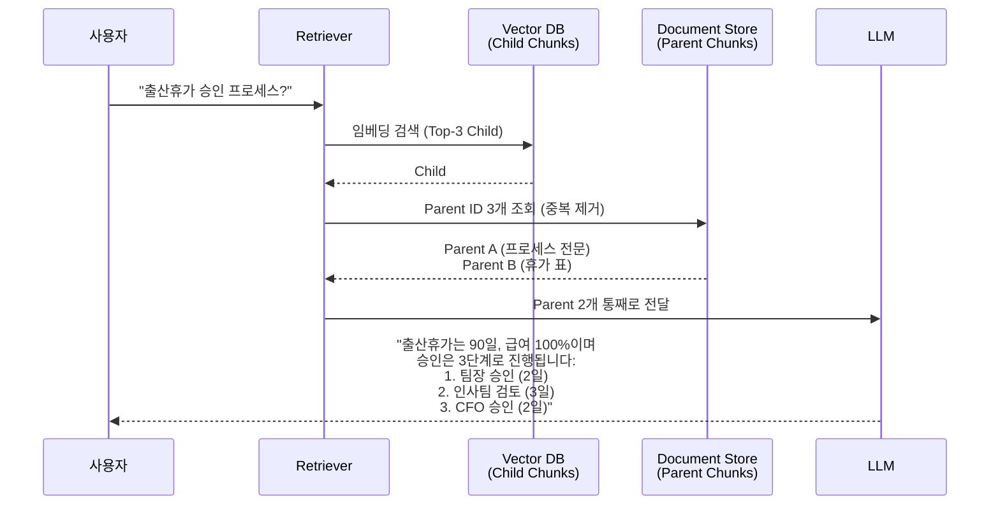

### Day 131. RAG Chunking 전략 — "그냥 500자씩 자르면 되지"의 치명적 순진함, 그리고 사내 위키 5,200개 문서를 넣고도 "휴가 승인 프로세스가 뭐예요?"에 "먼저 팀장님께"라는 반 토막 답을 돌려줘 인사팀이 "RAG 쓸모없다"고 Jira 올린 목요일 오후 15:40

---

#### 들어가며: Chunking은 "자르는 문제"가 아니라 "경계 설계" 문제다

RAG를 처음 붙일 때 모두가 똑같은 코드를 쓴다.

```python
# 90%의 RAG 프로젝트가 1주차에 쓰는 코드
chunks = [text[i:i+500] for i in range(0, len(text), 500)]
```

그리고 한 달 뒤 똑같은 증상을 호소한다.

> "검색은 되는데 답변이 이상해요. 문서는 분명히 있는데, LLM이 '정보가 부족하다'고 하거나, **문장 중간이 잘린 답**을 줍니다."

원인은 Vector DB도, 임베딩 모델도, LLM도 아니다. **문서를 자른 방식**이다. 이 글은 Chunking이 왜 RAG 품질의 **70% 이상**을 결정하는지, 그리고 어떤 전략이 언제 맞는지를 다룬다.

---

#### 1. 그날의 사건 — 인사팀 사내 위키 RAG 프로젝트

**배경**
- 사내 위키 Confluence 5,200 페이지를 RAG로 묶어 "사내 지식 챗봇"을 출시
- Chunking 전략: `RecursiveCharacterTextSplitter(chunk_size=500, overlap=50)` — LangChain 튜토리얼 그대로
- Vector DB: pgvector, 임베딩: `text-embedding-3-small`
- 출시 2주 후, 인사팀 사용률 **71% → 18%** 급락

**결정적 질문 1건**
사용자: *"출산 휴가 승인 프로세스 알려줘"*

RAG가 검색한 Top-3 청크:

```
[청크 #4172] (score: 0.89)
"...먼저 팀장님께 사전 보고 후 인사팀 포털에서 신청서를..."

[청크 #4173] (score: 0.84)
"...작성하여 제출합니다. 승인 절차는 다음 3단계로 진행됩니다:
1. 팀장 승인 (영업일 기준 2일 이내)..."

[청크 #4174] (score: 0.81)
"...2. 인사팀 1차 검토 (3일), 3. 최종 승인 (CFO, 2일)..."
```

LLM 답변:
> "먼저 팀장님께 사전 보고 후 인사팀 포털에서 신청서를 작성하여 제출합니다."

**3단계 프로세스가 통째로 사라졌다.** 왜? 청크 #4172가 가장 높은 점수를 받았고, LLM은 그 문맥만 보고 답했기 때문. 뒤에 붙은 **3단계 상세**는 "따로 떨어진 청크"로 인식되어 Top-3 안에 들어왔는데도, LLM은 "이게 같은 프로세스인지" 모른다.

더 심각한 것: Confluence의 **표(table)**가 500자 기준으로 잘리면서 "휴가 유형"과 "일수"가 다른 청크로 분리됨.

| 휴가 유형 | 일수 | 급여 |
|---|---|---|
| 출산휴가 | 90일 | 100% |
| 배우자 출산 | 10일 | 100% |

→ 청크 A: `| 휴가 유형 | 일수 | 급여 | | 출산휴가 | 90일 |`
→ 청크 B: `| 100% | | 배우자 출산 | 10일 | 100% |`

청크 B만 검색되면 LLM은 "**100% / 10일 / 100%**"를 보고 "배우자 출산 휴가는 10일"이라고 답하지만, **출산휴가 자체는 답을 못 한다**. 급여 컬럼이 떨어져 나갔기 때문.

인사팀 티켓: *"챗봇이 자꾸 반쪽짜리 답을 줘요. 그냥 Ctrl+F가 낫겠어요."*

---

#### 2. Chunking 전략의 스펙트럼

```
작은 청크 ←—————————————————————————————————————→ 큰 청크
(128 tokens)                                      (4,000 tokens)

┌────────┐  ┌────────┐  ┌──────────┐  ┌──────────┐  ┌──────────┐
│ 고정   │  │ 재귀적 │  │  문서    │  │ Semantic │  │  Parent- │
│ 크기   │  │ 분할   │  │  구조    │  │ Chunking │  │  Child   │
│Splitter│  │        │  │(Markdown │  │          │  │          │
│        │  │        │  │ Heading) │  │          │  │          │
└────────┘  └────────┘  └──────────┘  └──────────┘  └──────────┘
   ↑           ↑             ↑             ↑             ↑
 단순       구분자        문서의 의미    문장 임베딩   작게 검색,
 /빠름      기반          구조 존중      유사도 기반   크게 전달
 /멍청      (\n,.)        (H1/H2/표)     (느림/비쌈)  (최강/복잡)
```

각 전략의 **정확한 트레이드오프**를 보자.

---

#### 3. 다섯 가지 전략 비교

##### 3.1 Fixed-Size Chunking (고정 크기)

```python
chunks = [text[i:i+500] for i in range(0, len(text), 450)]  # overlap=50
```

- **장점**: 구현 1줄, 예측 가능한 토큰 비용
- **단점**: 문장/문단/표/코드블록을 **무차별 절단**
- **쓸 곳**: 균질한 로그, 채팅 로그, 하나의 톤으로 쓰인 뉴스 기사
- **쓰지 말 곳**: 사내 위키, 기술 문서, 계약서, 표가 섞인 문서 **(= 대부분의 엔터프라이즈)**

##### 3.2 Recursive Character Splitting (재귀적 구분자)

LangChain 기본. `["\n\n", "\n", ". ", " "]` 순서로 시도.

- **장점**: 문단 경계를 어느 정도 존중, 여전히 빠름
- **단점**: **의미**는 모른다. "1. 팀장 승인" 다음 "2. 인사팀 검토"가 같은 리스트인 걸 모르고 자른다.
- **쓸 곳**: 블로그, 일반 문서, 프로토타입
- **쓰지 말 곳**: 번호 리스트가 중요한 프로세스 문서, 표, 코드

##### 3.3 Structure-Aware Chunking (문서 구조 인식)

Markdown의 `#`, `##`, `###` / HTML의 `<h1>`, `<table>` / PDF의 섹션을 **경계로 삼는다**.

```python
from langchain.text_splitter import MarkdownHeaderTextSplitter

splitter = MarkdownHeaderTextSplitter(
    headers_to_split_on=[("#", "H1"), ("##", "H2"), ("###", "H3")]
)
# 메타데이터로 "H1: 휴가 규정 > H2: 출산휴가 > H3: 승인 프로세스" 유지
```

- **장점**: **문서 작성자의 의도**를 그대로 보존. "출산휴가 > 승인 프로세스" 섹션은 통째로 하나의 청크.
- **단점**: 구조가 없는 문서(평문 PDF, 스캔본)에서는 무력
- **쓸 곳**: Confluence/Notion 위키, 기술 문서, GitHub README, API 레퍼런스
- **실제 사례**: **Notion AI**가 이 전략을 베이스로 사용. 자사 서비스가 블록 기반이라 구조가 명확하기 때문.

##### 3.4 Semantic Chunking (의미 기반)

문장을 임베딩한 뒤 **인접 문장 간 코사인 유사도**가 급격히 떨어지는 지점을 경계로 삼는다.

```python
# 유사도 그래프
문장1 ──0.91── 문장2 ──0.88── 문장3 ──0.42── 문장4 ──0.89── 문장5
                                     ↑
                            여기서 "주제 전환" 감지 → 청크 경계
```

- **장점**: 주제가 바뀌는 지점을 수학적으로 찾는다
- **단점**: 임베딩 API 비용 **n배** 증가 (문서 전체를 문장 단위로 임베딩), 인덱싱 시간 증가
- **쓸 곳**: 긴 보고서, 논문, 법률 문서처럼 **주제 전환이 잦은** 문서
- **쓰지 말 곳**: 짧은 FAQ, 구조화된 위키 (오버엔지니어링)

##### 3.5 Parent-Child Chunking (작게 검색, 크게 전달)

핵심 아이디어: **검색용 청크**와 **LLM에 전달할 청크**를 분리한다.

```
원본 문서
   │
   ├─ Parent Chunk (2,000 tokens) "출산휴가 > 승인 프로세스 전체"
   │     │
   │     ├─ Child #1 (200 tokens) "먼저 팀장님께 사전 보고..."  ← 벡터 인덱싱
   │     ├─ Child #2 (200 tokens) "1. 팀장 승인 (2일)..."       ← 벡터 인덱싱
   │     └─ Child #3 (200 tokens) "3. 최종 승인 (CFO)..."       ← 벡터 인덱싱
   │
   └─ Parent Chunk (2,000 tokens) "휴가 유형별 일수 표"
         └─ Child #4 (200 tokens) "출산휴가 90일 100%..."        ← 벡터 인덱싱
```

- **검색**: 작은 Child 청크로 정밀 매칭 (의미가 좁으니 임베딩 품질 ↑)
- **전달**: 매칭된 Child의 **Parent**를 LLM에 통째로 넘김 (문맥 손실 X)



- **장점**: **반 토막 답변 문제 해결**. 표, 리스트, 다단계 프로세스에서 결정적.
- **단점**: 저장소 2개 운영(Vector DB + Document Store), 구현 복잡도 ↑, Parent가 크면 토큰 비용 ↑
- **실제 사례**: **Perplexity**, **Glean**(사내 검색 SaaS, $7B 밸류에이션)이 유사한 전략. 사내 문서 검색에서 "답이 뚝 끊기는" 문제를 제품 품질로 승부해야 하기 때문.

---

#### 4. 트레이드오프 요약표

| 전략 | 구현 | 비용 | 품질(위키) | 품질(코드) | 품질(표) | 품질(법률) |
|---|---|---|---|---|---|---|
| Fixed-Size | ★☆☆☆☆ | ★☆☆☆☆ | 2/10 | 1/10 | 1/10 | 2/10 |
| Recursive | ★★☆☆☆ | ★☆☆☆☆ | 5/10 | 3/10 | 2/10 | 4/10 |
| Structure-Aware | ★★★☆☆ | ★★☆☆☆ | **9/10** | **8/10** | 7/10 | 6/10 |
| Semantic | ★★★★☆ | ★★★★☆ | 6/10 | 2/10 | 3/10 | **9/10** |
| Parent-Child | ★★★★★ | ★★★☆☆ | **9/10** | 7/10 | **9/10** | 8/10 |

---

#### 5. 사건 복구 — 인사팀 RAG는 어떻게 고쳤나

**변경 사항**

1. **Confluence → Markdown 변환**: Confluence Storage Format을 Markdown으로 정규화 (표/리스트/헤더 보존)
2. **Structure-Aware + Parent-Child 조합**
   - Parent: H2 단위 (평균 1,800 tokens)
   - Child: H3 또는 리스트 아이템 단위 (평균 250 tokens)
3. **표는 통째로 하나의 Child**: Markdown 표를 절대 자르지 않음. 큰 표는 Parent로 승격.
4. **메타데이터 enrichment**: 각 Child에 "H1 > H2 > H3" 경로를 **임베딩 입력에 포함**
   ```
   "사내 규정 > 휴가 > 출산휴가 승인 프로세스: 먼저 팀장님께..."
   ```
   → 짧은 청크에 **문맥을 주입**해 임베딩 품질 상승

**결과 (3주 후)**
- 반 토막 답변 리포트: 주 23건 → 주 **2건**
- 인사팀 사용률: 18% → **64%** 복귀
- 추가 비용: 임베딩 재생성 1회성 $340, 월 Document Store(Postgres) $18

---

#### 6. 시니어의 판단 기준 — 언제 뭘 쓸 것인가

| 상황 | 전략 |
|---|---|
| 프로토타입, 1주 내 데모 | Recursive (LangChain 기본) |
| Markdown/Notion/Confluence 위키 | **Structure-Aware** |
| 표·다단계 프로세스·매뉴얼이 많은 엔터프라이즈 문서 | **Parent-Child** |
| 코드베이스 RAG (GitHub Copilot류) | Structure-Aware (AST/함수 단위) |
| 법률/논문/장문 보고서 | Semantic |
| 로그·채팅 이력 | Fixed-Size (의미 전환 적음) |

**쓰지 말아야 할 때**
- 문서가 100개 미만 → **RAG 자체가 오버킬**. 전체를 context에 넣거나 BM25로 충분.
- 문서가 자주(주 단위) 바뀌는 환경 + Semantic Chunking → **재인덱싱 비용이 운영을 잠식**. Structure-Aware로 다운그레이드.
- Parent-Child를 "유행"이라 도입했는데 문서가 전부 2-3문장짜리 FAQ → **그냥 Child가 Parent다**. 복잡도만 늘고 품질은 그대로.

---

#### 7. 안티패턴

1. **Chunking을 "한 번 정하면 끝"으로 여김** → 문서 종류별(위키/PDF/코드)로 다른 전략을 써야 함. 하나로 통일하지 마라.
2. **overlap = 50으로 "안심"** → overlap은 경계에서의 문맥 손실을 **희석**할 뿐, **구조적 절단 문제**는 못 고친다.
3. **청크 크기를 임베딩 모델의 max_tokens까지 꽉 채움** → `text-embedding-3-small`은 8,192까지 받지만, **임베딩 품질은 256~512 토큰 부근에서 피크**. 큰 청크일수록 "하나의 의미 벡터"로 압축하면서 세부가 사라진다.
4. **Chunking을 바꿨는데 평가 지표가 없음** → 다음 주 똑같은 사고를 반복. 최소 20개의 "정답 질문-문서" 페어로 Retrieval Recall@3을 매번 측정해야 한다.

---

> 💡 **왜 중요한가**: RAG의 품질은 임베딩 모델도, Vector DB도, LLM도 아닌 **문서를 자른 방식**이 70%를 결정하며, Chunking을 "구현 디테일"로 치부하는 순간 시스템은 반 토막 답변을 자신 있게 돌려준다.
