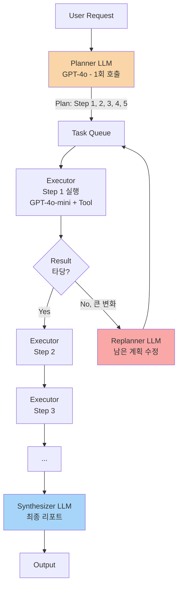
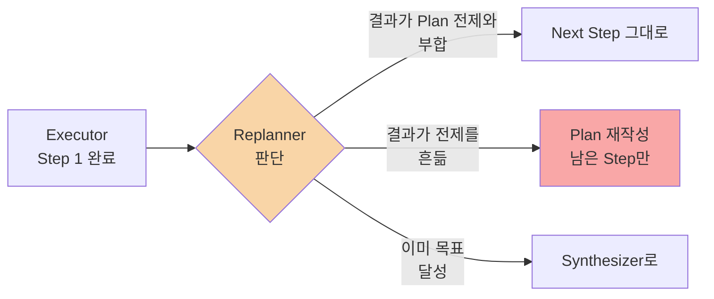

### Day 132. Agent Planning (Plan-and-Execute 패턴) — "ReAct가 똑똑하니까 알아서 계획 짜겠지"라는 순진함, 그리고 "경쟁사 3곳 가격 모델 비교해줘" 한 마디에 Agent가 **47 스텝**을 돌며 같은 뉴스 기사를 6번 재검색한 뒤 리포트 1건당 토큰 비용 $4.80, 응답 시간 **11분 23초**를 찍어 세일즈팀 CMO가 "이거 Perplexity보다 못하잖아"라고 Slack 올린 토요일 오전 11:47

---

#### 그 토요일 오전 11:47에 있었던 일

세일즈팀이 쓰는 사내 **Deep Research Agent** (ReAct 기반, GPT-4o + Tavily Search + 사내 CRM Tool). CMO가 치명적인 한 문장을 던진다.

> **"우리 제품이랑 Salesforce Service Cloud, Zendesk, Intercom 세 개 가격 모델 비교해서 월요일 아침 보드미팅용 리포트 뽑아줘."**

Agent가 뱉은 47 스텝의 trace를 뜯어보면 — ReAct 특유의 **"매 스텝마다 다음을 결정"** 하는 구조가 어떻게 무너지는지 그대로 보인다.

```
Step 1:  Thought: Salesforce 가격부터 찾아야겠다
         Action: web_search("Salesforce Service Cloud pricing 2026")
Step 2:  Observation: [검색결과 10개, 32KB]
         Thought: 첫 페이지 읽자
         Action: read_page(url_1)
Step 3:  Observation: [페이지 내용 48KB]
         Thought: 이제 Zendesk...
Step 4:  Action: web_search("Zendesk pricing 2026")
...
Step 11: [Context 누적 410KB 도달]
         Thought: 어, Salesforce 가격을 아직 못 찾은 것 같은데?
         Action: web_search("Salesforce Service Cloud pricing")  ← 재검색
Step 17: Thought: Intercom은 아직 안 봤네
         Action: web_search("Intercom pricing")  ← 사실은 Step 8에서 함
Step 23: Thought: 사용자가 원한 건 뭐더라? 다시 보자
         Action: ... (프롬프트 초기 지시문을 "다시 생각"하면서 비용 폭발)
Step 47: Thought: 이제 리포트를 쓰자
         → 최종 출력: 반쪽짜리 표 + "자세한 내용은 각 벤더 사이트 참조"
```

- 총 입력 토큰: **1,940,000**
- 총 비용: **$4.80/건**
- 응답 시간: **11분 23초**
- 세일즈팀 10명 × 하루 평균 3건 = 월 **$4,320** / 30일 중 CMO가 쓰는 건 단 2번

CMO가 올린 Slack 한 줄 —

> *"@everyone Perplexity Pro가 월 $20인데 이걸로 왜 한 번에 $4.80씩 나가는지 설명해줄 사람?"*

ReAct는 **"매 스텝마다 전체 맥락을 다시 읽고 다음 수를 결정"** 하는 구조라, 복잡도가 **스텝 수 × 누적 context**로 **곱셈**으로 터진다. 똑똑해 보이지만, 뇌 수술 중인 의사에게 **매 1분마다 "그래서 환자 이름이 뭐였죠? 무슨 수술이었죠?"를 다시 물어보는 꼴**이다.

---

#### Plan-and-Execute는 뭐가 다른가 — "한 번만 계획하고, 쭉 집행한다"

핵심 전환: **"다음 수를 매번 결정"** → **"전체 계획을 먼저 짜고, 그 다음엔 계획대로 집행"**.



**세 가지 역할 분리**가 핵심이다.

| 역할 | 모델 | 호출 횟수 | 역할 |
|---|---|---|---|
| **Planner** | GPT-4o (강한 모델) | 1회 (+ Replan 시 추가) | 전체 Step 목록을 짠다 |
| **Executor** | GPT-4o-mini (약한 모델) | Step 수만큼 | 한 스텝의 Tool만 실행 |
| **Synthesizer** | GPT-4o | 1회 | 수집된 중간 결과를 최종 응답으로 |

위 CMO 사례에 적용하면:

```
[Planner 1회 호출 — 입력 8KB, 출력 2KB]
  Plan:
    1. web_search("Salesforce Service Cloud pricing tiers 2026")
    2. web_search("Zendesk Support pricing 2026")
    3. web_search("Intercom pricing 2026")
    4. crm_lookup("우리 제품 가격 테이블")
    5. 4개 벤더 가격을 user/월 기준으로 정규화
    6. 팀 규모 10/50/200명 시나리오별 TCO 계산
    7. 비교표 + 포지셔닝 서술 작성

[Executor × 7회 — 각 호출 입력 평균 12KB, 출력 4KB]
  Step 1 실행 → 결과를 Blackboard에 저장
  Step 2 실행 → 결과를 Blackboard에 저장
  ...

[Synthesizer 1회 — 입력 Blackboard 42KB, 출력 리포트 6KB]
```

- 총 토큰: **1,940,000 → 310,000** (84% ↓)
- 비용: **$4.80 → $0.62/건**
- 응답 시간: **11분 23초 → 2분 48초**

**왜 이렇게 싸지는가?** ReAct는 매 스텝마다 "전체 대화 + 전체 Tool 결과"를 다시 보내지만, Executor는 **"Step N의 지시 + 이번 Tool 결과"만** 본다. 누적 context가 **선형(Executor) + 1회(Synthesizer)**로 분리되어 곱셈이 끊긴다.

---

#### Replanner는 왜 있는가 — "계획대로 되는 세상은 없다"

Plan-and-Execute의 진짜 통찰은 Planner가 아니라 **Replanner**에 있다. 순수 Plan-and-Execute (초기 AutoGPT 류) 는 **"한 번 짠 계획을 끝까지 집행"** 했는데, 중간에 Tool이 예상 밖 결과를 내놓으면 그대로 삽질했다.

```
Plan:
  1. web_search("Salesforce pricing") → 결과: "2026년부터 Agentforce로 통합, 가격 체계 전면 개편"
  2. (예정) web_search("Zendesk pricing") ← 그대로 가면 안 됨
```

여기서 **Replanner**가 개입해야 한다.



Replanner는 **매 스텝 뒤 호출될 필요 없다**. 실무 설정 —

- **"결과가 null/에러"** 일 때만 호출 (90% 케이스)
- **"결과 크기가 예상의 3배 이상"** 일 때 (new finding 가능성)
- 또는 Executor에 `flag_for_replan: bool` 출력 필드를 두고 모델이 스스로 플래그

이 선택적 Replan 구조 덕에 **Plan-and-Execute가 ReAct의 유연성을 포기하지 않으면서도 비용을 지킨다**.

---

#### Reflexion — 실패에서 배우는 변형

Plan-and-Execute의 사촌 격. **"Step이 실패하면, 실패 이유를 자연어로 적어두고 재시도"**.

```
Step 3: crm_lookup("우리 제품 가격")
  → Error: table "pricing_v2" not found
  
Reflection: "CRM의 pricing 테이블 이름이 변경된 듯. 
  대신 products 테이블에서 price_tier 컬럼을 조회해야 함."
  → Blackboard["reflections"]에 저장

Step 3 재시도 (reflection을 프롬프트에 주입):
  → crm_lookup("products 테이블의 price_tier")
  → 성공
```

Reflexion은 **같은 Agent가 다음에 같은 Task를 만났을 때** 성능이 올라간다는 점에서 "학습"에 가깝다 (가중치 업데이트 없이). 단, **persistent reflection store**가 필요하고 (Redis/Postgres), **reflection이 쌓이면서 context가 다시 터질 위험**이 있어 TTL + 최대 개수 제한을 반드시 걸어야 한다.

---

#### 트레이드오프 — ReAct vs Plan-and-Execute vs Reflexion

| 기준 | ReAct | Plan-and-Execute | Reflexion |
|---|---|---|---|
| **구현 복잡도** | 낮음 (Loop 하나) | 중간 (3 역할 분리) | 높음 (+ Memory Store) |
| **짧은 Task (1~3 Tool)** | ✅ 최적 | ❌ 오버엔지니어링 | ❌ 오버엔지니어링 |
| **긴 Task (5+ Tool)** | ❌ Context 폭발 | ✅ 선형 스케일 | ✅ 선형 스케일 |
| **예측 불가 Task** | ✅ 유연 | ⚠️ Replan에 의존 | ✅ 학습으로 보완 |
| **병렬 실행 가능성** | ❌ 순차 강제 | ✅ Plan에서 독립 Step 병렬화 | ✅ |
| **비용 (토큰)** | 스텝 수 × 누적 context (곱셈) | Plan(1회) + Σ Executor (덧셈) | + Memory Replay 비용 |
| **디버깅** | 어렵다 (매 스텝 Thought) | 쉽다 (Plan만 보면 됨) | 가장 어렵다 |
| **Latency 민감 (챗봇)** | ⚠️ (매 스텝 LLM 호출) | ✅ Executor는 mini 모델 가능 | ❌ Reflection 지연 |
| **대표 프레임워크** | LangChain Agent, AutoGPT 초기 | **LangGraph Plan-and-Execute**, CrewAI | Reflexion (논문), AutoGPT 후기 |

---

#### 실제 사례 — 어떤 회사가 어떤 걸 왜 골랐나

**Perplexity의 "Deep Research" (2025 Q1~)** — 명시적 **Plan-and-Execute**. Planner가 Research Plan 7~15 Step을 먼저 짜서 UI에 보여주고 ("I'm going to..."), 각 Step을 병렬 Executor로 돌린 뒤 Synthesizer가 citation 포함 리포트를 작성. 응답 시간이 길어도 **"Plan이 보이니까 사용자가 기다릴 수 있는"** UX 설계가 핵심.

**Cognition의 Devin (AI 소프트웨어 엔지니어)** — Plan-and-Execute + **대규모 Replanner**. 초기 Plan은 거칠게 짜고 (`"1. 코드베이스 파악 → 2. 테스트 추가 → 3. 버그 재현 → ..."`), Executor가 각 Step에서 **매우 자주 Replan을 트리거**한다. 코드 작업은 "예상대로 안 되는" 경우가 90%라, Plan 안정성을 포기하고 Replan 빈도를 높인 설계.

**LangGraph의 공식 Plan-and-Execute 템플릿** — Planner (GPT-4o) + Executor (GPT-4o-mini) + Replanner (GPT-4o). 템플릿이 Reference 구현으로 자리 잡은 뒤, 2025년 이후 **"Agent 만든다"** 하면 이 구조가 디폴트가 됐다.

**OpenAI의 "ChatGPT Deep Research" (2025~)** — 공개된 바로는 Plan-and-Execute + Reflexion 혼합. 5~30분짜리 Task에 ReAct 루프를 쓰면 context가 MB 단위로 터지기 때문에, **"매 5~10 Step마다 중간 요약(compression)을 Blackboard에 쓰고 Executor는 요약만 본다"** 는 구조로 추정됨.

반대로 — **Cursor의 "Composer Agent" (2025~)** 는 **ReAct를 고수**한다. 왜? 코드 편집은 **"다음 수가 이전 수에 강하게 의존"** 하는 성격이고, 한 턴당 1~5 Step으로 짧다. Plan을 미리 짜는 것 자체가 낭비.

---

#### 언제 쓰고, 언제 쓰면 안 되는가 — 시니어 판단 기준

**써야 하는 상황**
- Task 당 예상 Tool 호출이 **5회 이상**
- Tool이 **독립적**이어서 병렬 실행 가능 (여러 API를 동시에 조회)
- 사용자가 **응답 시간보다 품질에 민감** (리서치, 리포트, 분석)
- Executor 단계는 작은 모델(mini/haiku)로 처리 가능한 단순 Tool Use
- **디버깅 가능성**이 중요한 Enterprise 환경 (Plan을 로그로 남길 수 있음)

**쓰면 안 되는 상황**
- Task가 **1~3 Tool 호출**로 끝나는 경량 챗봇 — 오히려 Planner 호출이 오버헤드
- **고객 대화형** 인터페이스 — Plan 짜는 동안 1~3초 침묵이 생긴다
- Tool 결과가 **매번 다음 Step을 완전히 바꾸는** Task (ex. 코드 편집, 인터랙티브 게임) — ReAct가 맞다
- **스트리밍 응답**이 필수 — Plan-and-Execute는 본질상 전체 완료 후 Synthesize
- Planner가 **도메인 지식 부족**으로 엉뚱한 Plan을 짜는 경우 — 이땐 Few-shot Plan 예시를 주거나, 아예 Hand-written Plan Template을 쓰는 게 낫다

---

#### 시니어 체크리스트 — 프로덕션 투입 전

1. **Plan 자체를 로깅**하는가? (Plan은 Agent의 의도 — 사후 분석의 핵심 증거)
2. **Max Step 제한**이 걸려 있는가? (Planner가 20 Step을 짜면 강제 중단)
3. **Replan 호출 상한**은? (무한 Replan 루프 방지. 보통 3회)
4. **Executor 실패 시 Retry 정책**은 Reflexion인가 단순 지수 백오프인가?
5. **독립 Step 병렬 실행**이 구현됐는가? (안 하면 순차 실행 대비 이득의 절반을 버리는 것)
6. **Planner와 Executor를 다른 모델**로 쓰고 있는가? (같은 모델로 쓰면 비용 이득 반감)
7. **Plan을 사용자에게 보여줄 것인가**? (Perplexity식 UX — "I'm going to..." → 체감 레이턴시 완화)
8. **Blackboard(중간 결과 저장소)의 크기 제한**은? (무제한이면 Synthesizer가 다시 터진다)
9. **AI Observability (Day 130)에서 Plan 단위로 trace를 볼 수 있는가**? (Step별 비용/지연 분리 필수)
10. **금액/삭제/외부 전송 Step이 Plan에 섞여 있을 때 Human-in-the-Loop 승인 게이트**가 있는가?

---

> 💡 **왜 중요한가**: ReAct는 "매 스텝마다 전체를 다시 생각하는" 구조라 Task가 길어질수록 **비용이 곱셈으로 터지고 길을 잃지만**, Plan-and-Execute는 **Planner(1회) + Executor(선형) + Synthesizer(1회)** 로 비용을 덧셈으로 끊어낸다 — 복잡한 Agent를 "데모에서 프로덕션으로" 넘기는 순간 반드시 거쳐야 할 구조 전환이다.
