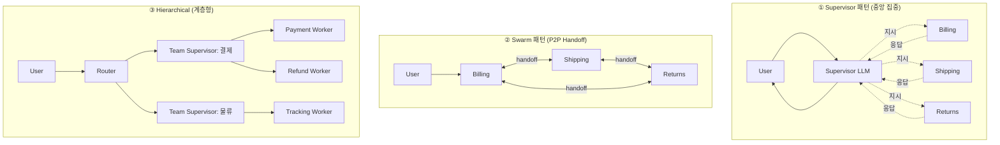

### Day 135. Multi-Agent Orchestration — "에이전트 10개 돌리면 10배 똑똑해지겠지"의 치명적 순진함, 그리고 "환불 요청이요"라는 한 줄에 Billing Agent → Technical Agent → Policy Agent → Billing Agent 가 **23번 Ping-Pong** 하다가 토큰 $7.20을 태우고 마지막에 "담당 부서로 연결해드리겠습니다"를 돌려준 뒤 고객이 X에 스크린샷 올려 리트윗 4,100회를 찍은 수요일 오후 15:33

---

#### 🎬 사건 재구성: "AI 상담사 10명이 24시간 일합니다"

2026년 3월 어느 수요일 오후, 한 D2C 커머스 스타트업이 자랑스럽게 블로그에 썼다.

> "저희는 고객 문의를 처리하는 **전문화된 AI 에이전트 7명**을 배치했습니다.
> Billing, Technical, Shipping, Returns, Product, Escalation, Scheduler."

이틀 뒤, X에 올라온 스크린샷 하나.

```
[고객]  "3월 2일 결제한 노트북 환불하고 싶어요. 아직 안 왔어요."

[봇]   [15:33:02] "환불 요청 접수. Billing Agent에 전달합니다."
       [15:33:07] "결제 이력 확인. 실물 미수령은 Shipping Agent 관할입니다."
       [15:33:14] "배송 조회. 미배송 사유 확인을 위해 Technical Agent에 문의."
       [15:33:21] "시스템 정상. 환불 처리는 Billing Agent에 요청."
       [15:33:28] "미수령 건 환불은 Returns Agent 정책 확인 필요."
       [15:33:36] "Returns Policy: 배송 전 환불은 Billing에서 즉시 처리."
       [15:33:43] "결제 이력 확인. 실물 미수령은 Shipping Agent 관할입니다."
       [15:33:50] "배송 조회. 미배송 사유 확인을 위해 Technical Agent에 문의."
       ... (23회 반복) ...
       [15:36:11] "담당 부서로 연결해드리겠습니다. 영업일 기준 3-5일 소요됩니다."
```

**토큰 비용: $7.20 (한 건 기준)**, 리트윗 4,100회, CTO가 월요일 아침 "멀티 에이전트 전면 중단" 지시.

---

#### 💣 왜 터졌는가 — Multi-Agent의 3가지 함정

##### ① 핸드오프 데드락 (Handoff Deadlock)

각 에이전트는 **"내 책임이 아닌 것"**을 거절하도록 프롬프팅되어 있다. 그래서 책임 경계가 흐린 요청은 서로에게 떠넘기며 순환한다.

```
Billing: "미수령 건은 Shipping 소관"
Shipping: "환불 처리는 Billing 소관"
Billing: "미수령 건은 Shipping 소관"  ← 무한 루프
```

LangGraph, AutoGen, CrewAI 모두 기본 설정에서는 **max_iterations**만 제한할 뿐 "같은 노드 재방문 감지"는 하지 않는다. `recursion_limit=25`가 한도이면 **25번 Ping-Pong 후 포기 메시지**가 나간다.

##### ② 컨텍스트 폭발 (Context Explosion)

Supervisor 패턴에서 메시지가 쌓이는 방식:

```
Turn 1: [user_msg]                                    → 180 tokens
Turn 2: [user_msg, billing_response]                  → 920 tokens
Turn 3: [user_msg, billing, shipping_response]        → 2,100 tokens
Turn 4: [user_msg, billing, shipping, technical]      → 4,800 tokens
...
Turn 23: [23개 에이전트 응답 전체]                      → 47,200 tokens
```

각 에이전트가 **전체 히스토리**를 입력으로 받기 때문에, 단순한 N개 에이전트가 아니라 **O(N²)의 토큰 비용**이 발생한다. GPT-4o 기준 $0.005/1K input → 23턴이면 **턴당 $0.24**, 총 $5.52가 input에서만 나간다.

##### ③ 환각 전파 (Hallucination Propagation)

Agent A가 "결제가 완료되지 않았습니다"라고 잘못 판단하면, Agent B는 그걸 **사실로 믿고** "그럼 재결제 안내를 드리겠습니다"로 이어간다. 한 에이전트의 오염이 **downstream 모두를 오염**시킨다.

---

#### 🏗️ 아키텍처 패턴 3가지



| 패턴 | 장점 | 단점 | 대표 구현 |
|------|------|------|-----------|
| **Supervisor** | 흐름 명확, 디버깅 쉬움, 루프 방지 수월 | Supervisor LLM이 SPOF, 토큰 O(N²) | LangGraph `create_supervisor` |
| **Swarm (Handoff)** | 토큰 효율적, 자율성 높음 | 무한 핸드오프 위험, 추적 어려움 | OpenAI Swarm, CrewAI `hierarchical=False` |
| **Hierarchical** | 대규모 조직화 가능, 격리 | 설계 복잡도 폭증, 에이전트 ≥ 10개부터 ROI | LangGraph `Subgraph`, AutoGen `GroupChat` |

---

#### 🩹 Supervisor 패턴을 "실제로 쓸 수 있게" 만드는 가드레일 5가지

```python
# LangGraph 예시 - 실전 가드레일 포함
from langgraph.graph import StateGraph, END
from typing import TypedDict, Annotated
import operator

class AgentState(TypedDict):
    messages: Annotated[list, operator.add]
    visited: Annotated[list, operator.add]     # ① 방문 이력 추적
    hop_count: int                              # ② 홉 카운터
    confidence: float                           # ③ 신뢰도 임계값

def supervisor_router(state: AgentState) -> str:
    # ④ 순환 감지: 같은 에이전트 3회 연속 방문 → 강제 종료
    if len(state["visited"]) >= 3 and \
       state["visited"][-1] == state["visited"][-2] == state["visited"][-3]:
        return "escalate_to_human"

    # ⑤ 홉 제한: 7홉 초과 → 사람 연결
    if state["hop_count"] > 7:
        return "escalate_to_human"

    # Supervisor LLM 호출
    next_agent = llm.invoke(ROUTER_PROMPT.format(state))

    # 신뢰도가 낮으면 사람에게
    if next_agent.confidence < 0.6:
        return "escalate_to_human"

    return next_agent.name
```

핵심은 **"AI가 끝까지 처리해야 한다"는 환상을 버리는 것**. Escalation 경로는 기능이 아니라 **SLA**다.

---

#### 🏢 실제 사례 — 누가 어떻게 썼는가

##### Klarna (2024~2026 변곡점)
- 초기: "AI가 상담사 700명분의 일을 한다"고 자랑 (단일 에이전트 + RAG)
- 2024년 중반: Multi-Agent로 전환 시도 (Billing, Returns, Disputes 분리)
- 2025년 말 **되돌림**: "복잡한 라우팅보다 **강력한 단일 에이전트 + 명확한 escalation**이 CSAT 높았다"
- 교훈: **에이전트 ≠ 조직도**. 사내 조직을 그대로 에이전트로 쪼개면 사내 관료제가 AI에 복제됨.

##### Anthropic Research (Multi-Agent Research System, 2025)
- Lead Agent + Subagents 구조 (Supervisor + Worker)
- **각 Subagent에 독립 컨텍스트 윈도우** 할당 → O(N²) 문제 회피
- 토큰 사용량이 단일 에이전트 대비 **15배**였지만, 복잡한 리서치 과제 성능이 **90.2%** 향상
- 교훈: Multi-Agent는 **"넓게 탐색해야 하는 작업"**(리서치, 코드베이스 탐색)에서 ROI가 나옴. CS 응답 같은 **"좁고 결정론적"** 작업에는 **과잉 설계**.

##### GitHub Copilot Workspace
- Planner → Coder → Reviewer의 **3-agent 파이프라인** (파이프라인은 Multi-Agent의 특수형)
- 핵심: **역방향 핸드오프 금지**. Coder는 Planner에게 되돌릴 수 없고, Reviewer만 Coder로 되돌림 가능. **DAG**로 구조화.

---

#### ⚖️ 트레이드오프 — 언제 쓰고 언제 쓰면 안 되는가

##### ✅ Multi-Agent가 맞는 경우
1. **병렬화 가능한 탐색 작업**: "경쟁사 10곳 조사" → 10개 Subagent 병렬 (단, Day 132에서 봤듯 **Planner로 중복 작업 방지**)
2. **명확히 격리된 도메인**: SQL 생성 / 차트 그리기 / 문서 요약처럼 **도구 경계가 선명한** 작업
3. **사람 조직과 책임 매핑이 1:1인 작업**: 법무 리뷰 → 계약 수정 → 서명 요청 (각 단계가 실제로 다른 **데이터 접근 권한**을 가짐)

##### ❌ Multi-Agent가 과잉인 경우
1. **고객 응대처럼 턴 지연이 치명적인 작업**: 23홉이면 그 자체로 UX 실패
2. **에이전트 간 책임 경계가 모호한 작업**: "환불 겸 배송 문의" 같은 cross-cutting
3. **에이전트 수 < 4개**: 단일 에이전트 + Tool Use(Function Calling)로 충분
4. **스테이트 공유가 많은 작업**: 에이전트마다 state를 직렬화/역직렬화하는 비용이 LLM 호출 비용을 초과

---

#### 🧭 시니어 백엔드 체크리스트

의사결정할 때 자신에게 던져야 할 질문:

- [ ] 이 작업을 **단일 에이전트 + 5개 Tool**로 할 수 없는가? (Occam's Razor)
- [ ] 각 에이전트는 **독립된 컨텍스트 윈도우**를 갖는가, 공유하는가? (공유면 O(N²) 비용)
- [ ] **max_hops, max_recursion, same_node_revisit** 가드가 있는가?
- [ ] 각 홉마다 **traceId + agentId + input_tokens + output_tokens**를 로깅하는가? (LangSmith/LangFuse 연동 — Day 130 참고)
- [ ] Escalation 경로가 **"최후 수단"이 아니라 "정상 경로"**로 설계됐는가?
- [ ] 한 홉 실패 시 **부분 응답**을 사용자에게 돌릴 수 있는가, 아니면 전체 롤백인가?
- [ ] 토큰 비용 상한선(**per-conversation budget**)이 있는가?

---

> 💡 **왜 중요한가**: Multi-Agent는 "AI 조직화"가 아니라 **"조직화된 실패 모드의 확장"**이다 — 패턴을 이해하지 못하고 쪼개면, 단일 에이전트의 환각 1개가 N개로 복제되고 토큰 비용이 N²로 폭발하며, 그 모든 걸 **"AI가 알아서 처리했겠지"**라는 블랙박스가 가린다.
