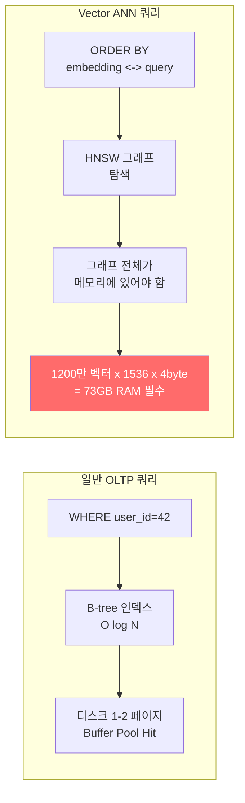
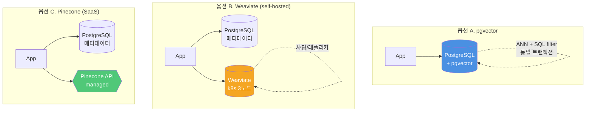

### Vector DB 선택 — "pgvector 깔면 되지"라는 순진함, 그리고 1,240만 벡터에서 HNSW 인덱스 재빌드가 8시간째 돌다 OOM으로 터진 토요일 새벽 03:47

---

#### 1. 그날의 전화 — 토요일 새벽 03:47

CTO 폰이 울린다. 당직 SRE의 목소리:

> "RAG API p99가 **8.2초**로 튀었습니다. 지난주 2주일 치 콜 센터 통화 녹취록 220만 건 임베딩 넣고 나서 `ANALYZE` 돌리는 중인데… `postgres` 프로세스 RSS가 **94GB** 먹고 OOMKiller 두 번 돌았습니다."

6개월 전 PoC 시작할 때 아키텍트가 쓴 의사결정 문서는 이렇게 끝나고 있었다:

> "Pinecone은 월 $2,000+ 예상, Weaviate는 운영 부담.  
> **pgvector면 기존 RDS에 익스텐션 하나만 깔면 되므로 추가 비용·운영 부담 0. 당분간 이걸로 간다.**"

그 "당분간"이 1,240만 벡터에서 멈췄다.

---

#### 2. 왜 모두가 pgvector로 시작하는가 — 그리고 왜 깨지는가

시니어가 처음 RAG 아키텍처를 그릴 때 흔한 논리 흐름은 이렇다.

```
"우리 운영 DB가 이미 PostgreSQL이다"
    → "트랜잭션 일관성 챙기려면 벡터도 같은 DB에 두는 게 편하다"
    → "pgvector 깔면 SQL JOIN으로 메타데이터 필터링도 공짜다"
    → "별도 운영 포인트가 안 생긴다"
    → "ship it"
```

여기까지는 **100% 합리적**이다. 문제는 **벡터 DB의 비용 모델이 OLTP DB와 근본적으로 다르다**는 걸 모른 채 이 결정을 영원히 지키려 할 때 터진다.



Postgres가 받은 요구는 하나였다 — "큰 그래프 하나를 전부 RAM에 올려두고, 쿼리마다 그 그래프를 탐색해라." 이건 B-tree가 설계된 세계가 아니다. **shared_buffers, work_mem, autovacuum이 전부 OLTP 가정 위에 튜닝되어 있는 엔진에, 73GB짜리 그래프 하나를 밀어넣은 것이다.**

---

#### 3. 세 가지 선택지 — 운영 토폴로지가 다르다



핵심은 **"벡터와 메타데이터가 같은 DB에 있는가 / 분리되어 있는가"**, 그리고 **"그 운영을 누가 지는가"** 이 두 축이다.

---

#### 4. 실무 비교 — 뜨거운 지점만

| 축 | pgvector | Weaviate | Pinecone |
|---|---|---|---|
| **인덱스** | IVFFlat / HNSW | HNSW (자체 구현) | 비공개 (proprietary ANN) |
| **벡터 ↔ 메타데이터 조인** | ✅ **네이티브 SQL JOIN** | ⚠️ GraphQL 필터 (제약 있음) | ⚠️ metadata filter (기본 연산자만) |
| **Pre-filter vs Post-filter** | Pre-filter 가능 (옵티마이저 결정) | Pre-filter 지원 | Pre-filter 제한적 (고카디널리티 필터에 약함) |
| **인덱스 빌드 시간 (1M vec, 1536dim)** | HNSW 약 20–40분 | 약 10–15분 | 자동 (비공개) |
| **메모리 요구** | 벡터+그래프 **거의 전량** RAM 필요 | 샤드 단위 분산 가능 | 완전 매니지드 |
| **실시간 upsert 영향** | HNSW 삽입 중 쿼리 레이턴시 튐 | 샤드 단위로 격리 | 투명 |
| **운영 비용 (10M vec, QPS 50 기준)** | EC2 r6i.4xlarge $730/월 + 운영자 1명 | k8s 3노드 $1,100/월 + 운영 숙련자 | 약 $700–$2,000/월, 운영 0 |
| **트랜잭션 일관성** | ✅ 벡터 쓰기와 메타데이터 쓰기가 **같은 트랜잭션** | ❌ 2PC 필요 | ❌ 2PC 필요 |
| **멀티테넌시** | RLS로 해결 | 네이티브 namespace | 네이티브 namespace |
| **락인** | 낮음 (SQL 표준) | 중간 (GraphQL) | 높음 (API 전용) |

---

#### 5. "pre-filter vs post-filter" — 벡터 DB 선택을 가르는 조용한 함정

RAG 쿼리는 거의 항상 이렇게 생겼다:

```sql
-- "이 사용자의 회사가 접근 가능한 문서 중" 에서 유사도 검색
SELECT doc_id, content
FROM documents
WHERE tenant_id = 'acme'
  AND status = 'published'
  AND created_at > now() - interval '90 days'
ORDER BY embedding <-> :query_vec
LIMIT 10;
```

이때 **필터 조건이 벡터 검색 "전에" 걸리느냐, "후에" 걸리느냐** 가 유저 경험을 결정한다.

```
┌──────────────────────────────────────────────────────────┐
│ Post-filter (Pinecone 초기형에 가까움)                    │
│                                                          │
│  ANN top-100 뽑음 → 필터 적용 → 7개만 남음 😨             │
│  (사용자에게 필요한 top-10 중 3개는 top-100 밖에 있었음)   │
└──────────────────────────────────────────────────────────┘

┌──────────────────────────────────────────────────────────┐
│ Pre-filter (pgvector + btree, Weaviate 최신)             │
│                                                          │
│  조건 맞는 20만 벡터만 추려서 → 그 중 ANN top-10 뽑음 ✅   │
│                                                          │
│  단, 필터 결과가 "너무 작으면" (수백 건)                   │
│  ANN 인덱스 안 타고 brute-force 전환 → 레이턴시 튐         │
└──────────────────────────────────────────────────────────┘
```

**pgvector 0.5+ 의 진짜 가치는 ivfflat/hnsw 인덱스와 B-tree 인덱스를 옵티마이저가 조합해준다는 점이다.** 다중 테넌트 B2B SaaS 에서 이건 치명적으로 중요하다. Pinecone이 멀티 테넌트 메타데이터 필터링에 약하다는 이유로 Weaviate로 갈아탄 팀이 2024년 초 꽤 많았던 배경이 여기 있다.

---

#### 6. 그래서 토요일 새벽은 어떻게 끝났나

아키텍트가 복기한 **진짜 원인**은 세 가지였다.

1. **HNSW 그래프의 메모리 모델 오해.** `shared_buffers = 48GB`로 올려놨지만 HNSW 그래프는 Postgres가 "일반 테이블 페이지"로 취급해 buffer pool 밖으로 밀려나곤 했다. 쿼리마다 그래프 노드가 디스크에서 올라오면 p99는 바로 초 단위가 된다.

2. **`maintenance_work_mem` 8GB로 1,240만 벡터 HNSW 인덱스 빌드를 시도했다.** pgvector의 HNSW 빌드는 메모리 상한을 넘으면 디스크 기반으로 폴백하며, 이 폴백이 **8시간→타임아웃→재시작** 루프를 만든다.

3. **벡터 테이블 autovacuum 비활성화를 안 해뒀다.** 임베딩 220만 건을 `COPY`로 쏟아붓자 autovacuum이 테이블 락을 잡고 ANN 쿼리가 줄을 섰다.

**단기 처방:** 1,240만 벡터 중 90일 이내 "hot" 벡터 180만 개만 pgvector에 남기고, 콜드 벡터는 Weaviate 2노드로 분리. tenant_id 샤드 키로 pre-filter 유지.

**장기 처방 — 그리고 이 글의 결론:**

> **"벡터 5M까지는 pgvector, 5M~50M은 Weaviate self-hosted, 50M+ 혹은 운영 리소스 0명이면 Pinecone."**

이게 2026년 현재 대부분의 B2B SaaS가 수렴한 경험칙이다.

---

#### 7. 실제 회사들은 어떻게 갈랐나

- **Notion AI (초기):** 블록 레벨 검색에 **pgvector** 채택. 이미 PostgreSQL이 메인 DB였고, 블록 메타데이터와 벡터가 같은 트랜잭션에 묶여야 "삭제된 페이지가 검색에 뜨는" 일관성 버그를 원천 차단할 수 있었다. 스케일이 커지면서 일부 워크로드를 분리했지만 **메타데이터 일관성이 중요한 도메인에서 pgvector가 지는 안전망**은 지금도 유효하다.

- **Shopify (Sidekick):** 커머스 도메인 지식 검색에 **pgvector + 커스텀 리랭커**. 상품 카탈로그가 이미 Postgres에 있어서 벡터를 다른 스토어로 꺼내는 순간 "재고 0인 상품이 추천에 뜨는" 2PC 지옥이 열렸을 것이다.

- **Perplexity:** 웹 스케일 검색 인덱스에 자체 ANN 스택. "매니지드 SaaS가 커버하지 못하는 스케일"의 사례. 대부분의 회사는 여기까지 안 간다.

- **Anthropic 내부 도구 다수:** **Pinecone 혹은 Turbopuffer**. 이유는 간단하다 — 운영 엔지니어링 리소스를 ANN 인덱스 튜닝에 쓰고 싶지 않다. **"벡터 DB는 코어 역량이 아니다"** 라는 명시적 결정이다.

---

#### 8. 시니어의 결정 체크리스트

**pgvector 를 선택해야 하는 경우:**
- 벡터가 **500만 개 미만**이고, 2년 내 5천만을 넘지 않을 전망
- **메타데이터와의 트랜잭션 일관성**이 비즈니스 규칙에 깔려 있다 (삭제·권한·만료)
- 이미 PostgreSQL 운영 숙련도가 팀에 있다
- 멀티 테넌트 B2B SaaS 이고 **pre-filter 카디널리티가 높다**

**Weaviate self-hosted를 선택해야 하는 경우:**
- 벡터 500만~5천만 구간
- k8s 운영 역량이 팀에 **이미** 있다 (없으면 바로 다음 옵션으로)
- 벡터 트래픽이 메인 OLTP 와 격리되어야 한다
- 비용이 Pinecone 보다 중요하고, 운영 시간 20% 를 낼 수 있다

**Pinecone (혹은 Turbopuffer) 을 선택해야 하는 경우:**
- 벡터 5천만 이상 또는 **운영 엔지니어 0명**
- 벡터 DB 가 코어 역량이 **아니다** — 앱 레벨 가치에 집중하고 싶다
- Latency SLO 가 p99 100ms 수준으로 빡빡하다
- 지역 레플리카, 장애 복구를 **직접** 운영하고 싶지 않다

**어떤 경우에도 하지 말아야 할 것:**
- "벡터 DB 비교해서 가장 싼 거" 라는 기준으로 결정
- PoC 단계 벡터 수(수십만) 로 **프로덕션 아키텍처를 못박기**
- 한번 고르면 영원히 간다고 가정하기 — **벡터 DB는 갈아타기 쉬운 편**이다 (임베딩만 들고 가면 됨). 과잉 결정 금지.

---

#### 9. 아키텍트의 유언

PoC 문서에 **반드시** 들어가야 할 한 줄:

> _"이 선택은 벡터 수 N개까지 유효하다. N에 도달하면 재검토한다. N = ____."_

빈칸을 못 채우겠으면 그건 결정이 아니라 **미룸**이다. 3년 뒤 토요일 새벽 03:47에 전화받을 사람은 그 결정을 미룬 사람이 아니라, 그 결정을 **상속받은** 사람이다.

> 💡 **왜 중요한가**: Vector DB 선택은 "성능 비교"가 아니라 **"일관성·운영·비용 셋 중 무엇을 희생할지"** 를 명시적으로 고르는 아키텍처 결정이며, 이 결정을 미룬 대가는 1,240만 벡터에서 OOM 으로 돌아온다.
