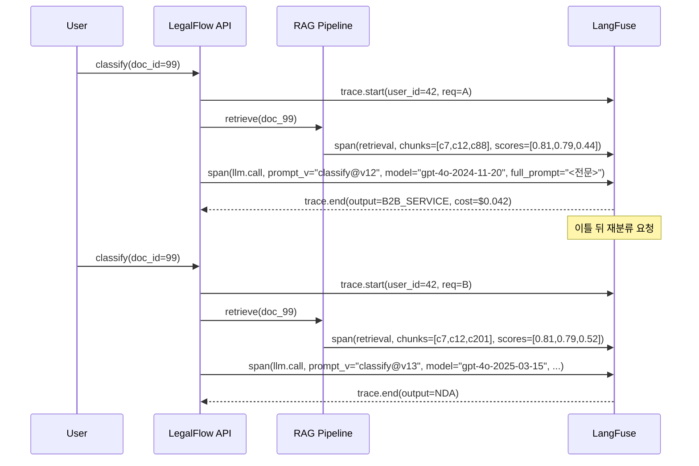

### Day 138. AI Observability (LangSmith / LangFuse) — "print로 찍어보면 되지"의 치명적 순진함, 그리고 고객이 "AI가 어제는 분명 B2B 계약서라고 했는데 오늘은 NDA라고 하네요"라며 올린 Jira에 **그 요청의 흔적을 어디서도 찾을 수 없어** 엔지니어 3명이 **6일**간 재현 시도만 하다 결국 "그 사용자 요청하신 거 지워주실 수 있나요?"를 쓴 금요일 오후 16:42

---

#### 🎬 사건 재구성: "로그는 있는데 왜 아무것도 모르겠지?"

목요일 오전 09:30. 법무 SaaS "LegalFlow"의 PM이 Slack에 스크린샷을 올린다.

> **고객사 CS 티켓 #7821**
> "계약서 종류 자동 분류 기능 — 어제 저희 변호사가 올린 문서를 **B2B 서비스 계약**이라고 분류했는데, 오늘 같은 문서 다시 넣으니 **NDA**로 분류됩니다. 이거 믿고 워크플로우 돌려도 되는 건가요?"

엔지니어 A가 서버에 들어가 로그를 본다.

```
2026-11-13 14:22:11 INFO classify_contract called user_id=42
2026-11-13 14:22:13 INFO classification_done result=B2B_SERVICE
2026-11-15 10:11:08 INFO classify_contract called user_id=42
2026-11-15 10:11:10 INFO classification_done result=NDA
```

끝이다. **어떤 프롬프트가 나갔는지, 어떤 청크가 리트리벌 됐는지, 어떤 모델 버전이었는지, 토큰이 얼마나 쓰였는지, 중간에 Tool call이 몇 번 돌았는지 — 아무것도 없다.**

- "두 요청 사이에 프롬프트 바뀐 거 있어?" → Git log 뒤짐. 커밋 3개 있음. 어느 게 영향 줬는지 모름.
- "리트리벌된 청크가 달랐나?" → Vector DB 재현 시도. 하지만 그 사이 임베딩 모델이 `text-embedding-3-small` → `-large`로 올라감. 과거 상태 복원 불가.
- "모델이 바뀌었나?" → OpenAI 쪽 로그? 없음. Gateway 로그? 요청/응답 바이트 수만 있음.

엔지니어 3명이 **6일**간 붙어서 재현만 시도한다. 금요일 오후 16:42, A가 PM에게 DM을 쓴다.

> "죄송한데, 고객한테 **그 요청 내용을 지워달라고** 요청드려야 할 것 같아요. 저희 쪽에서 확인할 방법이 없어요."

PM이 답장하기 전에, 같은 고객이 X(트위터)에 올린다.

> "AI 계약서 분류 믿지 마세요. 어제 다르고 오늘 다릅니다. 심지어 벤더 엔지니어도 뭐가 문제인지 모른대요."

리트윗 1,800회.

---

#### 🤔 왜 이런 일이 벌어지는가 — "LLM 시스템은 로깅의 가정 자체가 다르다"

전통적인 서비스에서 로깅의 가정:
- **입력이 결정론적이다** → 같은 입력 → 같은 출력 → 재현 가능
- **상태가 DB에 있다** → DB 스냅샷 복원하면 재현 가능
- **코드 버전은 Git에 있다** → 특정 커밋으로 가면 동일 바이너리

LLM 시스템에서 깨지는 가정:
- 입력이 **같아 보여도** 리트리벌 결과가 다름 (벡터 인덱스 재빌드, 임베딩 모델 교체)
- 모델이 **같은 이름이어도** 뒤에서 조용히 업데이트됨 (`gpt-4o` 2024-11-20 → 2025-03-15 snapshot)
- **프롬프트 템플릿**이 코드가 아닌 DB/YAML/CMS에 있어서 Git log로 못 쫓음
- **Agent/Chain**은 1 요청 = N개 LLM 호출 → stdout 로그 한 줄로 요약 불가
- **확률적 샘플링** → 같은 프롬프트 + 같은 모델 + 같은 context에서도 다른 결과 (temperature > 0)

즉 "로그에 요청 결과 한 줄 찍기"로는 **재현도, 디버깅도, 품질 모니터링도 불가능**하다.

---

#### 🧭 해법: LLM 전용 Observability의 3층 구조

LangSmith/LangFuse 같은 도구들이 공통적으로 세우는 추상은 아래 3개다.

```
┌─────────────────────────────────────────────────────────────┐
│  Layer 3: Session (사용자 대화 세션 / 비즈니스 트랜잭션)    │
│  - user_id, session_id, feature_flag, 비용 합계              │
└────────────┬────────────────────────────────────────────────┘
             │ 1:N
┌────────────▼────────────────────────────────────────────────┐
│  Layer 2: Trace (하나의 "요청" = 하나의 분류/검색/답변)      │
│  - request_id, 입력, 최종 출력, latency, 총 토큰, 평가 점수  │
└────────────┬────────────────────────────────────────────────┘
             │ 1:N (tree)
┌────────────▼────────────────────────────────────────────────┐
│  Layer 1: Span (각 LLM 호출 / 리트리벌 / Tool call 1건)      │
│  - 프롬프트 템플릿 이름+버전, 렌더된 full prompt,            │
│    모델 ID+snapshot, temperature, 리트리벌 청크 ID+score,    │
│    tool input/output, 입력/출력 토큰, 비용, 지연             │
└──────────────────────────────────────────────────────────────┘
```

전통적 APM(Datadog APM, Jaeger)의 **Trace/Span**과 모양은 같지만, 각 Span에 LLM 특유의 **content payload**(프롬프트 전문, 리트리벌 결과, 모델 응답)가 **그대로** 저장된다는 게 결정적 차이다. APM은 보통 payload를 metadata로 요약(`200 OK`, `size=4KB`)하는데, LLM은 **payload 자체가 디버깅의 1차 증거**다.

위 사건을 이 구조로 디버깅하면:



A가 LangFuse UI에서 두 trace를 나란히 놓고 **diff**를 누르면 10초 만에 보인다:

1. 리트리벌 결과: `c88` → `c201` (NDA 템플릿 조항이 섞인 청크)
2. 프롬프트 버전: `classify@v12` → `v13` (누군가 "짧게 답해" 한 줄 추가)
3. 모델 snapshot: `2024-11-20` → `2025-03-15` (OpenAI alias가 조용히 롤)

**6일짜리 미스터리가, 설계만 되어 있었다면 10분짜리 PR 리버트였다.**

---

#### 🔧 실제 적용: LangFuse 기준 최소 계측 코드

```python
from langfuse.decorators import observe, langfuse_context

@observe(name="classify_contract")  # trace
def classify_contract(doc_id: str, user_id: str) -> str:
    langfuse_context.update_current_trace(
        user_id=user_id,
        session_id=current_session_id(),
        tags=["legal", "classify"],
    )
    chunks = retrieve(doc_id)        # 내부에서 @observe(as_type="retriever")
    answer = call_llm(doc_id, chunks) # 내부에서 @observe(as_type="generation")
    return answer

@observe(as_type="generation")
def call_llm(doc_id: str, chunks: list[Chunk]) -> str:
    prompt_obj = langfuse.get_prompt("classify", label="production")  # 버전 추적
    rendered = prompt_obj.compile(chunks=chunks, doc_id=doc_id)
    langfuse_context.update_current_observation(
        model="gpt-4o-2024-11-20",   # ← alias가 아닌 snapshot ID 명시
        model_parameters={"temperature": 0.0, "top_p": 1.0},
        prompt=prompt_obj,            # 버전 link
        input=rendered,
    )
    resp = openai.chat.completions.create(...)
    langfuse_context.update_current_observation(
        output=resp.choices[0].message.content,
        usage={"input": resp.usage.prompt_tokens,
               "output": resp.usage.completion_tokens},
    )
    return resp.choices[0].message.content
```

여기서 **놓치면 가치가 반 토막 나는 4가지**:
1. **모델은 alias(`gpt-4o`)가 아닌 snapshot ID**로 기록 — 그래야 provider가 몰래 롤해도 추적 가능
2. **프롬프트는 "렌더된 전문" + "템플릿 버전 참조" 둘 다** — 템플릿만 있으면 변수 치환 전 상태라 재현 불가, 전문만 있으면 어떤 버전인지 모름
3. **리트리벌 청크는 ID + score + 본문 스냅샷** — vector DB가 재인덱싱되면 ID만으로는 과거 본문 못 꺼냄
4. **session_id**를 trace에 꼭 붙이기 — 대화형 서비스에서 "3번째 턴에서 이상해졌다"를 보려면 세션 레벨 재구성이 필수

---

#### ⚖️ 트레이드오프: 공짜가 아니다

| 축 | 가볍게(stdout + Datadog) | 제대로(LangSmith/LangFuse) |
|---|---|---|
| **구축 비용** | 0 | 계측 PR + SDK 학습 1~2주 |
| **지연** | 0 | +5~50ms (async flush 권장, 1~5ms로 줄일 수 있음) |
| **스토리지** | 요약 몇 KB | 프롬프트 전문 저장 → **trace당 수 KB~수백 KB**, 월 수백만 요청이면 수십~수백 GB |
| **PII/기밀** | 일반 로그 마스킹만 | 프롬프트에 **고객 계약서 전문**이 들어감 → 별도 마스킹/저장소 분리 필수 |
| **재현 가능성** | 사실상 불가 | PR 전후 trace diff로 10초 |
| **품질 지표** | 없음 (QA 수동) | eval score를 trace에 붙여 회귀 감지 |

**숨은 비용**이 셋 있다:
- **PII 리스크**: LLM 입력이 그대로 저장된다. 의료/금융/법무는 **self-hosted** LangFuse(오픈소스)로 가거나, 입력에 PII 마스킹 proxy를 앞에 둬야 한다. SaaS LangSmith에 환자 기록 그대로 쏘면 그 자체가 사고다.
- **스토리지 폭발**: 1 요청 = 평균 20KB (프롬프트+청크+응답) × 월 3천만 요청 = 600GB/월. 보존 정책(샘플링, 30일 후 요약화)을 설계 단계에 넣어야 한다.
- **async flush의 유혹**: 성능 때문에 fire-and-forget으로 보내면, **장애 났을 때 바로 그 trace가 유실**된다. 치명적 trace(error, high-latency)는 sync로 보내는 분기가 필요.

---

#### 🏢 누가 왜 쓰는가

- **Elastic (Elastic AI Assistant)**: LangSmith로 보안 분석가용 Copilot의 "retrieval 품질"을 세션별로 추적. 해킹 분석 세션은 수 턴을 거치는데, "3번째 턴에 잘못된 CVE를 리트리벌했다"를 발견하는 게 핵심 사용 사례. 전통적 APM으로는 보이지 않는 결함.
- **Notion AI**: 자체 observability 레이어 + 외부 트래이싱 병용. "답변 품질 저하"를 **코드 릴리스 → trace score drop** 자동 알림으로 잡음. 사건 평균 감지 시간이 "며칠(고객 티켓)"에서 "분 단위(알림)"로 단축.
- **Khan Academy (Khanmigo)**: 학생 대화 세션별 비용/품질을 LangSmith로 추적. "수학 세션은 평균 7턴, 영어는 12턴"을 알고 나서 **feature별 토큰 예산**을 분리 — AI 비용 구조화의 출발점.
- **반면 Anthropic 내부 Claude 팀**: 독자 구축. 이유는 ① PII/모델 데이터 격리 ② 자체 트레이닝 피드백 루프와 결합 필요. **"벤더 쓸까 자체 만들까"의 분기점은 "트레이스를 학습 데이터로 다시 쓸 생각이 있는가"**.

---

#### 🎯 시니어의 "언제 쓰고 언제 쓰면 안 되는가"

**반드시 써야 할 때**
- LLM이 **고객 응답 경로**에 있다 (내부 분석용 ≠ 외부 노출). 외부 노출된 순간 재현성은 SLA의 일부다.
- **Agent/RAG/Chain** — 1 요청 = 여러 LLM 호출. 로그만으론 어디서 틀어졌는지 영원히 모름.
- **프롬프트가 코드 밖**에 있다 (DB, CMS, 운영자가 수정). Git log로 안 쫓이면 observability가 유일한 감사 로그.
- **AB 테스트/모델 교체**를 하고 있다. "새 모델이 더 나은가"를 **score 분포**로 봐야지 "체감"으로 결정하면 지난주 사건이 재발한다.

**쓰면 안 되거나 신중해야 할 때**
- **PII 거버넌스가 정리 안 됐다** → 계측부터 하지 말고 **마스킹 레이어 + self-hosted 선택** 먼저. 벤더 SaaS에 민감 데이터 밀어넣는 게 더 큰 사고.
- **단일 LLM 호출, 결정론적 사용** (ex. 요약 API 하나, temperature=0, 입력도 내부 검증된 포맷) → 과잉 설계. 일반 APM + 입출력 샘플 저장으로 충분.
- **스타트업 PoC 단계** (< 월 1만 요청) → 벤더 free tier로 시작하고 self-host는 나중에. 지금 self-host 운영 비용이 observability 가치보다 크다.
- **MLOps 성숙도가 낮다** → 데이터만 쌓이고 아무도 안 본다. **대시보드 + 알림 + 리뷰 루틴**(주 1회 "하위 10% trace 리뷰")을 세트로 설계하지 않으면 그냥 비싼 로그 창고.

---

#### 🧪 품질 지표를 trace에 붙이는 패턴 (LLM-as-a-Judge)

Day 137에서 다룬 자동 Eval을 production trace에 **온라인**으로 붙이면 observability가 **품질 모니터링**이 된다.

```python
@observe(as_type="generation")
def classify_contract(...):
    answer = call_llm(...)
    # 10% 샘플링으로 LLM judge 호출 (비용 통제)
    if random.random() < 0.1:
        score = judge_relevance(input=doc, output=answer)  # 0~1
        langfuse_context.score_current_observation(
            name="relevance", value=score, comment="auto-judge"
        )
    return answer
```

이러면 "classify@v13 배포 후 relevance score p50이 0.84 → 0.71로 drop" 같은 알림이 **고객 티켓보다 먼저** 뜬다. Day 134의 프롬프트 롤백 사건도 이 알림 하나로 **배포 15분 내 감지**됐을 것이다.

---

> 💡 **왜 중요한가**: LLM 시스템에서 "재현 불가능한 버그"는 버그가 아니라 **관측 설계의 실패**다 — 사건이 일어난 뒤 로그를 추가하는 건 이미 늦었고, 고객은 그 사이 X에 스크린샷을 올린다.
