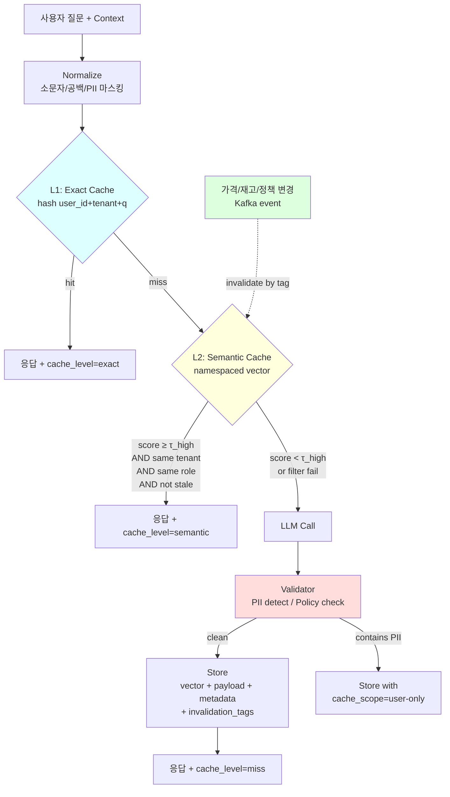

### Day 139. Semantic Cache — "같은 질문이면 Redis에 캐싱하면 되지"의 치명적 순진함, 그리고 "환불 정책 알려주세요"라는 익명 질문에 **다른 고객의 주문번호 KR-2024-8847과 카드 뒷 4자리 ****9832**가 박힌 "고객님 환불은 11월 12일 완료되었습니다" 답변이 그대로 돌아가 개인정보보호위원회 자율점검 레터가 법무팀에 꽂힌 11월 10일 월요일 오전 10:23

---

#### 1. 사건: "같은 질문 두 번 안 돌리면 되잖아"의 비용

SaaS 커머스 CS봇, MAU 32만. LLM 호출 비용이 월 $18,400을 찍자 PO가 외쳤다.

> "질문 90%는 비슷하잖아. Redis에 캐싱 좀 하면 비용 반토막 날 텐데?"

주니어가 금요일 오후에 **1시간** 만에 짰다.

```python
# v1 — exact match cache
cache_key = hashlib.sha256(user_question.encode()).hexdigest()
if cached := redis.get(cache_key):
    return cached
answer = llm.invoke(user_question)
redis.setex(cache_key, 3600, answer)
return answer
```

월요일 모니터링:
- Cache hit rate: **2.1%**
- 비용 절감: $390 / 월

PO가 재촉했다. "의미가 같으면 캐싱해야지. Vector 쓰면 되잖아?"

주니어가 **또 1시간** 만에 짰다.

```python
# v2 — semantic cache (naive)
q_vec = embedder.embed(user_question)
hits = vector_db.search(q_vec, top_k=1)
if hits and hits[0].score > 0.85:   # ← 이 숫자 하나가 지옥의 열쇠
    return hits[0].payload["answer"]
answer = llm.invoke(user_question)
vector_db.upsert(id=uuid(), vector=q_vec, payload={"answer": answer})
return answer
```

Cache hit rate: **41.7%**. 비용 $7,900 절감. 전원 하이파이브. 월요일 밤 배포.

**4일 후 월요일 오전 10:23**, 개인정보보호위원회 자율점검 레터.

---

#### 2. 무엇이 터졌는가 — Semantic Cache의 5대 지뢰

##### 2.1 지뢰 ①: PII Leak Through Similarity

```
User A (11월 7일):  "제 주문 KR-2024-8847 환불 처리됐나요?"
→ LLM이 사용자 context 받아 답: "고객님의 KR-2024-8847 환불은 11월 12일 완료되었습니다 (카드 ****9832 환급)"
→ embedding(질문) + payload(답변) → vector_db에 저장

User B (11월 10일): "환불 정책 알려주세요"
→ embedding similarity 0.871 ← threshold 0.85 통과
→ User A 답변 그대로 반환
→ User B가 SNS 캡처 투척
```

**원인**: 캐시 key에 **user_id, role, tenant_id가 namespacing 되지 않음**. 임베딩은 "환불"이라는 토픽 유사도만 본다. 답변에 담긴 PII는 보지 못한다.

##### 2.2 지뢰 ②: Negation Blindness

```
질문 A: "이 상품 환불 됩니까?"      → "네, 가능합니다"
질문 B: "이 상품 환불 안 되나요?"   ← cosine 0.94 (거의 동일)
→ 답변 A가 그대로 반환 → 고객 "환불 된다면서요?" → CS 폭주
```

Sentence embedding 대부분은 **부정어에 둔감**하다. BGE, E5, text-embedding-3-small 모두 negation flip에 cosine 0.02 이내로 움직인다. threshold 아무리 올려도 안 걸린다.

##### 2.3 지뢰 ③: Stale Cache Serves Lies

11월 1일: "AirPods Pro 가격 얼마예요?" → "329,000원" 캐싱
11월 8일: 블랙프라이데이로 229,000원 변경
11월 9일: 동일 질문 → **329,000원** 그대로 응답 → 가격 표시 광고법 위반 신고

**원인**: TTL 1시간이라 믿었지만, 임베딩이 거의 같은 변형 질문("에어팟 프로 얼마?", "AirPods Pro 가격?")이 매 시간 새로 들어와 **"가장 최근 질문의 vector로 payload만 덮어쓴다"는 로직이 없어** 7일 묵은 답변이 계속 hit로 잡혔다.

##### 2.4 지뢰 ④: Threshold Drift

threshold 0.85 → recall 높지만 오답 40%
threshold 0.95 → 오답 2%지만 hit rate 7%로 추락, 비용 절감 사라짐

그래서 "0.90이 스윗스팟"이라 커밋했지만, 임베딩 모델을 `text-embedding-3-small` → `3-large`로 업그레이드하자 distribution이 통째로 이동. **0.90은 이제 사실상 0.78에 해당**. 아무도 모른 채 PII 유출이 다시 시작.

##### 2.5 지뢰 ⑤: Context Collapse

```
Session A context: {user_id: 101, tier: "VIP", region: "KR"}
Session B context: {user_id: 889, tier: "FREE", region: "US"}
```

둘 다 "배송비 얼마예요?" 질문 → VIP용 "무료" 답변이 FREE 유저에게 캐시 hit. "왜 저는 돈 내요?" 컴플레인.

---

#### 3. 진짜 Semantic Cache 아키텍처



**5개 레이어 원칙**:

| # | 레이어 | 역할 | 실패 시 결과 |
|---|---|---|---|
| 1 | **Normalize** | PII/변동 식별자 마스킹 후 임베딩 | 주문번호가 벡터에 들어가 recall↓ |
| 2 | **Namespace** | `{tenant}:{role}:{locale}` 단위 분리 인덱스 | 테넌트 간 답변 유출 |
| 3 | **Threshold + 2nd pass** | τ_low ≤ score < τ_high는 **LLM-as-Judge**로 재검증 | FP/FN 중 하나 폭증 |
| 4 | **Invalidation tags** | `product:airpods-pro`, `policy:refund` 태그로 이벤트 기반 무효화 | 가격·정책 stale |
| 5 | **Shadow eval** | 10% 트래픽은 cache hit 여도 LLM 돌려 **diff 로깅** | threshold drift 무감지 |

##### 3.1 Namespacing — 가장 먼저 해야 할 것

```python
cache_namespace = f"{tenant_id}:{user_role}:{locale}:{llm_model_version}"
# PII 포함 응답은 user_id까지 붙여 "해당 유저 외엔 영원히 hit 없음"
if pii_detected(answer):
    cache_namespace += f":{user_id}"
```

##### 3.2 Negation 전용 Guard

```python
NEGATION_TOKENS = {"안", "못", "말고", "제외", "not", "no", "without", "except"}

def negation_mismatch(q1: str, q2: str) -> bool:
    n1 = any(t in q1 for t in NEGATION_TOKENS)
    n2 = any(t in q2 for t in NEGATION_TOKENS)
    return n1 != n2   # XOR — 하나만 부정이면 reject
```

고전적이고 투박하지만, **embedding이 못 잡는 걸 1-gram이 잡는다**. 프로덕션은 그런 조합의 승리다.

##### 3.3 Event-Driven Invalidation

```python
# Kafka consumer
@on_event("product.price.changed")
def invalidate(evt):
    vector_db.delete(filter={"tags": f"product:{evt.product_id}"})

@on_event("policy.refund.updated")
def invalidate(evt):
    vector_db.delete(filter={"tags": "policy:refund"})
```

TTL만으론 절대 못 막는다. **도메인 이벤트와 캐시를 묶어야** 가격 bug가 CS로 번지지 않는다.

---

#### 4. 실제 사례 — 누가 어떻게 썼나

| 회사/제품 | 전략 | 왜 그렇게 했나 |
|---|---|---|
| **Perplexity** | 쿼리 정규화 + exact match 우선, 뉴스성 토픽은 캐시 금지 (`freshness_required=true`) | 사실성 손상이 브랜드 치명상. "어제 뉴스" 질문은 캐시 hit이 재앙 |
| **Notion AI** | per-workspace namespace, document_id 태그 기반 invalidation | 워크스페이스 간 유출 = 엔터프라이즈 계약 파기 |
| **GitHub Copilot Chat** | semantic cache 사용 **안 함**. 대신 KV-cache 재사용 (prefix caching) | 코드 질문은 context가 매번 달라 semantic hit rate가 사실상 0 |
| **Anthropic Prompt Caching** | semantic 아닌 **prefix exact match** API로만 제공 | 플랫폼이 semantic 판단을 "하지 않겠다"는 선언. 의미 유사도는 앱 레이어 책임 |
| **GPTCache (Zilliz)** | 2-stage: embedding ANN → similarity threshold + 선택적 LLM judge | 오픈소스 디폴트가 바로 이 구조라는 게 "혼자 쉽게 못 짠다"의 증거 |
| **Portkey / Helicone** | Gateway 레이어에서 캐시 제공하되 기본값은 **exact only**, semantic은 opt-in | 기본값으로 켜면 사고 난다는 걸 경험으로 안다 |

**패턴**: 큰 플레이어일수록 **semantic cache를 기본으로 켜지 않는다**. 켜더라도 **도메인 격리 + 이벤트 기반 무효화 + shadow eval**을 세트로 둔다.

---

#### 5. 언제 쓰고, 언제 쓰면 안 되는가

##### ✅ 써도 되는 경우
- **FAQ / 정책 문서 Q&A**: 응답이 단일 진실원(single source of truth)에 묶여 있고 이벤트로 invalidation 가능
- **번역 / 요약 등 멱등 변환**: 입력이 비슷하면 출력도 비슷해야 하는 함수형 태스크
- **Codegen 템플릿 생성**: 입력 파라미터 외엔 변동 없음
- **Public read-only 지식**: 백과사전적 질문, 법령 조항 안내

##### ⛔ 쓰면 안 되는 경우
- **개인화 응답**: 유저별 주문/프로필/권한이 섞이는 순간 유출 위험
- **실시간 데이터 질문**: 가격/재고/뉴스/날씨 — TTL로 못 막는 신선도 요구
- **에이전트의 Tool 호출 결과**: 같은 질문도 외부 상태 바뀌면 답이 달라야 함
- **의료/금융/법률 자문**: 오답 1건의 비용이 캐시 1만 건 절감보다 크다
- **멀티턴 대화 중간 턴**: 이전 턴에 종속된 답은 재사용 불가

##### 🤔 조건부 허용
- **메타데이터 필터 + 짧은 TTL + shadow eval 3종 세트** 없이는 semantic cache를 프로덕션에 올리지 말 것
- Hit rate가 40% 이상 나오면 **의심부터** 하라. 대개는 threshold가 너무 느슨하거나 namespace가 빠져 있다

---

#### 6. 시니어의 체크리스트

```
□ 캐시 key에 tenant/user/role/locale/model_version이 들어가는가?
□ PII 탐지 후 scope를 user-only로 강등하는가?
□ 부정어 mismatch guard가 있는가?
□ 임베딩 모델 교체 시 threshold 재보정 플로우가 있는가?
□ 도메인 이벤트(가격/정책/재고 변경)로 invalidation 되는가?
□ 10% shadow traffic으로 cache 답 vs LLM 답 diff를 모니터링하는가?
□ cache_level(exact/semantic/miss)이 로그에 남는가? (장애 시 재현 필수)
□ 캐시 hit의 응답에도 responsible-AI 가드레일(PII 재검증)이 돌아가는가?
```

하나라도 □면, 지금 당장 feature flag로 semantic cache를 꺼라. $18,000 아끼려다 과징금 $180,000과 브랜드를 날린다.

---

> 💡 **왜 중요한가**: Semantic Cache는 비용을 줄이는 최적화가 아니라 **"다른 사용자의 응답을 서빙할 수도 있다"는 격리 실패 시스템**이다 — namespacing과 invalidation 없이 켜는 순간, 캐시 히트율이 올라갈수록 유출 반경이 함께 올라간다.
