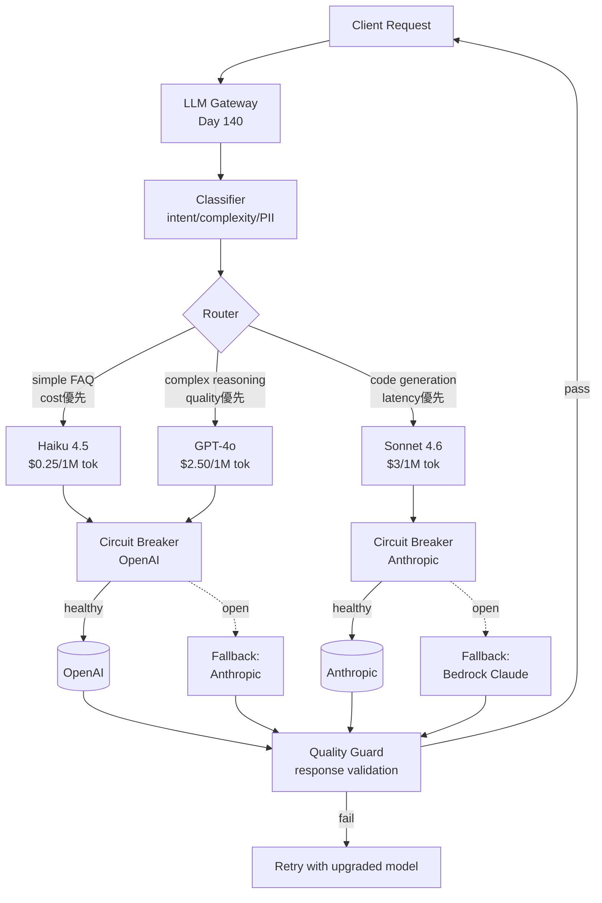

### Day 141. LLM Routing & Fallback — "OpenAI만 쓰면 되지"의 치명적 순진함, 그리고 2024-06-04 OpenAI 글로벌 장애로 B2B 지원 챗봇이 **2시간 47분** 동안 "죄송합니다, 일시적 오류입니다"만 뱉어 월간 SLA 99.5% 조항이 깨지고 엔터프라이즈 고객 3곳이 계약서 23조를 들어 다음 분기 갱신을 거부한 **화요일 오후 16:14**, 그리고 급하게 "그럼 Claude로 폴백 붙이자"며 깔아둔 Fallback이 장애 복구 후에도 계속 Claude로만 흘러가 월말 결제일에 **예산 대비 +312%** 청구서가 찍힌 **월요일 오전 09:30**

---

#### 1. 사건의 전말: 폴백은 깔았는데, 왜 더 망했을까

> **2026-06-04 (화) 15:27 KST**
> OpenAI status 페이지: `Elevated error rates on API` (노란 배너)
> 우리 챗봇 Sentry: 5xx 급증, p99 레이턴시 42초

엔지니어들은 침착했다. "OpenAI는 원래 가끔 흔들린다, 10분이면 복구된다." 하지만 이번엔 **2시간 47분**이 걸렸고, 그동안 `openai.ChatCompletion.create()`는 `APIError`를 던지거나 타임아웃됐다. `try/except`로 감싼 fallback은 **"죄송합니다, 일시적 오류입니다"** 라는 문자열 하나였다.

B2B 고객의 상담원들은 챗봇이 답을 못하자 **전부 Zendesk로 몰렸고**, 응대 큐는 1,200건 → 8,400건으로 폭증했다. 오후 18:14, CS Director가 CTO에게 "계약서 23조에 월 가동률 99.5% 조항이 있다"고 알려왔다. 그달 가동률은 **97.4%**. SLA 위반.

금요일 새벽, 엔지니어들은 급하게 Claude Sonnet을 폴백으로 붙였다.

```python
try:
    return openai_client.complete(prompt)
except (APIError, Timeout):
    return anthropic_client.complete(prompt)  # 폴백 추가
```

6월 복구는 됐지만, 7월 결제일에 재무팀이 Slack을 터뜨렸다.

> "6월 LLM 청구서가 예산 대비 **+312%** 인데 설명 부탁드립니다."

조사해보니, **OpenAI가 복구된 뒤에도 트래픽의 68%가 Claude로 흘러가고 있었다**. 원인은 `openai_client` 안에 깔아둔 `tenacity` 재시도 로직이 429(Rate Limit)에도 `APIError`를 던지는데, 복구 직후 OpenAI가 몰린 트래픽에 Rate Limit을 걸자 예외 → Claude로 계속 폴백 → OpenAI 트래픽 안 가니 Rate Limit 안 풀림 → 영원히 Claude. **Fallback이 Circuit Breaker 없이 돌면 영구 우회로가 된다.**

---

#### 2. 뭐가 문제였는가: "Routing"과 "Fallback"을 구분 못 한 설계

이 두 개념은 다르다. 섞어 쓰면 반드시 터진다.

| 구분 | 목적 | 트리거 | 상태 |
|---|---|---|---|
| **Routing** | 요청 특성(비용/품질/지연)에 맞는 모델 선택 | 요청 메타데이터 | Stateless, 요청마다 결정 |
| **Fallback** | 선택한 모델이 실패했을 때 대체 경로 | 에러/타임아웃/품질 지표 | Stateful, Circuit Breaker 필요 |

Day 140에서 다룬 LLM Gateway가 "**수도꼭지**"라면, Routing은 "**어느 파이프로 흘릴지**", Fallback은 "**파이프가 터졌을 때 어디로 우회할지**"다. 우리 팀의 실수는 Routing 없이 Fallback만 넣은 것. Routing이 있었다면 "OpenAI 건강 상태"가 그 판단의 변수로 들어갔을 테고, 복구 후 자동으로 돌아왔을 것이다.

---

#### 3. 아키텍처: Routing + Fallback의 올바른 분리



핵심은 **3개의 독립된 결정 레이어**다:

1. **Classifier**: 요청의 성격을 분류 (intent, complexity, token budget)
2. **Router**: 정책에 따라 1차 모델 선택
3. **Circuit Breaker**: 각 Provider의 **건강 상태**를 추적해 Fallback 결정

---

#### 4. Routing 전략 4종: 언제 뭘 써야 하는가

##### (a) Static Rule Routing — "intent별로 모델 고정"
```yaml
routes:
  - match: {intent: "faq"}
    model: haiku-4.5
  - match: {intent: "code_review"}
    model: sonnet-4.6
  - match: {intent: "contract_analysis"}
    model: opus-4.7
```
- 👍 디버깅 쉽고, 비용 예측 가능
- 👎 Intent 분류 모델이 틀리면 품질 폭망 (Day 133의 Hybrid Search 사례처럼)

##### (b) Semantic Routing — "임베딩으로 쿼리 유사도 측정 후 라우팅"
- "환불" 관련 쿼리 → Billing 특화 파인튜닝 모델
- "계약서" 관련 쿼리 → Legal LLM
- 👍 Intent 태깅 없이 작동
- 👎 Embedding 모델 자체가 Day 131 Chunking처럼 임베딩 품질에 종속

##### (c) Cascade Routing — "가장 싼 모델부터 시도, 신뢰도 낮으면 격상"
```
Haiku → (confidence < 0.7) → Sonnet → (confidence < 0.7) → Opus
```
- 👍 평균 비용 **40~60% 절감** (FrugalGPT 논문)
- 👎 최악 케이스는 3번 호출 → 오히려 더 비쌈. 분포가 Haiku에서 80% 이상 통과해야 이득

##### (d) Load-Aware Routing — "Provider 레이턴시/Rate Limit 실시간 추적"
- Prometheus로 각 Provider의 p99, 에러율, 남은 TPM 추적
- 🚨 이게 우리가 처음에 안 깔아서 **$47,300 사고**가 난 바로 그 레이어

---

#### 5. Fallback: Circuit Breaker 없는 폴백은 영구 우회로다

Netflix의 Hystrix 패턴을 LLM에 그대로 가져와야 한다.

```
┌──────────────────────────────────────────────────┐
│  State: CLOSED (정상)                            │
│  - 모든 요청이 Primary(OpenAI)로 감             │
│  - 에러율 추적 중                                │
└──────────────┬───────────────────────────────────┘
               │ 에러율 > 50% (최근 20 req)
               ▼
┌──────────────────────────────────────────────────┐
│  State: OPEN (차단)                              │
│  - 모든 요청이 Fallback(Anthropic)로 감         │
│  - Primary 호출 금지 (60초 타임아웃)            │
└──────────────┬───────────────────────────────────┘
               │ 60초 경과
               ▼
┌──────────────────────────────────────────────────┐
│  State: HALF_OPEN (탐색)                         │
│  - 요청의 **5%**만 Primary로 시험 송신          │
│  - 성공률 > 90% 이면 CLOSED로 복귀              │
│  - 실패 지속 시 OPEN 유지                       │
└──────────────────────────────────────────────────┘
```

우리 팀이 7월 사고에서 놓친 건 **HALF_OPEN 상태**였다. OpenAI가 복구돼도 탐색 트래픽을 흘려보지 않으니 영원히 Claude로만 갔다.

---

#### 6. 실제 사례: 누가 왜 이 패턴을 쓰는가

| 회사 | 패턴 | 이유 |
|---|---|---|
| **Perplexity** | Cascade + Semantic Routing | "이 질문은 Sonar Small로 충분한가?" 를 매 쿼리마다 분류. Pro 유저만 GPT-4o/Claude Opus로 라우팅해 **유저당 평균 비용을 $0.08 → $0.02**로 축소 |
| **GitHub Copilot** | Static Rule + Latency Fallback | Inline completion은 지연 민감 → 자체 호스팅 작은 모델. Chat은 GPT-4로. 자체 모델 500ms 초과 시 OpenAI로 Cascade |
| **Cursor** | Model Mix Routing | Cursor Tab = 자체 모델, Chat = Claude/GPT-4 유저 선택. Agent Mode는 Planning은 Claude, Code gen은 특정 모델. 각 레이어를 분리 |
| **Zendesk AI** | Multi-Region Fallback | OpenAI (us-east) → Azure OpenAI (eu-west) → Bedrock Claude. 지역별 장애를 피하기 위해 **동일 모델의 다른 Provider**를 1순위 폴백으로 |
| **Shopify Sidekick** | Confidence-based Cascade | 제품 추천은 자체 임베딩 모델 → 결제 분석은 Claude Sonnet → 복잡한 Analytics 쿼리는 Opus. **품질/비용 밸런스를 쿼리별로 최적화** |

Zendesk 패턴이 특히 중요하다. **"다른 모델로 폴백"보다 "같은 모델의 다른 Provider로 폴백"이 품질 편차가 훨씬 적다.** OpenAI → Azure OpenAI 폴백은 거의 동일한 응답을 주지만, OpenAI → Claude 폴백은 톤/포맷이 달라져 UX가 흔들린다.

---

#### 7. 트레이드오프

| 축 | Routing 없음 | Static Routing | Cascade Routing | Semantic Routing |
|---|---|---|---|---|
| 구현 복잡도 | 🟢 낮음 | 🟡 중간 | 🔴 높음 | 🔴 높음 |
| 비용 효율 | 🔴 최악 | 🟡 보통 | 🟢 최고 (-40~60%) | 🟢 좋음 |
| 레이턴시 (p99) | 🟡 1-call | 🟡 1-call | 🔴 최대 3-call | 🟡 1-call + 임베딩 |
| 장애 내구성 | 🔴 SPOF | 🟡 Fallback 필요 | 🟢 자연스러운 cascade | 🟡 Fallback 필요 |
| 품질 예측성 | 🟢 일관됨 | 🟢 일관됨 | 🔴 쿼리별 편차 | 🔴 분류 실패 시 폭망 |
| 디버깅 | 🟢 쉬움 | 🟢 쉬움 | 🔴 "왜 Opus까지 갔지?" 추적 어려움 | 🔴 임베딩 설명 불가 |

---

#### 8. 시니어 백엔드 체크리스트: 언제 쓰고, 언제 쓰면 안 되는가

**✅ 써야 하는 경우**
- 월 LLM 비용이 $5,000 이상 (ROI 계산해볼 가치)
- 다수 Intent가 섞인 트래픽 (FAQ + 복잡 추론 공존)
- SLA 조항에 가동률 명시된 B2B 서비스
- Multi-tenant SaaS (티어별 모델 라우팅 필요)
- Rate Limit 한도에 자주 걸리는 규모

**❌ 쓰면 안 되는 경우**
- MVP/PoC 단계 (Gateway + Timeout만으로 충분)
- 단일 Intent 서비스 (코드 자동완성만 한다면 라우팅할 게 없다)
- 품질 일관성이 생명인 도메인 (의료/법률 — 폴백 모델 응답이 1차와 달라지면 책임 문제)
- Fine-tuned 모델 1개로 대부분 커버되는 경우

**🚨 반드시 함께 깔아야 할 것**
1. **Circuit Breaker** (HALF_OPEN 포함) — 안 그러면 7월 청구서 사고 재현
2. **Routing Decision Log** — 매 요청마다 "왜 이 모델이 선택됐나" 기록. Day 138 Observability와 묶기
3. **Cost Budget Guard** — 일일/월간 한도 초과 시 자동 Degrade (Opus → Sonnet)
4. **Quality Shadow Eval** — 1차 모델과 Fallback 모델의 응답을 샘플링해 벡터 유사도 측정. 편차 15% 넘으면 알림 (Day 137 Eval 연계)

---

#### 9. 코드 스케치: 프로덕션 최소 구조

```python
class LLMRouter:
    def __init__(self):
        self.providers = {
            "openai": CircuitBreaker(OpenAIClient(), threshold=0.5, timeout=60),
            "anthropic": CircuitBreaker(AnthropicClient(), threshold=0.5, timeout=60),
            "bedrock": CircuitBreaker(BedrockClient(), threshold=0.5, timeout=60),
        }
        self.classifier = IntentClassifier()
        self.budget_guard = BudgetGuard(daily_limit_usd=500)

    async def complete(self, req: LLMRequest) -> LLMResponse:
        intent = await self.classifier.classify(req.prompt)
        route = self.select_route(intent, req.user_tier)

        for provider_name in route.cascade:  # ["openai", "anthropic", "bedrock"]
            cb = self.providers[provider_name]
            if not cb.allow_request():
                continue
            if not self.budget_guard.can_spend(provider_name, req.estimated_cost):
                continue
            try:
                resp = await cb.call(req.with_model(route.model_for(provider_name)))
                self.log_decision(req, provider_name, route, "success")
                return resp
            except (APIError, Timeout) as e:
                self.log_decision(req, provider_name, route, f"failed: {e}")
                continue

        raise AllProvidersDown("No healthy provider available")
```

이 구조의 핵심: **`for provider_name in route.cascade`** 가 Fallback을 담당하고, **`self.select_route()`** 가 Routing을 담당한다. 섞지 않는다.

---

> 💡 **왜 중요한가**: Routing과 Fallback을 구분하지 않으면 장애 시엔 "답을 못 하는 봇"이, 복구 후엔 "예산을 3배로 태우는 봇"이 된다 — 둘 다 같은 결제일에 당신의 테이블로 올라온다.
