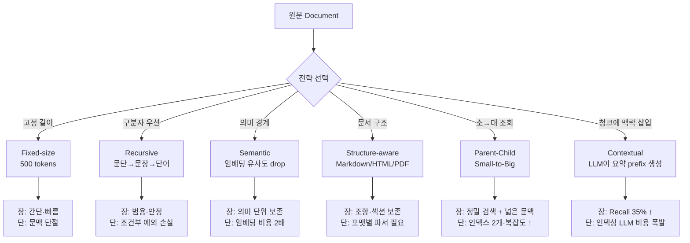

### Day 142. RAG Chunking 전략 — "500토큰씩 자르면 되지"가 공정위 민원 23건이 된 수요일 오전 11:52

"임베딩만 잘 뽑으면 검색 품질은 알아서 나오겠지"라는 치명적 순진함, 그리고 "환불 정책이 어떻게 되나요?"라는 평범한 질문에 "환불이 불가능합니다"를 1.2초 만에 자신 있게 뱉은 챗봇이, 실제 약관 제6조 **"단, 수신일로부터 14일 이내인 경우 전자상거래법 제17조에 따라 전액 환불 가능하다"** 라는 결정적 단서를 **다른 청크에 떨어져 있어** 검색조차 못 한 뒤, 고객 71명이 "AI가 환불 불가라 그랬다"는 스크린샷을 들고 공정거래위원회에 민원 23건, 한국소비자원 집단분쟁조정 신청 1건을 올리고, 법무팀장이 "이거 전자상거래법 제21조의 거짓·과장 광고 소지 있습니다"라는 메일을 CTO에게 보낸 2026년 11월 11일 수요일 오전 11:52.

---

#### 1. 무엇이 문제였나

Lv5 Day 130 이후 우리는 "교과서 RAG 파이프라인"을 세웠다. `text-embedding-3-large`, pgvector + HNSW, Top-K=5, cross-encoder Reranker까지. Eval 벤치마크 **Recall@5 = 91.3%**. "완성"으로 찍었다.

문제의 약관 원문은 이랬다:

```
제6조 (환불 정책)
① 당사는 원칙적으로 결제 완료된 서비스에 대해 환불을 제공하지 않습니다.
② 다만 다음 각 호의 경우에는 예외로 한다.
   1. 수신일로부터 14일 이내인 경우
   2. 서비스 이용 이력이 없는 경우
③ 환불은 전자상거래법 제17조에 따라 전액으로 하며...
```

`chunk_size=500, overlap=50`으로 자르자 이렇게 쪼개졌다:

- **Chunk A** : "① 당사는 원칙적으로 결제 완료된 서비스에 대해 환불을 제공하지 않습니다. ② 다만 다음 각 호의…"
- **Chunk B** : "…경우에는 예외로 한다. 1. 수신일로부터 14일 이내인 경우 2. 서비스 이용 이력이 없는 경우 ③ 환불은 전자상거래법…"

질의 **"환불 정책이 어떻게 되나요"** 의 임베딩은 Chunk A와 코사인 유사도 **0.87**로 강하게 붙었고, Chunk B는 0.61로 Top-5에서 탈락했다. 모델이 본 컨텍스트는 **"원칙적으로 환불 제공하지 않습니다"** 한 줄뿐이었다.

조각이 잘린 게 아니라 **문맥의 전제(premise)와 결론(conclusion)이 서로 다른 청크에 떨어진** 것이다. Recall@5 91%는 "정답 청크가 Top-5에 들어왔는가"만 셌지, **"정답을 구성하기 위해 필요한 모든 청크가 함께 들어왔는가"(Joint Recall)** 를 측정하지 않았다. 지표가 거짓말을 한 게 아니라, 지표가 측정하지 않는 공간에서 사고가 난 것이다.

---

#### 2. Chunking 전략의 지형도



---

#### 3. 6가지 전략의 트레이드오프

| 전략 | 인덱싱 비용 | 검색 정밀도 | "조건부 조항" 보존 | 적합한 도메인 |
|---|---|---|---|---|
| **Fixed-size (500t)** | 가장 저렴 | 낮음 | ❌ 자주 끊어짐 | FAQ, 짧은 블로그 |
| **Recursive (langchain 기본)** | 저렴 | 보통 | ⚠️ 운에 맡김 | 일반 문서 |
| **Semantic Chunking** | 중간 (임베딩 2회) | 높음 | ⚠️ 경계가 모호하면 실패 | 에세이, 긴 설명문 |
| **Structure-aware** | 중간 (파서 개발비) | 높음 | ✅ 조항 단위로 끊음 | 법률, 계약서, 기술문서 |
| **Parent-Child** | 비쌈 (인덱스 2개) | 매우 높음 | ✅ 부모 문단 전체 리턴 | 정책 문서, 매뉴얼 |
| **Contextual Retrieval**<br/>(Anthropic 2024) | 매우 비쌈 (청크당 LLM 1회) | 최고 (Recall 67% ↑) | ✅ 요약 prefix로 전제 보존 | 고리스크 QA, 금융/법무 |

---

#### 4. 실제 사례 — 누가 어떤 전략을 왜 골랐나

**Notion AI (2023~)** : 유저 문서는 이미 `H1/H2/toggle/callout` 같은 블록 구조가 명확하다. 그래서 **Structure-aware**를 택했다. 블록 1~3개를 묶어 하나의 청크로 만들고, 각 청크 앞에 "속한 페이지 title + 상위 heading 경로"를 prefix로 붙인다. 500토큰 고정분할로 자르면 유저가 작성한 `/callout 경고 블록`의 머리말과 본문이 끊겨 의미가 깨지기 때문.

**Perplexity** : 웹 검색 결과는 포맷이 제각각이다. **Recursive + 강력한 Reranker** 조합. 재현율을 포기하는 대신 Top-20을 뽑아 cross-encoder reranker로 정밀도를 복구한다. 인덱싱 비용을 아끼고 질의 시점 비용을 쓰는 설계.

**Anthropic Contextual Retrieval (2024-09)** : 각 청크를 임베딩하기 전에, **Claude Haiku로 "이 청크가 전체 문서 안에서 어느 맥락에 속하는지"를 50토큰 요약으로 생성해 prefix로 붙인다.** 공식 실험에서 Top-20 실패율이 **5.7% → 1.9%로 67% 감소**. 대신 100만 토큰 문서를 인덱싱할 때 **LLM 호출 비용이 벡터 임베딩 비용의 약 10배**. Prompt Caching으로 90% 할인받아도 여전히 "모든 문서에 켜도 되는" 전략은 아니다.

**국내 모 증권사 약관 QA (2025)** : 약관 조항은 "제 N 조 (제목) ① ② ③" 구조가 법적으로 **고정돼 있다**. 그래서 **Structure-aware + Parent-Child** 조합. 조(條)를 부모 청크로, 항(項)을 자식 청크로 인덱싱. 질의가 자식에 매칭되면 **부모 조문 전체를 컨텍스트로 리턴**한다. "① 원칙적으로 환불 불가"가 매칭돼도 모델은 "② 다만 14일 이내는 예외"까지 통째로 받는다.

**우리의 이번 사고**의 근본 원인은 금융·법무 성격의 B2C 약관에 **Fixed-size Recursive**를 썼다는 것이다. 데이터가 "조건부 전제가 다른 항에 흩어진" 구조인데, chunking 전략이 그 구조를 완전히 무시했다.

---

#### 5. Contextual Retrieval이 왜 비싼지 — 비용 수식

```
문서 토큰 수       : N = 1,000,000
청크 크기          : c = 500
청크 수            : N/c = 2,000

Vanilla RAG        : 임베딩 1회 × 2,000 = 약 $0.26 (text-embedding-3-large)

Contextual RAG     : Claude Haiku 요약(문서 전체 input + 청크 input + 요약 100 output) × 2,000
                     ≈ (1M + 500 + 100) × $0.25/1M × 2,000  (캐싱 전)
                     ≈ $500
                   Prompt Caching 적용 시 input 90% 할인 → 약 $55
```

$0.26 vs $55 — 약 **200배 차이**. Anthropic 조차 "모든 RAG가 Contextual로 가야 한다"고 말하지 않는다. **고리스크(legal / medical / financial) QA**, **문서 수는 적은데 질의가 많은** 케이스에서만 ROI가 선다. FAQ 챗봇에 이걸 켜면 월 임베딩 비용이 커피값에서 집세로 바뀐다.

---

#### 6. 언제 쓰고 언제 쓰면 안 되는가 (시니어 판단 기준)

**Fixed-size 500t가 괜찮은 때**
- 문서가 짧고(평균 2,000토큰 미만) 서로 독립적이다 (FAQ, 블로그 포스트)
- 오답의 비용이 낮다 (내부 검색, 추천)
- "답이 틀려도 사용자가 Ctrl+F로 교차검증 가능한" 맥락

**Fixed-size를 쓰면 **안 되는** 때 — 이번 사고의 교훈**
- **조건부 조항**이 많은 문서 (약관, 사규, 세법, 의료 가이드라인)
- **표·리스트·계층 구조**가 의미를 담는 문서 (기술 스펙, API 레퍼런스, 매뉴얼)
- 오답이 **법적·금전적 책임**을 부른다 (B2C 환불 정책은 공정거래법상 "표시·광고"로 해석될 수 있음)
- 질의가 **"조건부 예외"를 묻는 형태** ("...인 경우에도?", "예외는 없나요?")

**선택 가이드**

```
문서가 법률/정책/의료인가?
├─ Yes → Structure-aware 파싱은 필수.
│         오답 비용이 매우 크면 Parent-Child 또는 Contextual Retrieval 추가.
└─ No → 문서에 명확한 구조(Markdown heading, HTML, JSON)가 있는가?
         ├─ Yes → Structure-aware 우선
         └─ No → Recursive + 강한 Reranker로 시작.
                 재현율 문제 생기면 Semantic Chunking으로 교체.
```

---

#### 7. 사고는 어떻게 복구했나

1. **당일 (Day 142, 수)** — 약관 섹션 전체를 임시로 system prompt에 통째로 박아 넣고(약 8,400토큰), 환불 관련 질의가 들어오면 RAG를 우회하도록 라우팅. 토큰 비용이 10배 뛰지만 민원이 추가로 발생하는 것보다 싸다.
2. **Day 143 ~ 145** — 약관 파서를 Structure-aware로 재작성. `제\s*\d+\s*조` 정규식과 `①②③` 항 단위로 분할. **조(條)를 parent, 항(項)을 child**로 저장.
3. **Day 146** — Eval 지표를 Recall@K에서 **Joint Recall@K**(정답을 구성하기 위한 필수 청크 집합이 **모두** 들어왔는지)로 교체. 환불 질의의 정답 집합을 `{조6-①, 조6-②-1, 조6-③}`로 정의하고 세 개 모두 Top-5 안에 들어왔을 때만 "성공"으로 계산.
4. **Day 150** — 법무팀과 **100개짜리 법률 Golden Set** 을 만들어 CI 게이트로 등록([[cicd-llm-eval-gate]]). Joint Recall < 95%면 배포 차단.

---

#### 8. 핵심 교훈

Chunking은 "인덱싱 파이프라인의 전처리 단계"가 아니다. 그것은 **"모델이 세상을 보는 창의 모양"** 을 정하는 결정이다. 창을 잘못 자르면 모델이 아무리 똑똑해도 **전제가 빠진 결론**을 자신 있게 뱉는다. 그리고 그 자신감이 공정거래위원회 민원 23건을 만든다.

그리고 또 하나 — **Recall@K를 보고 "RAG가 잘 되고 있다"고 판단하는 건, 재정 상태를 매출만 보고 영업이익은 안 보는 것과 같다.** "정답을 구성하기 위해 필요한 모든 조각이 함께 왔는가(Joint Recall)" 가 진짜 지표다. 질의와 정답을 쌍이 아니라 **질의 ↔ 정답 청크 집합**으로 정의하는 순간, 당신의 Eval은 비로소 프로덕션 사고를 잡을 수 있게 된다.

> 💡 **왜 중요한가**: RAG 사고의 90%는 모델이 아니라 Chunking에서 나오며, 그 책임은 벡터 DB가 아니라 **"문서를 어떻게 자를 것인가"** 를 결정한 아키텍트에게 있다.
