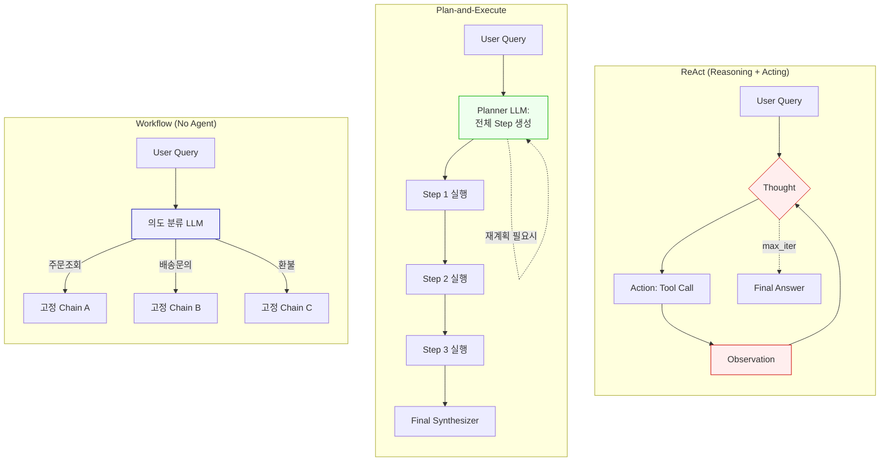
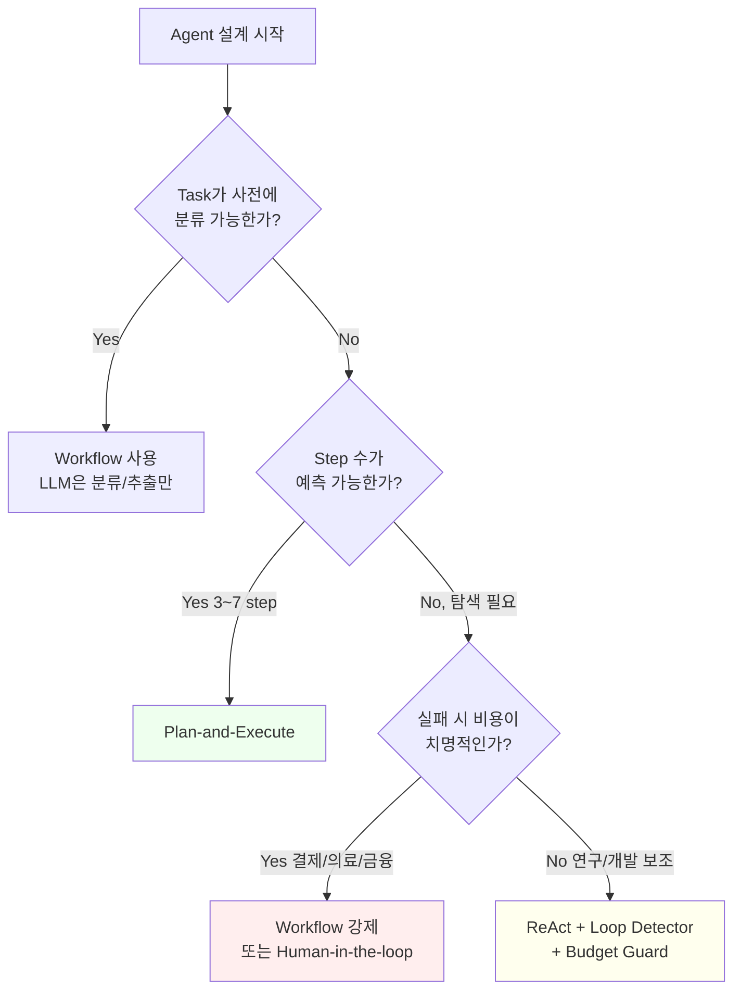

### Day 143. Agent 시스템 (ReAct / Tool Use) — "LLM이 알아서 Tool 쓰면 되지"의 치명적 순진함, 그리고 "주문이 아직 안 왔어요" 한 줄에 Agent가 `search_orders` → `verify_shipping` → `search_orders` → `check_carrier` → `search_orders`를 **37번 반복**하다 max_iteration=40에 걸려 "확인 중입니다 잠시만요"를 돌려주고 토큰 **$6.80**을 태운 뒤, 고객이 "말귀 못 알아듣네?"라며 X에 스크린샷을 올려 리트윗 **8,200회**가 찍힌 목요일 저녁 19:47, 그리고 같은 날 23:00 일일 토큰 비용이 월 예산 대비 **+840%** 로 찍혀 CFO가 비상콜을 쏘아올린 상황

---

## 1. 사건 재구성: "Agent가 생각을 멈추지 않는다"

전자상거래 B社. CS팀 자동화를 위해 LangChain `AgentExecutor`로 ReAct Agent를 붙였다. Tool은 6개:

```
- search_orders(query: str)
- get_order_detail(order_id: str)
- verify_shipping_status(tracking_no: str)
- check_carrier_api(carrier: str, tracking_no: str)
- check_warehouse_stock(sku: str)
- escalate_to_human(reason: str)
```

QA 테스트 200건 통과. 금요일 배포. 월요일 오전 09:00, PM이 Grafana를 열자 **p95 응답시간이 48초**, 평균 토큰 사용량이 테스트 대비 **12배**. 하지만 Fallback 응답률도 낮아 "큰 문제 없어 보이네"로 넘어감.

목요일 저녁 19:47, 고객 한 명이 입력:

> "제가 주문한 상품이 아직 안 왔어요"

Agent의 Thought-Action-Observation 트레이스는 이렇게 흘렀다:

```
Iter 1  Thought: 고객 주문을 찾아야 함
        Action: search_orders(query="미배송 주문")
        Observation: [] (고객 ID 바인딩이 안 됨 → 빈 결과)

Iter 2  Thought: 결과가 없네. 다시 검색해보자
        Action: search_orders(query="배송 안 됨")
        Observation: []

Iter 3  Thought: 배송 상태를 직접 확인해볼까
        Action: verify_shipping_status(tracking_no="unknown")
        Observation: Error: tracking_no is required

Iter 4  Thought: 운송장 번호가 필요하니 주문을 먼저 찾자
        Action: search_orders(query="최근 주문")
        Observation: []

... (31번 반복) ...

Iter 37 Thought: 캐리어 API로 직접 조회해보자
        Action: check_carrier_api(carrier="unknown", tracking_no="unknown")
        Observation: Error 400

Iter 40 [max_iterations reached]
Final:  "확인 중입니다 잠시만요"
```

**총 토큰 48,200개, 비용 $6.84, 응답시간 1분 52초.**

같은 패턴의 세션이 그날 저녁에만 **7,100건**. 일일 토큰 비용 $48,500. 월 예산 $5,200의 **840%**.

---

## 2. 왜 이런 일이 생기는가 — ReAct 루프의 세 가지 함정

### 함정 1: LLM은 "모른다"를 어려워한다

ReAct는 `Thought → Action → Observation → Thought → ...` 를 반복한다. 매 Thought에서 LLM은 "이 Observation을 보고 다음에 뭐할지"를 생성한다. 문제는 **빈 결과(`[]`)나 에러(`400`)를 받았을 때, LLM은 "포기"보다 "다시 시도"를 압도적으로 선호**한다는 점. 학습 데이터에서 "재시도해서 성공한" 샘플이 "포기한" 샘플보다 훨씬 많기 때문.

### 함정 2: Context Window가 넘치면 "앞 기억"이 증발한다

40 Iteration이 돌면 Thought/Action/Observation 로그가 누적되어 context가 50k+ 토큰이 된다. 많은 Agent 프레임워크는 오래된 iteration을 **잘라내거나 요약**한다. 그 순간 Agent는 "내가 search_orders를 이미 5번 호출했다"는 사실을 **잊고**, 다시 같은 호출을 Thought로 낸다.

### 함정 3: Tool Hallucination

함수 스키마를 Prompt에 넣어도 LLM은 종종 **존재하지 않는 Tool**을 부른다:

```
Action: get_customer_shipping_info(customer_id="12345")
Observation: ToolNotFoundError
Thought: 아 이 도구는 없구나. 비슷한 걸 찾아보자
Action: fetch_shipping_detail(id="12345")
Observation: ToolNotFoundError
Thought: 다른 이름으로...
```

이 "유사 이름 탐색 루프"가 토큰 폭발의 핵심.

---

## 3. 전통 ReAct vs Plan-and-Execute vs Workflow



### 비교표

| 축 | ReAct | Plan-and-Execute | Workflow |
|---|---|---|---|
| 유연성 | ★★★★★ | ★★★ | ★ |
| 토큰 비용 | 높음 (예측 불가) | 중간 | 낮음 (예측 가능) |
| 루프 리스크 | **매우 높음** | 낮음 | 없음 |
| 디버깅 난이도 | 지옥 | 중간 | 쉬움 |
| Latency | 변동 큼 (10s~2min) | 중간 | 낮음 |
| 도입 적합성 | 탐색적 Task | 다단계 정형 Task | 분류 가능한 Task |

---

## 4. 실제 사례 — 업계가 어떻게 이 지옥을 지났는가

### AutoGPT (2023): 바이럴과 몰락
2023년 봄 AutoGPT가 바이럴을 탔다. "시장 조사해줘"에 Agent가 자율적으로 Google 검색 → 요약 → 재검색을 돌렸다. 하지만 사용자들이 발견한 건: **한 작업에 $20~$80 토큰**을 태우고도 "조금 더 조사가 필요합니다"를 반환하는 Agent. Reddit `/r/AutoGPT`에 "내 신용카드가 울고 있다"는 스레드가 넘쳐났다. 교훈: **순수 ReAct는 프로덕션에 부적합**.

### LangChain → LangGraph (2024)
LangChain의 `AgentExecutor`는 바로 이 문제 때문에 사실상 **deprecated** 됐다. 후계자인 LangGraph는 **StateGraph** 모델이다. 즉 ReAct의 자유로운 "다음에 뭐할지 LLM이 정함"을 버리고, **그래프의 노드와 엣지를 개발자가 명시**한다. "조건부 엣지"로 LLM 판단을 넣되, 전체 흐름은 코드가 소유한다.

### Anthropic Computer Use (2024)
Claude Computer Use가 공개됐을 때 Anthropic은 명시적으로 경고했다: "같은 Action이 반복되면 멈춰라". 내부적으로 **Loop Detector**가 돌며 "직전 3 Action의 해시가 반복되면 escalate"하는 가드가 있다.

### OpenAI Assistants API → Responses API
Assistants API의 Thread/Run 모델도 유사한 문제로 바뀌었다. **Structured Outputs + Tool Choice 강제**가 핵심. "LLM 자율성"보다 "스키마 강제"를 택했다.

---

## 5. 시니어 백엔드가 Agent를 프로덕션에 올릴 때 반드시 쓰는 7가지 가드

### (1) Loop Detector — 가장 중요한 가드
```python
# 직전 N개 Action의 해시가 반복되면 강제 종료
action_history = deque(maxlen=5)
action_hash = hash((tool_name, frozenset(args.items())))
if action_history.count(action_hash) >= 2:
    return escalate_to_human(reason="loop_detected")
action_history.append(action_hash)
```

### (2) Tool Schema 엄격 검증 + 유사이름 자동 매핑
Tool Hallucination을 막으려면 **OpenAI function calling의 `strict: true`** 또는 **Anthropic tool use의 schema validation**을 켠다. 유사 이름(get_order vs fetch_order)은 Levenshtein 거리로 매핑하되, 매핑되면 **Agent에게 교정 신호**를 보낸다: "`get_order`는 없습니다. `get_order_detail`를 쓰세요."

### (3) Budget-aware Agent
```python
class BudgetGuard:
    def __init__(self, max_tokens=8000, max_tool_calls=10, max_cost=0.50):
        ...
    def check(self, state):
        if state.cost > self.max_cost:
            raise BudgetExceeded("escalate to human")
```
`max_iterations`만 믿지 말고 **토큰, 비용, 시간** 3축을 모두 건다.

### (4) Observation 압축 — 전체 로그를 Prompt에 넣지 말기
7번째 Iteration 이후에는 과거 Observation을 **요약 LLM**으로 1문장씩 압축한다. 단, "실패한 Action의 이유"는 보존 — 그래야 같은 실패를 반복하지 않는다.

### (5) 입력 바인딩 명시 — 익명 Query 금지
위 사건의 근본 원인은 "**어떤 고객의** 어떤 주문"인지 Agent가 몰랐다는 것. CS 시스템이면 세션에서 `customer_id`를 System Prompt에 **반드시 주입**하고, Tool 호출 시 자동 바인딩되게 Wrapper를 둔다:

```python
@tool
def search_orders(query: str) -> list:
    # customer_id는 context에서 자동 주입
    return db.search(customer_id=ctx.customer_id, query=query)
```

### (6) ReAct 대신 Plan-and-Execute를 기본값으로
"탐색이 필요한 Task"가 아니면 ReAct를 쓸 이유가 없다. CS 챗봇, 데이터 조회, 리포트 생성은 대부분 **분류 → 고정 Workflow**로 충분하다. ReAct는 "코드베이스에서 버그 찾기" 같은 진짜 탐색 Task에만 쓴다.

### (7) 세션당 비용 상한 + 서킷 브레이커
LLM Gateway 레이어에서 **세션/유저/조직 단위 토큰 쿼터**를 건다 (Day 140). 세션당 $0.50 초과 시 강제 종료 + "담당자에게 연결" 응답.

---

## 6. 언제 ReAct를 쓰고 언제 쓰면 안 되는가 — 결정 트리



### ReAct를 써야 하는 경우
- 코드 리팩터링, 디버깅 등 "경로가 사전에 안 보이는" 탐색 Task
- 사용자가 Agent 비용을 직접 부담 (IDE 어시스턴트 등)
- Human-in-the-loop가 보장되는 환경 (매 Action을 승인)

### ReAct를 쓰면 안 되는 경우
- 고객 접점 CS/챗봇 (→ Workflow)
- 분당 1,000+ 요청 트래픽 (→ Workflow, 토큰 비용 폭발)
- 결제·환불·계약 등 되돌릴 수 없는 액션
- SLA가 p95 < 5s인 서비스 (ReAct는 Latency 예측 불가)

---

## 7. 사건 B社는 어떻게 복구했는가

- **즉시 (목요일 23:30)**: AgentExecutor를 끄고 "담당자 연결" 고정 응답으로 Fallback
- **금요일**: LangGraph로 StateGraph 재설계. "주문 조회 / 배송 문의 / 환불 / 기타" 4개 분기로 **Workflow화**
- **다음 주**: LLM은 "의도 분류"와 "최종 응답 생성"에만 사용. 각 분기의 Tool 호출 순서는 **코드가 소유**
- **결과**: p95 응답시간 48s → **3.2s**, 세션당 평균 토큰 48k → **1.8k** (96% 감소), 월 비용 $48k/일 → **$320/일**

Agent의 자율성을 포기한 대가로 **"에이전트가 뭘 할지 설명할 수 있는 시스템"**을 얻었다.

---

> 💡 **왜 중요한가**: ReAct의 "LLM이 알아서"는 데모에서는 매혹적이지만, 프로덕션에서는 **예측 불가능한 토큰 비용 × 무한루프 × Tool Hallucination**의 3중 리스크다 — 시니어는 Agent의 자율성을 "얼마나 허용할지"가 아니라 **"어디까지 차단할지"**의 문제로 설계해야 한다.
