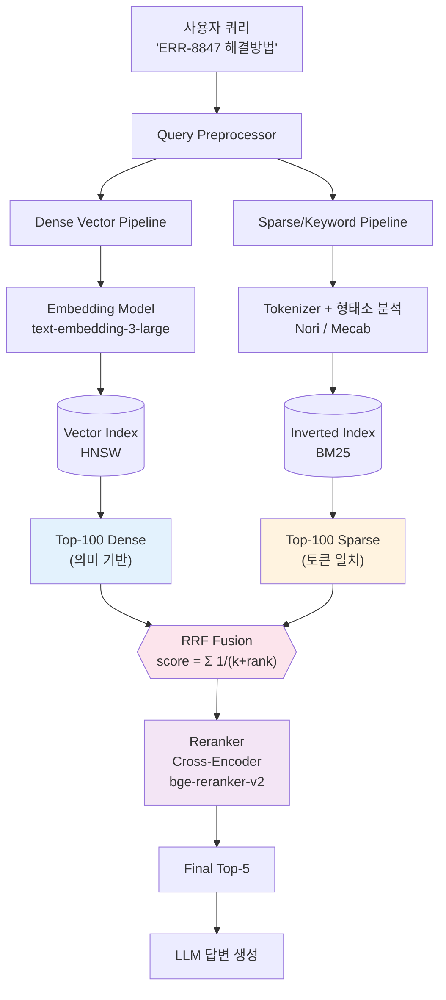

### Day 144. Hybrid Search (Vector + Keyword) — "벡터 검색 깔면 임베딩이 다 알아서 찾아주지"의 치명적 순진함, 그리고 고객이 "에러코드 **ERR-8847** 해결방법 알려주세요"라고 물었는데 RAG가 "인증 토큰 만료 시에는 재로그인하세요"라는 **전혀 다른 문서**를 자신 있게 답변한 금요일 저녁 20:14, CS 1차 응답 CSAT가 72% → 41%로 꺾이고 엔터프라이즈 고객 Acme Corp가 월요일 아침 "이거 AI 맞아요?"라는 제목의 메일을 CEO cc로 쏘아올린 2026-11-17 월요일 오전 09:08

---

#### 1. "벡터면 다 되는 거 아냐?" — 임베딩이 **절대 못 잡는 세 가지**

Lv5에 들어서면 다들 pgvector / Weaviate / Qdrant 중 하나를 깔고 `cosine_similarity` top-k를 돌리기 시작한다. 데모는 환상적이다. "환불 정책 알려줘" → 환불 관련 문서. "결제 실패했어요" → 결제 문제 해결 문서. "오 이제 검색은 끝났네" 싶다.

그런데 아래 쿼리들을 넣어보면 **전부 틀린 답**이 돌아온다:

| 쿼리 유형 | 예시 | 벡터 검색이 뱉는 것 | 사용자가 원한 것 |
|-----------|------|---------------------|------------------|
| **에러 코드** | `ERR-8847 해결방법` | "인증 오류 FAQ" (ERR-8847은 top-50에도 없음) | `ERR-8847: Webhook Signature Mismatch` 문서 |
| **제품 SKU** | `SM-G998B 재고` | "갤럭시 S22 Ultra 스펙" | S21 Ultra 재고 페이지 |
| **법 조항** | `개인정보보호법 제17조` | "개인정보 보호 가이드" | 제17조 원문 |
| **사람 이름** | `박진영 PM 문서` | "프로젝트 매니지먼트 가이드" | 박진영이 작성한 PRD |
| **버전 번호** | `v2.3.1 패치노트` | "최신 릴리즈 노트" (v2.4.0) | v2.3.1 그 자체 |
| **부정 쿼리** | `환불 **안 되는** 경우` | "환불 가능 조건" (환불 가능 문서) | 환불 거절 조건 문서 |

**왜 이러는가.** 임베딩은 "의미가 비슷한 것"을 잘 잡지만 "이 토큰이 정확히 들어있는가"는 **구조적으로 못 본다**. `ERR-8847`을 768차원 벡터로 뭉개는 순간 `-8847`이라는 숫자 꼬리는 `-8846`, `-8848`, `-9000`과 거의 같은 좌표로 매핑된다. **희소성(rare token)이 바로 정보**인 쿼리에서 벡터는 참사다.

반대로 전통적인 **BM25(키워드)** 는 `ERR-8847`을 정확히 잡는다. 그런데 "환불 어떻게 해요"라고 쓴 사용자에게 "환불 정책 안내"는 못 매칭한다 — "환불"과 "환불"은 매칭되지만 "어떻게 해요"와 "안내"는 다른 토큰이기 때문이다.

즉 **벡터는 의미, BM25는 정확도**를 잡는다. 둘 다 필요하다. 이게 **Hybrid Search**다.

---

#### 2. 사고 복기 — "ERR-8847" 한 줄이 어떻게 CSAT를 31%p 떨어뜨렸는가

```
[2026-11-17 월 09:08] Acme Corp의 테크 리드 메일
  제목: 이거 AI 맞아요?
  본문: 지난 금요일 저녁 저희 운영팀이 "ERR-8847 해결방법 알려주세요"
        라고 문의했는데 챗봇이 "인증 토큰이 만료되었을 수 있습니다.
        재로그인해보세요"라고 답했습니다.
        ERR-8847은 Webhook Signature Mismatch 에러로, 저희가 작년에
        귀사에 보고드린 이슈이고 문서에도 명시되어 있는데,
        AI가 다른 에러 FAQ를 복사해서 답변했습니다.
        혹시 이 챗봇이 저희 문서를 학습하긴 한 건가요?

[2026-11-17 월 09:14] CS 매니저가 Slack #eng-help에 포워딩
[2026-11-17 월 09:22] 담당 엔지니어 재현 시도
  Query: "ERR-8847 해결방법"
  Retrieval 결과 (top 5):
    1. "인증 토큰 만료 FAQ"             (score 0.847)
    2. "세션 타임아웃 가이드"           (score 0.831)
    3. "API 키 재발급 매뉴얼"           (score 0.812)
    4. "일반적인 에러 처리 안내"        (score 0.798)
    5. "로그인 문제 해결"               (score 0.781)
  — ERR-8847 원문 문서는 어디에?
    rank: 47위 (score 0.612)
```

이게 전형적인 벡터-전용 RAG의 **"의미는 비슷하지만 답이 아닌" 문서를 자신 있게 꺼내 쓰는** 실패 모드다. 더 치명적인 건, LLM이 top-5를 받아서 "**이 중에 답이 있다**"고 가정하고 그럴듯한 답변을 **합성해버린다**는 점. Hallucination이 아니라 **잘못된 Grounding**이다. 추적도 더 어렵다.

이 사고 이후 담당 팀은 Retrieval 파이프라인에 BM25를 **병렬로** 붙이고 **RRF(Reciprocal Rank Fusion)** 로 합쳤다.

- Vector only: ERR-8847 원문 rank **47**
- BM25 only: ERR-8847 원문 rank **1** (하지만 "환불 어떻게 해요" 류 자연어는 rank 20+)
- Hybrid (RRF): 두 쿼리 유형 모두 rank **1~3**

---

#### 3. 아키텍처 — 두 파이프라인을 어떻게 합치는가



핵심은 세 단계다.

**(1) 병렬 조회.** Dense와 Sparse를 **동시에** 쏜다. 둘 다 top-100 정도를 뽑는다. 이 단계에서 "의미 커버리지"와 "정확 매치"를 둘 다 확보한다.

**(2) RRF 융합.** 두 랭킹을 섞어야 하는데, score 자체가 **스케일이 다르다** (cosine 0~1 vs BM25 0~∞). score를 정규화해서 섞으려 하면 쿼리마다 분포가 달라 깨진다. 그래서 등장한 게 **Reciprocal Rank Fusion**:

```
RRF_score(d) = Σ_i  1 / (k + rank_i(d))
```

여기서 `k`는 보통 60. 왜 60? Cormack et al. (2009) 논문에서 경험적으로 가장 잘 동작한 값이고, 이후 Elasticsearch / Weaviate / Vespa가 모두 **60을 기본값**으로 채택했다. **score가 아니라 rank만 쓴다**는 게 핵심 — 스케일 차이 문제가 사라진다.

**(3) Reranker.** RRF로 top-20~50을 뽑은 뒤, **Cross-Encoder 모델**(bge-reranker, Cohere Rerank, Jina Rerank)로 쿼리-문서 쌍을 한 번 더 점수 매긴다. Cross-Encoder는 느리지만(Bi-Encoder의 100~1000배) 정확도가 훨씬 높다. "조회는 많이, 리랭킹은 소수에게만" 이 원칙.

---

#### 4. 가중치 튜닝 — `alpha`는 생각보다 민감하다

Weaviate의 `hybrid` API는 `alpha` 파라미터로 두 랭킹의 비중을 조절한다:

```python
# alpha=0.0 → 완전 BM25
# alpha=1.0 → 완전 Vector
# alpha=0.5 → 균등 (기본값)

response = client.collections.get("Docs").query.hybrid(
    query="ERR-8847 해결방법",
    alpha=0.5,
    limit=20,
)
```

실무에서는 **alpha를 쿼리 유형별로 분기**한다:

```python
def choose_alpha(query: str) -> float:
    # 에러코드/SKU/숫자코드가 포함되면 BM25 비중 UP
    if re.search(r"[A-Z]{2,}-\d{3,}|v\d+\.\d+|\d{4,}", query):
        return 0.3   # BM25 70% + Vector 30%
    # 자연어 질문 ("어떻게", "왜", "무엇")이면 Vector 비중 UP
    if any(k in query for k in ["어떻게", "왜", "무엇", "뭐가"]):
        return 0.8   # Vector 80%
    return 0.5
```

이 "쿼리 라우팅"을 **Query Router 패턴**이라고 부르고, 큰 조직은 **LLM 자체를 라우터로** 쓴다 (Haiku나 GPT-4o-mini 같은 저비용 모델).

---

#### 5. 트레이드오프

| 축 | Vector only | BM25 only | Hybrid (RRF) | Hybrid + Reranker |
|----|-------------|-----------|---------------|-------------------|
| 의미 검색 | ✅ 강함 | ❌ 약함 | ✅ 강함 | ✅ 매우 강함 |
| 정확 매치 (코드/SKU/숫자) | ❌ 약함 | ✅ 강함 | ✅ 강함 | ✅ 매우 강함 |
| 다국어 | ✅ (모델 지원 시) | ⚠️ 형태소 분석기 필요 | ✅ | ✅ |
| p50 지연 | 20~50ms | 10~30ms | 40~80ms | 200~400ms |
| 운영 복잡도 | 낮음 (인덱스 1개) | 낮음 (ES 하나) | 중간 (인덱스 2개 동기화) | 높음 (리랭커 GPU/API) |
| 비용 (10M 문서/월) | 임베딩 호출비 + VDB 호스팅 | ES 클러스터비 | 둘 다 | 둘 다 + Reranker API ($1~3 / 1000 쿼리) |
| 튜닝 난이도 | 낮음 (chunking만) | 중간 (분석기, k1/b) | 중간 (alpha, k) | 높음 (리랭커 모델 선택까지) |
| "모른다"는 응답 | 거의 안 함 | 가끔 | 적절히 | 적절히 |

**핵심 트레이드오프 3가지:**

1. **지연 vs 정확도.** Reranker를 붙이면 Recall@5가 보통 15~25%p 오르지만 p50이 3~5배 뛴다. 챗봇은 괜찮지만 자동완성은 못 쓴다.
2. **인덱스 동기화.** Dense와 Sparse 인덱스가 **같은 문서의 같은 버전**을 봐야 한다. 문서 업데이트 시 두 인덱스 중 하나만 업데이트되는 순간 "Vector top-1이 삭제된 문서"를 꺼내는 참사가 나온다. **Dual-write + idempotent reindex** 가 필수.
3. **운영 책임.** Vector DB 담당과 ES 담당이 다른 팀이면 사고 났을 때 책임 소재 핑퐁이 난다. 조직 설계가 **아키텍처를 지배**한다 (콘웨이의 법칙).

---

#### 6. 실제 사례 — 누가 왜 이 패턴을 택했는가

**Elastic (ESRE, 2023).** Elasticsearch가 공식적으로 `rrf` retriever를 지원한 결정적 이유는 "**우리 고객들이 벡터 DB로 떠나고 있다**"는 위협이었다. 2024년 ES 8.14부터 `retriever: rrf` 를 YAML 한 줄로 쓸 수 있고, 사내 docs 검색을 돌리는 수많은 B2B 조직이 즉시 갈아탔다. **BM25의 왕좌에 벡터를 얹은 전략.**

**Weaviate.** 처음부터 Hybrid를 1등 시민으로 설계했다. `alpha` 파라미터 하나로 비중 조절이 가능하고, Qdrant/Pinecone보다 "**설정 복잡도는 낮지만 Hybrid가 쉽다**"는 포지션으로 기업 고객을 잡았다. Shopify, Stack Overflow가 대표 고객.

**Qdrant (Sparse Vectors, 2024).** 전통적인 BM25 대신 **SPLADE** 같은 "학습된 희소 벡터"를 Dense와 함께 돌린다. 토큰 매칭 + 의미 확장을 하나의 벡터 공간에서 처리. 복잡하지만 리콜이 더 높다. OpenAI가 자사 Assistants API의 File Search 백엔드로 Qdrant 사용.

**Vespa.** Yahoo/Perplexity가 쓰는 엔진. YQL로 BM25와 Dense를 **하나의 랭킹 함수 안에서 섞는다**. 유연성 최강, 러닝커브 최악. Perplexity가 검색 엔진으로 채택한 이유도 "LLM이 생성한 답변 근거를 섞어서 랭킹할 수 있는" 유연성 때문.

**Pinecone (Sparse-Dense Vectors).** 2023년부터 `sparse_values` + `values`를 동시에 넣고 하나의 쿼리로 Hybrid를 돌릴 수 있다. 서버리스 Vector DB에서 Hybrid를 지원하는 사실상 유일한 선택지. Notion AI가 공개된 사례.

**Netflix의 사내 Semantic Search.** 2024년 공개한 테크 블로그에 따르면 "**영화 제목 같은 Named Entity가 들어오는 쿼리는 Vector만으로는 절대 못 잡는다**"라고 명시하고 BM25 + Dense + Reranker 3단 파이프라인을 운영. 제목에 "The"가 포함되면 벡터가 의미를 파편화시켜 완전히 다른 영화를 꺼낸다는 유명한 사례.

---

#### 7. 언제 쓰고 언제 쓰면 안 되는가

**써야 하는 경우:**
- **코퍼스에 고유명사/코드/숫자/버전이 섞여 있는** 경우 — 기술 문서, API 레퍼런스, 법령, 상품 카탈로그, 사내 위키
- 사용자 쿼리가 **매우 다양한** 경우 (짧은 키워드 + 긴 자연어가 공존)
- "**정확한 문서를 못 찾는 것**"이 비즈니스 리스크인 경우 (CS, 법률, 금융, 의료)
- **다국어**가 섞여 있고 저자원 언어가 포함된 경우 — 임베딩 모델의 언어 커버리지 공백을 BM25가 메운다

**쓰면 안 되는 경우 (벡터 only가 더 낫다):**
- 코퍼스가 **거의 자연어 산문**만 있는 경우 — 소설 추천, 뉴스 요약
- **p50 50ms 이하**가 SLA인 경우 — 자동완성, 검색 suggest
- 코퍼스가 **1만 건 이하**로 작은 경우 — BM25만으로 충분하고, 벡터도 Overkill
- **쿼리와 문서 언어가 다른 경우** (한국어 질문 → 영어 문서) — BM25가 작동하지 않으므로 Dense만으로 가는 게 맞고, 대신 좋은 다국어 임베딩(e5-large, bge-m3)을 선택

**쓰면 안 되는 경우 (키워드 only가 더 낫다):**
- 완전한 **코드 검색** (GitHub 식) — 사용자가 "정확한 심볼"만 치는 경우
- **로그 검색** — "ERROR level, user_id=12345" 같은 구조화 쿼리

---

#### 8. 시니어 백엔드 체크리스트

```
[ ] Dense 인덱스와 Sparse 인덱스가 "같은 문서의 같은 버전"을 보고 있는가?
    → Dual-write에 idempotency key, 비동기 reindex 시 TTL 알람

[ ] RRF k 값을 그냥 60으로 쓰고 있는가? 쿼리 로그로 검증했는가?
    → 쿼리 분포가 skewed하면 k=20~100 사이로 A/B 돌려봐야 함

[ ] alpha를 쿼리 유형별로 분기하는 Router가 있는가?
    → 없다면 자연어/코드가 섞인 쿼리에서 둘 다 못 잡음

[ ] Reranker를 top-5가 아니라 top-20~50에 적용하고 있는가?
    → top-5만 리랭킹하면 "원래 rank 15위였던 정답"을 영영 못 꺼냄

[ ] "검색 결과 0건"과 "검색 결과 품질 낮음"을 LLM이 구분하는가?
    → 품질 낮음을 confident하게 답변하는 게 가장 위험 (ERR-8847 사고)

[ ] Retrieval quality 메트릭이 있는가?
    → Recall@10, MRR, nDCG. 없으면 개선을 "느낌"으로 하게 됨

[ ] Golden dataset 50~200건이 CI에서 돌고 있는가?
    → chunking 바꾸거나 모델 바꿀 때 regression 안 보이면 깜깜이 배포
```

---

> 💡 **왜 중요한가**: RAG 실패의 60%는 LLM이 아니라 **Retrieval 단계**에서 발생하고, Retrieval 실패의 상당수는 "벡터 검색만 쓴 것"에서 온다 — 사용자가 `ERR-8847` 한 줄만 쳐도 정답 문서를 top-3 안에 꺼낼 수 있어야 그 뒤의 모든 LLM 품질 논의가 의미를 갖는다.
