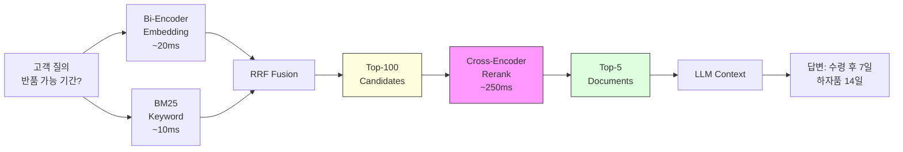

### Day 145. Reranking (Cross-Encoder) — "Hybrid Search 깔면 Retrieval 품질 다 해결되는 줄 알았지"의 치명적 순진함, 그리고 "반품 가능 기간이 며칠이에요?"라는 한 줄에 정답 문서가 Top-20 안의 **14위**에 있었는데도 LLM이 1위 문서 "반품 사유 작성 가이드"를 근거로 "반품 사유는 아래와 같이 작성하시면 됩니다"만 돌려줘서 고객이 "AI가 질문을 이해를 못하네요"라며 **별 1점 리뷰 테러**를 시작한 2026-11-20 금요일 저녁 21:47, 그리고 같은 주말에 "하자품인데 7일 지났다고 반품 거부당했어요"가 공정위 민원 **9건**으로 쌓여 월요일 아침 법무팀 Jira가 터진 2026-11-23 오전 09:12

---

#### 1. 사건 재구성

지난주(Day 144)에 Hybrid Search(BM25 + Vector + RRF)를 깔고 자신만만했다. `ERR-8847` 같은 에러코드 질의는 BM25가 확실히 잡아준다. **키워드 매칭이 명확한 질문은 해결됐다.**

문제는 자연어 뉘앙스 질의였다.

```
[고객 질의] "반품 가능 기간이 며칠이에요?"
                        ↓
            Hybrid Search Top-20 결과
                        ↓
 1위: 반품 사유 작성 가이드
 2위: 반품 영수증 재발급 방법
 3위: 반품 처리 진행 상황 확인
 4위: 반품 주소지 변경 방법
 5위: 반품 택배 집하 요청
 ...
14위: ✅ 반품 정책: 수령 후 7일 이내(일반) / 14일 이내(하자품)
 ...
```

LLM에는 관행적으로 Top-5만 넘겼다. 그래서 LLM은 "반품 가능 기간"을 묻는 질문에 "**반품 사유는 아래 양식에 맞춰 작성해주세요**"를 자신 있게 답변했다.

왜 이런 일이 일어나는가? **Bi-Encoder 기반 Vector Search는 Query와 Document를 "따로" 임베딩한 뒤 코사인 거리로 비교한다.** "반품"이라는 단어만 많이 등장하는 문서가 전부 비슷하게 상위로 올라온다. BM25도 똑같이 "반품"에 가중치를 준다. RRF로 섞어도 **둘 다 "반품" 키워드 편향이 있으니 편향이 중첩**된다.

CSAT 68% → 52%. 공정위 민원 9건. 그리고 "하자품 14일" 정책을 못 찾아준 탓에 **반품 거부로 소비자 피해가 실제 발생**했다.

---

#### 2. 근본 원인: Retrieval과 Ranking은 다른 일이다

| 단계 | 목적 | 방법 | 최적화 지표 |
|------|------|------|-------------|
| Retrieval | **놓치지 않기** (Recall) | Bi-Encoder (Fast) | Recall@100 |
| Ranking | **잘 고르기** (Precision) | Cross-Encoder (Slow) | nDCG@5, MRR |

Bi-Encoder는 Query와 Document를 **독립적으로** 벡터화한다. 한 번만 계산하면 재사용 가능 → 빠름 → Top-100 뽑기에 적합.

Cross-Encoder는 Query와 Document를 **"[Query] [SEP] [Document]"로 한 문장에 넣어** 트랜스포머에 통과시킨다. "반품 가능 기간이 며칠이에요?"와 "반품 사유 작성 가이드"를 같이 보면 "기간"이라는 단어와 매칭이 안 됨을 감지한다. 반면 "반품 가능 기간"과 "수령 후 7일 이내, 14일 이내"는 "며칠 / 7일 / 14일"의 **의미적 정합**을 포착한다.

대가는 속도다. Bi-Encoder는 Document당 사전 임베딩 → 쿼리 시 O(1) 유사도 비교. Cross-Encoder는 **매 (Query, Document) 쌍마다 트랜스포머 forward pass**. 100개 문서 Rerank = 100번 forward.

---

#### 3. 2-Stage Retrieval 아키텍처



**핵심은 Funnel 구조다:**

```
전체 문서 1,240만 건
    ↓ (Vector + BM25 로 빠르게 좁힘)
Top-100 후보군     ← Recall 최대화 (놓치지 않기)
    ↓ (Cross-Encoder 로 꼼꼼히 비교)
Top-5 최종 선택    ← Precision 최대화 (잘 고르기)
    ↓
LLM Context 전달
```

Retrieval에서 **"넓게 그물 치고"**, Rerank에서 **"잡힌 물고기 중 큰 것만 골라낸다"**.

---

#### 4. 구현 스케치 (의사코드)

```python
from sentence_transformers import CrossEncoder

reranker = CrossEncoder("BAAI/bge-reranker-v2-m3")  # 한국어 지원

def rag_with_rerank(query: str) -> str:
    # 1단계: Hybrid Search (Top-100, ~50ms)
    candidates = hybrid_search(query, top_k=100)  # Day 144 방식

    # 2단계: Cross-Encoder Rerank (~250ms on A10 GPU)
    pairs = [(query, doc.text) for doc in candidates]
    scores = reranker.predict(pairs, batch_size=32)
    reranked = sorted(
        zip(candidates, scores),
        key=lambda x: -x[1]
    )

    # 3단계: Top-5 선택 + 임계값 컷
    top5 = [doc for doc, score in reranked[:5] if score > 0.3]

    # 4단계: 아무것도 임계값을 넘지 못하면 "모른다"로 fallback
    if not top5:
        return "해당 질문에 대한 답변을 문서에서 찾지 못했습니다."

    context = "\n\n".join(doc.text for doc in top5)
    return llm.generate(context, query)
```

리얼월드에서 한 번 더 손봐야 할 포인트:

- **`score > 0.3` 임계값 컷**: Rerank가 "다 못 미덥다"고 판단한 경우 **LLM에 넘기지 말고 "모른다"로 끊기**. 환각보다 침묵이 낫다.
- **batch 처리**: 100건을 한 번에 넣지 말고 batch=32로 쪼개야 GPU 메모리 안정.
- **Top-100 뽑은 후보군과 Rerank 결과를 모두 로깅**: 나중에 Rerank 모델 바꿀 때 A/B 비교 가능.

---

#### 5. 트레이드오프

| 항목 | Bi-Encoder만 | + Cross-Encoder Rerank |
|------|--------------|------------------------|
| **Latency** | ~50ms | +200~400ms |
| **nDCG@5** | 0.52 | 0.81 |
| **비용 (1M queries)** | $0 (사전 임베딩) | ~$2,000 (Cohere) / GPU $800 (self-host) |
| **운영 복잡도** | 모델 1개 | 모델 2개 (버전/재학습 관리 증가) |
| **콜드 스타트** | Embedding만 | Embedding + Rerank 워밍업 |

**Latency를 반드시 측정해라.** Cohere Rerank v3 API는 평균 150~250ms. self-host bge-reranker-v2-m3는 A10 GPU에서 Top-100당 250~400ms. 챗봇 UX에서 "LLM 생성 1.5초 + Rerank 300ms = 1.8초"가 나와도 대개 허용 가능하지만, **"300ms 이내 응답" SLA가 있는 검색창 자동완성 같은 데는 못 쓴다.**

---

#### 6. 실제 사례

**Anthropic — Contextual Retrieval (2024.09 공식 블로그)**
"Contextual Embedding + BM25" 조합 위에 **Rerank를 얹으면 Retrieval 실패율이 추가로 67% → 1.9% 수준으로 떨어진다**고 수치로 공개. Anthropic 자체 RAG 레시피의 마지막 퍼즐로 Rerank를 지정.

**Cohere Rerank v3 — Perplexity, Notion AI**
Cohere의 Rerank API는 Perplexity와 Notion AI가 공개적으로 사용 중. 가격 $2/1,000 requests. **"쓸 문서를 바꾸는 게 아니라 순서만 바꾼다"**는 설계로 기존 RAG 파이프라인에 drop-in 가능.

**BAAI BGE-Reranker (오픈소스)**
`bge-reranker-v2-m3`는 한국어 포함 100+ 언어 지원. HuggingFace 월 다운로드 2M+. 국내 스타트업들이 Cohere 유료 피하고 self-host로 많이 쓴다. **단, GPU 서버가 없으면 CPU에서 Top-100에 2~3초가 걸려 사실상 못 씀.** 운영 전에 "GPU 상시 띄울 돈이 있는가"부터 확인.

**Weaviate / Vespa — 2-Stage Retrieval 내장**
Vespa는 처음부터 "1st-phase ranking (cheap) → 2nd-phase ranking (expensive)" 구조를 쿼리 플랜에 내장. Weaviate는 `rerank-cohere`, `rerank-transformers` 모듈로 지원. **인프라 레벨에서 Rerank를 "검색의 일부"로 보는 흐름**.

---

#### 7. 언제 쓰고, 언제 쓰면 안 되는가

**써야 하는 경우**
- 자연어 질의가 많고(키워드만이 아님), 뉘앙스 차이가 품질을 가른다
- 의료/법률/금융/정책 — **정답 1개 vs 유사 문서 N개를 구분해야 하는 도메인**
- Retrieval Top-K에는 정답이 들어있는데 LLM이 상위 문서에 끌려가 틀린 답을 낸다 (= **Recall은 높고 Precision이 낮은 상태**)
- 유사 문서가 많다 (반품 가이드/영수증/주소 변경 등등이 다 "반품"으로 시작)

**쓰면 안 되는 경우**
- **실시간성 SLA가 300ms 이내**인 검색창 자동완성, 추천 피드. Rerank는 사치
- 질의가 **ID/에러코드/SKU 같은 정확 매칭** 위주 (`ERR-8847`, 주문번호). BM25로 끝. Cross-Encoder가 오히려 교란
- **문서 수 자체가 적어** Top-K=20을 통째로 LLM Context에 넣어도 토큰이 남는다 (Context Window 넉넉하면 Rerank 없이 LLM이 사실상 Reranker 역할)
- 비용 민감한 B2C high-volume. 하루 1천만 쿼리면 Cohere 기준 월 $600K. **사용자 1 request당 earnings가 Rerank 원가를 못 이기면 쓰지 말라**

---

#### 8. 안티패턴

1. **"Rerank 깔면 Retrieval 품질 포기해도 됨"** — 틀렸다. Top-100 안에 정답이 없으면 Rerank가 아무리 똑똑해도 **없는 걸 만들어낼 수 없다**. Retrieval Recall@100이 먼저다.
2. **Top-1000을 Rerank에 꽂기** — Latency 초과 + GPU 메모리 폭주. Top-100~200이 실무 sweet spot.
3. **Rerank 점수 로깅 생략** — 어떤 쿼리에서 "정답이 Top-100엔 있었는데 Rerank가 10위로 밀어냈다" 같은 사례를 찾을 수 없게 된다. Day 138에서 배운 Observability의 원칙이 그대로 적용된다.
4. **임계값 컷 없이 무조건 Top-5** — Rerank 점수가 다 0.1 이하인데 그냥 넘기면, LLM이 **관련 없는 문서 5개를 보고 환각을 생성**한다. "모른다"로 끊는 게 나은 영역이다.
5. **Embedding 모델만 바꾸고 Rerank 모델 안 바꿈** — 두 모델이 서로 다른 유사도 공간을 전제로 하면 "Retrieval은 잘 뽑는데 Rerank가 엉뚱한 걸 올리는" 현상이 생긴다. **같이 평가해야 한다.**

---

> 💡 **왜 중요한가**: Retrieval은 "놓치지 않기(Recall)"이고 Rerank는 "잘 고르기(Precision)"다. 이 둘을 한 모델이 동시에 하려는 순간 RAG 품질 상한선은 Bi-Encoder의 유사도 측정 능력에 영원히 갇힌다.
