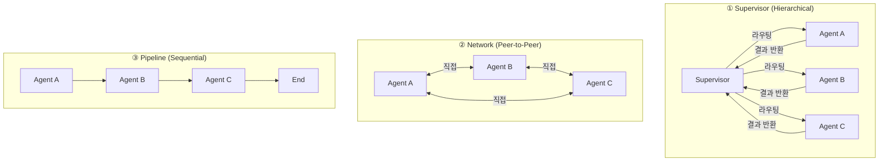
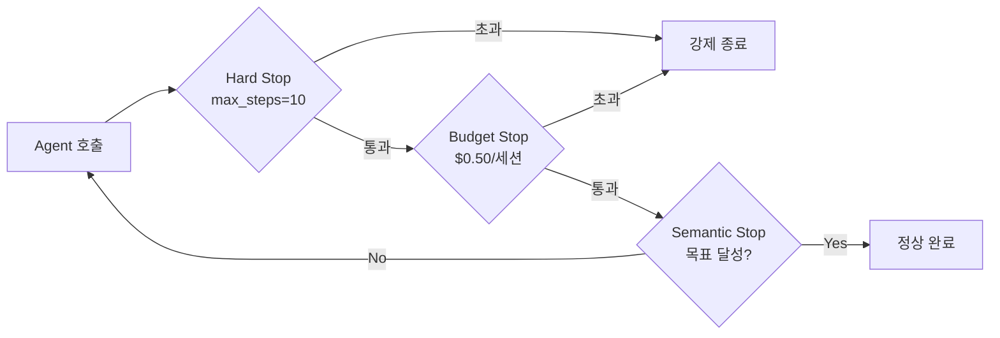

### Day 146. Multi-Agent Orchestration — "Agent 여러 개 붙이면 전문가 팀처럼 알아서 협업하겠지"의 치명적 순진함, 그리고 Supervisor → Research → Writer → Reviewer → Supervisor → Research... **23단계 왕복** 끝에 고객 한 명의 환불 문의 하나를 처리하는 데 토큰 **$14.20**, 응답 시간 **4분 17초**를 태우고 "AI가 자기들끼리 회의하다 시간 다 보냈어요"라는 X 밈이 **리트윗 3,400회**를 찍은 2026-11-21 토요일 오전 10:34, 그리고 월요일 아침 CFO가 "단일 Agent 때보다 비용이 11.7배인데 품질은 왜 더 떨어졌냐"고 화상회의에 전사 임원 17명을 호출한 2026-11-23 오전 08:30

---

#### 0. 사건 재구성 — "전문가 팀"이라는 로망의 민낯

2026-11-21 토요일 오전 10:34. 이커머스 B사의 신규 AI CS 시스템에 들어온 평범한 질문 하나.

> "주문번호 KR-2026-77231 환불 요청합니다. 상품 하자입니다."

이걸 처리한 Multi-Agent 로그 (요약):

```
[10:34:12] Supervisor: "하자 환불이네. ResearchAgent에 넘긴다"
[10:34:18] ResearchAgent: "정책 검색 완료. WriterAgent에 넘긴다"
[10:34:25] WriterAgent: "답변 초안 작성. ReviewerAgent에 넘긴다"
[10:34:33] ReviewerAgent: "주문번호 검증 누락. Supervisor로 반려"
[10:34:40] Supervisor: "주문 검증이 필요하네. ResearchAgent에 다시 넘긴다"
[10:34:47] ResearchAgent: "주문 조회 완료. WriterAgent에 넘긴다"
[10:34:55] WriterAgent: "답변 보강. ReviewerAgent에 넘긴다"
[10:35:03] ReviewerAgent: "하자 사진 요청 누락. Supervisor로 반려"
[10:35:10] Supervisor: "사진 요청 문구 추가 필요. WriterAgent로..."
... (23회 반복)
[10:38:29] Supervisor: "max_handoff=25 도달. 종료"
[10:38:29] 최종 응답: "확인 후 연락드리겠습니다"
```

- 총 토큰: **$14.20** (단일 Agent 대비 **11.7배**)
- 응답 시간: **4분 17초** (단일 Agent 대비 **19배**)
- 품질: "확인 후 연락드리겠습니다" (= **실질적 답변 없음**)

같은 패턴이 토요일 하루에만 **1,847건**. 월요일 아침 CFO 호출.

왜 이런 일이 일어났나? Multi-Agent 아키텍처를 **"전문가 팀"이라는 은유**로만 이해했기 때문이다. 실제로 그들이 설계한 것은 **종료 조건 없는 메시지 패싱 네트워크**였다.

---

#### 1. Multi-Agent Orchestration의 3대 토폴로지

Agent를 여러 개 붙이는 방식은 크게 세 가지다. 각각 **"언제 종료되는가"** 가 완전히 다르다.



| 토폴로지 | 종료 조건 | 비용 예측성 | 적합한 작업 | 함정 |
|---|---|---|---|---|
| **Supervisor** | Supervisor가 "완료" 선언 | 중간 (Supervisor의 판단력에 의존) | 동적 라우팅, 작업 분해 | Supervisor-Worker 왕복 루프 |
| **Network** | 합의(consensus) 또는 타임아웃 | 낮음 (예측 불가) | 창의적 토론, 다관점 검토 | 무한 토론, 메시지 폭증 |
| **Pipeline** | 마지막 노드 도달 | 높음 (결정론적) | ETL, 단계적 처리 | 유연성 없음, 중간 실패 처리 복잡 |

B사가 쓴 것은 **①Supervisor 패턴**이었고, 치명적 결함은 **"Supervisor가 Worker의 결과물을 받아 다시 라우팅할 때, 이전 라운드의 상태를 잃어버렸다"** 는 것이다. 매번 "처음 보는 요청"처럼 판단해서 같은 Worker에게 다시 할당했다.

---

#### 2. 왜 Multi-Agent는 Single Agent보다 **더 멍청**해지는가

흔한 오해: "GPT-4 하나보다 GPT-4 세 개가 낫지 않을까?"

실제로는 반대가 자주 일어난다. 이유는 세 가지.

##### (1) Context Fragmentation

각 Agent는 **자기 역할만 적힌 시스템 프롬프트**를 갖는다. Supervisor가 Worker에게 넘길 때, 전체 대화 맥락을 다 넘기지 않으면 Worker는 "왜 이 작업을 받았는지" 모른다. 그렇다고 다 넘기면 Context가 폭증한다.

```
Supervisor Context: [User Request] + [Worker A 결과] + [Worker B 결과] + ...
Worker A Context:   [Supervisor의 지시] (전체 맥락 없음)
```

Worker A는 자기가 뱉은 답이 **전체 플로우에 어떻게 기여하는지** 모른 채 "완벽한 단독 답변"을 생성한다. 그 답은 다음 단계에서 쓸모없을 가능성이 높다.

##### (2) Handoff Overhead

Agent 간 넘김(handoff)은 공짜가 아니다. 매 handoff마다:
- 수신 Agent의 시스템 프롬프트 전체 재전송 (수백~수천 토큰)
- 이전 Agent의 결과물을 요약/전달 (수백 토큰)
- LLM 호출 1회 (latency 2~5초)

3단계 파이프라인이면 **최소 3배 비용 + 3배 latency**. Supervisor 패턴이면 왕복이 섞여 **5~20배**로 튄다.

##### (3) Error Compounding

Agent 각각이 95% 정확도라고 가정하자. 5단계 파이프라인의 끝단 정확도는?

```
0.95^5 = 0.774 (≈ 77%)
```

**단일 Agent 95% → 5-Agent 파이프라인 77%**. 중간 Agent 하나가 잘못된 가정을 하면, 뒤의 Agent들은 그걸 "주어진 사실"로 받고 더 정교한 거짓말을 만든다.

---

#### 3. 종료 조건 설계 — 가장 많이 빠뜨리는 것

B사 사건의 **진짜 원인**은 무한 루프가 아니라 **"무엇이 완료인지 명시하지 않은 설계"** 였다. 아래 3단 방어선이 필요하다.



1. **Hard Stop (기계적)**: 전체 handoff 횟수 상한. `max_total_steps=10` 처럼. **반드시 있어야 한다**. 이게 없으면 LLM이 "조금만 더 하면 될 것 같아요"로 계속 간다.
2. **Budget Stop (경제적)**: 세션당 토큰 비용 상한. B사는 이걸 Agent 단위로만 걸고 **세션 전체 합산**은 걸지 않았다. (Day 141에서 다룬 서킷 브레이커를 Multi-Agent에 적용해야 한다는 뜻)
3. **Semantic Stop (의미적)**: "목표 달성 체크리스트"를 명시적 구조화. Supervisor가 "답변할 준비가 됐는가?"를 **구조화된 JSON**으로 평가하게 한다. 자연어 "완료했음"에 의존하면 Agent가 거짓말한다.

```python
class CompletionCheck(BaseModel):
    has_order_verified: bool
    has_policy_cited: bool
    has_customer_facing_response: bool
    next_action: Literal["RESPOND", "NEED_INFO", "ESCALATE"]
```

LLM이 자연어로 "네 완료했어요"가 아니라 **위 스키마에 맞춰 답하게** 해야 Hallucination이 줄어든다.

---

#### 4. 실제 사례 — 누가 어떻게 썼나

##### Anthropic: "Multi-Agent Research System" (2025)
Anthropic이 Research 기능에 쓴 Orchestrator-Worker 패턴. 핵심 설계:
- **병렬 Worker**: 하나의 질문을 Orchestrator가 서브쿼리로 분해 → 여러 Worker가 **병렬**로 각자 조사
- **격리된 Context Window**: 각 Worker는 자기 서브쿼리 + 검색 결과만 봄 (전체 맥락 X)
- **종료는 Orchestrator가 결정**: Worker는 자기 몫만 끝내면 끝, 왕복 없음
- 단일 Agent 대비 **15배 토큰**을 쓰지만 **품질이 그만큼** 올라가는 작업(심층 리서치)에만 쓴다고 공식 블로그에서 명시

##### Devin (Cognition AI): "단일 Agent + 긴 Context" 회귀
초기 Devin은 Multi-Agent 구조였으나, Cognition은 공개 블로그에서 **"Multi-Agent를 버리고 단일 Agent로 돌아갔다"** 고 밝혔다. 이유: Agent 간 통신에서 **Context가 손실되는 비용**이 멀티 Agent의 이점을 넘어섰기 때문. "**Don't build multi-agents**"라는 제목의 글이 2025년 상반기 엔지니어링 커뮤니티에서 큰 논쟁을 불렀다.

##### LangGraph (LangChain): Supervisor/Swarm 패턴의 표준화
LangGraph는 Supervisor/Swarm/Hierarchical을 **State Machine의 노드/엣지**로 모델링한다. 왜 중요한가? "암묵적 handoff"가 아니라 **명시적 상태 전이**로 강제한다. 각 노드가 어떤 상태를 읽고/쓰는지, 어떤 엣지로 갈 수 있는지 **정적으로 선언**해야 하므로 무한 루프를 **그래프 설계 단계에서** 잡을 수 있다.

---

#### 5. 트레이드오프 — 시니어가 반드시 체크할 것

| 축 | Single Agent | Multi-Agent |
|---|---|---|
| 비용 | 1x (baseline) | **5~20x** (handoff overhead) |
| Latency | 1x | **3~10x** (직렬 handoff) |
| 디버깅 | Trace 1개 | **여러 Trace를 상관시켜야** 함 (Day 138 Observability 2배 중요) |
| 품질 (단순 작업) | 높음 | **낮음** (Context Fragmentation) |
| 품질 (복잡/병렬화 가능) | 낮음 (Context Window 한계) | 높음 (분해 가능 시) |
| 확장성 | 수직 (더 큰 모델) | 수평 (Worker 추가) — 단, **병렬일 때만** |
| 실패 모드 | 명확 (1개 지점) | 분산 (어느 Agent가 틀렸는지 추적 필요) |

---

#### 6. 시니어 백엔드의 판단 기준

##### Multi-Agent를 **써야 할 때**
- 작업이 **진정으로 병렬화 가능**할 때 (여러 소스 조사, 여러 측면 분석)
- 단일 Context Window로 **감당 불가능한 정보량**을 다룰 때
- 각 Agent의 **역할이 명확히 분리**되고 **상호 호출이 거의 없을** 때 (Pipeline)
- 품질 이득이 **15배 비용**을 정당화할 때 (예: 심층 리서치, 법률 검토)

##### Multi-Agent를 **쓰면 안 될 때**
- 단순 CS 응답, Q&A, 고객 챗봇 → **단일 Agent + Tool Use로 충분**
- 응답 시간이 **3초 이하**로 제약된 사용자 대면 기능
- **왕복 루프** 가능성이 있는 Supervisor 패턴에 Hard Stop/Budget Stop/Semantic Stop **3단 방어선**이 없을 때
- Agent 간 Trace를 상관시키는 Observability (Day 138)가 **아직 구축 안 됐을 때**
- 팀이 "Agent 하나로는 안 되는 이유"를 **구체적 실패 사례**로 설명하지 못할 때 → **단일 Agent부터 시작**이 정답

##### B사가 했어야 할 것 (사후 교정)
1. "환불 문의"는 **Multi-Agent가 아니라 단일 Agent + Tool Use**로 되돌리기
2. Multi-Agent는 **진짜 복잡한 케이스**(법적 분쟁 검토, 다중 주문 연쇄 환불 등)에만 승격
3. 승격 기준: "단일 Agent가 3번 이상 실패했거나 escalation 요청한 케이스"만 Multi-Agent로 라우팅
4. Multi-Agent 세션 단위 **$1 Hard Budget Stop** + **max_handoff=6**
5. Supervisor의 "완료 판단"을 자연어 → **구조화 스키마**로 전환

---

> 💡 **왜 중요한가**: Multi-Agent는 "Agent 여럿 = 전문가 팀"이라는 은유에 속아 도입하면 **비용 10배·latency 10배·품질은 오히려 하락**이라는 세 가지 패널티를 한꺼번에 떠안는, LLM 시대 가장 과대평가된 패턴이다. 종료 조건 3단 방어선(Hard/Budget/Semantic Stop)과 "**정말 병렬화 가능한 작업인가**"라는 질문을 통과하지 못하면, 단일 Agent로 돌아가는 것이 시니어의 판단이다.
