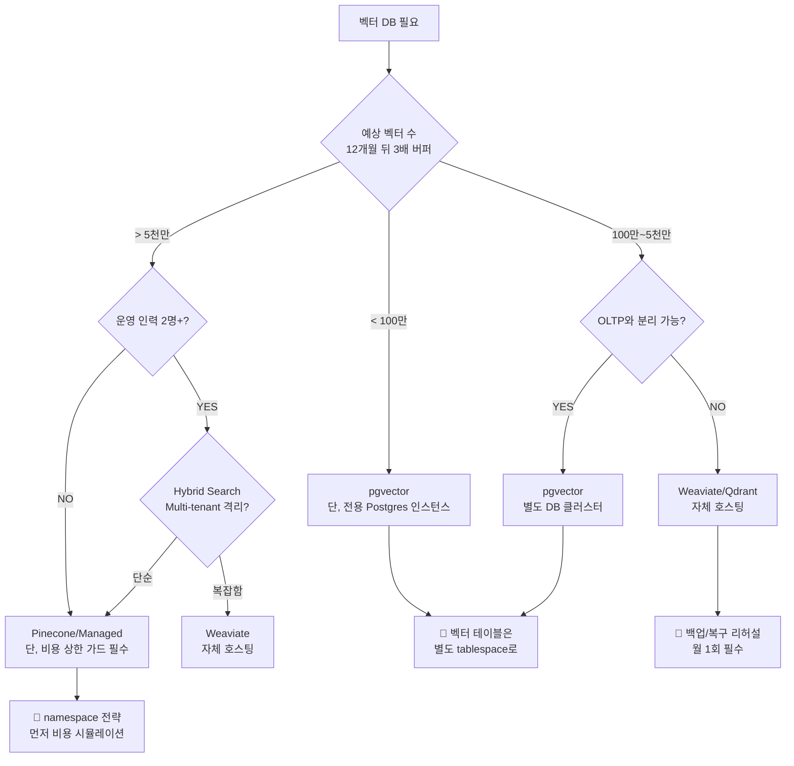

### Day 147. Vector DB 선택 (Pinecone vs Weaviate vs pgvector) — "Postgres에 pgvector만 깔면 되지"의 치명적 순진함, 그리고 문서 50만 건에서 완벽했던 검색이 **540만 건**에서 P99 레이턴시 **4.7초**로 꺾이고 PostgreSQL 메인 DB의 CPU가 **96%**에 쳐박혀 주문 쿼리까지 **8초** 넘게 걸리기 시작한 2026-11-18 수요일 오후 15:22, 그리고 급하게 "Pinecone으로 올리자"며 마이그레이션한 다음 달 월 예상 비용 **$400 → 청구서 $8,247**이 꽂혀 CFO가 "너희 벡터 DB 하나 고르는 데 왜 세 번을 실패하냐"고 아키텍처 리뷰 보드를 소집한 2026-12-05 금요일 오전 09:30

---

#### 1. 사건의 전말

**스타트업 "LegalMind" — 법무 문서 Q&A 서비스**

- B2B SaaS. 고객사가 업로드한 계약서/약관을 임베딩해두고, 법무팀이 "이 조항 위반 시 책임 범위 알려줘" 같은 질문을 던지면 RAG로 답변
- 2026년 초, 시드 라운드 직후 엔지니어 3명. "Postgres 어차피 쓰고 있으니 `pgvector` extension 깔아서 벡터 검색 붙이면 되지" — 2일 만에 POC 완성, 투자자 데모 성공
- **의사결정의 근거**: "별도 DB 안 늘려도 되고, 트랜잭션도 공유하고, 운영 복잡도도 낮고. Pinecone은 Vendor Lock-in에 비싸고."

**문제의 시작 (2026년 11월, 11개월 뒤)**

| 지표 | 2026년 1월 | 2026년 11월 |
|---|---|---|
| 고객사 수 | 12개 | 340개 |
| 총 문서 수 | 1.2만 건 | **540만 건** |
| 임베딩 벡터 수 (chunk 단위) | 48만 | **8,600만** |
| 벡터 검색 P50 | 42ms | **1,840ms** |
| 벡터 검색 P99 | 180ms | **4,720ms** |
| PG CPU (업무시간) | 18% | **96%** |
| 주문/과금 쿼리 P99 | 120ms | **8,200ms** ⚠️ |

11월 18일 수요일 15:22, Datadog에서 PostgreSQL CPU 알람이 터졌다. **벡터 검색 때문에 메인 DB가 통째로 느려졌다.** 결제 결제 실패율이 0.2% → 11%로 치솟았고, CS 큐가 1시간 만에 180건이 쌓였다.

**원인 분석**
- `pgvector`의 HNSW 인덱스 크기: 임베딩 차원 1536 × vector 수 8,600만 ≈ **인덱스 메모리만 520GB**
- RDS 인스턴스는 `db.r6g.4xlarge` (메모리 128GB) — 인덱스가 메모리에 못 올라가서 **디스크 I/O가 폭주**
- 더 치명적인 건, **같은 shared_buffers와 같은 커넥션 풀을 주문/결제 트랜잭션과 공유** → 벡터 검색이 CPU와 I/O를 다 빨아먹으니 OLTP가 같이 죽음

---

#### 2. 급하게 Pinecone으로 갈아탔더니 — 이번엔 비용이 터진다

11월 20일, CTO가 "Pinecone으로 마이그레이션. 이번 주말에 끝내자." 지시.

**견적 당시 계산**
- 8,600만 vector × 1536 dim (float32) × Pinecone Serverless → 공식 계산기: **월 $400 예상**

**12월 1일 청구서: $8,247**

차이가 난 원인 3가지:
1. **Namespace 분리** — 340개 고객사를 테넌시 분리하려고 namespace 340개로 쪼갰더니, Pinecone은 namespace마다 **최소 유지 비용**이 붙음
2. **Read Unit 단가 오판** — "query 1건당 1 RU" 가정했는데, 실제론 **top-K와 metadata filter 복잡도**에 따라 RU가 3~12배 뛴다. Hybrid Search + rerank 후보 50개 받다 보니 쿼리당 평균 **7.2 RU**
3. **임베딩 재인덱싱 비용** — 11월 말 임베딩 모델을 `text-embedding-3-small` → `3-large` (3072 dim)로 업그레이드 → **전체 재업로드 Write Unit 폭탄**

---

#### 3. 그래서 벡터 DB 선택은 어떻게 접근해야 하는가

**핵심 질문 3가지를 먼저 답해라:**

```
┌─────────────────────────────────────────────────────────────┐
│ Q1. 벡터 수가 얼마나 커지나? (1년 뒤 예상치, 3배 버퍼)       │
│     < 100만         → pgvector 충분                          │
│     100만 ~ 5천만   → pgvector 분리 인스턴스 or Weaviate     │
│     > 5천만         → Pinecone / Weaviate / Qdrant / Milvus │
├─────────────────────────────────────────────────────────────┤
│ Q2. 메인 OLTP와 트랜잭션을 공유해야 하나?                    │
│     YES → pgvector (단, 반드시 DB 분리 또는 Read Replica)   │
│     NO  → 전용 벡터 DB                                       │
├─────────────────────────────────────────────────────────────┤
│ Q3. Multi-tenant 격리 요구 수준은?                           │
│     Soft (metadata filter)   → 아무거나 OK                   │
│     Hard (namespace/shard)   → Pinecone 비용 폭탄 조심,     │
│                                Weaviate multi-tenancy 고려  │
└─────────────────────────────────────────────────────────────┘
```

#### 4. 세 선택지의 트레이드오프

| 축 | pgvector | Weaviate (자체 호스팅) | Pinecone (Managed) |
|---|---|---|---|
| **초기 세팅 시간** | 10분 | 반나절 | 10분 |
| **추가 인프라 비용** | $0 (Postgres에 얹음) | VM/K8s 비용 + 운영 인력 | 사용량 과금 |
| **Scale 한계** | ~5천만 vector (현실적) | ~수십억 (샤딩 시) | 사실상 무제한 |
| **OLTP와 트랜잭션 공유** | ✅ 가능 | ❌ 불가 | ❌ 불가 |
| **Hybrid Search (BM25+Vector)** | 가능하지만 수동 구현 | ✅ 내장 | ⚠️ sparse-dense 옵션 (제약 있음) |
| **Multi-tenant 격리** | schema/row 수준 | namespace 내장 | namespace 내장 (⚠️비용 주의) |
| **운영 부담** | 낮음 (DBA가 커버) | **매우 높음** (백업/업그레이드/리밸런스) | 거의 없음 |
| **벡터 1억 기준 월 비용 추정** | $800 (r6g.8xlarge 전용) | $1,200 (EC2+EBS+인력 제외) | $3,000~$10,000 (쿼리량에 따라) |
| **Vendor Lock-in** | 없음 | 낮음 (OSS) | 높음 |

---

#### 5. 선택 플로우차트 (시니어 관점)



---

#### 6. 실제 사례

**Notion AI** — pgvector로 시작했다가 수십억 블록 임베딩이 쌓이면서 **전용 벡터 인덱스 서비스**로 이관. 다만 "작은 워크스페이스는 Postgres에 남겨두고 큰 테넌트만 전용 샤드로" 하는 **tiered 전략**. 단순 "다 바꾼다"가 아니다.

**Shopify** — Semantic Search 초기에는 Elasticsearch 위에 벡터 필드 얹어 썼지만, 상품 수억 건 되자 **Qdrant 자체 호스팅**으로 이관. Pinecone은 "검색 트래픽 패턴이 뾰족해서 Managed로 가면 쿼리 비용이 비선형으로 뛴다"는 판단.

**Supabase** — "pgvector면 충분하다"는 포지션을 공개적으로 밀고 있음. 자사 블로그에서 **HNSW 파라미터 튜닝(ef_construction, m)과 파티셔닝으로 1억 vector까지는 PG로 커버 가능**함을 벤치마크로 공개. 다만 전제는 "메인 OLTP와 분리된 전용 PG 클러스터".

**Perplexity** — 초기엔 Pinecone, 쿼리량이 폭증하면서 **멀티 벡터 DB 전략**(Hot 데이터는 자체 호스팅 Qdrant, Cold는 Pinecone)으로 분할. "싼 DB 하나로 다 풀겠다"는 접근은 일찍 포기.

---

#### 7. 언제 쓰고 언제 쓰면 안 되는가

**pgvector를 써야 할 때**
- 벡터 수 **100만 미만**이고, 1년 뒤에도 500만을 넘지 않을 확실한 예측
- 임베딩이 **트랜잭션 데이터와 강하게 묶임** (예: 문서 삭제 시 벡터도 원자적으로 삭제되어야 함 → GDPR/개인정보 삭제 요청)
- 팀이 DBA 역량은 있는데 **벡터 DB 운영 경험은 없음**
- **반드시 메인 OLTP와 다른 DB 인스턴스로 분리**해라. 같은 DB에 얹는 순간 11월 18일 15:22가 반복된다

**pgvector를 쓰면 안 될 때**
- 벡터 수 5천만 넘어가는 순간 → HNSW 인덱스 메모리가 100GB 넘어감 → DB 메모리 늘려도 임계점에서 폭발
- Hybrid Search를 내장 기능으로 쉽게 쓰고 싶음 → 수동 구현 지옥
- 멀티 리전 복제가 필요한 글로벌 서비스

**Pinecone이 맞을 때**
- 운영 인력이 없다 (스타트업 2~3명)
- 쿼리 패턴이 **예측 가능**하고 top-K와 metadata filter가 단순
- Vendor Lock-in을 감수할 만큼 **time-to-market이 생명**

**Pinecone을 쓰면 안 될 때**
- Multi-tenant SaaS에서 namespace를 테넌트당 1개로 만들려는 순간 → 비용이 비선형으로 폭발
- 쿼리당 처리하는 top-K가 50 이상이거나, rerank 단계에서 후보를 많이 뽑아야 함
- 임베딩 모델을 자주 바꿀 예정 (재인덱싱 Write Unit 폭탄)

**Weaviate 자체 호스팅이 맞을 때**
- 벡터 1억 이상이고, **운영 인력 2명 이상** 확보
- Hybrid Search와 멀티테넌시가 **반드시 필요**
- Vendor Lock-in 회피가 전략적 우선순위

---

#### 8. 설계 체크리스트

```
□ 1년 뒤 벡터 수 3배 버퍼로 추정했는가?
□ 메인 OLTP와 **물리적으로 분리된** DB/클러스터에 벡터를 뒀는가?
□ 임베딩 모델 업그레이드 시 **재인덱싱 비용 시뮬레이션** 했는가?
□ Multi-tenant 격리 전략이 **namespace 비용 모델**과 맞는가?
□ HNSW 파라미터(ef_construction, m)를 **테넌트별 쿼리 패턴**으로 튜닝했는가?
□ Vector DB 쿼리에 **타임아웃과 Circuit Breaker**를 걸었는가?
□ 월간 비용 상한과 알람이 **쿼리 단가 기준**으로 걸려 있는가?
□ 임베딩 모델 버전을 벡터 레코드 metadata에 **반드시 저장**했는가?
   (안 하면 모델 교체 시 섞여서 검색 품질 붕괴)
```

---

> 💡 **왜 중요한가**: 벡터 DB는 "검색 성능" 문제가 아니라 **"메인 서비스를 어떻게 안 죽일 것인가"의 격리 설계 문제**이고, 비용 모델이 선형이 아니기 때문에 1년 뒤 vector 수와 쿼리 패턴을 못 예측하면 Pinecone에서는 월 청구서가, pgvector에서는 메인 DB가 터진다.
