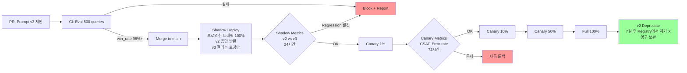

### Day 148. LLM Eval & Prompt Versioning — "프롬프트 한 줄 고쳐서 배포하면 되지"의 치명적 순진함, 그리고 PM이 "답변 좀 더 친절하게 해주세요"라고 Jira에 쓴 수요일에 엔지니어가 System Prompt 끝에 `"친절하고 공손하게 답변하세요"` 한 줄을 추가해 금요일 15:40에 머지하고 퇴근한 뒤, 월요일 아침 09:12에 환불 자동화 파이프라인이 **3,417건**의 미처리 환불을 쌓아놓고 CS팀 Slack이 터진 2026-11-23 오전의 전말

---

## 1. 사건의 전말 — 왜 "그냥 더 좋게 바꿨을 뿐"인데 운영이 멈췄나

**2026-11-19 (수) 14:02** — PM이 Jira에 티켓 하나를 올린다.

> "고객센터 AI 답변이 너무 딱딱해서 CSAT가 72점에서 68점으로 떨어졌어요. 좀 더 친절하고 공손한 톤으로 바꿔주세요."

담당 엔지니어는 10분 만에 처리한다. `prompts/customer_support_v1.txt` 파일을 열어, 맨 끝 줄에 한 문장을 덧붙인다.

```diff
  당신은 교보문고 고객센터 AI입니다.
  주문/환불/배송 관련 질문에 답변하세요.
  응답은 반드시 JSON 형식으로 반환하세요: {"action": "...", "order_id": "...", "reply": "..."}
+ 친절하고 공손한 어조로 답변하세요.
```

PR은 **"AI 답변 톤 개선"** 한 줄 설명으로 단위 테스트 통과(JSON parsing에 영향 없으니까) → 코드리뷰 LGTM → **금요일 15:40 머지**. 퇴근. 주말.

**2026-11-23 (월) 09:12** — CS팀 Slack `#cs-urgent` 채널 폭발:

> "@here 주말 동안 들어온 환불 요청 중에 승인 처리된 게 하나도 없어요. 사용자 민원 쌓이고 있어요."

Finance 자동화 파이프라인 로그를 열어보니:

```
[ERROR] 2026-11-21 10:14:23 RefundProcessor: JSONDecodeError at position 0
  raw_llm_output: "네, 고객님 😊 저희가 최선을 다해 도와드리겠습니다!
                   주문 KR-2026-55821의 환불을 바로 진행해 드릴게요.
                   {"action": "refund", "order_id": "KR-2026-55821", ...}"
```

LLM이 **JSON 앞에 인사말을 붙이기 시작했다.** `json.loads()` 는 `"네, 고객님 😊"` 에서 터진다. 금요일 15:40 이후부터 월요일 아침까지, **3,417건의 환불 요청이 파싱 실패**로 Dead Letter Queue에 쌓였고, 결제 자동화는 그걸 전혀 모르고 "정상"이라고 Grafana에 초록불을 띄웠다(JSON parse 실패는 ERROR 로그로만 나가고 비즈니스 메트릭엔 반영 안 됨).

**질문 3개가 동시에 떨어진다.**

1. "이거 롤백하면 되는 거 아니야?" → 프롬프트는 `.txt` 파일로 Git에 있으니 revert 가능. 근데 **revert 하면 PM이 요청한 'CSAT 개선'은 어떻게 하지?** 애초에 새 프롬프트가 CSAT을 올리긴 했는지 **측정한 적이 없다.**
2. "왜 이게 리뷰에서 안 걸렸어?" → 리뷰어는 코드만 봤다. 프롬프트 변경이 **어떤 쿼리 분포에서 어떤 결과를 만드는지** 리뷰어가 머릿속으로 돌릴 수 없다.
3. "이런 거 미리 못 잡았어?" → 유닛 테스트는 있다. `assert json.loads(response).get("action") == "refund"` — 근데 테스트 케이스가 **"환불해주세요" 한 문장 하나**였고, 그건 우연히 LLM이 인사말 없이 JSON으로만 답한 케이스였다.

CFO가 11:30에 긴급 미팅을 소집한다. 안건 제목: **"프롬프트 하나 바꿨다는데 왜 환불 3,400건이 멈추나"**.

---

## 2. 왜 "그냥 배포" 가 깨지는가 — LLM 시스템은 **코드 + 데이터 + 프롬프트** 3자 결합이다

전통 백엔드에서 "배포 전 확인"은 다음 3개로 수렴한다.

1. **Unit test** — 함수가 올바른 값을 반환하는가
2. **Integration test** — 시스템 간 계약(Contract)이 유지되는가
3. **Canary/Staging** — 트래픽의 1%로 실환경 검증

이 세 가지가 LLM 시스템에선 **모두 반쪽짜리**가 된다. 이유:

| 전통 소프트웨어 | LLM 시스템 |
|---|---|
| 같은 입력 → 같은 출력 (결정적) | 같은 입력 → 다른 출력 (`temperature>0`, 모델 사이드 변화) |
| 테스트 케이스 100개면 분기의 대부분 커버 | 테스트 케이스 100개는 실 쿼리 분포의 **0.0001%**도 못 커버 |
| 코드 1줄 바꾸면 영향 범위가 call graph로 추적됨 | 프롬프트 1줄 바꾸면 **모든 쿼리**에 다 영향 — 영향 범위 = 전체 |
| 성공/실패가 Boolean | 성공/실패가 **연속 스펙트럼** (정답, 거의 정답, 그럴듯한 거짓, 명백한 거짓) |

즉 LLM 시스템에서 "프롬프트 변경"은 코드 수정이 아니라 **분포(distribution) 변경**이다. 분포 변경을 검증하려면 **분포를 기반으로 평가(Eval)** 해야 한다. 한 줄 요약:

> **"유닛 테스트로 LLM 프롬프트 변경을 검증하는 건, A/B 테스트 없이 가격 정책 바꾸는 것과 같다."**

---

## 3. 세 가지 축 — Prompt Registry · Eval Harness · Regression Gate

이 사건을 다시 안 겪으려면, LLM 시스템 Delivery 파이프라인에 **세 개의 축**을 박아야 한다.

```
┌─────────────────────────────────────────────────────────────────────┐
│                       LLM Delivery Pipeline                          │
│                                                                      │
│   ┌──────────────┐    ┌──────────────┐    ┌──────────────────────┐ │
│   │  1. Prompt   │───▶│  2. Eval     │───▶│  3. Regression Gate  │ │
│   │   Registry   │    │   Harness    │    │   (Block Merge)      │ │
│   │              │    │              │    │                      │ │
│   │ v1: hash a1  │    │ Dataset:     │    │ If win_rate < 95%    │ │
│   │ v2: hash b2  │    │  500 queries │    │   → Block            │ │
│   │ v3: hash c7  │    │  w/ labels   │    │ If latency > 1.5x    │ │
│   │              │    │              │    │   → Block            │ │
│   │ Immutable    │    │ Judges:      │    │ If cost > 1.3x       │ │
│   │ Versioned    │    │  - exact     │    │   → Block            │ │
│   │ Addressable  │    │  - LLM-as-   │    │ If JSON schema       │ │
│   │              │    │    judge     │    │   violation > 0.1%   │ │
│   │              │    │  - regex     │    │   → Block            │ │
│   └──────────────┘    └──────────────┘    └──────────────────────┘ │
│          ▲                   │                     │                 │
│          │                   ▼                     ▼                 │
│   Runtime Resolution   Eval Report           Shadow Deployment       │
│   (by hash, not path)  (artifact in CI)      (1% traffic, compare)  │
└─────────────────────────────────────────────────────────────────────┘
```

### 3-1. Prompt Registry — 프롬프트는 "소스코드"가 아니라 "릴리즈 아티팩트"다

`prompts/customer_support_v1.txt` 를 직접 수정하는 순간, 두 가지가 동시에 깨진다.

1. **어느 시점에 어떤 프롬프트가 프로덕션에 떠 있었는지** 알 수 없다 (Git blame으로 추적은 가능하지만, 실행 시점에 어느 커밋이 떠 있었는지는 로그에 안 찍힘)
2. **A/B 테스트 불가능** — v1과 v2를 동시에 띄울 방법이 없음

해결: 프롬프트를 **콘텐츠 주소 기반 불변 객체**로 다룬다.

```python
# ❌ Bad — 파일 경로로 참조
system_prompt = open("prompts/customer_support.txt").read()

# ✅ Good — 해시로 참조, Registry에서 조회
PROMPT_ID = "cs-support@v3:sha256:c7a9e4..."  # 해시가 Canonical ID
system_prompt = prompt_registry.get(PROMPT_ID)

# 요청 로그에 PROMPT_ID 가 반드시 함께 찍힌다
logger.info("llm_call", extra={
    "prompt_id": PROMPT_ID,      # ← 재현 가능성의 핵심
    "model": "claude-opus-4-7",
    "trace_id": trace_id,
})
```

도구 레이어: **LangSmith Prompt Hub**, **PromptLayer**, **Weights & Biases Prompts**, 또는 자체 Postgres 테이블 하나.

핵심 원칙:
- 프롬프트는 **한 번 쓰이면 수정 불가(immutable)**. 수정하면 새 버전.
- 런타임이 참조하는 건 **버전 ID**. 파일 경로 아님.
- 모든 요청 로그에 `prompt_id` 가 찍힌다. 그래야 "어제 그 답변을 만든 프롬프트가 뭐였는지" 를 재현할 수 있다.

### 3-2. Eval Harness — "500개 쿼리로 승률 측정" 이 유닛 테스트를 대체한다

사건의 핵심은 "새 프롬프트가 더 나아졌는지 측정한 적이 없다" 였다. Eval Harness가 이걸 못 하게 막는다.

**Eval Dataset의 3단 구성:**

| 레이어 | 용도 | 크기 | 생성 출처 |
|---|---|---|---|
| **Golden Set** | 손으로 라벨링한 고품질 정답 | 100~500 | 도메인 전문가 + CS팀 리뷰 |
| **Regression Set** | 과거 운영에서 터졌던 쿼리 (Postmortem 유래) | 50~200 | 매 인시던트마다 자동 추가 |
| **Production Replay** | 실 트래픽 샘플링 (24시간 전) | 1,000~5,000 | 로그에서 샘플링 |

이 사건 뒤에는 Regression Set에 반드시 들어가야 할 쿼리 3개가 있다.
- `"환불해주세요"` → expected JSON schema 엄격 검증
- `"고마워요 처리해주세요"` → 인사말 섞인 요청 처리
- `"환불 좀요!! ㅠㅠ"` → 감정 섞인 요청 처리

**Judge의 4단 구성:**

```python
# Layer 1: Exact Match / Schema (가장 빠름, 가장 확실함)
def judge_schema(response: str) -> bool:
    try:
        obj = json.loads(response)
        return "action" in obj and "order_id" in obj
    except json.JSONDecodeError:
        return False  # ← 이 사건을 잡는 게이트

# Layer 2: Regex / Rule-based
def judge_no_pii(response: str) -> bool:
    return not re.search(r'\d{4}-\d{4}-\d{4}-\d{4}', response)  # 카드번호

# Layer 3: Embedding Similarity (의미 유사도)
def judge_semantic(response: str, expected: str) -> float:
    return cosine_similarity(embed(response), embed(expected))

# Layer 4: LLM-as-Judge (가장 비쌈, 가장 유연함)
def judge_llm(response: str, query: str, expected: str) -> float:
    # Claude Opus 등 큰 모델에게 채점시키기
    # 주의: Judge LLM도 bias가 있음 — 자기 모델 답변을 선호함
    return llm_score(query, response, expected)
```

**철칙 하나**: Judge는 **싼 것부터 비싼 것 순서로** 캐스케이드. 500개 쿼리 × 4단계 Judge × 매 PR마다 돌리면 CI 비용이 금방 터진다.

### 3-3. Regression Gate — CI에서 Merge를 막는다

Eval 리포트를 사람이 읽고 판단하면 늦다. 숫자로 자동 차단한다.

```yaml
# .github/workflows/llm-eval.yml
eval_gates:
  win_rate_vs_prod:      # 현재 프로덕션 대비 승률
    threshold: 0.95       # 새 프롬프트가 95% 이상 이기거나 비겨야 함
    action: block

  json_schema_pass_rate: # Schema 통과율
    threshold: 0.999      # 1,000건 중 1건 미만 실패
    action: block         # ← 이 사건을 잡는 게이트

  p95_latency_ratio:     # 지연 비율
    threshold: 1.5        # 기존 대비 1.5배 넘으면 차단
    action: block

  cost_per_query_ratio:  # 쿼리당 비용 비율
    threshold: 1.3        # 기존 대비 30% 이상 비싸지면 차단
    action: block

  pii_leak_rate:         # PII 유출률
    threshold: 0.0        # 0건 허용
    action: block
```

이 사건의 프롬프트 변경은 **`json_schema_pass_rate` 게이트에서 100% 차단**됐을 것이다. "친절하고 공손한 어조" 가 LLM에게 `JSON 앞에 인사말을 붙여도 된다`는 신호를 준 결과, Schema 통과율이 ~40%로 떨어진다. 이걸 CI에서 자동으로 잡는다.

---

## 4. Prompt 배포 전체 흐름 — Shadow → Canary → Full

Eval 통과 = 배포 가능 ≠ 전면 배포. LLM은 아무리 잘 평가해도 **실 트래픽에서 분포가 다르다**. 그래서 단계별 롤아웃.



**핵심 개념 3개:**

1. **Shadow Deploy** — v3는 실 트래픽을 받지만, 사용자에겐 **여전히 v2 응답**이 간다. v3 응답은 로깅만 하고 나중에 비교. 사용자 영향 0, 실 분포 100% 검증.
2. **Canary** — 사용자 1% → 10% → 50% → 100%. 각 단계마다 24~72시간 Hold. CSAT, Error rate, 비용을 **자동 모니터링**.
3. **자동 롤백** — Canary 단계에서 지표 악화되면 사람 개입 없이 즉시 이전 버전으로. 운영자가 깨어있는 시간을 기다리지 않는다.

v2는 영구 보관한다. 왜? **3개월 뒤에 고객이 "그때 AI가 이상한 답했어요"** 라고 민원을 올리면, 그 시점의 프롬프트 버전으로 재현을 시도해야 한다.

---

## 5. 실제 사례 — 누가, 왜, 어떻게 쓰고 있는가

### Anthropic (Claude Console의 Prompt Evaluation)
- Anthropic Console에서 **Test Case 기반 Eval**을 UI로 제공. 프롬프트 변경 시 과거 테스트 셋에 대한 변화를 **표로 Diff**.
- 실무 패턴: "Prompt는 Code처럼 PR로 리뷰하고, Eval은 자동 CI로 돌린다" — Anthropic 자체 Applied AI 팀이 외부 가이드에서 반복적으로 강조.

### OpenAI — Evals Framework (오픈소스)
- `openai/evals` GitHub 레포. YAML로 Eval 정의, `oaieval` CLI로 실행.
- 흥미로운 점: **model-graded eval** (LLM-as-judge) 를 공식 샘플로 제공. 단, "채점 모델이 채점 대상 모델과 다른 가족이어야 bias가 줄어든다"는 노트 포함.

### Netflix — 추천 설명문 LLM Prompt 운영
- 2024년 발표 사례: "왜 이 영화를 추천했는가" 를 생성하는 LLM 프롬프트를 **A/B 테스트로만** 배포. Shadow 단계에서 **"설명 톤이 바뀌면 시청 이탈률(abandonment rate)에 어떻게 영향 주는지"** 측정.
- 교훈: LLM 평가 지표는 "답변 품질" 만이 아니라 **비즈니스 지표와 연결**해야 한다.

### Shopify — "Sidekick" AI Assistant
- 수천 명의 머천트가 쓰는 AI 어시스턴트. 프롬프트를 바꿀 때마다 **과거 3일치 질문 1만 건을 Replay**.
- 비용 문제 해결: **Importance Sampling** 적용. 모든 질문을 다 돌리지 않고, 과거에 민감하게 반응했던 질문 카테고리에 가중치.

### LangSmith / LangFuse — Prompt Experiment UI
- "Prompt v2를 올리면 과거 500개 Trace에 대해 어떻게 답변이 달라졌을지" 를 **A/B 뷰어로 사람이 리뷰** 가능.
- Judge를 **사람 + LLM 혼합**으로. 핵심 쿼리 50개는 사람 라벨링, 나머지 450개는 LLM Judge.

---

## 6. 트레이드오프 — 공짜가 아니다

| 선택 | 얻는 것 | 잃는 것 |
|---|---|---|
| **Prompt Registry 도입** | 재현성, A/B, 롤백 | 파일 하나 고치면 끝이던 개발자 경험. PR + 리뷰 + Eval 사이클 필요. |
| **Eval Set 500개 수동 라벨링** | 실측 가능한 품질 지표 | 초기 **2~3주 인당 작업**. 도메인 전문가 섭외 필수. |
| **LLM-as-Judge** | 유연한 평가 (의미 이해 가능) | Judge 모델 호출 비용. Judge Bias (Position Bias, Length Bias, Self-Preference). |
| **Shadow + Canary** | 실 트래픽 검증, 안전한 롤아웃 | 동일 트래픽에 **LLM 2번 호출** → Shadow 기간 동안 비용 2배. |
| **Regression Gate 엄격화** | 사고 차단 | False Positive (실제론 더 좋은데 Gate가 막음) → 엔지니어가 Gate를 우회하기 시작하면 유명무실. |

### 특히 위험한 안티패턴 4개

1. **"Eval은 1주일에 한 번 수동으로 돌리면 되지"** — 그 1주일 사이에 10개 PR이 들어온다. 어느 PR이 깼는지 못 찾는다. **CI에서 PR당 자동 실행이 원칙**.
2. **"Golden Set은 한 번 만들면 영구히 쓰면 되지"** — 비즈니스가 바뀐다. 새 상품 라인업, 새 정책. **매달 Golden Set을 업데이트**해야 한다 (사건 Replay도 여기 포함).
3. **"LLM Judge 하나로 다 커버되지"** — Judge도 틀린다. 심지어 체계적으로 틀린다 (긴 답변을 선호, 자기 가족 모델 선호). **Schema/Regex 같은 결정적 Judge를 앞단에 둬야** 한다.
4. **"Prompt는 기획자가 Admin UI에서 직접 수정"** — 매력적이지만 재앙. **Admin UI에서 수정 = 즉시 머지 + Eval 스킵**. 최소한 Admin UI는 "Staging Prompt에만" 쓰거나, UI 수정도 **PR로 변환되어야** 한다.

---

## 7. 언제 쓰고, 언제 쓰면 안 되는가 — 시니어 판단 기준

### ✅ 반드시 도입해야 하는 경우
- **LLM이 자동화 시스템(JSON/Tool Call)에 물려 있을 때** — 이 사건처럼 포맷이 깨지면 다운스트림이 멈춤
- **프롬프트를 자주 바꾸는 팀** (주 1회 이상) — 바꿈의 자유도 ↔ 사고 확률이 정비례
- **규제 산업(금융/의료/법률)** — "왜 그런 답변을 했는가" 를 재현해야 함
- **매출/결제에 직접 영향** — CSAT 1점 하락도 매출로 환산됨
- **여러 팀이 같은 프롬프트에 변경 권한** — 리뷰 게이트 없으면 Blame War

### ⚠️ 비용 대비 효용이 낮을 수 있는 경우
- **내부 전용 도구, 사용자 10명 미만** — 전면 Eval보다 Dogfooding이 더 효과적
- **일회성 데이터 분석 LLM 호출** — 사람이 매번 결과를 확인
- **프로토타입 (PMF 탐색 단계)** — 아직 "품질 기준"이 뭔지도 모름. 섣불리 Eval Set 만들면 잘못된 방향으로 고착화
- **프롬프트가 거의 안 바뀌는 시스템** — 유저 입력만 바뀜 (예: 요약기). 이 경우 **"모델 업그레이드 Eval"** 에만 집중

### 🚫 안 쓰는 게 나은 경우
- **Eval Set이 20개 미만인데 Gate부터 깔려는 경우** — 통계적 의미가 없다. 오히려 "Eval 통과했으니 괜찮아"라는 **잘못된 안전감**을 준다. Eval Set 양부터 늘려라.
- **Judge가 평가 대상 모델과 완전히 같은 모델** (Claude로 답변, Claude로 채점) — Self-Preference Bias로 **거의 모든 변화를 "개선"이라고 평가**한다.

---

## 8. 이 사건을 다시 안 겪기 위한 구체적 체크리스트

사건 후 **Postmortem Action Item** 으로 아키텍처 리뷰 보드에 올라간 항목들:

- [ ] 모든 프롬프트를 Registry(Postgres `prompts` 테이블)로 이관. 파일 경로 참조 금지.
- [ ] 모든 LLM 호출 로그에 `prompt_id` + `model_id` + `trace_id` 를 기록. (이번 사건 재현의 기본)
- [ ] Golden Set 200개 구축 (CS팀 2명 × 3일). 매 인시던트마다 +5개씩 Regression Set에 추가.
- [ ] CI에 `eval` 잡 추가. PR 당 자동 실행. `json_schema_pass_rate < 0.999` 면 Block.
- [ ] Shadow Deploy 인프라 구축. 신규 프롬프트는 최소 24시간 Shadow 후 Canary.
- [ ] Canary 자동 롤백 조건 정의: Error rate 2배 증가 OR CSAT 5점 하락 OR 토큰 비용 30% 증가.
- [ ] Prompt 수정 PR 템플릿에 **"측정 지표"** 필수 입력란 추가. "어떤 지표를 왜 개선하려 하는가" 가 없으면 리뷰어가 Block.
- [ ] 월 1회 "Prompt Registry 감사" — 안 쓰는 버전 식별, 사용 중인 버전 Tagging. 삭제는 **금지** (법적 재현성).

> 💡 **왜 중요한가**: LLM 시스템에서 "프롬프트 한 줄 변경" 은 코드가 아니라 **분포(distribution) 변경**이며, 분포 변경을 유닛 테스트로 검증하겠다는 발상은 가격 정책을 A/B 테스트 없이 바꾸는 것과 정확히 같은 종류의 운영 사고로 귀결된다.
