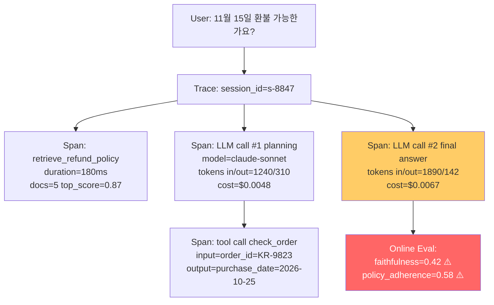

### Day 149. AI Observability (LangSmith / LangFuse) — "Datadog에 로그만 꽂으면 되지"의 치명적 순진함, 그리고 "답변 품질이 저번 주보다 떨어진 것 같은데요"라는 CS팀의 Slack 한 줄에 아무도 "언제부터, 얼마나, 왜"를 답하지 못한 채 **5일 동안 CSAT 68 → 54**가 깎이고 그 사이 환불 챗봇이 **1,247건의 오답**을 상담원 에스컬레이션 없이 "해결됨"으로 닫아버린 2026-11-24 화요일 오후 14:08, 그리고 포스트모템 회의에서 "Trace가 하나도 안 남아 있다"는 말에 CTO가 "그래서 지난주 금요일 15:40 배포 이후 품질이 꺾인 건 확실한 거야 아닌 거야"를 **9번 반복해서 물어본** 2026-11-26 수요일 오전 10:17의 침묵

---

#### 1. 사건 재구성 — "로그는 분명 찍고 있었습니다"

**2026-11-20 금요일 15:40** — 환불 챗봇의 System Prompt에 "환불 가능 여부를 먼저 확인하고 답변하세요" 한 줄이 추가되어 배포됨. Eval은 통과. Regression Gate도 통과. (Day 148에서 세팅해둔 바로 그 게이트)

**2026-11-24 화요일 09:12** — CS팀 리더가 Slack에 글을 남긴다.

> "저번 주말부터 챗봇 답변이 뭔가 애매해진 것 같아요. 환불 가능하다고 해놓고 고객이 다시 물어보면 '정책 확인 후 안내드린다'는 식으로 바뀌는 케이스가 늘었어요. 혹시 뭐 바뀐 거 있나요?"

엔지니어는 Datadog을 연다. `llm_request_count`, `llm_latency_p99`, `llm_error_rate` — 세 지표 전부 **정상**. P99 1.4초, 에러율 0.3%. 지난주와 차이 없음.

**14:08** — 데이터 분석가가 CSAT를 수동 집계한다. 11/19 68점 → 11/24 54점. **14점 하락.** 환불 챗봇이 열려 있는 고객 세션 중 "해결됨"으로 자동 종결된 1,247건을 샘플링해보니, **38%**가 "환불 가능 여부를 정확히 안내받지 못한 채" 세션이 닫혀 있었다.

**14:30** — CTO 소집. 질문은 단 하나다.

> "지난 금요일 배포가 원인인 거 맞아?"

엔지니어는 답하지 못한다. 로그에는 요청 시각, 프롬프트 토큰 수, 응답 토큰 수, 지연 시간, 에러 유무만 있다. **어떤 질문에 어떤 답이 나갔는지는 PII 마스킹 때문에 저장하지 않았다.** Tool Call이 몇 번 호출됐는지도 메트릭에만 있고, 어떤 Tool이 어떤 인자로 호출됐는지의 Trace는 없다. Retrieval에서 어떤 문서가 Top-K에 들어갔는지도 없다.

> "그러면 우리는 지금 뭐가 왜 바뀌었는지 모른다는 거네?"

침묵.

---

#### 2. 왜 Datadog/CloudWatch만으로는 안 되는가

전통 백엔드 관측(Observability)의 세 축은 **Logs, Metrics, Traces**. LLM 애플리케이션에 그대로 꽂으면 세 가지가 전부 깨진다.

| 전통 백엔드 | LLM 애플리케이션 | 왜 깨지는가 |
|---|---|---|
| Log: `"POST /refund 200 OK 143ms"` | Log: `"llm_call completed 1.4s"` | **입출력 내용 자체가 가장 중요한 신호**인데 PII 때문에 못 찍음 |
| Metric: 에러율 / p99 | 에러율 0.3%, p99 1.4s — 둘 다 정상 | **"정답률"**은 Datadog이 모름. 200 OK가 "말이 안 되는 답"일 수 있음 |
| Trace: Service → DB → Cache | Trace: Prompt → LLM → Tool → Retrieval → LLM → Tool → … | **중첩된 LLM 호출 + Tool Call + Retrieval**을 Span으로 묶지 않으면 왕복이 안 보임 |

핵심은 이거다. **LLM 애플리케이션은 "성공한 요청"이 "실패한 응답"일 수 있다.** HTTP 200이 뜨고 p99도 정상이지만, 답변 내용이 환불 정책을 틀리게 안내하고 있을 수 있다. 전통 관측 스택은 이 상황을 "장애가 아니다"라고 보고한다.

AI Observability가 추가로 잡아야 하는 축은 네 가지다.

```
전통 Observability           LLM Observability (추가)
┌──────────────┐             ┌──────────────────────┐
│ Logs         │             │ Prompt / Completion  │  ← 입출력 원문 (PII 마스킹)
│ Metrics      │  +          │ Token / Cost per req │  ← 세션/유저/프롬프트 버전별
│ Traces       │             │ Retrieval Context    │  ← Top-K 문서 + 점수
└──────────────┘             │ Eval Score (online)  │  ← 실시간 품질 점수
                             └──────────────────────┘
```

---

#### 3. LangSmith / LangFuse가 실제로 보여주는 것

LangSmith (LangChain, 상용)와 LangFuse (오픈소스, self-host 가능)는 거의 동일한 모델을 따른다. 하나의 사용자 요청을 **Trace**로 묶고, 그 안의 각 LLM 호출/Tool Call/Retrieval을 **Span**으로 중첩시킨다.



여기서 아까 그 사고를 다시 보자. **LangFuse Trace 뷰**가 있었다면 CTO의 질문 "금요일 배포가 원인이냐"는 다음 한 번의 쿼리로 끝났다.

```sql
-- LangFuse에서 가능한 쿼리 (pseudo)
SELECT
  prompt_version,
  AVG(online_eval.policy_adherence) AS adherence,
  COUNT(*) AS n
FROM traces
WHERE created_at BETWEEN '2026-11-18' AND '2026-11-24'
  AND application = 'refund-chatbot'
GROUP BY prompt_version
ORDER BY prompt_version;

prompt_version | adherence | n
---------------+-----------+-------
v47            | 0.89      | 18,422
v48 (11/20~)   | 0.61      | 14,208   ← 여기다
```

Prompt v48 배포 이후 `policy_adherence` 점수가 **0.89 → 0.61**로 꺾였다. 범인 확정. 롤백 결정까지 3분.

---

#### 4. 핵심 구성요소 — 4-레이어 모델

LangSmith/LangFuse 둘 다 아래 4개 레이어로 설계되어 있다.

##### 4-1. Tracing Layer — "LLM 호출은 전부 Span으로 감싼다"

SDK 데코레이터 한 줄로 끝난다.

```python
from langfuse.decorators import observe

@observe()
def answer_refund(question: str, user_id: str):
    docs = retrieve(question)              # 자동으로 child span
    plan = llm_plan(question, docs)        # 자동으로 child span
    tool_result = check_order(plan.order)  # 자동으로 child span
    answer = llm_finalize(plan, tool_result)
    return answer
```

핵심은 **트레이스 ID를 유저 세션 ID와 묶는 것**이다. 그래야 "별 1점을 준 세션 15개를 즉시 Trace 뷰에서 열어서 비교"가 가능하다.

##### 4-2. Prompt Management Layer — "Prompt는 버전 태그와 함께 호출된다"

Day 148에서 세팅한 Prompt Registry와 결합된다. **모든 Trace에는 어떤 Prompt 버전이 쓰였는지가 라벨로 붙는다.**

```python
prompt = langfuse.get_prompt("refund-chatbot", version="v48")
# → Trace에 prompt_name=refund-chatbot, prompt_version=v48 자동 태깅
```

이것이 "금요일 배포 이후 품질 꺾였냐"의 판별을 가능하게 한다.

##### 4-3. Online Eval Layer — "답변마다 품질 점수를 실시간으로 매긴다"

여기가 Day 148의 Eval Harness와 가장 다른 지점이다. Day 148은 **배포 전 오프라인** 500개 쿼리 승률. **Day 149는 프로덕션 트래픽의 N%를 샘플링해 실시간 평가**.

평가 축 3개가 표준이다.

| 평가 축 | 어떻게 측정 | 왜 필요한가 |
|---|---|---|
| **Faithfulness** | 답변이 Retrieval 문서에 근거하는가 (LLM-as-judge) | 할루시네이션 감지 |
| **Answer Relevance** | 답변이 질문과 관련 있는가 | 동문서답 감지 |
| **Policy Adherence** | 회사 규정(환불/약관)과 일치하는가 | 비즈니스 리스크 감지 |

전체 트래픽의 **5~10%**만 샘플링한다. 왜? LLM-as-judge 호출 자체가 추가 비용이고, 100% 돌리면 비용이 2배가 된다. 중요한 세션(에스컬레이션, 환불 금액 큰 건)은 100%, 나머지는 5%가 표준 조합.

##### 4-4. Dataset / Replay Layer — "프로덕션 세션을 Eval Dataset으로 승격"

LangSmith/LangFuse의 진짜 killer feature. **낮은 점수를 받은 프로덕션 Trace를 그대로 선택해서 Eval Dataset에 추가**할 수 있다.

```
[프로덕션 Trace]  policy_adherence=0.42
     │
     ▼  "Add to Dataset: refund-regression-v2"
[Eval Dataset]  → 다음 Prompt 변경 시 Regression Gate에서 재실행
```

이게 바로 **"실패가 다음 번에 다시 깨는 테스트가 된다"**는 CI의 황금률을 LLM 세계에 이식한 것이다.

---

#### 5. 전체 아키텍처 — 운영 환경 통합도

```
┌─────────────────────────────────────────────────────────────┐
│                     Client (Web / App)                       │
└──────────────────────────┬──────────────────────────────────┘
                           │
                           ▼
┌─────────────────────────────────────────────────────────────┐
│                 API Gateway / LLM Gateway                    │ ← Day 140
│   (인증 · Rate Limit · 예산 체크 · Semantic Cache 히트)      │ ← Day 139
└──────────────────────────┬──────────────────────────────────┘
                           │
                           ▼
┌─────────────────────────────────────────────────────────────┐
│                    Agent Orchestrator                        │
│   ┌──────────┐  ┌──────────┐  ┌──────────┐                   │
│   │ Retrieve │→ │ Plan     │→ │ Tool     │  (각 단계가 Span)  │
│   │ (Hybrid) │  │ (LLM)    │  │ Execute  │                   │
│   └──────────┘  └──────────┘  └──────────┘                   │
└────┬────────────────┬───────────────┬────────────────────────┘
     │                │               │
     │ Trace          │ Prompt ver    │ Cost / Token
     ▼                ▼               ▼
┌─────────────────────────────────────────────────────────────┐
│          LangFuse / LangSmith (Observability Plane)          │
│  ┌───────────┐ ┌───────────┐ ┌───────────┐ ┌────────────┐    │
│  │  Traces   │ │  Prompts  │ │  Online   │ │  Datasets  │    │
│  │  (Spans)  │ │  (versions│ │  Eval     │ │  (replay)  │    │
│  │           │ │   + A/B)  │ │  Scores   │ │            │    │
│  └─────┬─────┘ └─────┬─────┘ └─────┬─────┘ └─────┬──────┘    │
└────────┼─────────────┼─────────────┼─────────────┼───────────┘
         │             │             │             │
         ▼             ▼             ▼             ▼
┌─────────────────────────────────────────────────────────────┐
│   Alerting (PagerDuty)  ·  Dashboard  ·  CI Regression Gate │
│   "adherence < 0.70 for 15min" → 자동 롤백 트리거            │
└─────────────────────────────────────────────────────────────┘
```

이 그림에서 중요한 포인트 두 가지.

- Observability Plane은 **애플리케이션 플레인과 비동기**로 이벤트를 받는다. Trace 전송 실패가 응답을 막으면 안 된다 (fire-and-forget + buffered send).
- Online Eval은 **서비스 응답 경로가 아닌 샘플링 큐로 넘긴다**. Eval LLM 호출은 사용자에게 보이는 지연에 포함되면 안 된다.

---

#### 6. 트레이드오프 — "다 켜면 비용이 폭발한다"

AI Observability는 "다 켜면 좋은 것"이 아니다. 이걸 모르면 Day 140의 재현이 일어난다.

| 항목 | 비용 | 가치 | 권장 기본값 |
|---|---|---|---|
| **Tracing 100% 샘플링** | 낮음 (Trace 저장은 싸다) | 매우 높음 (디버깅 필수) | **100% ON** |
| **Prompt/Completion 원문 저장** | 중간 (스토리지 + PII 리스크) | 높음 (근본원인 분석) | **100%, 단 PII 마스킹 필수** |
| **Online Eval (LLM-as-judge)** | **높음 (LLM 호출 비용 2배 가능)** | 높음 (회귀 탐지) | **5~10% 샘플링** |
| **Human Feedback 수집** | 낮음 (👍👎 버튼만) | 매우 높음 (Ground truth) | **항상 ON** |
| **Replay 자동화** | 중간 (저장 + 재실행) | 중간 | 선별적 ON |

**가장 흔한 실수 3가지:**

1. **Online Eval을 100%로 켠다** — 토큰 비용이 그대로 2배. "답변 품질을 평가하는 데 답변 비용만큼 쓰고 있다"는 농담이 현실이 된다.
2. **원문을 마스킹 없이 그대로 저장한다** — Day 139의 Semantic Cache 참사의 쌍둥이. 관측 DB가 PII 유출의 2차 공격면이 된다.
3. **Trace를 서비스 응답 경로에 동기 전송한다** — Observability 플랫폼이 흔들리면 서비스가 같이 흔들린다. LangFuse SDK의 `flush_at`, `flush_interval` 기본값을 반드시 확인할 것.

---

#### 7. 실제 사례

- **Notion AI** — LangSmith를 Prompt 버전관리 + 실시간 품질 관측용으로 사용한다고 공개. "답변 품질 메트릭을 Datadog에 직접 꽂지 않는다"는 원칙을 명시 — Datadog은 infra용, LangSmith는 AI 품질용으로 **플레인을 분리**.
- **Khan Academy (Khanmigo)** — 학생 안전 리스크 때문에 **Online Eval을 100% 가까이**로 돌린다. "교사에게 부적절한 답변이 가면 안 된다"는 요구사항이 비용보다 우선. 대신 Eval 자체에 저렴한 Haiku-tier 모델을 쓰는 비대칭 조합.
- **Shopify Sidekick** — Human Feedback(👍👎)을 핵심 신호로 쓴다. LLM-as-judge보다 머천트의 직접 피드백이 "커머스 맥락"을 더 잘 반영하기 때문. 👎가 찍힌 Trace는 자동으로 다음 Eval Dataset에 승격.
- **LinkedIn (AI Hiring Assistant)** — LangFuse self-host로 간 케이스. EU GDPR + 채용 데이터의 민감성 때문에 외부 SaaS에 Prompt/Completion 원문을 보낼 수 없어서. **"관측 데이터의 Data Residency"**가 벤더 선택을 뒤집는 사례.

---

#### 8. 언제 쓰고 언제 쓰면 안 되는가

**✅ 반드시 도입해야 하는 경우**

- 프롬프트가 **일주일에 한 번 이상** 바뀌는 프로덕트 (= 회귀 위험이 상시 존재)
- LLM 호출이 **Agent/Tool Use로 중첩**되는 시스템 (= Trace 없으면 디버깅 불가능)
- **고객 접점**에 LLM이 있는 경우 (= 품질 꺾임이 돈과 평판으로 즉시 환산됨)
- Multi-model/Multi-provider 라우팅 중 (Day 141) — 모델별 품질 비교에 반드시 필요

**⚠️ 비용 대비 효용이 낮을 수 있는 경우**

- 내부 코드 리뷰 봇처럼 **실패해도 돈/신뢰가 안 깨지는 유즈케이스** — Tracing만 켜고 Online Eval은 끈다
- 하루 **100콜 미만**의 저트래픽 사이드 프로젝트 — Vendor Lock-in 비용이 가치를 넘음. 그냥 JSON 로그로 충분

**🚫 안 쓰는 게 나은 경우**

- PII/PHI 데이터가 압도적으로 많고 **외부 SaaS 전송이 법적으로 금지**된 경우 → self-host 가능한 LangFuse OSS를 보되, 그것조차 운영 여력 없으면 자체 Trace 테이블로 시작하는 게 나음
- **Prompt를 거의 바꾸지 않는 Fine-tuned 모델 중심 서비스** — 품질이 모델 자체에 고정되므로 Prompt Observability의 ROI가 낮음

---

#### 9. 시니어 관점 체크리스트

프로덕션에 올리기 전 이 7개만 통과하면 Day 149의 참사는 거의 다 막는다.

1. **모든 LLM 호출에 Trace ID + 세션 ID + Prompt 버전이 태깅되는가**
2. **PII 마스킹이 SDK 레이어가 아닌 Trace 전송 직전 레이어에 있는가** (중간 Span에 노출되면 의미 없음)
3. **Trace 전송이 Fire-and-forget 비동기인가** (Observability 장애가 서비스 장애를 유발하지 않는가)
4. **Prompt 버전별 품질 지표(adherence/faithfulness)를 하나의 대시보드에서 비교할 수 있는가**
5. **"policy_adherence < 0.70 지속 15분"에 자동 롤백 또는 Alert가 걸려 있는가**
6. **낮은 점수를 받은 프로덕션 Trace → Eval Dataset 승격 → Regression Gate 재사용**의 루프가 돌아가는가 (Day 148과의 연결)
7. **Online Eval 비용이 전체 LLM 비용의 10% 이내로 유지되는가** (아니면 샘플링률을 낮춰야 함)

> 💡 **왜 중요한가**: HTTP 200과 p99 1.4초가 정상인 순간에도 LLM은 틀린 답을 돌려줄 수 있고, "틀린 답"이 돈과 평판으로 환산되는 속도는 전통 서비스의 "에러 500"보다 훨씬 빠르다 — Trace·Prompt 버전·Online Eval 세 축이 없는 상태로 프로덕션에 LLM을 올리는 것은 데이터센터에 로그 없이 서비스를 띄우는 것과 같다.
