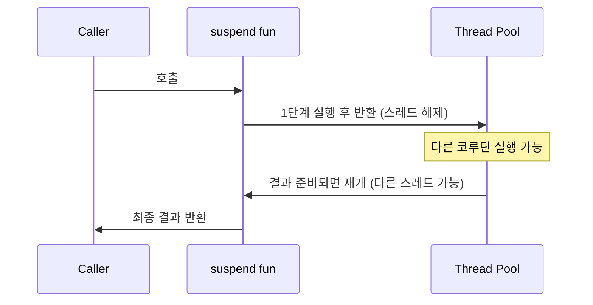

### 1. `suspend`는 "비동기"가 아니다: 함수를 "중단 가능하게" 만드는 컴파일러 트릭

많은 개발자가 `suspend fun`을 "비동기 함수"로 오해한다. 실제로는 "이 함수는 중간에 멈췄다가 나중에 재개될 수 있다"는 표시일 뿐이며, 비동기 실행은 `launch`/`async` 같은 코루틴 빌더가 담당한다. 컴파일러는 `suspend` 함수를 **CPS(Continuation-Passing Style) 변환**으로 상태 머신으로 바꿔서, 중단 지점마다 다음 작업을 `Continuation` 객체로 넘긴다.

```kotlin
// 개발자가 쓴 코드
suspend fun fetchUser(id: Long): User {
    val profile = api.getProfile(id)  // suspend point 1
    val orders = api.getOrders(id)    // suspend point 2
    return User(profile, orders)
}

// 컴파일러가 실제로 만드는 코드 (단순화)
fun fetchUser(id: Long, cont: Continuation<User>): Any? {
    // 상태 머신 (label 0, 1, 2 ...)
    when (cont.label) {
        0 -> { cont.label = 1; return api.getProfile(id, cont) }
        1 -> { cont.label = 2; return api.getOrders(id, cont) }
        2 -> return User(profile, orders)
    }
}
```



**핵심 포인트**:
- `suspend` 함수는 **다른 `suspend` 함수 또는 코루틴 빌더 안**에서만 호출 가능
- 중단된 동안 **스레드를 점유하지 않음** → 스레드 하나로 수만 개 코루틴 처리 가능
- "비동기"는 결과지, 본질이 아니다. 본질은 "함수 실행을 일시정지/재개할 수 있다"

> 💡 **왜 중요한가**: `suspend`의 정체를 알아야 "왜 `Thread.sleep()` 대신 `delay()`를 써야 하는지", "왜 `runBlocking`이 안티패턴인지" 자연스럽게 이해된다.

---

### 2. Kotlin의 `?:` (엘비스 연산자)는 "null 대체"가 전부가 아니다: `return`/`throw`와 결합한 Early Exit 패턴

엘비스 연산자(`?:`)를 단순히 "null이면 기본값 반환"으로만 쓰는 건 절반만 활용하는 것이다. 우변에 `return`, `throw`, `continue`, `break` 같은 **제어 흐름 표현식**을 넣으면 Java의 `if (x == null) throw ...` 가드문을 한 줄로 줄이는 강력한 패턴이 된다. 이걸 "Elvis Early Exit"라고 부른다.

```kotlin
// ❌ Java 스타일 (장황)
fun processOrder(orderId: Long): Receipt {
    val order = orderRepo.findById(orderId)
    if (order == null) {
        throw OrderNotFoundException(orderId)
    }
    val user = userRepo.findById(order.userId)
    if (user == null) {
        throw UserNotFoundException(order.userId)
    }
    return Receipt(order, user)
}

// ✅ Kotlin 스타일 (Elvis Early Exit)
fun processOrder(orderId: Long): Receipt {
    val order = orderRepo.findById(orderId)
        ?: throw OrderNotFoundException(orderId)
    val user = userRepo.findById(order.userId)
        ?: throw UserNotFoundException(order.userId)
    return Receipt(order, user)
}

// 루프 안에서 continue와 결합
fun syncUsers(ids: List<Long>) {
    for (id in ids) {
        val user = userApi.fetch(id) ?: continue  // 없으면 다음 id로
        val profile = user.profile ?: continue    // 프로필 없으면 skip
        db.save(profile)
    }
}

// let과 조합: "있을 때만 처리"도 가능
val length = nullable?.let { it.length } ?: 0
```

**비교표**:

| 패턴 | 용도 | 예시 |
|------|------|------|
| `?: defaultValue` | 기본값 대체 | `name ?: "Unknown"` |
| `?: throw X()` | 가드 (필수값 검증) | `user ?: throw NotFound()` |
| `?: return` | 함수 조기 종료 | `data ?: return null` |
| `?: continue` | 루프 다음 반복으로 | `item ?: continue` |

**주의**: `?:`는 **좌변이 null일 때만** 우변을 평가한다. 즉 우변의 `throw`는 null일 때만 실행된다 — 이게 "early exit"로 작동하는 이유다.

> 💡 **왜 중요한가**: `!!` (강제 언래핑) 남용을 줄이고, 의도가 명확한 "null이면 즉시 끝낸다"를 한 줄로 표현할 수 있다. 실무 Kotlin 코드의 가독성을 결정짓는 핵심 패턴 중 하나.
